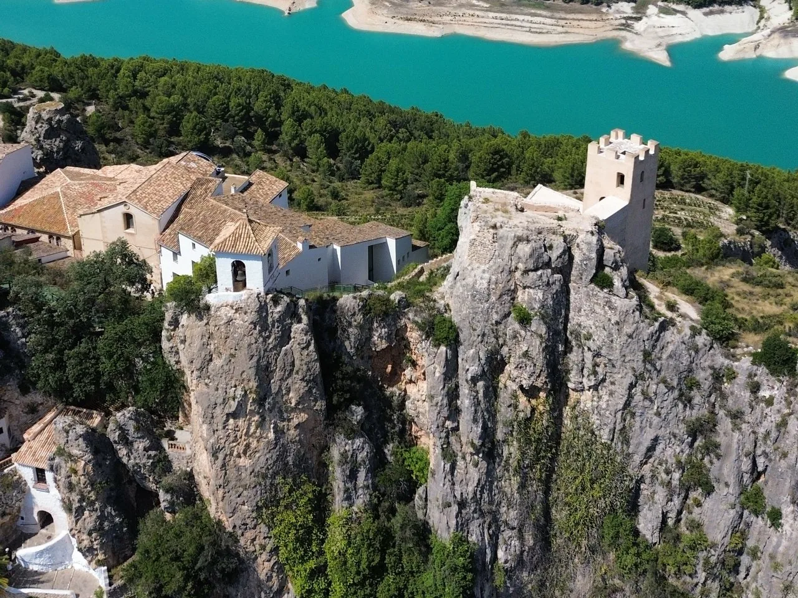
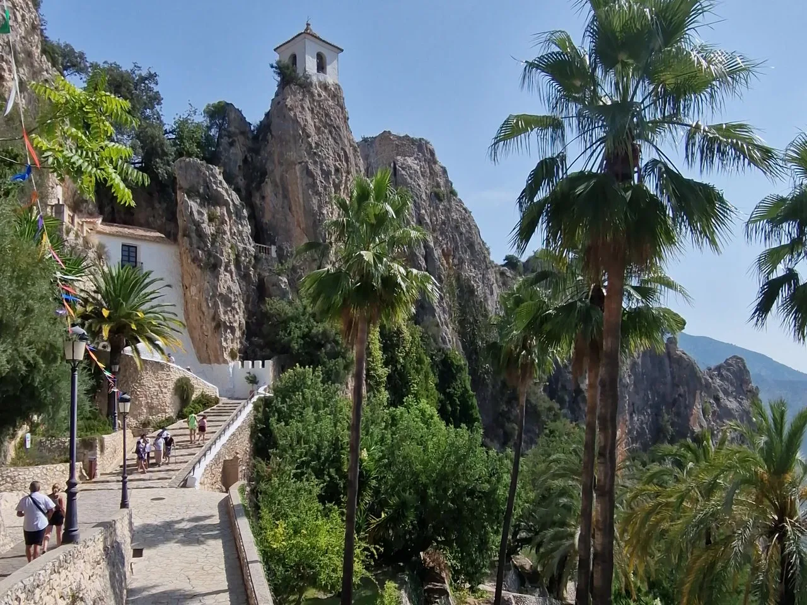
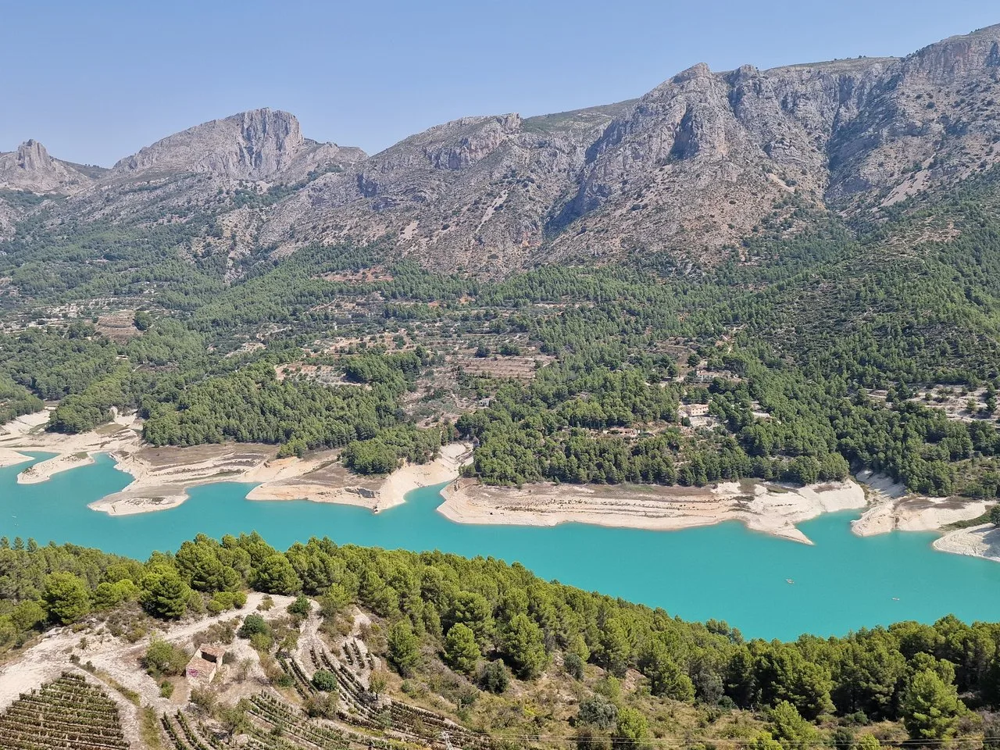
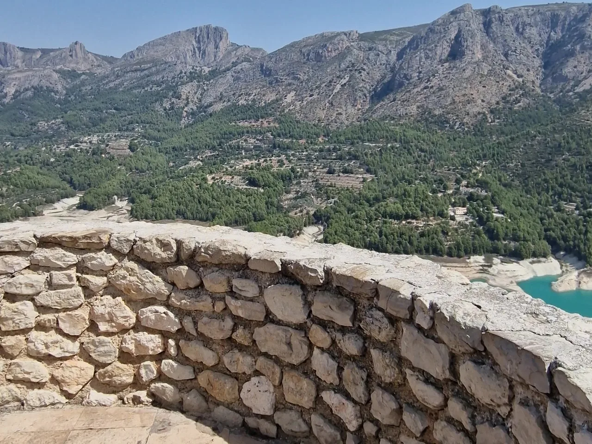

Hay pueblos bonitos, y luego está Guadalest, que parece dibujado a propósito para que se te caiga el móvil al suelo de tanto hacer fotos. Encajado entre las sierras de Aitana y Xortá, con un peñón rocoso partido en dos y un embalse de un azul turquesa casi de mentira a sus pies, entiendo perfectamente por qué es de los pueblos con más visitas de toda España a pesar de tener poco más de 200 vecinos.

En un vistazo<h2>Lo que vas a encontrar</h2>

<b>🏰</b>Castillo del siglo XI

<b>💧</b>Embalse turquesa

<b>🏘️</b>Casco antiguo

<b>📸</b>Miradores

<b>🚗</b>Cómo llegar

Puedes ver el vídeo completo en [este reel de Instagram](https://www.instagram.com/p/Db_YXJ8xcVo/).

Antes de ir<h2>Lo básico de Guadalest</h2>

<h3>📍 Dónde está</h3>
En el interior de la <strong>Marina Baixa</strong> (Alicante), entre las sierras de Aitana y Xortà, a unos <strong>25 km de Benidorm</strong>.

<h3>💶 Precio</h3>
El pueblo es <strong>gratis</strong>. El castillo cuesta unos <strong>4 €</strong> (con la Casa Orduña) y cada museo tiene su entrada.

<h3>🕙 Horario del castillo</h3>
De <strong>10:00 a 18:00</strong> de octubre a mayo y hasta las <strong>20:00</strong> de junio a septiembre.

<h3>⏱️ Tiempo</h3>
Dos horas para lo esencial; <strong>medio día</strong> si entras al castillo, a un par de museos y comes con vistas al embalse.

Qué ver<h2>Qué ver en Guadalest</h2>

<ol class="guide__grid guide__grid--cuenca">
<li class="gcard reveal">
01

<h3>El Castillo de San José</h3>
Una fortaleza musulmana sobre la <strong>roca más alta</strong> del pueblo. Se llega por un túnel excavado en la roca; la entrada cuesta unos 4 €.

</li>
<li class="gcard reveal">
02

<h3>El casco antiguo</h3>
Calles empedradas y el barrio de <strong>El Arrabal</strong>, conectado con el castillo por el túnel de roca.

</li>
<li class="gcard reveal">
03

<h3>El embalse</h3>
Ese <strong>azul turquesa</strong> de todas las fotos, justo debajo del casco antiguo. Parece retocado, pero no lo es.

</li>
<li class="gcard reveal">
04

<h3>Los miradores</h3>
Asómate a los muros de piedra para ver <strong>todo el valle</strong> y las montañas que lo rodean.

</li>
</ol>

Museos<h2>Los museos más curiosos de Guadalest</h2>
En un pueblo de 200 vecinos hay más museos que en muchas ciudades.

<h3>🔍 Microminiaturas</h3>
Obras tan diminutas que solo se aprecian con lupa.

<h3>🏠 Casa Orduña</h3>
Casa señorial del siglo XVIII, incluida en la entrada del castillo.

<h3>🧂 Saleros y pimenteros</h3>
Una colección enorme de saleros de todo el mundo.

<h3>🧺 Etnológico</h3>
Cómo se vivía en el valle: aperos, cocina y oficios tradicionales.

<h3>🚗 Vehículos históricos</h3>
Coches y motos antiguos.

<h3>⛓️ Instrumentos de tortura</h3>
Réplicas de instrumentos medievales; no es para niños pequeños.

<!--actividades-->

<h3>Mi experiencia</h3>
Lo mejor es asomarte al mirador y ver el embalse: el agua es de un turquesa que parece retocado, y te aseguro que no lo es.

<!--enr-->
## Un castillo entre dos rocas

Guadalest era ya una fortaleza musulmana en el <strong>siglo XI</strong>, y los restos que se ven hoy son sobre todo del XII. Su <strong>castillo de San José</strong> y la torre de la <strong>Alcozaiba</strong> se levantaron sobre una roca casi inaccesible, que daba al pueblo una defensa natural. Los cristianos lo conquistaron a mediados del <strong>siglo XIII</strong> (con el rey Jaime I, hacia 1245) y en <strong>1293</strong> Jaime II lo cedió como feudo a Bernat de Sarrià.

El castillo fue perdiendo piedra con los siglos: lo dañó un <strong>terremoto en 1644</strong>, la <strong>voladura de 1708</strong> durante la guerra de Sucesión lo dejó en ruinas y otro seísmo, en <strong>1748</strong>, acabó de arruinar el casco antiguo. En 1974 se declaró el pueblo <strong>conjunto histórico-artístico</strong>. Con la llegada del turismo y la construcción del embalse, que da color turquesa al valle, Guadalest se convirtió en uno de los pueblos más visitados de la Costa Blanca interior, con museos curiosos y tiendas.

## Cómo llegar a Guadalest

En coche es la forma más cómoda: desde Benidorm son unos 25 km por la CV-70 (media hora), y desde Altea se llega por la CV-755 en un tiempo similar. También hay una línea de autobús desde Benidorm, aunque con muy poca frecuencia (un único trayecto al día en cada sentido), así que si no tienes coche, lo más práctico suele ser una <a href="https://www.civitatis.com/es/benidorm/excursion-guadalest-altea/?aid=110968" target="_blank" rel="noopener sponsored">excursión a Guadalest, Altea y Fuentes del Algar</a> desde Benidorm.

Al llegar, deja el coche en los <strong>aparcamientos de pago</strong> de la entrada del pueblo: dentro del casco no se puede circular.

📍 [Abrir Guadalest en Google Maps](https://www.google.com/maps/search/?api=1&query=Guadalest+Alicante) para llevar la ruta lista desde el móvil.

## ¿Cuándo ir y cuánto tiempo hace falta?

Guadalest recibe más de dos millones de visitas al año, así que el horario pesa más que la época: si puedes, entra antes de las 10:00 o después de las 16:00 y te va a cundir muchísimo más, con menos gente por las calles y mejor luz para las fotos. En cuanto a temporada, primavera y otoño son las más agradecidas por la temperatura; en verano, evita mediodía a toda costa, porque el peñón está muy expuesto al sol. El castillo abre de 10:00 a 20:00 en verano (junio-septiembre) y de 10:00 a 18:00 el resto del año.

Con un par de horas ves lo esencial, pero yo le dedicaría medio día: entre el castillo, un par de museos y comer con vistas al embalse, se pasa el rato solo.

## Dificultad y accesibilidad

Es un plan fácil y apto para casi cualquier edad, pero ojo: hay calles con bastante desnivel, escalones y el propio túnel de roca, así que lleva calzado cómodo. No es un sitio accesible para personas con movilidad reducida.

## Para tu próxima escapada

El acceso al pueblo es gratuito (solo pagas si entras al castillo o a algún museo), lo que lo convierte en un planazo de bajo presupuesto y alto impacto en el carrete. Y si te queda tiempo, a media hora en coche tienes Altea, otro de esos pueblos que parecen de postal — [ya te lo enseñé por aquí](/blog/altea-que-ver-costa-blanca.html).

<!--faq-->

Sígueme en Instagram como [@chenoaventuras](https://www.instagram.com/chenoaventuras/) para más rincones así, y no olvides recoger tus residuos y respetar el entorno cuando vayas.
