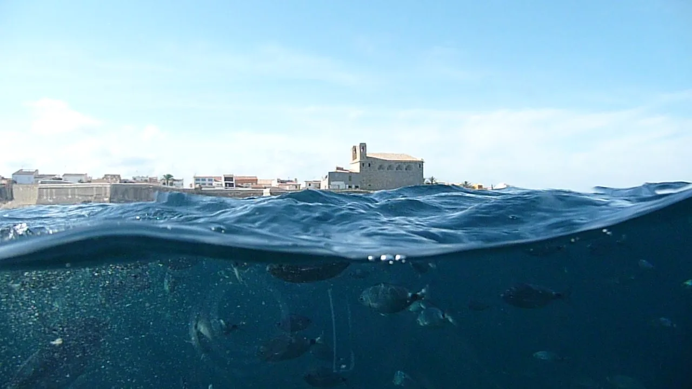
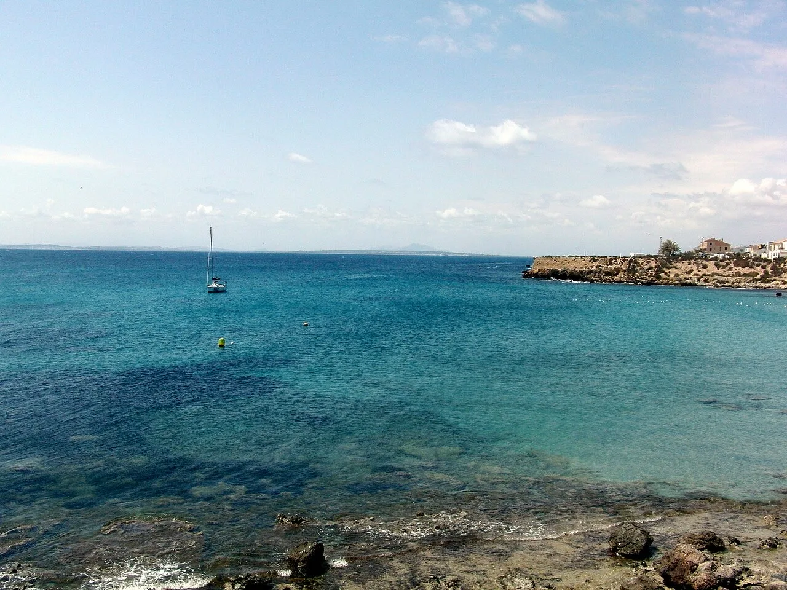
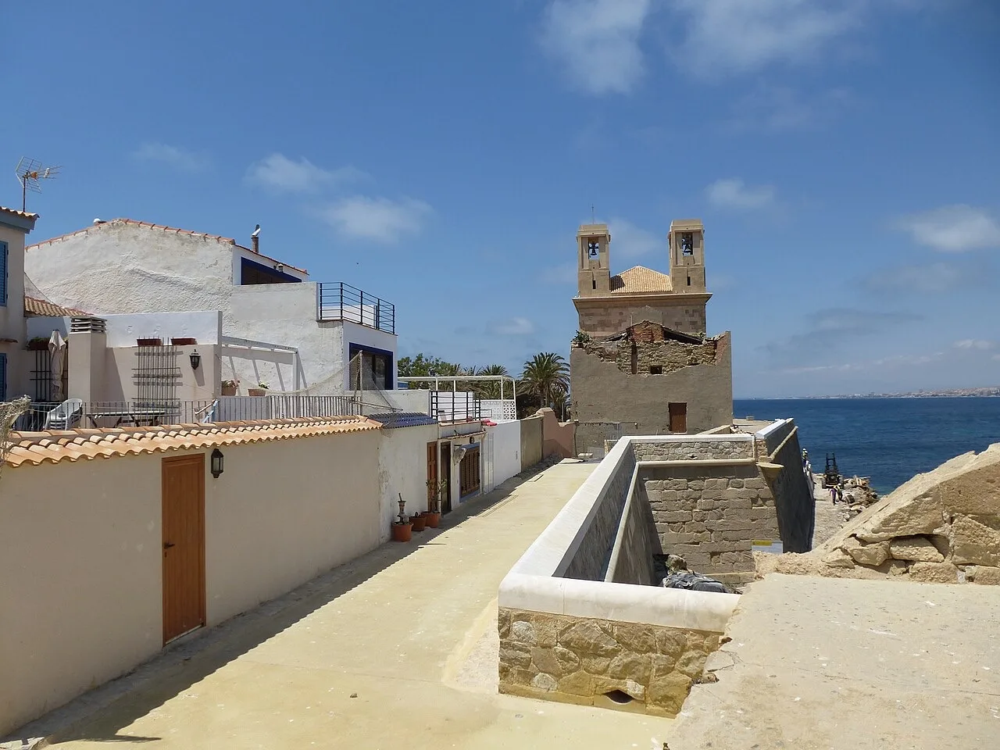
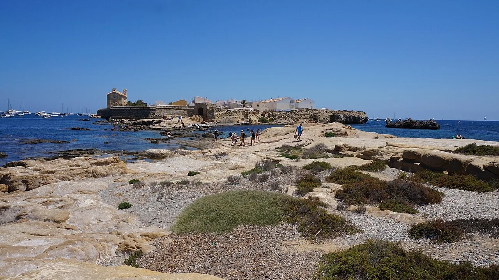
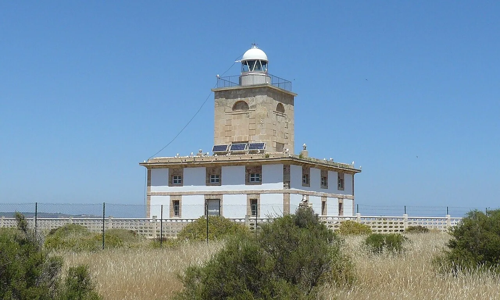
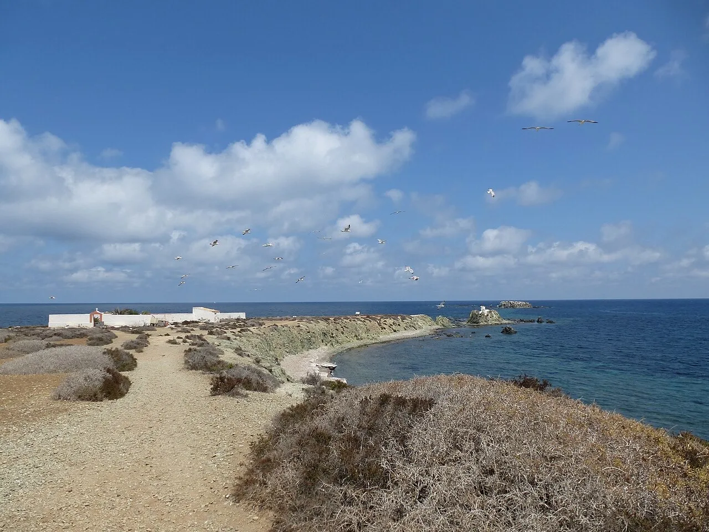

Una isla pequeñita, plana, con un pueblo amurallado, un faro y unas aguas tan claras que fue la **primera reserva marina de España**. **Tabarca** es la única isla habitada de la Comunidad Valenciana y uno de los mejores sitios del Mediterráneo para hacer **snorkel** sin necesidad de barco propio.

Te cuento cómo llegar, dónde meterte al agua y qué ver en la isla 👇

En un vistazo<h2>Lo que vas a encontrar</h2>

<b>⛴️</b>Barco

<b>🤿</b>Snorkel

<b>🐠</b>Reserva marina

<b>🧱</b>Pueblo amurallado

<b>🏖️</b>Calas

Antes de ir<h2>Lo básico de Tabarca</h2>

<h3>⛴️ Cómo llegar</h3>
En <strong>barco</strong>: el trayecto más corto sale de <strong>Santa Pola</strong> (unos 25-30 minutos). También hay barcos desde <strong>Alicante</strong> y, en temporada, desde otros puertos como Torrevieja o Benidorm.

<h3>🤿 Snorkel</h3>
Las aguas de la reserva marina están llenas de vida: lleva gafas y tubo y busca las calas rocosas alrededor del pueblo.

<h3>⏱️ Tiempo</h3>
Un <strong>día</strong> da para recorrer la isla, bañarte y comer un caldero. La isla mide menos de 2 km de punta a punta.

Curiosidades<h2>Una isla fundada con presos rescatados</h2>

Durante siglos, Tabarca fue refugio de piratas berberiscos. En el siglo XVIII, el rey <strong>Carlos III</strong> decidió fortificarla y repoblarla con <strong>familias de origen genovés</strong> rescatadas del cautiverio en la isla de Tabarka, en la actual Túnez. De ahí viene su nombre, y de ahí también los apellidos de origen italiano que todavía se escuchan en la isla.

<h3>🐟 La primera reserva marina</h3>
En <strong>1986</strong> sus aguas se convirtieron en la <strong>primera reserva marina de España</strong>. Gracias a las praderas de posidonia y a la protección de la pesca, bajo el agua hay meros, sargos, doradas y bancos de peces que se dejan ver casi desde la orilla.

Snorkel<h2>Snorkel en Tabarca: dónde y cómo</h2>
Lo mejor de la isla está debajo del agua, y no hace falta barco ni permiso.

Las aguas de Tabarca llevan protegidas desde 1986 y se nota: <strong>praderas de posidonia</strong>, rocas llenas de recovecos y peces que se acercan casi a la orilla. Según <strong>Alicante Turismo</strong>, el snorkel se puede hacer <strong>libremente en las aguas interiores sin pedir ningún permiso</strong>; basta con unas gafas y un tubo.

Las rutas oficiales<h2>Las 8 rutas de snorkel de Tabarca</h2>

<h3>1. La Muralla</h3>
Bajo las murallas del pueblo, a un paso del puerto. La más cómoda para empezar.

<h3>2. La Cantera</h3>
Junto al islote de La Cantera, en el extremo oeste de la isla.

<h3>3. Cala Guardia</h3>
Una pequeña cala de roca con fondo de piedras y posidonia.

<h3>4. Cova Llop Marí</h3>
«Llop marí» es como se llama en valenciano a la foca monje, que antiguamente vivía en estas aguas.

<h3>5. La Galera</h3>
Alrededor del islote de La Galera, uno de los que rodean Tabarca.

<h3>6. Escullos Faroleta</h3>
Escollos de roca con muchos escondrijos para los peces.

<h3>7. Punta Falcón</h3>
Una punta rocosa más alejada del puerto, normalmente más tranquila.

<h3>8. Panxón</h3>
Otro punto rocoso, para cuando ya hayas probado las rutas de al lado del pueblo.

<h3>⚠️ Normas de la reserva</h3>
La <strong>pesca recreativa está prohibida</strong> y no se puede sacar nada vivo del fondo. El <strong>buceo con botella necesita autorización</strong> (los centros de buceo de Santa Pola y Alicante la gestionan). En la <strong>reserva integral</strong>, la zona más oriental y profunda, no se permite ningún uso.

Snorkel seguro<h2>Consejos para el snorkel</h2><ul><li><b>No te metas con oleaje, corrientes o agua turbia.</b></li><li><b>Lleva boya</b>: te ven los barcos y te ayuda a flotar.</li><li><b>Ojo con las embarcaciones</b>, sobre todo en verano junto al puerto.</li><li><b>Chaleco de flotación</b> si no nadas con soltura o vas con niños.</li><li><b>No toques ni des de comer a los peces</b>, ni saques estrellas de mar del agua.</li><li><b>Mejor de junio a octubre</b>, con el agua más templada; a primera hora el agua está más clara y hay menos gente.</li></ul>

¿Prefieres ir con guía y el equipo incluido? Hay una <a href="https://www.civitatis.com/es/santa-pola/excursion-tabarca-snorkel/?aid=110968" target="_blank" rel="noopener sponsored">excursión en barco desde Santa Pola con snorkel guiado</a>, y si te apetece probar con botella, un <a href="https://www.civitatis.com/es/santa-pola/bautismo-buceo-santa-pola/?aid=110968" target="_blank" rel="noopener sponsored">bautismo de buceo en Santa Pola</a>.

Qué ver<h2>Qué ver en Tabarca</h2>
Una isla pequeña, pero con mucho que ver… arriba y abajo del agua.

<ol class="guide__grid guide__grid--cuenca">
<li class="gcard reveal">
01

<h3>El fondo marino</h3>
Ponte las gafas en cualquier cala rocosa: la vida marina de la reserva se ve casi desde el primer metro.

</li>
<li class="gcard reveal">
02

<h3>Las calas</h3>
Además de la playa principal, hay pequeñas calas de roca con agua turquesa alrededor del pueblo.

</li>
<li class="gcard reveal">
03

<h3>El pueblo amurallado</h3>
Calles rectas, casas bajas y la iglesia de San Pedro y San Pablo, dentro de unas murallas del siglo XVIII.

</li>
<li class="gcard reveal">
04

<h3>Las murallas y puertas</h3>
Recorre las murallas y busca las puertas de San Rafael, San Miguel y San Gabriel.

</li>
<li class="gcard reveal">
05

<h3>El faro</h3>
En la parte deshabitada de la isla, un camino lleva al faro entre vegetación de matorral y gaviotas.

</li>
<li class="gcard reveal">
06

<h3>El campo</h3>
La mitad este de la isla es campo abierto: ideal para pasear con el mar a ambos lados.

</li>
</ol>

<!--actividades-->

Excursiones en barco<h2>Excursiones en barco a Tabarca</h2>

<h3>⛴️ Barco desde Santa Pola</h3>
El trayecto más corto. <a href="https://www.civitatis.com/es/santa-pola/excursion-tabarca-barco/?aid=110968" target="_blank" rel="noopener sponsored">Excursión en barco a Tabarca</a> con tiempo libre en la isla.

<h3>🐠 Con visión submarina</h3>
Barcos con <a href="https://www.civitatis.com/es/santa-pola/tabarca-barco-vision-submarina/?aid=110968" target="_blank" rel="noopener sponsored">visión submarina</a> para ver el fondo sin mojarte.

<h3>🚢 Ferry desde Alicante</h3>
Más largo pero cómodo si duermes en la ciudad: <a href="https://www.civitatis.com/es/alicante/ferry-isla-tabarca/?aid=110968" target="_blank" rel="noopener sponsored">ferry Alicante–Tabarca</a>.

<h3>⛵ En velero privado</h3>
Para grupos o parejas: <a href="https://www.civitatis.com/es/alicante/excursion-privada-tabarca-velero/?aid=110968" target="_blank" rel="noopener sponsored">velero privado desde Alicante</a>, con paradas para bañarse.

Cómo llegar<h2>Cómo llegar a Tabarca</h2>

Lo más rápido es salir desde el <strong>puerto de Santa Pola</strong>, con barcos frecuentes durante todo el año (más en verano). Desde el <strong>puerto de Alicante</strong> el trayecto es más largo, pero cómodo si te alojas en la ciudad.

Algunas navieras ofrecen barcos con <strong>fondo de cristal</strong> para ver el fondo marino durante el trayecto. Compra la vuelta con hora reservada en verano.

<a class="btn guide__mapbtn" href="https://www.google.com/maps/dir/?api=1&destination=Puerto+de+Santa+Pola" target="_blank" rel="noopener"><svg class="ico" viewBox="0 0 24 24" width="15" height="15" aria-hidden="true" fill="currentColor"><path d="M12 2a7 7 0 0 0-7 7c0 5.25 7 13 7 13s7-7.75 7-13a7 7 0 0 0-7-7zm0 9.5a2.5 2.5 0 1 1 0-5 2.5 2.5 0 0 1 0 5z"/></svg> Puerto de Santa Pola</a><a class="btn guide__mapbtn btn--ghost" href="https://www.google.com/maps/dir/?api=1&destination=Isla+de+Tabarca" target="_blank" rel="noopener"><svg class="ico" viewBox="0 0 24 24" width="15" height="15" aria-hidden="true" fill="currentColor"><path d="M12 2a7 7 0 0 0-7 7c0 5.25 7 13 7 13s7-7.75 7-13a7 7 0 0 0-7-7zm0 9.5a2.5 2.5 0 1 1 0-5 2.5 2.5 0 0 1 0 5z"/></svg> Isla de Tabarca</a>

Dónde dormir<h2>Dormir en la isla de Tabarca</h2>

Hay <strong>muy pocas plazas</strong>: un puñado de hoteles y hostales dentro del pueblo amurallado, casi todos a dos o tres minutos de la playa, y algunos apartamentos y B&amp;B. En <strong>julio, agosto y puentes</strong> se llenan pronto, así que reserva con tiempo.

Merece la pena: cuando se va el <strong>último barco</strong>, la isla se queda casi vacía. Atardecer en las murallas, cielo con estrellas y snorkel a primera hora, antes de que lleguen los visitantes. Recuerda que <strong>no se puede llevar coche</strong>: viaja con poco equipaje.

Consejos de Cheno<h2>Para disfrutarla al máximo</h2><ul><li><b>Coge el primer barco</b>: a media mañana llegan muchos visitantes y la isla se llena.</li><li><b>Gafas, tubo y escarpines</b>: el fondo es rocoso y la vida marina, increíble.</li><li><b>Prueba el caldero tabarquino</b>: el plato típico de la isla, con arroz y pescado de roca.</li><li><b>Quédate a dormir</b>: cuando se va el último barco, la isla es otra.</li><li><b>Respeta la reserva</b>: no se puede pescar ni coger nada del fondo.</li></ul>

<!--faq-->

<h2>¿Te gustan estos planes?</h2>
Sígueme en Instagram como <a href="https://www.instagram.com/chenoaventuras/" target="_blank" rel="noopener">@chenoaventuras</a>: subo escapadas como esta cada semana.
<a class="btn guide__btn" href="/blog.html">Ver más planes en el blog</a>

Información consultada en octubre y noviembre de 2026 (rutas y normas de snorkel: Alicante Turismo). Los horarios y precios de los barcos cambian según la temporada y la naviera. Fotos de Wikimedia Commons: <a href="https://commons.wikimedia.org/wiki/File%3ATabarca_Island-Alicante_%28Spain%29_-_48502403002_%28cropped%29.jpg" target="_blank" rel="noopener">Jose A.</a> (CC BY 2.0) · <a href="https://commons.wikimedia.org/wiki/File%3ACosta_de_Tabarca_-_panoramio.jpg" target="_blank" rel="noopener">Carlos Ramón Bonilla…</a> (CC BY-SA 3.0) · <a href="https://commons.wikimedia.org/wiki/File%3AIsla_de_Tabarca_-_panoramio.jpg" target="_blank" rel="noopener">cesar.ruiz</a> (CC BY-SA 3.0) · <a href="https://commons.wikimedia.org/wiki/File%3AIle_de_tabarca_-_panoramio_%2828%29.jpg" target="_blank" rel="noopener">chisloup</a> (CC BY 3.0) · <a href="https://commons.wikimedia.org/wiki/File%3ATabarca_Lighthouse.JPG" target="_blank" rel="noopener">MOs810</a> (CC BY-SA 4.0) · <a href="https://commons.wikimedia.org/wiki/File%3ATabarca_desde_el_sur.jpg" target="_blank" rel="noopener">Jorge Sanz from Aldaia, Spain</a> (CC BY-SA 2.0) · <a href="https://commons.wikimedia.org/wiki/File:Ile_de_tabarca_-_panoramio_(43).jpg" target="_blank" rel="noopener">chisloup</a> (CC BY 3.0).

