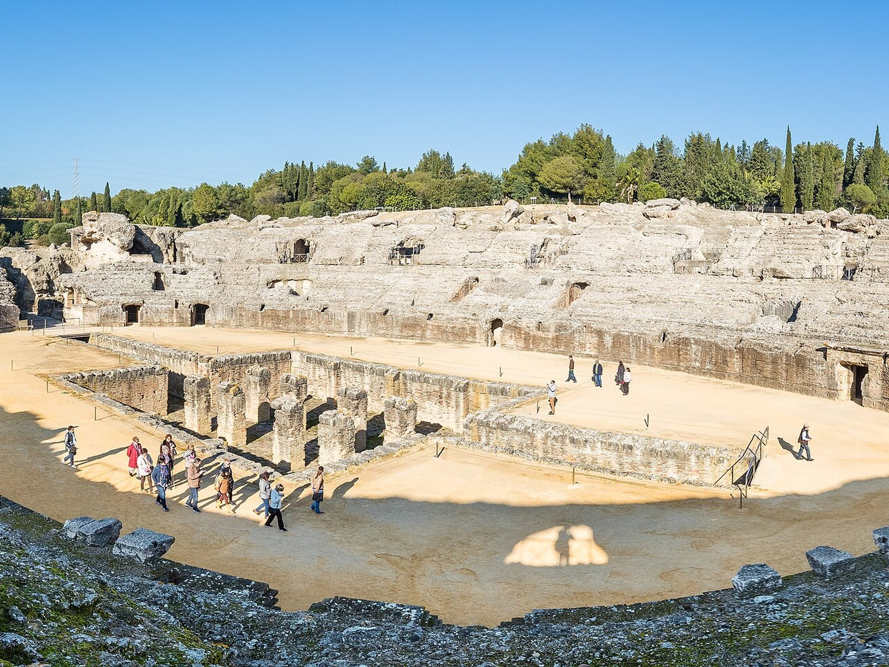
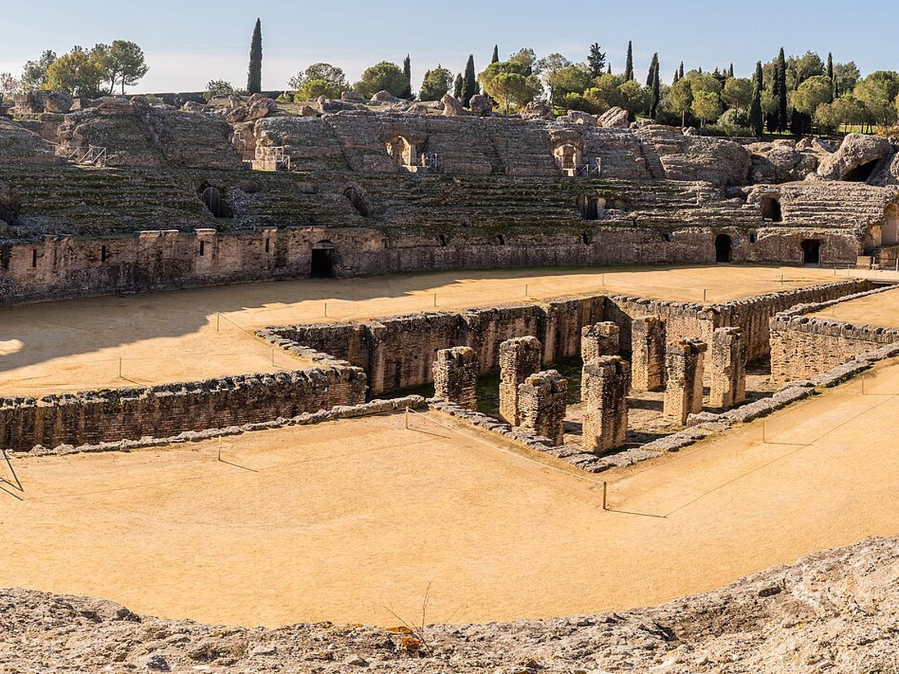
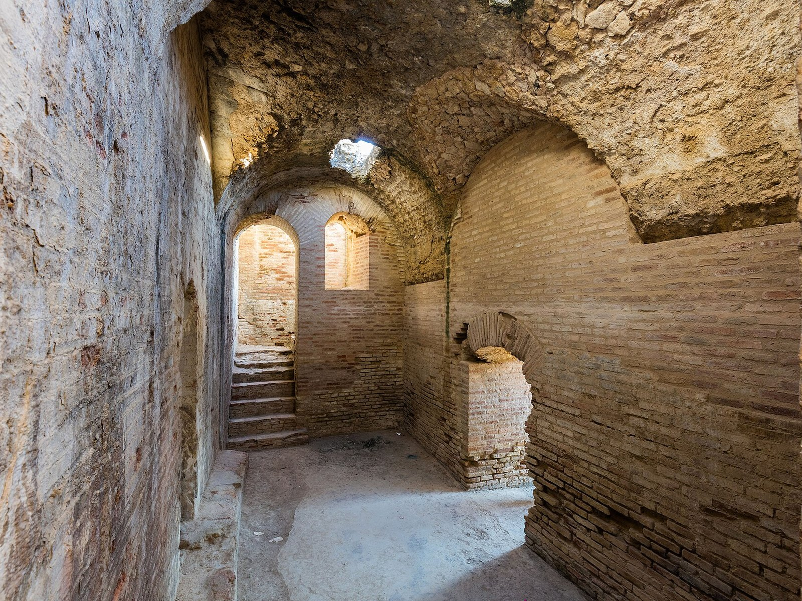
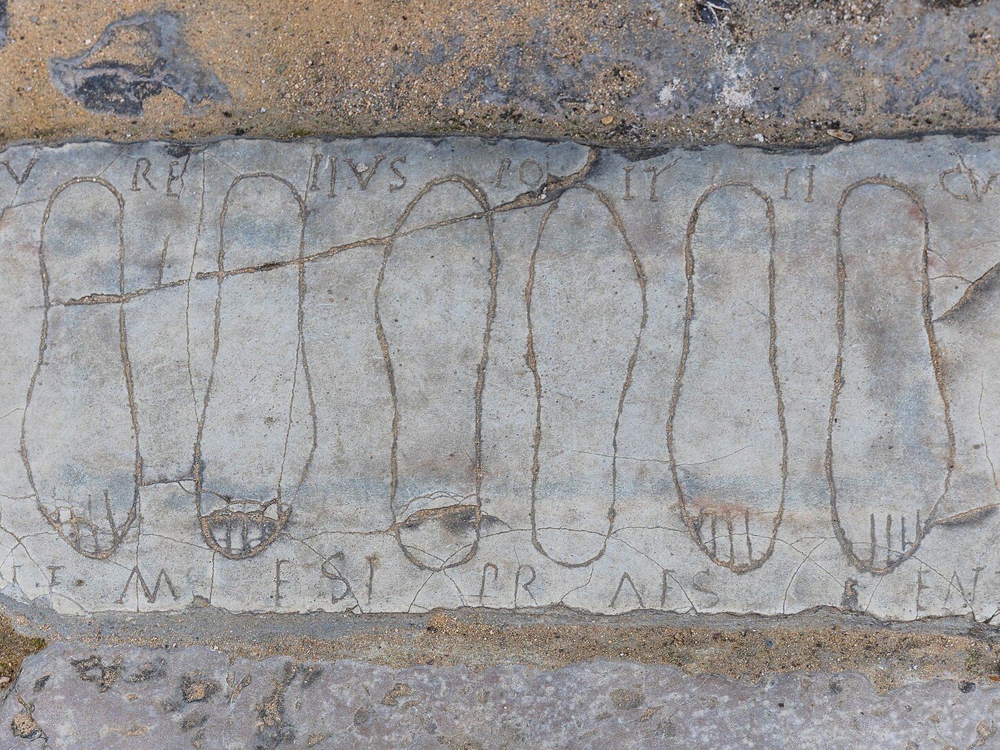
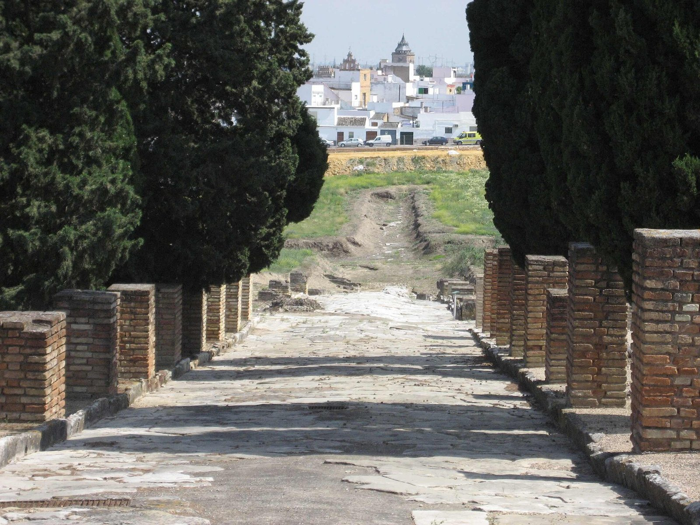
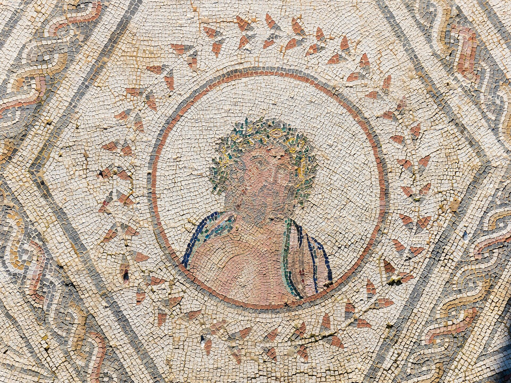
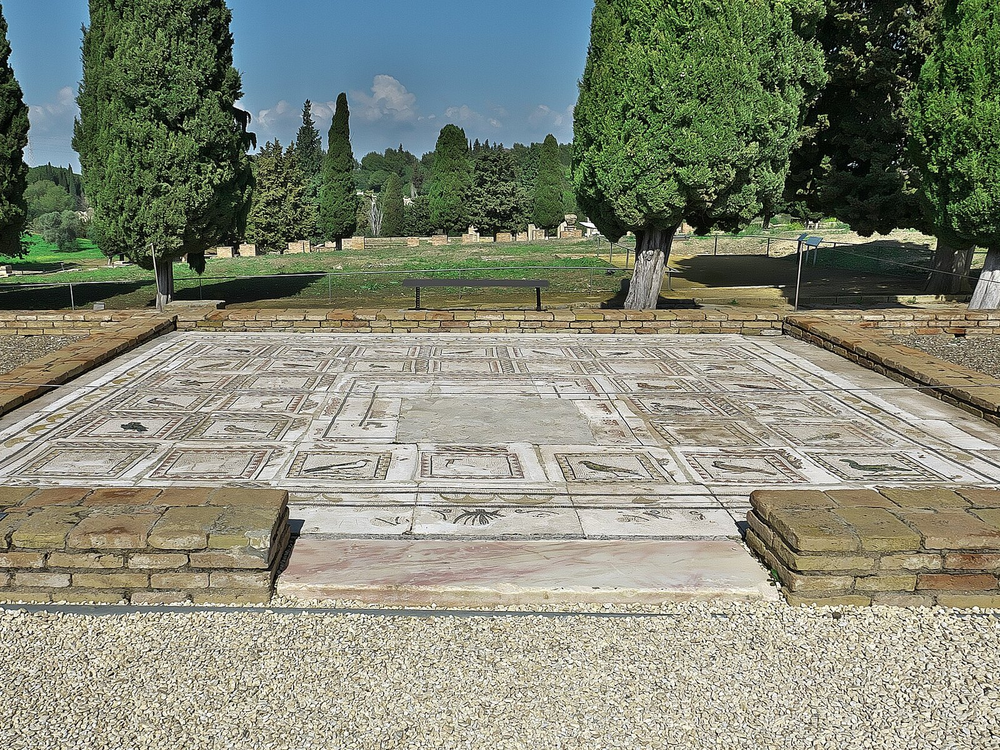
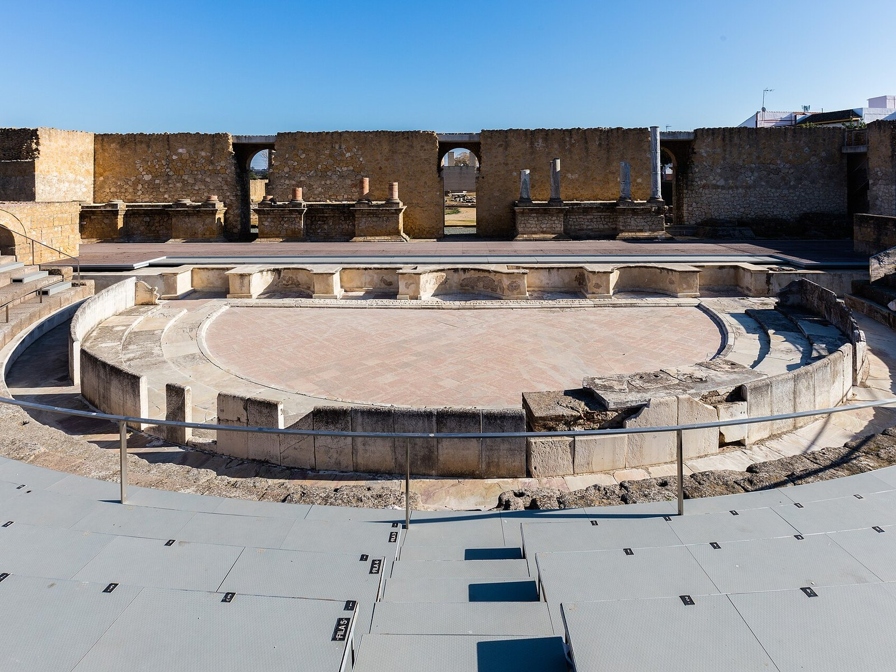

Mucho antes de que existiera Sevilla tal y como la conocemos, a 9 km de allí ya había una ciudad romana con calles empedradas, termas y un anfiteatro para miles de personas. **Itálica** se fundó en el **206 antes de Cristo** y fue la **primera ciudad romana de Hispania**. Aquí nació **Trajano**, el primer emperador nacido fuera de Italia, y su anfiteatro fue el **Pozo Dragón de Juego de Tronos**.

Lo mejor: si eres ciudadano de la Unión Europea, **entras gratis**. Te cuento qué ver y cómo llegar 👇

En un vistazo<h2>Lo que vas a encontrar</h2>

<b>🏛️</b>Anfiteatro

<b>🐉</b>Juego de Tronos

<b>🧩</b>Mosaicos

<b>👑</b>Cuna de Trajano

<b>🆓</b>Gratis UE

Antes de ir<h2>Entrada y horario</h2>

<h3>🎟️ Entrada</h3><ul class="guide__prices"><li>Ciudadanos de la UE<b>Gratis</b></li><li>Resto<b>1,50 €</b></li></ul>

<h3>🕒 Horario</h3>
De <strong>martes a domingo</strong>; cierra los lunes y algunos festivos. El horario cambia según la temporada: consúltalo antes en la web de la Junta.

<h3>☀️ Cuándo ir</h3>
En <strong>otoño, invierno y primavera</strong>. En verano no hay casi sombra: si vas, a primera hora.

La visita<h2>Qué ver en Itálica</h2>

<ol class="guide__grid guide__grid--cuenca">
<li class="gcard reveal">
01

<h3>El anfiteatro</h3>
Uno de los más grandes del Imperio romano: cabían unas <strong>25.000 personas</strong>. Aquí luchaban gladiadores y fieras.

</li>
<li class="gcard reveal">
02

<h3>El foso de la arena</h3>
En el centro hay un foso cubierto por tablones en época romana, desde donde subían las fieras y los decorados. En <strong>Juego de Tronos</strong> fue el Pozo Dragón.

</li>
<li class="gcard reveal">
03

<h3>Los pasillos bajo las gradas</h3>
Por estos pasillos abovedados entraba y salía el público. Camínalos: se entiende muy bien cómo funcionaba el edificio.

</li>
<li class="gcard reveal">
04

<h3>Las huellas de pies</h3>
Busca las placas con pies grabados: son <strong>ofrendas</strong> que dejaban quienes iban a luchar o a ver los juegos, para pedir protección a la diosa Némesis.

</li>
<li class="gcard reveal">
05

<h3>Las calles de la ciudad nueva</h3>
Anchas, rectas y con aceras: es la parte que amplió el emperador <strong>Adriano</strong>. Pasea entre los cipreses y verás las bases de las casas.

</li>
<li class="gcard reveal">
06

<h3>El mosaico del Planetario</h3>
Representa a los dioses de los <strong>siete días de la semana</strong>, cada uno en un hexágono. Es uno de los mosaicos más famosos de Itálica.

</li>
<li class="gcard reveal">
07

<h3>La Casa de los Pájaros</h3>
Una gran casa romana con un mosaico lleno de aves distintas, cada una en su cuadro. Ayuda a imaginar cómo vivían las familias ricas.

</li>
<li class="gcard reveal">
08

<h3>El teatro romano</h3>
Está fuera del recinto, en el centro de <strong>Santiponce</strong>, a 10 minutos a pie. En verano se usa para representaciones.

</li>
</ol>

Historia<h2>La ciudad de los emperadores</h2>

Itálica nació en el <strong>206 a. C.</strong>, cuando el general <strong>Escipión el Africano</strong> dejó aquí a los soldados heridos tras vencer a los cartagineses en la batalla de Ilipa. Con los siglos se convirtió en una ciudad rica, cuna de <strong>Trajano</strong>, el primer emperador nacido fuera de Italia. <strong>Adriano</strong>, su sucesor, era de familia italicense y engrandeció la ciudad con barrios nuevos, templos y el gran anfiteatro.

Cuando el río Guadalquivir cambió de cauce y Sevilla creció, Itálica se fue quedando vacía. Durante siglos sus piedras se usaron para construir en Sevilla y en los pueblos de alrededor, y buena parte de la ciudad antigua sigue bajo las casas de Santiponce.

<!--actividades-->

Cómo llegar<h2>Cómo llegar a Itálica desde Sevilla</h2>

<strong>En coche:</strong> unos 15 minutos (9 km) por la SE-30 y la A-66, salida Santiponce. Hay aparcamiento junto a la entrada.

<strong>En autobús:</strong> la línea <strong>M-170</strong> sale de la estación de autobuses de <strong>Plaza de Armas</strong> y para junto a la entrada del conjunto, en unos 20-25 minutos.

<a class="btn guide__mapbtn" href="https://www.google.com/maps/dir/?api=1&destination=37.4433,-6.0458" target="_blank" rel="noopener"><svg class="ico" viewBox="0 0 24 24" width="15" height="15" aria-hidden="true" fill="currentColor"><path d="M12 2a7 7 0 0 0-7 7c0 5.25 7 13 7 13s7-7.75 7-13a7 7 0 0 0-7-7zm0 9.5a2.5 2.5 0 1 1 0-5 2.5 2.5 0 0 1 0 5z"/></svg> Cómo llegar en Google Maps</a>

Combínalo con <a href="/blog/sevilla-que-ver.html">Sevilla</a> y sus <a href="/blog/setas-de-sevilla.html">Setas</a>, o con <a href="/blog/carmona-que-ver.html">Carmona</a>, otra ciudad con mucho pasado romano. Si te gustan las ruinas, en Extremadura tienes <a href="/blog/merida-que-ver.html">Mérida</a>.

Consejos de Cheno<h2>Para disfrutarlo al máximo</h2><ul><li><b>Lleva el DNI</b>: es lo que te da la entrada gratis.</li><li><b>Agua y gorra</b>: casi no hay sombra.</li><li><b>Empieza por el anfiteatro</b> y luego baja por las calles hacia los mosaicos.</li><li><b>Vuelve por el pueblo</b> para ver el teatro romano.</li></ul>

<!--faq-->

<h2>¿Te gustan estos planes?</h2>
Sígueme en Instagram como <a href="https://www.instagram.com/chenoaventuras/" target="_blank" rel="noopener">@chenoaventuras</a>: subo escapadas como esta cada semana.
<a class="btn guide__btn" href="/blog.html">Ver más planes en el blog</a>

Información consultada en noviembre de 2026. Los horarios del Conjunto Arqueológico cambian por temporadas: consúltalos en la web de la Junta de Andalucía antes de ir. Fotos de Wikimedia Commons: <a href="https://commons.wikimedia.org/wiki/File:Anfiteatro_de_las_ruinas_romanas_de_It%C3%A1lica,_Santiponce,_Sevilla,_Espa%C3%B1a,_2015-12-06,_DD_26-29_PAN.JPG" target="_blank" rel="noopener">Diego Delso</a> (CC BY-SA 4.0) · <a href="https://commons.wikimedia.org/wiki/File:Anfiteatro_de_las_ruinas_romanas_de_It%C3%A1lica,_Santiponce,_Sevilla,_Espa%C3%B1a,_2015-12-06,_DD_34-45_PAN_HDR.JPG" target="_blank" rel="noopener">Diego Delso</a> (CC BY-SA 4.0) · <a href="https://commons.wikimedia.org/wiki/File:Anfiteatro_de_las_ruinas_romanas_de_It%C3%A1lica,_Santiponce,_Sevilla,_Espa%C3%B1a,_2015-12-06,_DD_10.JPG" target="_blank" rel="noopener">Diego Delso</a> (CC BY-SA 4.0) · <a href="https://commons.wikimedia.org/wiki/File:Italica_street.jpg" target="_blank" rel="noopener">Rjdeadly</a> (CC BY-SA 4.0) · <a href="https://commons.wikimedia.org/wiki/File:Mosaico_del_Planetario,_ruinas_romanas_de_It%C3%A1lica,_Santiponce,_Sevilla,_Espa%C3%B1a,_2015-12-06,_DD_23.JPG" target="_blank" rel="noopener">Diego Delso</a> (CC BY-SA 4.0) · <a href="https://commons.wikimedia.org/wiki/File:Mosaico_de_la_Domus_de_los_P%C3%A1jaros,_It%C3%A1lica_(Santiponce).jpg" target="_blank" rel="noopener">Jl FilpoC</a> (CC BY-SA 4.0) · <a href="https://commons.wikimedia.org/wiki/File:Teatro_romano_de_It%C3%A1lica,_Santiponce,_Sevilla,_Espa%C3%B1a,_2015-12-06,_DD_47.JPG" target="_blank" rel="noopener">Diego Delso</a> (CC BY-SA 4.0) · <a href="https://commons.wikimedia.org/wiki/File:Anfiteatro_de_las_ruinas_romanas_de_It%C3%A1lica,_Santiponce,_Sevilla,_Espa%C3%B1a,_2015-12-06,_DD_15.jpg" target="_blank" rel="noopener">Diego Delso</a> (CC BY-SA 4.0).

