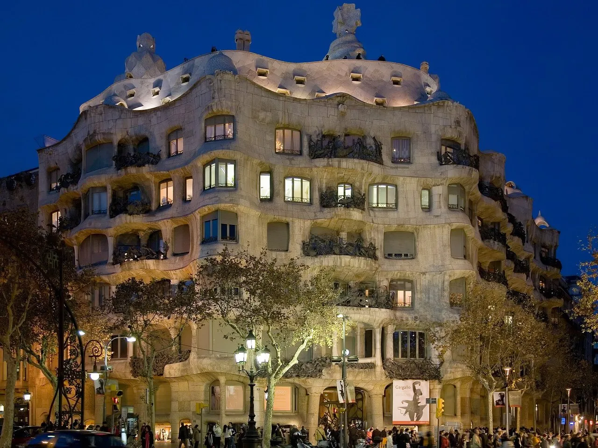
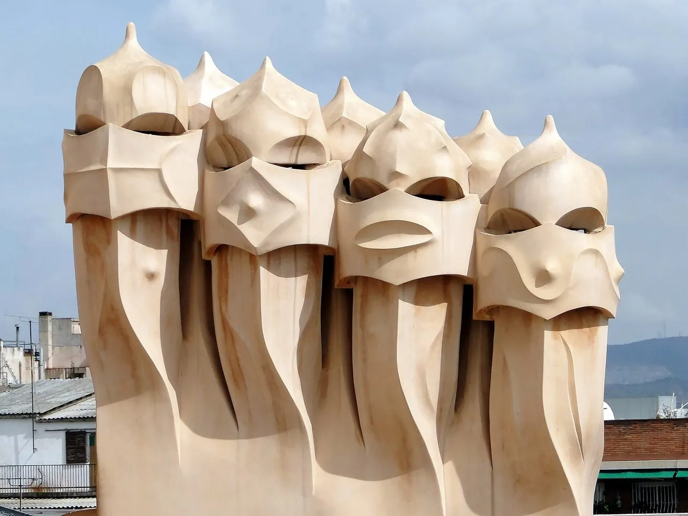
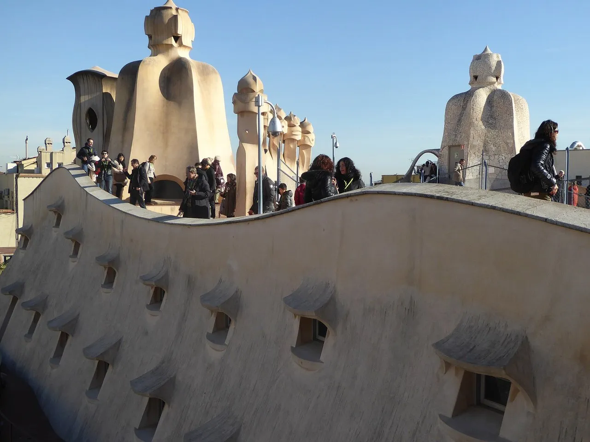
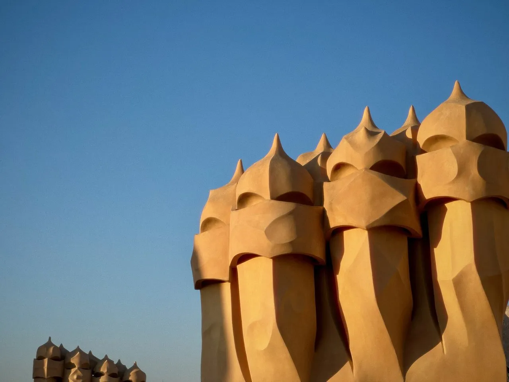
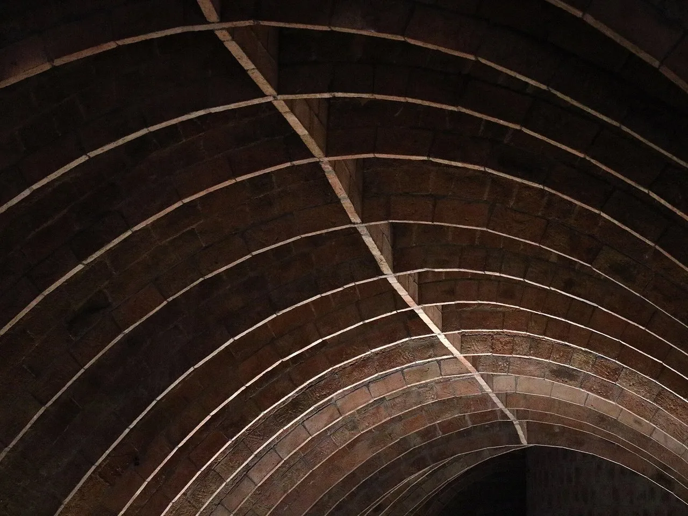
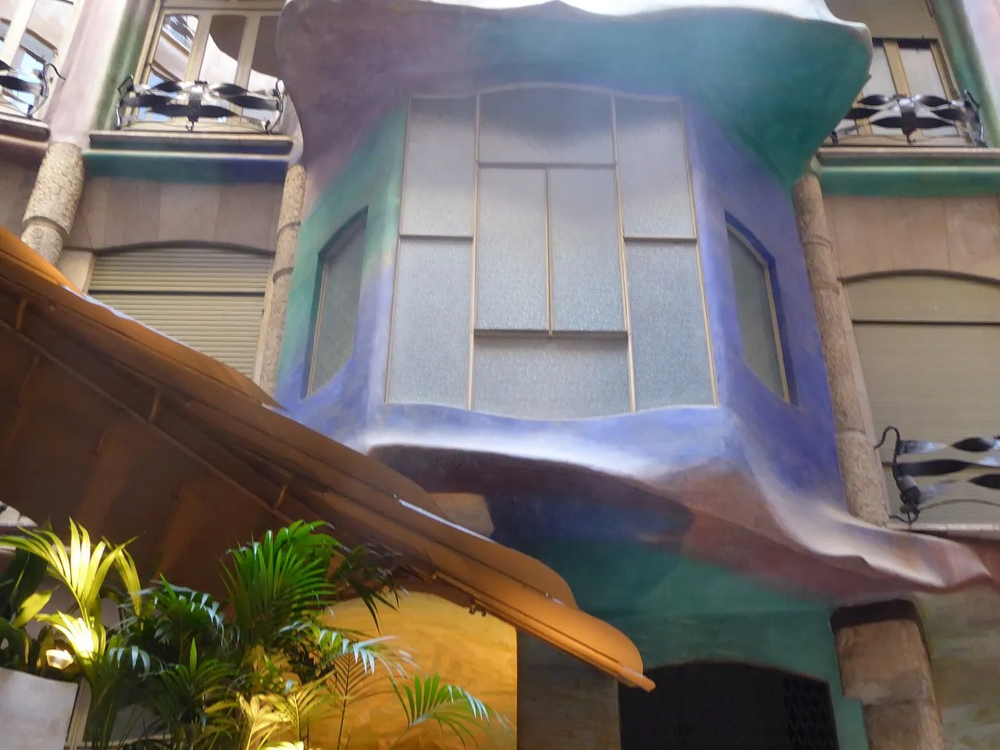

Una fachada de piedra ondulada como el mar, balcones de hierro que parecen algas y, en la azotea, chimeneas con forma de guerreros vigilando Barcelona. **La Pedrera**, o **Casa Milà**, fue la última obra civil de **Gaudí** y es Patrimonio Mundial desde 1984.

Te cuento cuánto cuesta, el horario de invierno (ojo al cierre de enero) y qué ver 👇

En un vistazo<h2>Lo que vas a encontrar</h2>

<b>🗿</b>Azotea de los guerreros

<b>🐋</b>Ático de la ballena

<b>🌙</b>Visita nocturna

<b>📱</b>Videoguía incluida

<b>👶</b>Niños gratis

Antes de ir<h2>Lo básico de La Pedrera</h2>

<h3>🎟️ Precio</h3>
Visita de día <strong>desde 29 €</strong>; nocturna <strong>desde 39,50 €</strong>. Niños de 0 a 11 años, <strong>gratis</strong>.

<h3>🕙 Horario de invierno</h3>
Hasta el 25 de febrero: <strong>9:00-18:30</strong> todos los días; nocturnas de 19:00 a 23:00.

<h3>⚠️ Cierres</h3>
<strong>25 de diciembre</strong> y del <strong>11 al 17 de enero de 2027</strong>.

<h3>⏱️ Duración</h3>
De <strong>1 a 1,5 horas</strong> la visita libre, con videoguía en 11 idiomas.

Qué ver<h2>Qué ver en La Pedrera</h2>

<ol class="guide__grid guide__grid--cuenca">
<li class="gcard reveal">
01

<h3>La fachada</h3>
Piedra ondulada sin una sola línea recta y balcones de hierro forjado. Por eso los barceloneses la llamaron «la pedrera», la cantera.

</li>
<li class="gcard reveal">
02

<h3>La azotea de los guerreros</h3>
Lo más famoso: chimeneas y salidas de escalera convertidas en esculturas que parecen guerreros con casco.

</li>
<li class="gcard reveal">
03

<h3>El paseo por la azotea</h3>
Un recorrido de subidas y bajadas entre las chimeneas, con vistas al paseo de Gràcia. Con lluvia, la cierran.

</li>
<li class="gcard reveal">
04

<h3>Las chimeneas</h3>
Cada grupo tiene una forma distinta. De cerca se aprecia el trabajo de Gaudí con el ladrillo, la piedra y el estuco.

</li>
<li class="gcard reveal">
05

<h3>El ático de la ballena</h3>
Arcos de ladrillo que recuerdan el esqueleto de una ballena. Aquí está la exposición dedicada a Gaudí.

</li>
<li class="gcard reveal">
06

<h3>Los patios y el piso</h3>
Los patios de las flores y de las mariposas, y un piso amueblado como vivían los vecinos a principios del siglo XX.

</li>
</ol>

<!--actividades-->

Entradas<h2>Tipos de entrada a La Pedrera</h2>

<h3>☀️ La Pedrera Esencial</h3>
Visita libre de día, <strong>desde 29 €</strong>: patios, piso, ático y azotea, con videoguía.

<h3>🌙 Night Experience</h3>
<strong>Desde 39,50 €</strong>: visita guiada, espectáculo en la azotea y copa de cava.

<h3>🌅 Sunrise</h3>
Visita guiada al amanecer, <strong>desde 39,50 €</strong> (en inglés y chino).

<h3>🎨 Combinadas</h3>
Con Sant Pau o el Palau de la Música (desde 42 €) o con el Teatro-Museo Dalí (desde 44,50 €).

Puedes reservar la <a href="https://www.civitatis.com/es/barcelona/entrada-la-pedrera/?aid=110968" target="_blank" rel="noopener sponsored">entrada a La Pedrera sin colas</a>, una <a href="https://www.civitatis.com/es/barcelona/visita-guiada-pedrera/?aid=110968" target="_blank" rel="noopener sponsored">visita guiada</a> o la <a href="https://www.civitatis.com/es/barcelona/visita-nocturna-espectaculo-pedrera/?aid=110968" target="_blank" rel="noopener sponsored">visita nocturna con espectáculo</a>.

La historia<h2>La última casa de Gaudí</h2>

<strong>Rosario Segimon</strong> y <strong>Pere Milà</strong> encargaron a Gaudí este edificio de viviendas, que construyó entre <strong>1906 y 1912</strong>: fue su última obra civil antes de dedicarse por completo a la Sagrada Familia. En <strong>1984</strong> la UNESCO la declaró Patrimonio Mundial junto con el Park Güell y el Palau Güell, y desde 1996 funciona como centro cultural.

Consejos de Cheno<h2>Para disfrutarla al máximo</h2><ul><li><b>Evita el 11-17 de enero</b>: está cerrada.</li><li><b>Mira el tiempo</b>: con lluvia no se sube a la azotea.</li><li><b>De noche</b> la azotea tiene otra magia, con espectáculo incluido.</li><li><b>Combínala con</b> la <a href="/blog/casa-batllo.html">Casa Batlló</a>, a cinco minutos andando, la <a href="/blog/sagrada-familia.html">Sagrada Familia</a> y el <a href="/blog/park-guell.html">Park Güell</a>.</li></ul>

<!--faq-->

<h2>¿Te gustan estos planes?</h2>
Sígueme en Instagram como <a href="https://www.instagram.com/chenoaventuras/" target="_blank" rel="noopener">@chenoaventuras</a>: subo escapadas como esta cada semana.
<a class="btn guide__btn" href="/blog.html">Ver más planes en el blog</a>

Información consultada en noviembre de 2026 en la web oficial de La Pedrera-Casa Milà (horarios, entradas e historia). Fotos de Wikimedia Commons: <a href="https://commons.wikimedia.org/wiki/File:Casa_Mil%C3%A0,_general_view.jpg" target="_blank" rel="noopener">Thomas Ledl</a> (CC BY-SA 4.0) · <a href="https://commons.wikimedia.org/wiki/File:Casa_Mil%C3%A0_-_Barcelona,_Spain_-_Jan_2007.jpg" target="_blank" rel="noopener">Diliff</a> (CC BY 2.5) · <a href="https://commons.wikimedia.org/wiki/File:Casa_Mil%C3%A0_01.jpg" target="_blank" rel="noopener">Bernard Gagnon</a> (CC BY-SA 3.0) · <a href="https://commons.wikimedia.org/wiki/File:Casa_Mil%C3%A0_roof,_Barcelona,_January_2015_(03).jpg" target="_blank" rel="noopener">Ardfern</a> (CC BY-SA 4.0) · <a href="https://commons.wikimedia.org/wiki/File:Chimneys_on_the_rooftop_terrace_of_Gaudi%27s_La_Pedrera_in_Barcelona.jpg" target="_blank" rel="noopener">Bravodelnorte</a> (CC0) · <a href="https://commons.wikimedia.org/wiki/File:Attic_of_Casa_Mil%C3%A0_by_Mikani_-_IMG_2444.jpg" target="_blank" rel="noopener">Mikani</a> (CC BY-SA 4.0) · <a href="https://commons.wikimedia.org/wiki/File:Casa_Mil%C3%A0_courtyard,_Barcelona,_January_2015_(02).jpg" target="_blank" rel="noopener">Ardfern</a> (CC BY-SA 4.0).

