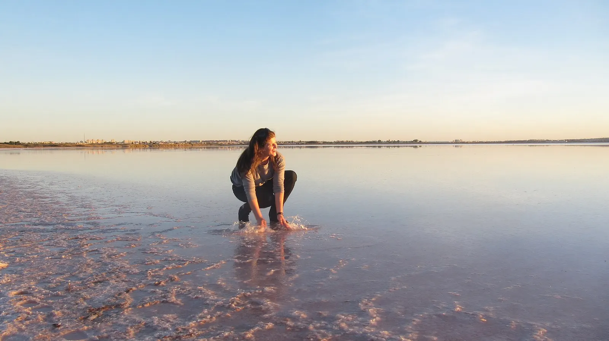
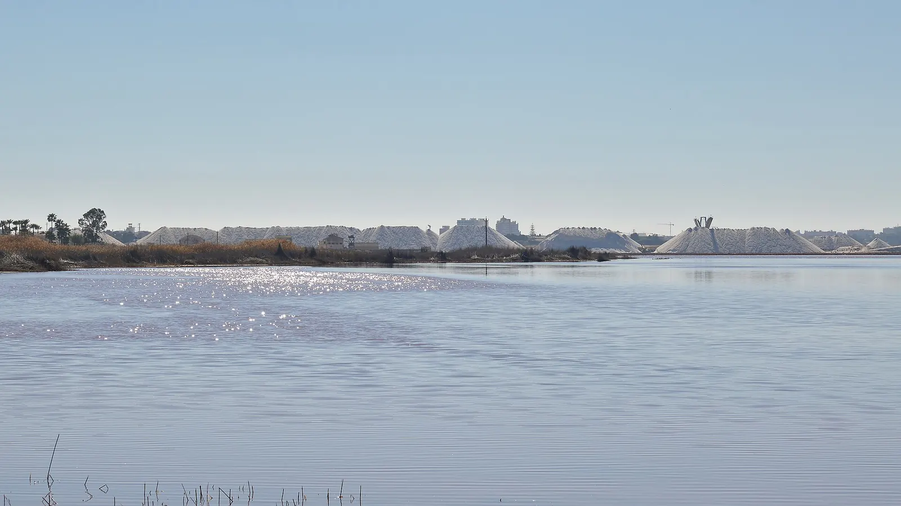
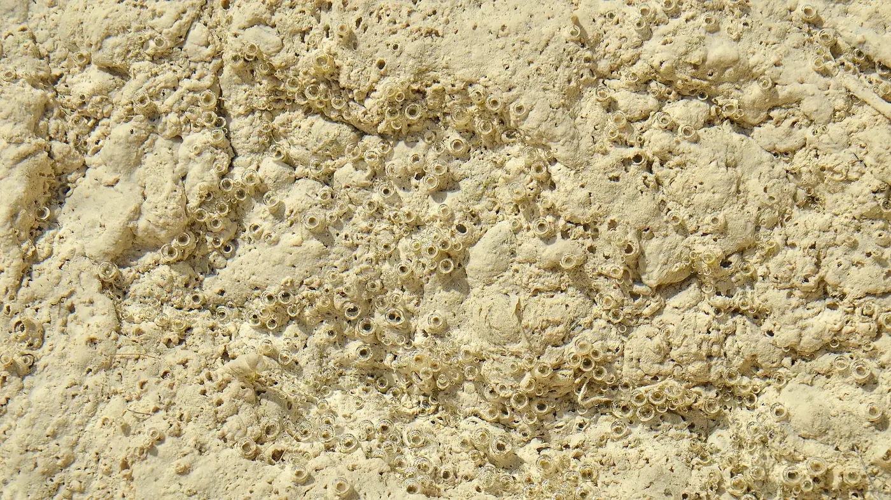

Agua de color **rosa chicle**, montañas de sal blanca y flamencos al fondo. La **Laguna Rosa de Torrevieja** es uno de esos sitios que parecen editados... y no lo están.

Lo primero que todo el mundo pregunta es si se puede bañar. Te lo cuento 👇

En un vistazo<h2>Lo que vas a encontrar</h2>

<b>🩷</b>Agua rosa

<b>🧂</b>Salinas

<b>🌅</b>Atardecer

<b>📸</b>Fotos

<b>🚫</b>Baño

Antes de ir<h2>Lo básico de la Laguna Rosa</h2>

<h3>📍 Dónde está</h3>
En <strong>Torrevieja (Alicante)</strong>, dentro del Parque Natural de las Lagunas de La Mata y Torrevieja.

<h3>⏱️ Tiempo</h3>
Con <strong>30-45 minutos</strong> tienes para verla y hacer fotos.

<h3>🚫 Baño</h3>
<strong>Prohibido</strong>. Hay multas de 60 a 600 euros.

La curiosidad<h2>¿Por qué el agua es rosa?</h2>

El color lo ponen unos seres diminutos: el alga <strong>Dunaliella salina</strong> y unas bacterias que viven en agua con muchísima sal. Para protegerse del sol fabrican pigmentos rojizos, y cuanta más sal y más sol, <strong>más rosa</strong> se ve la laguna.

Aquí se saca sal desde hace siglos: las <strong>salinas de Torrevieja</strong> están entre las más grandes de Europa, y las montañas blancas que verás son sal lista para salir.

<h3>🚫 ¿Se puede bañar en la Laguna Rosa?</h3>
<strong>No.</strong> El Parque Natural lo prohíbe por dos motivos: proteger el ecosistema y la <strong>seguridad</strong>, porque bajo el agua trabajan máquinas de extracción de sal. Además, la sal y el barro dañan la piel y los ojos. Se multa con 60 a 600 euros.

<!--enr-->

La historia<h2>Siete siglos de sal (y una ciudad que nació de ella)</h2>

La sal de esta laguna se explota desde hace siglos. Ya en <strong>1321</strong> la Corona concedió las salinas de Torrevieja al concejo de Orihuela. Durante mucho tiempo el centro de la actividad fue <strong>La Mata</strong>, la otra laguna, pero en <strong>1802</strong> las oficinas de la explotación se trasladaron a Torrevieja, junto al cabo Cervera, y alrededor de ellas creció el pueblo que hoy es una ciudad. Por eso se dice que <strong>Torrevieja nació de la sal</strong>.

Las dos lagunas, unidas por un canal llamado <strong>El Acequión</strong>, forman hoy el <strong>Parque Natural de las Lagunas de La Mata y Torrevieja</strong>, con más de 3.700 hectáreas. Funcionan como una cadena: el agua del mar entra en La Mata, se va concentrando y pasa a Torrevieja, donde la evaporación deja la sal.

Ciencia<h2>El truco del color rosa</h2>

El responsable del rosa es la <strong>Dunaliella salina</strong>, una microalga que vive en agua muchísimo más salada que el mar. Cuando la sal y el sol aprietan, produce grandes cantidades de <strong>betacaroteno</strong> (el mismo pigmento de la zanahoria) para protegerse, y tiñe el agua. Por eso la laguna está más rosa en <strong>verano y con días de sol fuerte</strong>, y puede verse más apagada en invierno o tras las lluvias. En La Mata, con menos sal, la misma vida microscópica no necesita protegerse tanto y el agua tira a verde.

Qué ver<h2>Qué ver en la Laguna Rosa</h2>

<ol class="guide__grid guide__grid--cuenca">
<li class="gcard reveal">
01

<h3>La laguna</h3>
El rosa cambia según la luz, la época y la cantidad de sal. Con sol fuerte, más intenso.

</li>
<li class="gcard reveal">
02

<h3>Las salinas</h3>
Montañas de sal y maquinaria de las salinas, en funcionamiento.

</li>
<li class="gcard reveal">
03

<h3>Las formaciones de sal</h3>
En la orilla la sal forma costras y burbujas blancas. Mírala, pero no la pises.

</li>
</ol>

<h3>La Laguna de La Mata</h3>
Al norte está la otra laguna del Parque Natural, la de <strong>La Mata</strong>, de color verde. Tiene centro de visitantes, sendas y observatorios de aves: flamencos, cigüeñuelas y garzas.

Cómo llegar<h2>Cómo llegar a la Laguna Rosa</h2>

La laguna está junto a <strong>Torrevieja</strong>, a unos 50 km de Alicante por la AP-7 o la N-332. Hay varios puntos para verla desde los caminos del parque; el más conocido está en la zona de las salinas, con un pequeño aparcamiento de tierra.

Sigue siempre los caminos señalizados y no entres en las zonas de explotación salinera.

<a class="btn guide__mapbtn" href="https://www.google.com/maps/dir/?api=1&destination=Laguna%20Rosa%20Torrevieja" target="_blank" rel="noopener"><svg class="ico" viewBox="0 0 24 24" width="15" height="15" aria-hidden="true" fill="currentColor"><path d="M12 2a7 7 0 0 0-7 7c0 5.25 7 13 7 13s7-7.75 7-13a7 7 0 0 0-7-7zm0 9.5a2.5 2.5 0 1 1 0-5 2.5 2.5 0 0 1 0 5z"/></svg> Cómo llegar en Google Maps</a>

<strong>Desde el puerto:</strong> en Torrevieja salen <a href="https://www.civitatis.com/es/torrevieja/tabarca-barco-vision-submarina/?aid=110968" target="_blank" rel="noopener sponsored">barcos con visión submarina a la isla de Tabarca</a>, un buen plan para completar el día.

Consejos de Cheno<h2>Para disfrutarlo al máximo</h2><ul><li><b>Ve con sol</b>: los días nublados el rosa se apaga mucho.</li><li><b>Atardecer</b>: la hora dorada da las mejores fotos, con el cielo también rosado.</li><li><b>Ni bañarse ni barro</b>: aunque veas a gente haciéndolo, está prohibido y es peligroso.</li><li><b>Lleva agua y gorra</b>: no hay sombra y en verano el calor aprieta.</li></ul>

<!--faq-->

<h2>¿Te gustan estos planes?</h2>
Sígueme en Instagram como <a href="https://www.instagram.com/chenoaventuras/" target="_blank" rel="noopener">@chenoaventuras</a>: subo escapadas como esta cada semana.
<a class="btn guide__btn" href="/blog.html">Ver más planes en el blog</a>

Información consultada en octubre de 2026. Respeta las normas del Parque Natural de las Lagunas de La Mata y Torrevieja. Fotos de Wikimedia Commons: <a href="https://commons.wikimedia.org/wiki/File%3AConcentraci%C3%B3n_de_sal_en_la_orilla%2C_Torrevieja.jpg" target="_blank" rel="noopener">Moisés Pastor</a> (CC BY-SA 3.0 es) · <a href="https://commons.wikimedia.org/wiki/File%3ATorrevieja%2C_Lagune_Rose.jpg" target="_blank" rel="noopener">Medjellel</a> (CC BY 4.0) · <a href="https://commons.wikimedia.org/wiki/File%3ASalinas_de_Torrevieja_-_Torrevieja%2C_Spain_2024-02-04.jpg" target="_blank" rel="noopener">Ryan Hodnett</a> (CC BY-SA 4.0) · <a href="https://commons.wikimedia.org/wiki/File%3ASalt_Bubbles_-_Torrevieja%2C_Spain_2024-02-04_%2801%29.jpg" target="_blank" rel="noopener">Ryan Hodnett</a> (CC BY-SA 4.0).

