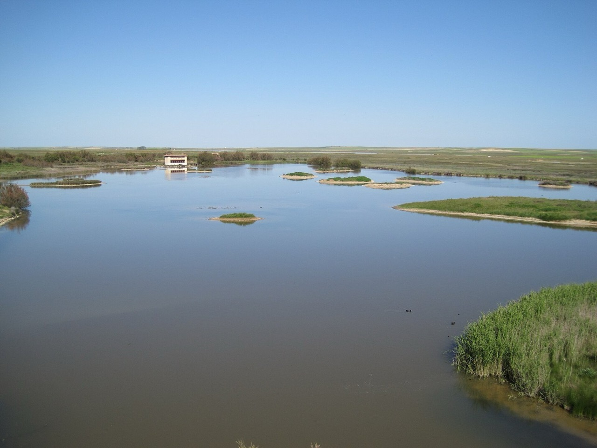
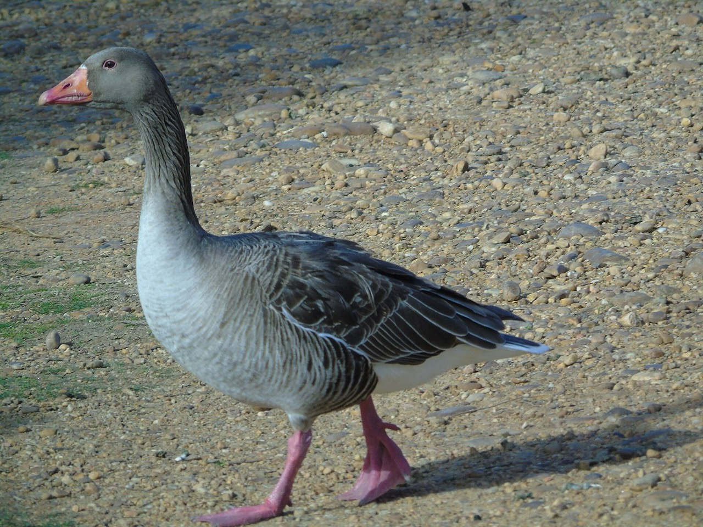
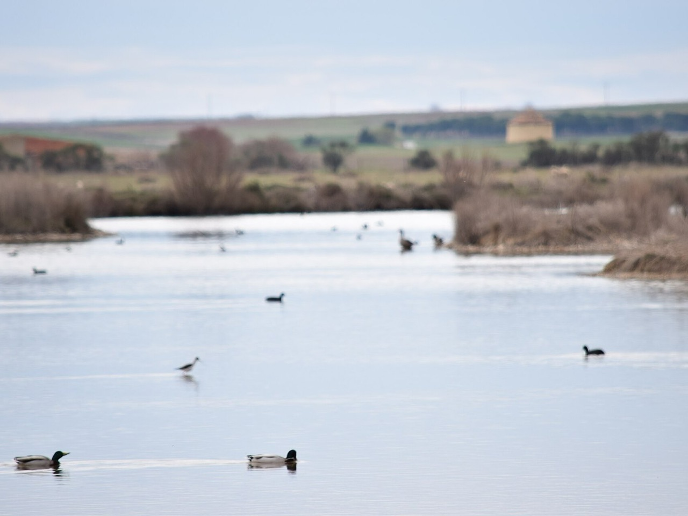
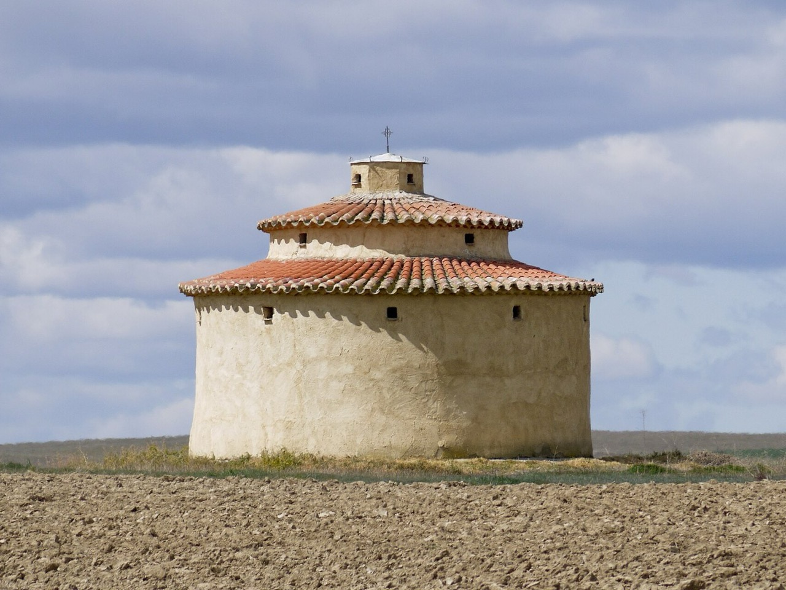
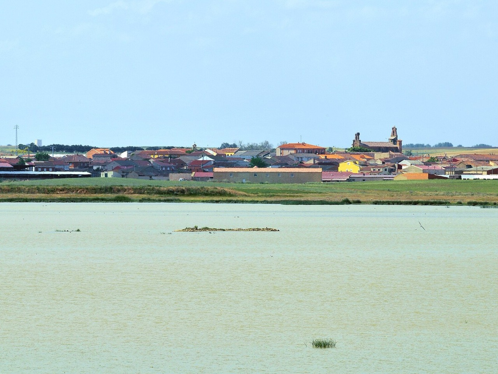

En plena llanura de **Tierra de Campos**, en Zamora, hay unas **lagunas saladas** que en invierno se llenan de vida: miles de **gansos** llegan a pasar aquí los meses fríos, y en los campos de alrededor vive la **población de avutardas más importante del mundo**. Son las **Lagunas de Villafáfila**, uno de los mejores sitios de España para ver aves sin ser experto.

Te cuento qué ver 👇

En un vistazo<h2>Lo que vas a encontrar</h2>

<b>🦢</b>Miles de gansos

<b>🦃</b>Avutardas

<b>💧</b>Lagunas saladas

<b>🏠</b>Casa del Parque

<b>🔭</b>Observatorios

Antes de ir<h2>Lo básico de Villafáfila</h2>

<h3>📍 Dónde está</h3>
En el norte de <strong>Zamora</strong>, a unos 45 minutos de la capital y media hora de Benavente.

<h3>📅 Cuándo ir</h3>
De <strong>noviembre a febrero</strong> para los gansos; en primavera, para las avutardas.

<h3>🆓 Precio</h3>
Ver las lagunas es <strong>gratis</strong>. La Casa del Parque abre solo algunos días: confírmalo.

Qué ver<h2>Qué ver en las Lagunas de Villafáfila</h2>

<ol class="guide__grid guide__grid--cuenca">
<li class="gcard reveal">
01

<h3>Las lagunas</h3>
Lagunas de agua <strong>salada</strong>, poco profundas, que cambian mucho según lo que haya llovido. La mayor es la Laguna Grande.

</li>
<li class="gcard reveal">
02

<h3>Los gansos</h3>
Llegan del norte de Europa a pasar el invierno. Al amanecer y al atardecer, sus <strong>vuelos en bandada</strong> son un espectáculo.

</li>
<li class="gcard reveal">
03

<h3>Las aves acuáticas</h3>
Patos, fochas, cigüeñuelas... Desde los <strong>observatorios</strong> se ven muy de cerca. Lleva prismáticos.

</li>
<li class="gcard reveal">
04

<h3>Los palomares</h3>
Palomares de <strong>adobe</strong> redondos repartidos por el campo. La Casa del Parque se llama El Palomar por uno de ellos.

</li>
<li class="gcard reveal">
05

<h3>Villafáfila</h3>
El pueblo, al borde de las lagunas. En los campos de alrededor busca las <strong>avutardas</strong>: grandes, pardas y muy desconfiadas.

</li>
</ol>

<h3>🧂 Lagunas de sal</h3>
El agua de estas lagunas es salada porque el suelo tiene mucha sal. Durante siglos se sacó <strong>sal</strong> de aquí. Por eso tienen una flora y una fauna tan especiales.

Cómo llegar<h2>Cómo llegar a Villafáfila</h2>

En coche, a unos <strong>45 minutos de Zamora</strong> y media hora de <strong>Benavente</strong>. La Casa del Parque El Palomar está en la carretera de Villalpando, a la salida del pueblo, y tiene aparcamiento.

<a class="btn guide__mapbtn" href="https://www.google.com/maps/dir/?api=1&destination=41.838,-5.608" target="_blank" rel="noopener"><svg class="ico" viewBox="0 0 24 24" width="15" height="15" aria-hidden="true" fill="currentColor"><path d="M12 2a7 7 0 0 0-7 7c0 5.25 7 13 7 13s7-7.75 7-13a7 7 0 0 0-7-7zm0 9.5a2.5 2.5 0 1 1 0-5 2.5 2.5 0 0 1 0 5z"/></svg> Cómo llegar en Google Maps</a>

Aprovecha el viaje para ver <a href="/blog/zamora-que-ver.html">Zamora</a>, <a href="/blog/toro-que-ver.html">Toro</a> o, más al norte, <a href="/blog/puebla-de-sanabria.html">Puebla de Sanabria</a>.

Consejos de Cheno<h2>Para disfrutarlo al máximo</h2><ul><li><b>Ve al amanecer o al atardecer</b> es cuando más se mueven las aves.</li><li><b>Lleva prismáticos</b> y ropa de abrigo: la llanura es fría y con viento.</li><li><b>No te acerques a las aves</b> quédate en caminos y observatorios.</li></ul>

<!--actividades-->

<!--faq-->

<h2>¿Te gustan estos planes?</h2>
Sígueme en Instagram como <a href="https://www.instagram.com/chenoaventuras/" target="_blank" rel="noopener">@chenoaventuras</a>: subo escapadas como esta cada semana.
<a class="btn guide__btn" href="/blog.html">Ver más planes en el blog</a>

Información consultada en noviembre de 2026 (Turismo de Castilla y León y Junta de Castilla y León). Los horarios y precios cambian: confírmalos antes de ir. Fotos de Wikimedia Commons: <a href="https://commons.wikimedia.org/wiki/File:Lagunas_de_Villaf%C3%A1fila,_detalle_laguna.jpg" target="_blank" rel="noopener">Rodelar</a> (CC BY-SA 3.0), <a href="https://commons.wikimedia.org/wiki/File:Lagunas_de_Villaf%C3%A1fila,_Casa_del_Parque.jpg" target="_blank" rel="noopener">Rodelar</a> (CC BY-SA 3.0), <a href="https://commons.wikimedia.org/wiki/File:Anser_anser.001_-_Villafafila.jpg" target="_blank" rel="noopener">Fernando Losada Rodríguez</a> (CC BY-SA 4.0), <a href="https://commons.wikimedia.org/wiki/File:Villafafila_Palomar.jpg" target="_blank" rel="noopener">Xauxa (Håkan Svensson)</a> (CC BY-SA 3.0), <a href="https://commons.wikimedia.org/wiki/File:Lagunas_de_Villaf%C3%A1fila_5.jpg" target="_blank" rel="noopener">LBM1948</a> (CC BY-SA 4.0), <a href="https://commons.wikimedia.org/wiki/File:Visita_a_las_Lagunas_de_Villaf%C3%A1fila_(32834759044).jpg" target="_blank" rel="noopener">Hispania Nostra from Madrid, España</a> (CC BY 2.0).

