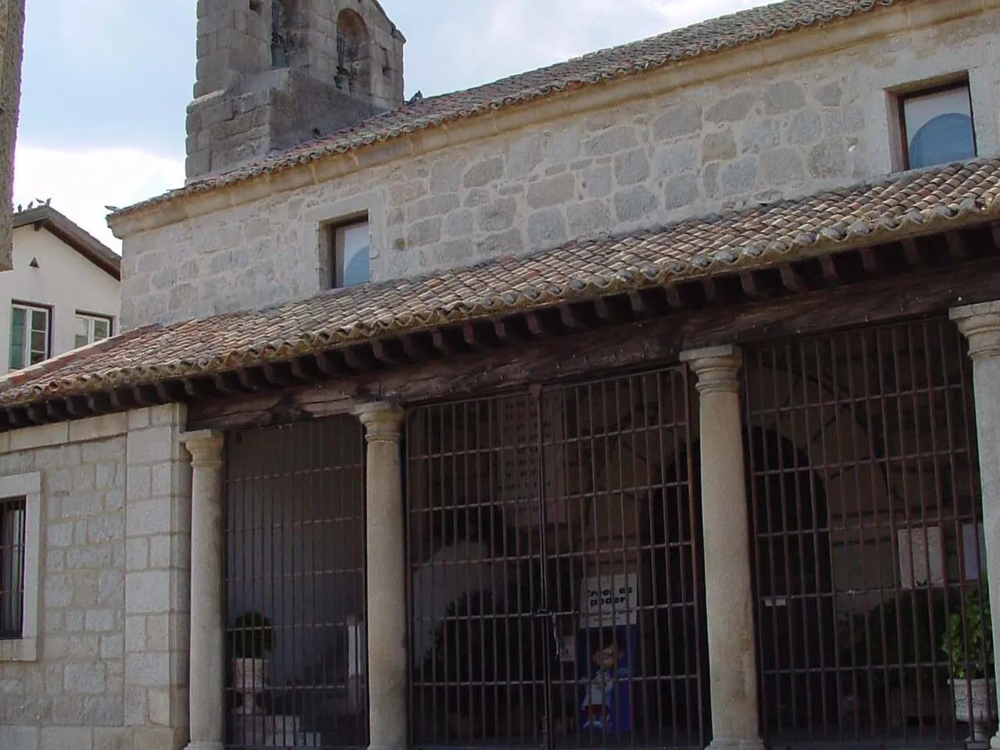
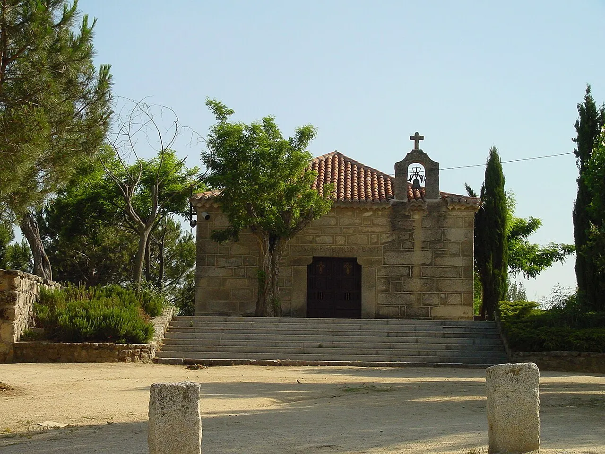
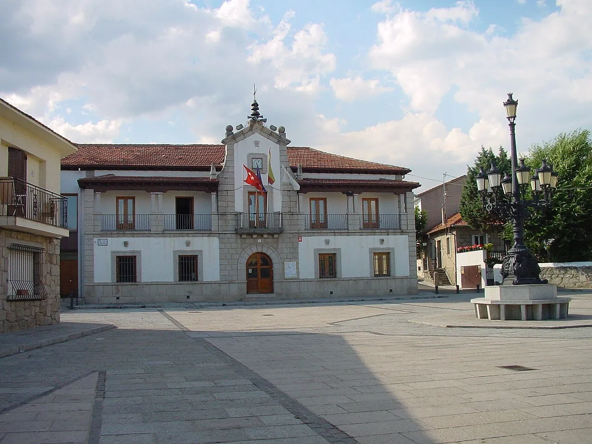
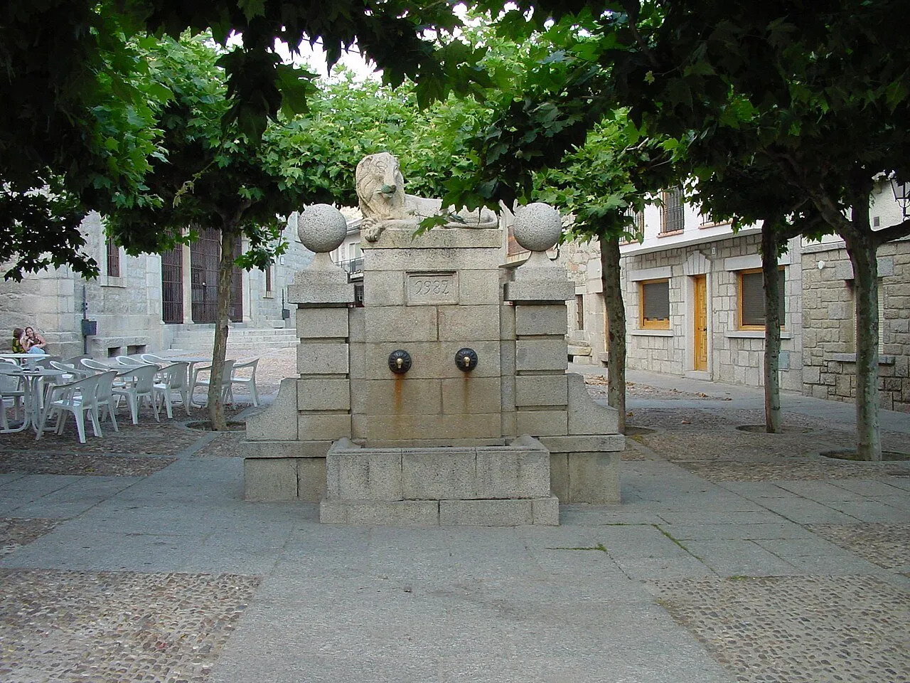
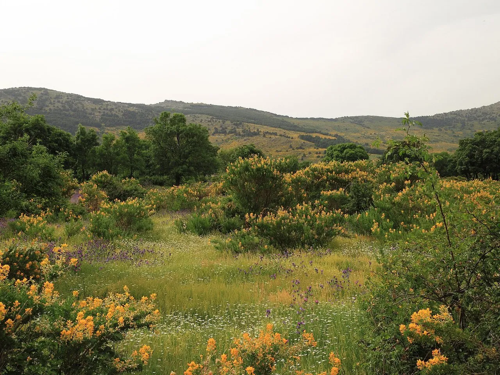

Calles sinuosas de granito, villas de veraneo con jardín, los restos de los viejos molinos junto al río y la sierra de fondo. **Los Molinos**, en la **Sierra de Guadarrama**, es uno de esos pueblos serranos a una hora de Madrid que conservan su aire de siempre, y este año compite por ser el **pueblo de la Navidad de Ferrero Rocher**.

Te cuento qué ver y qué hacer 👇

En un vistazo<h2>Lo que vas a encontrar</h2>

<b>⛰️</b>Sierra de Guadarrama

<b>⛪</b>Iglesia y ermita

<b>🏡</b>Villas de veraneo

<b>✨</b>Cielos de estrellas

<b>🎄</b>Candidato Ferrero 2026

Antes de ir<h2>Lo básico de Los Molinos</h2>

<h3>📍 Dónde está</h3>
En la <strong>Sierra de Guadarrama</strong>, junto al río Guadarrama, cerca del límite con Segovia.

<h3>⏱️ Tiempo</h3>
<strong>Medio día</strong> para el pueblo; un día con una ruta por la sierra.

<h3>🚆 En tren</h3>
Estación de <strong>Los Molinos-Guadarrama</strong>: fue el tren, en el siglo XIX, lo que lo convirtió en pueblo de veraneo.

<h3>✨ De noche</h3>
<a href="https://www.civitatis.com/es/los-molinos/observacion-estrellas-collado-mediano/?aid=110968" target="_blank" rel="noopener sponsored">Observación de estrellas</a> en la sierra, muy cerca.

Qué ver<h2>Qué ver en Los Molinos</h2>

<ol class="guide__grid guide__grid--cuenca">
<li class="gcard reveal">
01

<h3>La iglesia de la Purísima Concepción</h3>
De planta de cruz latina, con un pórtico de columnas toscanas y reja de forja de <strong>1768</strong>. Dentro guarda un <strong>retablo barroco</strong> del siglo XVIII.

</li>
<li class="gcard reveal">
02

<h3>La ermita de San José</h3>
Una sola nave con inscripciones de <strong>1737</strong> en sus dinteles y, al lado, un calvario de cruces de piedra.

</li>
<li class="gcard reveal">
03

<h3>La plaza y la Casa Consistorial</h3>
El centro del pueblo, rodeado de calles sinuosas que siguen el trazado de su origen ganadero, y la <strong>Casa-Museo Julio Escobar</strong> a un paso.

</li>
<li class="gcard reveal">
04

<h3>La Fuente del León</h3>
Una de las fuentes más fotografiadas del pueblo, en una plaza con árboles y terrazas.

</li>
<li class="gcard reveal">
05

<h3>Los molinos y la sierra</h3>
Por el río Guadarrama quedan restos de los molinos que dan nombre al pueblo, como el de la Cruz o el de los Tres Puentes, y paseos por los campos de la sierra.

</li>
</ol>

<!--actividades-->

Historia<h2>De los molinos al veraneo</h2>

Los Molinos nació en el <strong>siglo XIII</strong>, con la repoblación de la sierra, dentro de la Comunidad de Ciudad y Tierra de Segovia. Sus molinos harineros junto al río atrajeron a los primeros vecinos y en el <strong>siglo XVII</strong> se convirtió en villa. A finales del XIX llegó el tren y, con él, las familias de Madrid que construyeron sus <strong>villas de veraneo</strong> cerca de la estación.

<h3>🎄 Candidato a pueblo Ferrero Rocher</h3>
Los Molinos representa a la <strong>Comunidad de Madrid</strong> en el concurso de la Navidad de Ferrero Rocher 2026. Mira cómo va y cómo votar en <a href="/blog/pueblo-navidad-ferrero-rocher-2026.html">el pueblo de la Navidad de Ferrero Rocher</a>.

Consejos de Cheno<h2>Para disfrutarlo al máximo</h2><ul><li><b>Ve en tren</b> y olvídate de aparcar.</li><li><b>Lleva abrigo</b>: en invierno hace frío de sierra.</li><li><b>Si nieva</b>, prueba las <a href="https://www.civitatis.com/es/navacerrada/paseo-raquetas-nieve-sierra-guadarrama/?aid=110968" target="_blank" rel="noopener sponsored">raquetas de nieve</a> en Navacerrada.</li><li><b>Combínalo con</b> <a href="/blog/monasterio-de-el-escorial.html">El Escorial</a> o <a href="/blog/madrid-que-ver.html">Madrid</a>.</li></ul>

<!--faq-->

<h2>¿Te gustan estos planes?</h2>
Sígueme en Instagram como <a href="https://www.instagram.com/chenoaventuras/" target="_blank" rel="noopener">@chenoaventuras</a>: subo escapadas como esta cada semana.
<a class="btn guide__btn" href="/blog.html">Ver más planes en el blog</a>

Información consultada en noviembre de 2026 en el inventario de patrimonio del Parque Nacional de la Sierra de Guadarrama. Fotos de Wikimedia Commons: <a href="https://commons.wikimedia.org/wiki/File:Paisaje_de_los_campos_de_los_alrededores_de_Los_Molinos_-_Madrid_2.jpg" target="_blank" rel="noopener">Javier Perez Montes</a> (CC BY-SA 4.0) · <a href="https://commons.wikimedia.org/wiki/File:Ayuntamiento_de_Los_Molinos,_Madrid.jpg" target="_blank" rel="noopener">D. G. de Turismo de la Comunidad de Madrid</a> (CC BY 3.0 es) · <a href="https://commons.wikimedia.org/wiki/File:Parroquia_de_la_Pur%C3%ADsima_Concepci%C3%B3n_en_Los_Molinos.jpg" target="_blank" rel="noopener">D. G. de Turismo de la Comunidad de Madrid</a> (CC BY 3.0 es) · <a href="https://commons.wikimedia.org/wiki/File:Capilla_de_San_Jos%C3%A9_en_Los_Molinos.jpg" target="_blank" rel="noopener">D. G. de Turismo de la Comunidad de Madrid</a> (CC BY 3.0 es) · <a href="https://commons.wikimedia.org/wiki/File:Fuente_del_Le%C3%B3n_en_Los_Molinos.jpg" target="_blank" rel="noopener">D. G. de Turismo de la Comunidad de Madrid</a> (CC BY 3.0 es) · <a href="https://commons.wikimedia.org/wiki/File:Paisaje_de_los_campos_de_los_alrededores_de_Los_Molinos_-_Madrid_1.jpg" target="_blank" rel="noopener">Javier Perez Montes</a> (CC BY-SA 4.0).

