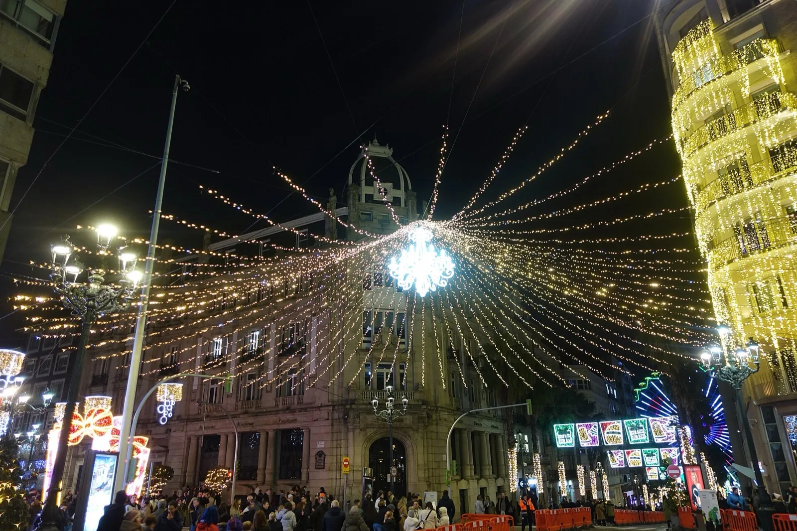
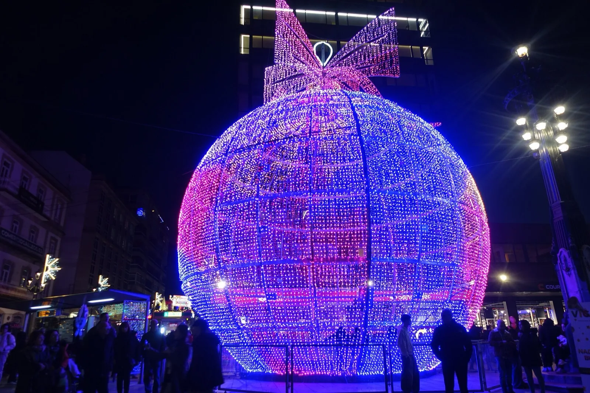
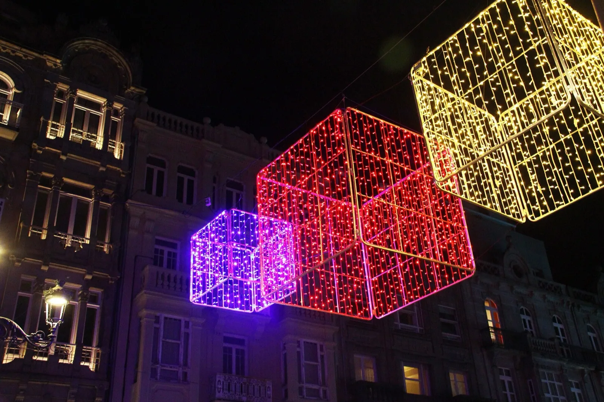
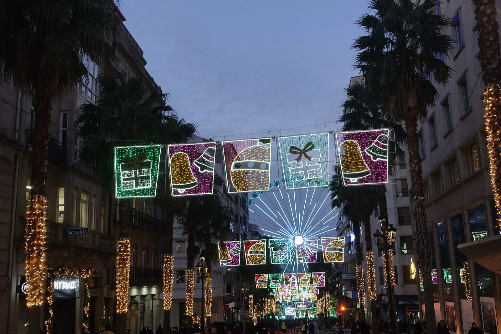
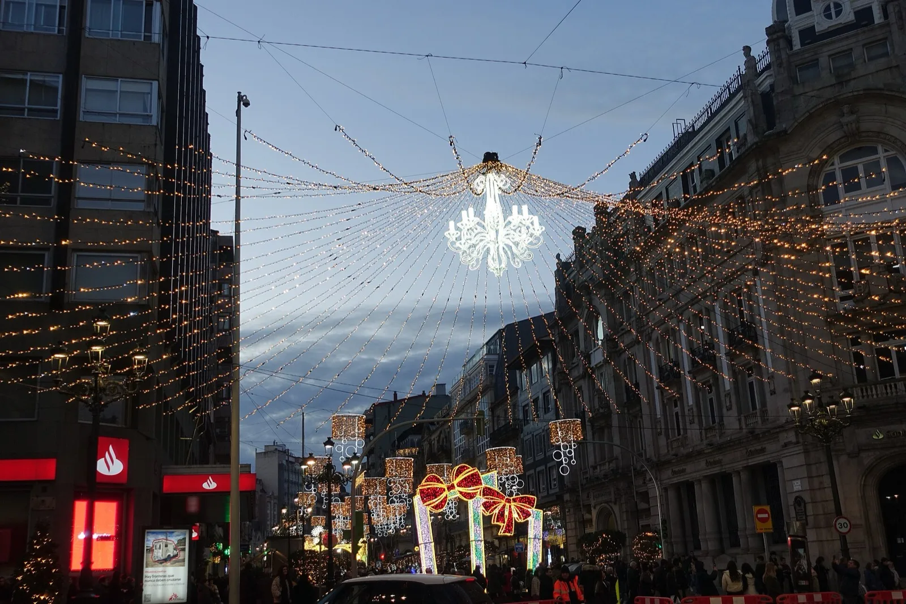
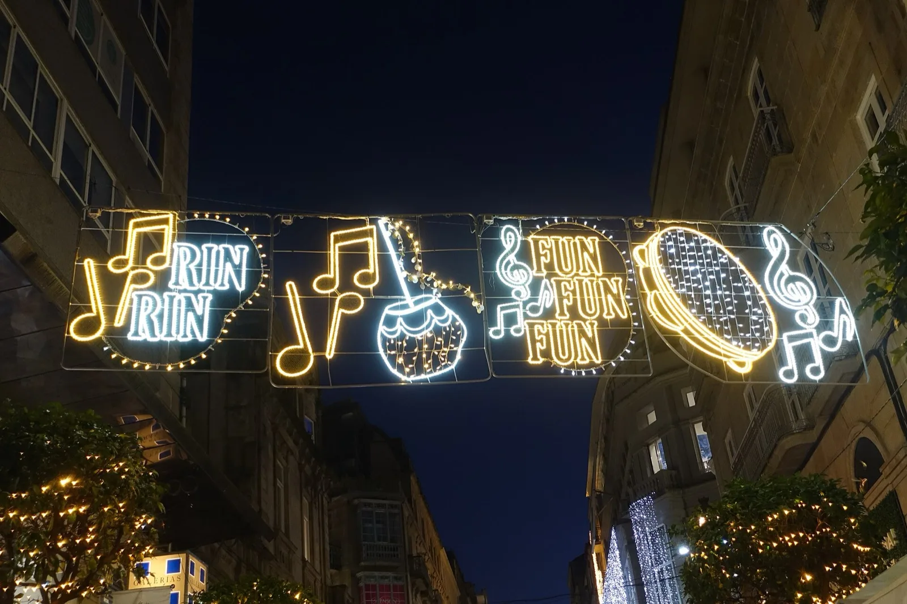

**Doce millones de luces LED**, un árbol que cada año intenta ser el más alto de España y una ciudad entera que sale a la calle para verlo encender. La **Navidad de Vigo** es ya una escapada en sí misma, y este año empieza antes que casi ninguna.

Te cuento la fecha del encendido, los horarios, qué ver y cómo organizarte 👇

En un vistazo<h2>Lo que vas a encontrar</h2>

<b>💡</b>Encendido 14 nov

<b>🎄</b>Árbol gigante

<b>🎡</b>Noria en Vialia

<b>🛍️</b>Cíes Market

<b>⛸️</b>Pista de hielo

<b>🚌</b>Mejor en bus

Antes de ir<h2>Lo básico de la Navidad de Vigo</h2>

<h3>📅 Cuándo</h3>
Desde el <strong>sábado 14 de noviembre de 2026</strong> hasta mediados de enero. El encendido es a las <strong>20:00 en Porta do Sol</strong>.

<h3>💶 Precio</h3>
Pasear las luces es <strong>gratis</strong>. Se pagan la noria, la pista de hielo, los trenes y el bus navideño.

<h3>🕕 Horario</h3>
Se encienden cada día a partir de las <strong>18:00</strong>. Las noches de Nochebuena, Navidad, Nochevieja y Reyes, hasta el amanecer.

<h3>💡 Mi consejo</h3>
Ve <strong>entre semana</strong>. Los sábados de diciembre el centro está lleno y aparcar es casi imposible.

Qué ver<h2>Los imprescindibles de la Navidad de Vigo</h2>

<ol class="guide__grid guide__grid--cuenca">
<li class="gcard reveal">
01

<h3>El árbol de Porta do Sol</h3>
GratisEncendido 14 nov, 20:00

Es el centro de todo: aquí se hace el <strong>encendido</strong> y aquí se junta más gente. Su altura se guarda en secreto hasta el día del estreno; en 2025 rondaba los <strong>45 metros</strong>. Desde Porta do Sol baja la calle del Príncipe, la más iluminada.

</li>
<li class="gcard reveal">
02

<h3>La bola gigante</h3>
GratisUrzáiz con Príncipe

Una de las fotos clásicas de la Navidad de Vigo. Está en La Farola, el cruce de <strong>Urzáiz con Príncipe</strong>, y este año tiene un <strong>Papá Noel trepando</strong> por ella.

</li>
<li class="gcard reveal">
03

<h3>La caja de regalo de Gran Vía</h3>
GratisGran Vía con Urzáiz

Al final de <strong>Gran Vía</strong>, en el cruce con Urzáiz, hay una caja de regalo gigante con luces que se mueven. En la foto, otros regalos de luz de una Navidad anterior.

</li>
<li class="gcard reveal">
04

<h3>La noria, ahora en Vialia</h3>
De pagoAparcamiento de Vialia

La gran noria cambia de sitio en 2026: pasa al <strong>aparcamiento exterior de Vialia</strong>, el centro comercial de la estación de tren, donde también hay un <strong>muñeco de nieve gigante</strong> y un tiovivo. El precio de este año aún no se ha publicado.

</li>
<li class="gcard reveal">
05

<h3>Las calles iluminadas</h3>
GratisUnas 500 calles

Cerca de <strong>500 calles</strong> y más de <strong>7.000 motivos</strong>. La ruta de siempre: Porta do Sol, Príncipe, Urzáiz, Gran Vía, Policarpo Sanz (con adornos en 3D este año) y García Barbón.

</li>
<li class="gcard reveal">
06

<h3>Cíes Market y mercadillos</h3>
Entrada libre14 nov – 10 ene

El mercadillo navideño grande, el <strong>Cíes Market</strong>, deja la Alameda y se monta en la <strong>plaza de Vialia</strong>. También hay mercadillos en <strong>O Calvario</strong> y en la Alameda de Bouzas.

</li>
</ol>

Con niños<h2>Pistas de hielo, trenes y más</h2>

<ul class="checklist" style="margin:0 0 1rem;"><li><strong>Pista de hielo y karting:</strong> en <strong>Samil</strong>, junto a la playa. Precios y fechas de 2026 por confirmar.</li><li><strong>Trenes navideños:</strong> tres trenes turísticos, dos por el centro y uno por la zona de Traviesas, además del <strong>Nadal Bus</strong>, un autobús de dos pisos que recorre las luces en unos 40 minutos.</li><li><strong>Atracciones en el centro y en Vialia:</strong> el tren de Papá Noel, tiovivos y castillos hinchables.</li><li><strong>Circo de Navidad:</strong> en Coia.</li><li><strong>Belén Monumental:</strong> exposición en la Casa das Artes.</li></ul>

Cómo llegar<h2>Cómo llegar y dónde aparcar</h2>

<strong>En tren:</strong> la estación de Vigo-Urzáiz está dentro de Vialia, justo donde este año van la noria y el Cíes Market. Desde allí, el centro iluminado queda a unos 10-15 minutos andando.

<strong>En coche:</strong> cerca de Porta do Sol es casi imposible aparcar en hora punta. El Concello recomienda dejar el coche en <strong>Samil o en Vialia</strong> y moverte en los autobuses de <strong>Vitrasa</strong>, que se refuerzan en Navidad.

<strong>Con guía:</strong> si quieres que te lo cuenten, hay un <a href="https://www.civitatis.com/es/vigo/free-tour-navidad-vigo/?aid=110968" target="_blank" rel="noopener sponsored">free tour de las luces de Navidad de Vigo</a> y, si te alojas en Pontevedra o Santiago, un <a href="https://www.civitatis.com/es/pontevedra/tour-pontevedra-luces-navidad-vigo/?aid=110968" target="_blank" rel="noopener sponsored">tour por Pontevedra que termina viendo las luces de Vigo</a>.

<a class="btn guide__mapbtn" href="https://www.google.com/maps/dir/?api=1&destination=Porta+do+Sol%2C+Vigo" target="_blank" rel="noopener"><svg class="ico" viewBox="0 0 24 24" width="15" height="15" aria-hidden="true" fill="currentColor"><path d="M12 2a7 7 0 0 0-7 7c0 5.25 7 13 7 13s7-7.75 7-13a7 7 0 0 0-7-7zm0 9.5a2.5 2.5 0 1 1 0-5 2.5 2.5 0 0 1 0 5z"/></svg> Cómo llegar a Porta do Sol</a>

Consejos de Cheno<h2>Una tarde de luces en Vigo</h2><ul><li><b>17:00</b>: llega en tren o deja el coche en Vialia y date una vuelta por el Cíes Market.</li><li><b>18:00</b>: se encienden las luces; sube la noria para verlas desde arriba.</li><li><b>Después</b>: baja por Urzáiz hasta la bola gigante y la calle del Príncipe.</li><li><b>Para terminar</b>: el árbol de Porta do Sol y, si te queda hambre, unas ostras en la calle de las Ostras, en el casco viejo.</li><li><b>Y al día siguiente</b>: aprovecha para ver el resto de la ciudad con mi guía de <a href="/blog/vigo-que-ver.html">qué ver en Vigo</a>.</li></ul>

<!--faq-->

<h2>¿Te gustan estos planes?</h2>
Sígueme en Instagram como <a href="https://www.instagram.com/chenoaventuras/" target="_blank" rel="noopener">@chenoaventuras</a>: subo escapadas como esta cada semana.
<a class="btn guide__btn" href="/blog.html">Ver más planes en el blog</a>

Información consultada el 9 de noviembre de 2026 en la prensa local (Atlántico Diario) y en la agenda de OcioVigo, a partir de lo anunciado por el Concello de Vigo. Algunos horarios y precios de 2026 están por confirmar: revísalos antes de ir. Fotos de Wikimedia Commons de otras Navidades: <a href="https://commons.wikimedia.org/wiki/File:2024_Christmas_in_Vigo_(12).jpg" target="_blank" rel="noopener">Joseolgon</a> (CC BY 4.0) · <a href="https://commons.wikimedia.org/wiki/File:2024_Christmas_in_Vigo_(11).jpg" target="_blank" rel="noopener">Joseolgon</a> (CC BY 4.0) · <a href="https://commons.wikimedia.org/wiki/File:2024_Christmas_in_Vigo_(10).jpg" target="_blank" rel="noopener">Joseolgon</a> (CC BY 4.0) · <a href="https://commons.wikimedia.org/wiki/File:2024_Christmas_in_Vigo_(5).jpg" target="_blank" rel="noopener">Joseolgon</a> (CC BY 4.0) · <a href="https://commons.wikimedia.org/wiki/File:2024_Christmas_in_Vigo_(4).jpg" target="_blank" rel="noopener">Joseolgon</a> (CC BY 4.0) · <a href="https://commons.wikimedia.org/wiki/File:Vigo-_Luces_de_Navidad_2017.jpg" target="_blank" rel="noopener">Contando Estrelas</a> (CC BY-SA 2.0)

