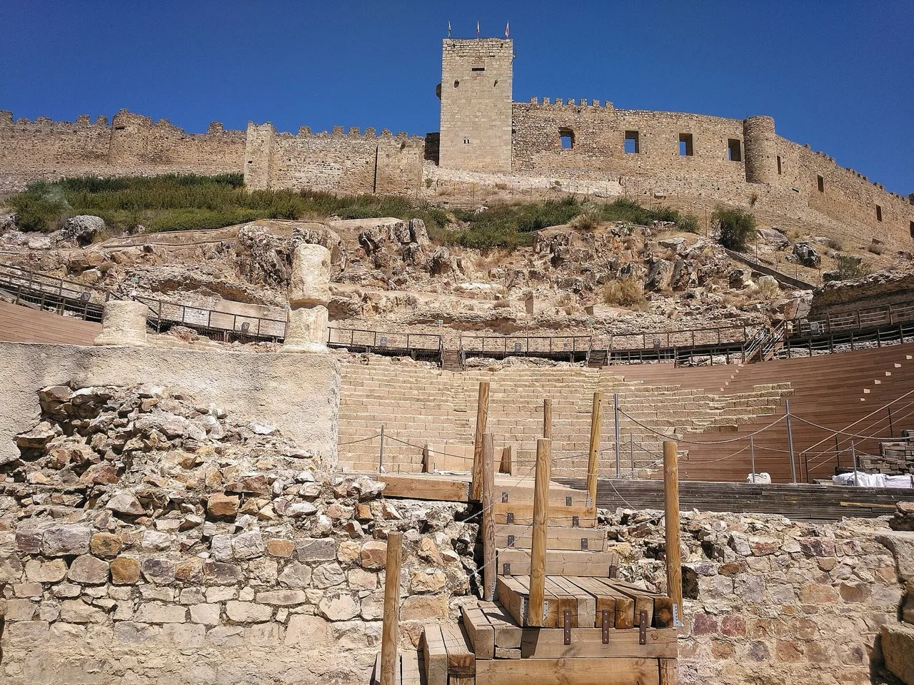
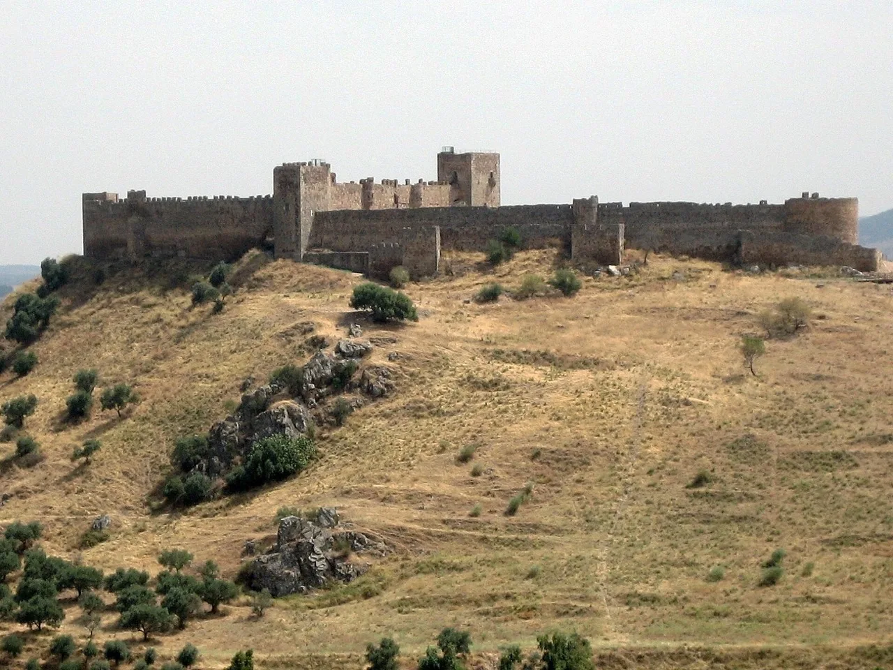
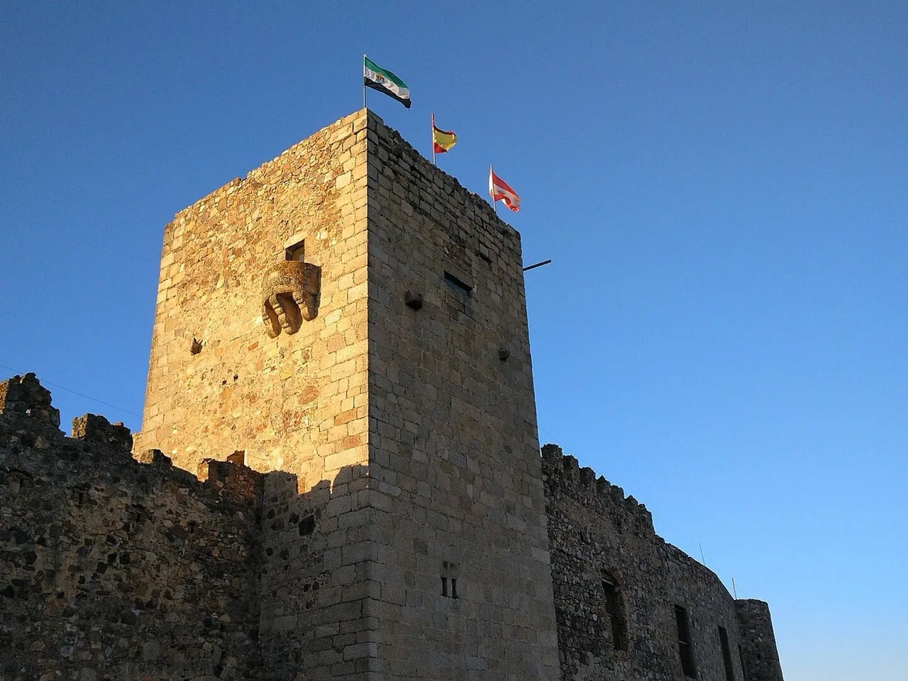
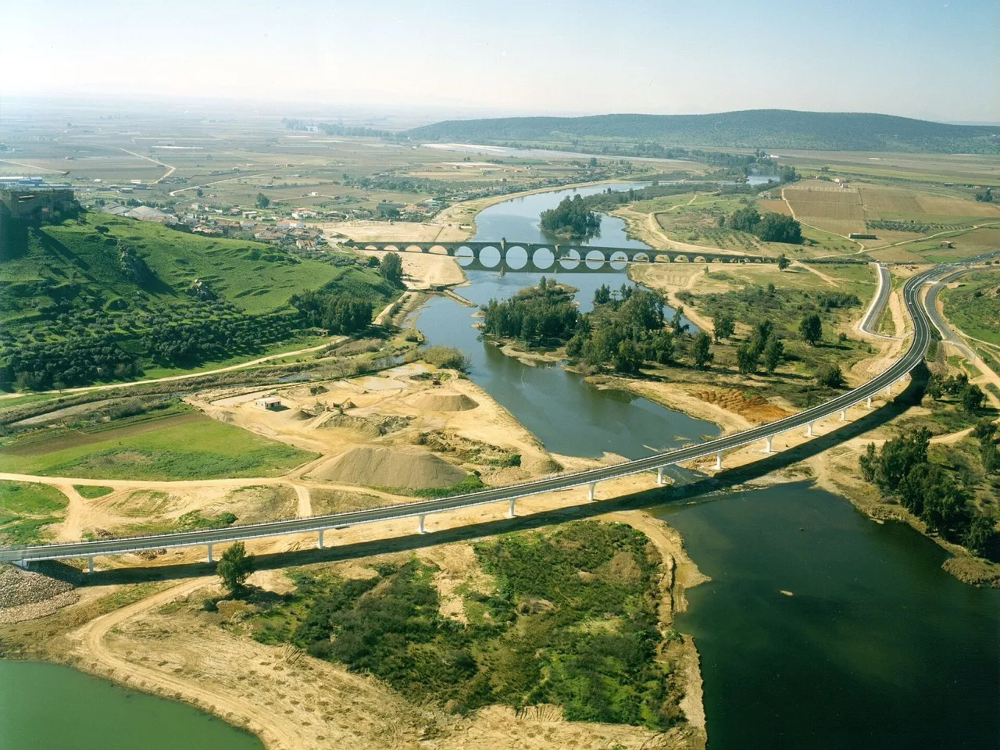
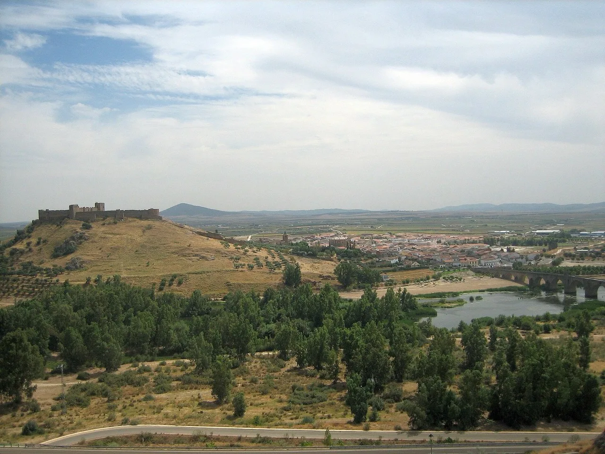

Pocos pueblos tienen algo así: un **teatro romano** excavado en la ladera de un cerro y, justo encima, un **castillo medieval** vigilando la vega del **Guadiana**. Es **Medellín**, en Badajoz, un pueblo pequeño con más de dos mil años de historia. El teatro estuvo escondido bajo tierra hasta hace muy poco.

Te cuento qué ver 👇

En un vistazo<h2>Lo que vas a encontrar</h2>

<b>🏛️</b>Teatro romano

<b>🏰</b>Castillo

<b>🌉</b>Puente sobre el Guadiana

<b>🗿</b>Hernán Cortés

<b>🌅</b>Vistas a la vega

Antes de ir<h2>Lo básico de Medellín</h2>

<h3>📍 Dónde está</h3>
En la <strong>vega del Guadiana</strong>, a unos 40 km de Mérida y junto a Don Benito.

<h3>⏱️ Tiempo</h3>
Unas <strong>dos o tres horas</strong> para el teatro, el castillo y el puente.

<h3>🎟️ Visita</h3>
Entrada de <strong>pocos euros</strong>. Cierra los lunes. Confirma el horario antes de ir.

Qué ver<h2>Qué ver en Medellín</h2>

<ol class="guide__grid guide__grid--cuenca">
<li class="gcard reveal">
01

<h3>El teatro romano</h3>
Construido a finales del <strong>siglo I a. C.</strong> en la ladera del cerro. Se excavó entre 2007 y 2011 y ganó el premio <strong>Europa Nostra</strong>.

</li>
<li class="gcard reveal">
02

<h3>El castillo</h3>
Una fortaleza medieval con largas murallas sobre el cerro. Desde arriba se ve toda la <strong>vega del Guadiana</strong>.

</li>
<li class="gcard reveal">
03

<h3>La torre del homenaje</h3>
La torre más alta del castillo. Sube la cuesta con calma: la recompensa son <strong>las vistas</strong>.

</li>
<li class="gcard reveal">
04

<h3>El puente sobre el Guadiana</h3>
Un puente de piedra del <strong>siglo XVII</strong>, de la época de Felipe IV, con una lápida que lo recuerda.

</li>
<li class="gcard reveal">
05

<h3>El pueblo y la vega</h3>
Casas blancas a los pies del cerro y el río al lado. En la plaza está la <strong>estatua de Hernán Cortés</strong>, que nació aquí.

</li>
</ol>

Cómo llegar<h2>Cómo llegar a Medellín</h2>

En coche, a unos <strong>40 minutos de Mérida</strong> y unos 10 de Don Benito. Desde Badajoz, alrededor de una hora y cuarto por la A-5 y la EX-206. Se aparca en el pueblo.

<a class="btn guide__mapbtn" href="https://www.google.com/maps/dir/?api=1&destination=38.9667,-5.9578" target="_blank" rel="noopener"><svg class="ico" viewBox="0 0 24 24" width="15" height="15" aria-hidden="true" fill="currentColor"><path d="M12 2a7 7 0 0 0-7 7c0 5.25 7 13 7 13s7-7.75 7-13a7 7 0 0 0-7-7zm0 9.5a2.5 2.5 0 1 1 0-5 2.5 2.5 0 0 1 0 5z"/></svg> Cómo llegar en Google Maps</a>

Combínalo con <a href="/blog/merida-que-ver.html">Mérida</a>, <a href="/blog/badajoz-que-ver.html">Badajoz</a> o <a href="/blog/zafra-que-ver.html">Zafra</a>.

Consejos de Cheno<h2>Para disfrutarlo al máximo</h2><ul><li><b>Ve en primavera u otoño</b> en verano el calor aprieta y hay poca sombra.</li><li><b>Sube al castillo al atardecer</b> la luz sobre el Guadiana es preciosa.</li><li><b>Pásate por la oficina de turismo</b> en la plaza de Hernán Cortés, para horarios y entradas.</li></ul>

<!--actividades-->

<!--faq-->

<h2>¿Te gustan estos planes?</h2>
Sígueme en Instagram como <a href="https://www.instagram.com/chenoaventuras/" target="_blank" rel="noopener">@chenoaventuras</a>: subo escapadas como esta cada semana.
<a class="btn guide__btn" href="/blog.html">Ver más planes en el blog</a>

Información consultada en noviembre de 2026 (Junta de Extremadura y Turismo de España). Los horarios y precios cambian: confírmalos antes de ir. Fotos de Wikimedia Commons: <a href="https://commons.wikimedia.org/wiki/File:Teatro_romano_y_castillo_de_Medell%C3%ADn.jpg" target="_blank" rel="noopener">Ángel M. Felicísimo</a> (CC BY 4.0), <a href="https://commons.wikimedia.org/wiki/File:Castillo_de_Medellin2.jpg" target="_blank" rel="noopener">Doalex</a> (CC BY-SA 3.0), <a href="https://commons.wikimedia.org/wiki/File:Teatro_Romano_de_Medell%C3%ADn_34.jpg" target="_blank" rel="noopener">Axel Cotón Gutiérrez</a> (CC BY-SA 4.0), <a href="https://commons.wikimedia.org/wiki/File:Puente_de_Medell%C3%ADn..jpg" target="_blank" rel="noopener">Alonsoquijano</a> (Public domain), <a href="https://commons.wikimedia.org/wiki/File:Torre_del_Castillo_de_Medell%C3%ADn.jpg" target="_blank" rel="noopener">Axel Cotón Gutiérrez</a> (CC BY-SA 4.0), <a href="https://commons.wikimedia.org/wiki/File:Castillo_y_Ciudad_de_Medellin.jpg" target="_blank" rel="noopener">Doalex</a> (CC BY-SA 3.0).

