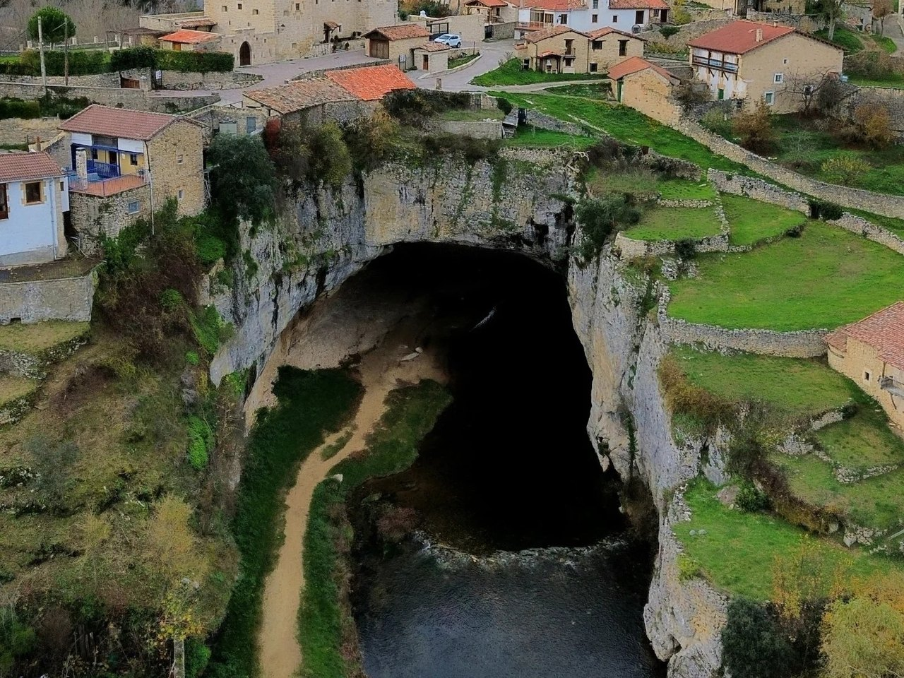
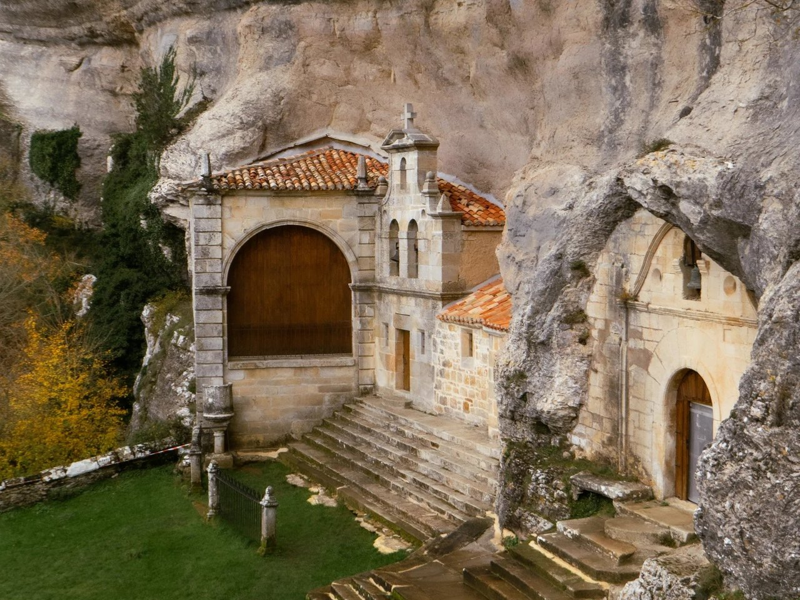
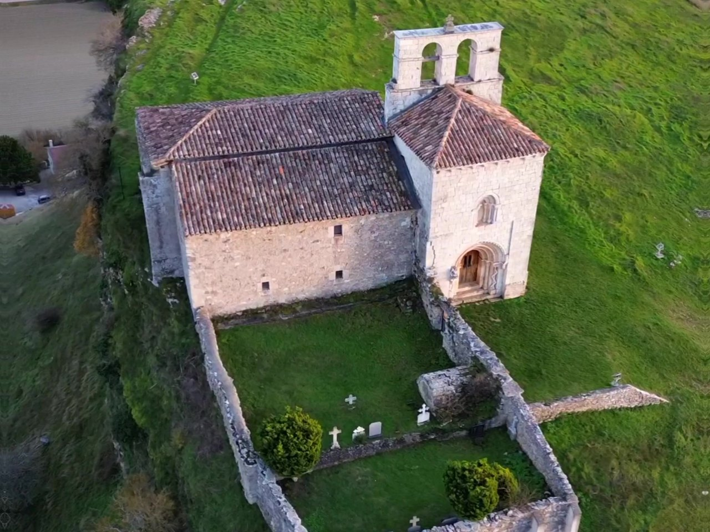
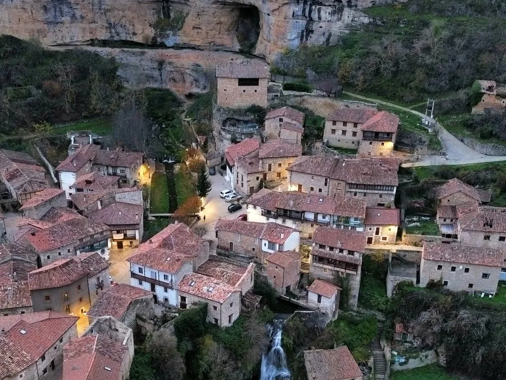
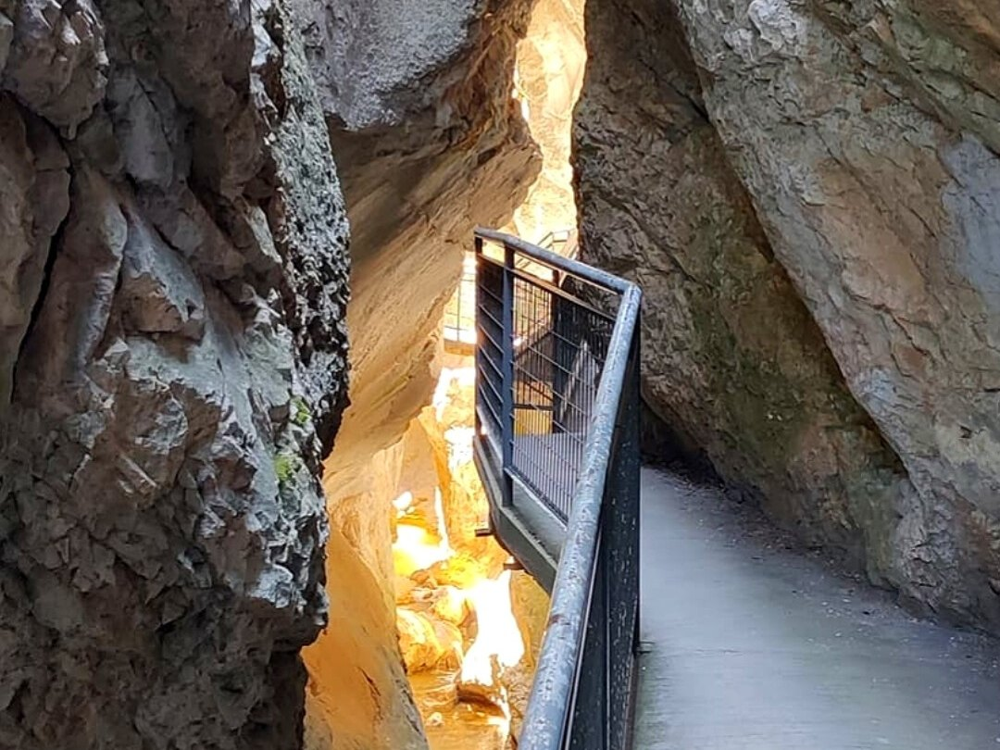
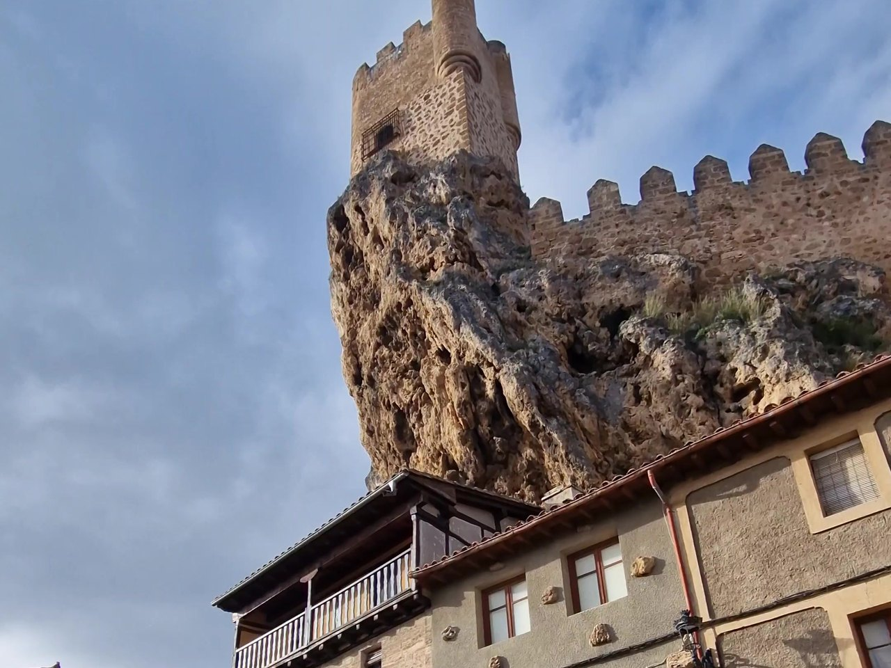
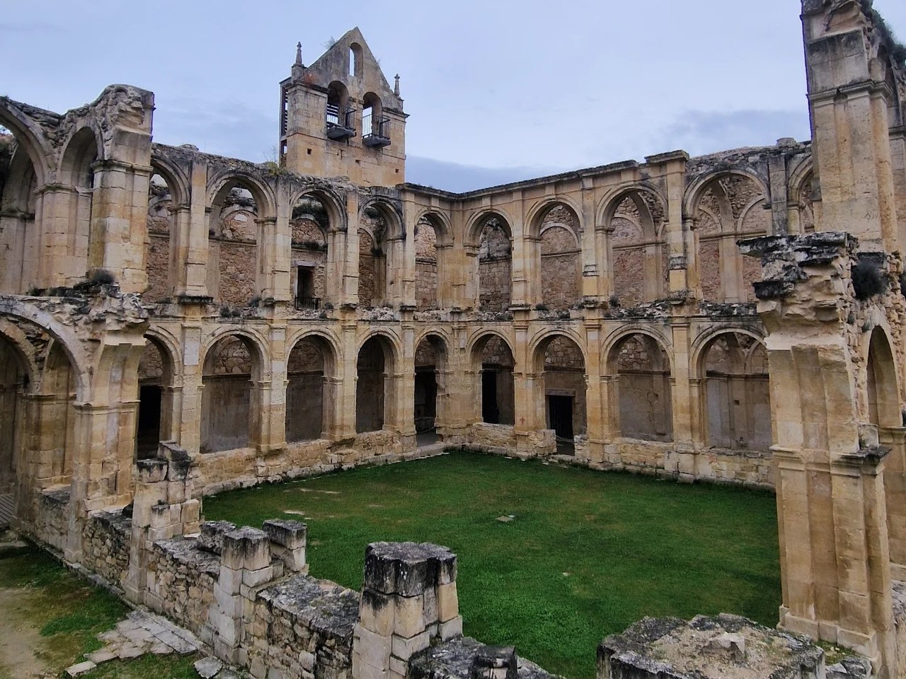
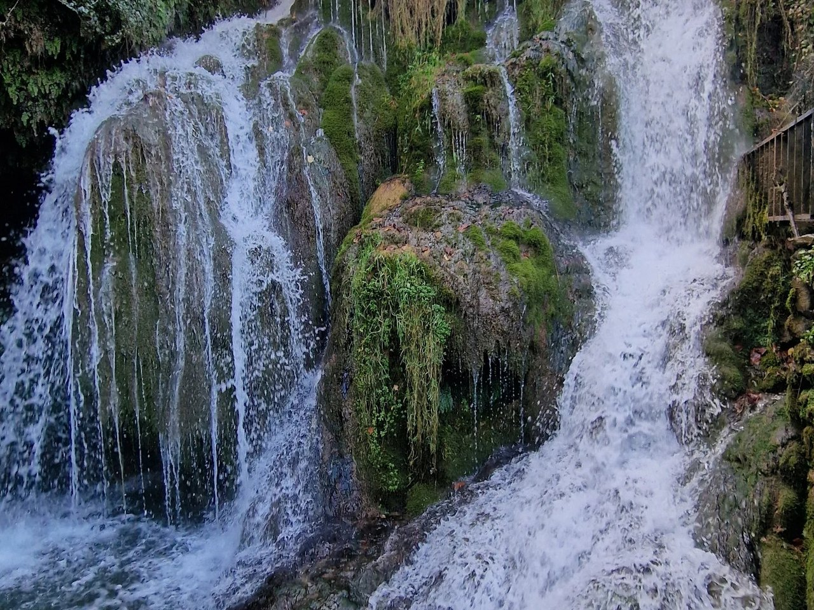

Al norte de la provincia de Burgos hay una comarca donde los pueblos se construyen bajo puentes de roca, las ermitas se excavan dentro de cuevas y hasta la ciudad más pequeña de España guarda su propio castillo. Se llama Las Merindades, y da para una escapada entera sin repetir paisaje ni una sola vez.

En un vistazo<h2>Lo que vas a encontrar</h2>

<b>🌉</b>Puentedey

<b>🏘️</b>Orbaneja del Castillo

<b>🏞️</b>Desfiladero de la Yecla

<b>🏘️</b>Frías

<b>🏰</b>Castillo

Puedes ver el resumen completo de la ruta en [esta publicación de Instagram](https://www.instagram.com/p/DTyTMSajP_5/).

La ruta<h2>Qué ver en Las Merindades</h2>

<ol class="guide__grid guide__grid--cuenca">
<li class="gcard reveal">
01

<h3>Puentedey, el pueblo bajo la roca</h3>
<strong>Puentedey</strong> es, probablemente, el rincón más fotogénico de toda la ruta: un pueblo construido literalmente bajo un enorme puente natural de roca caliza. Verlo por primera vez, con las casas asomando bajo ese arco de piedra, es de esas imágenes que cuesta creer hasta que las tienes delante. Puedes ver más en <a href="https://www.instagram.com/reel/DTFa2jmjCQC/" target="_blank" rel="noopener">este reel</a>.

</li>
<li class="gcard reveal">
02

<h3>Ermita de San Bernabé, dentro de Ojo Guareña</h3>
Excavada en la roca dentro de <strong>Ojo Guareña</strong>, uno de los complejos kársticos más grandes de Europa, la <strong>ermita de San Bernabé</strong> combina naturaleza, historia y un punto justo de misterio que la hace única entre las ermitas de la zona. Puedes ver más en <a href="https://www.instagram.com/reel/DTXbSnhDAFp/" target="_blank" rel="noopener">este reel</a>.

</li>
<li class="gcard reveal">
03

<h3>Ermita de San Pantaleón de Losa</h3>
Una pequeña <strong>ermita románica</strong>, cargada de simbolismo y leyendas locales, con vistas espectaculares al valle desde su ubicación tranquila y apartada. Puedes ver más en <a href="https://www.instagram.com/reel/DS0fMzIDPUK/" target="_blank" rel="noopener">este reel</a>.

</li>
<li class="gcard reveal">
04

<h3>Orbaneja del Castillo, con una cascada que atraviesa el pueblo</h3>
Considerado uno de los pueblos más bonitos de España, <strong>Orbaneja del Castillo</strong> tiene algo que pocos pueblos pueden presumir: una cascada que literalmente atraviesa sus calles de piedra, en un entorno natural que ya es espectacular por sí solo. Puedes ver más en <a href="https://www.instagram.com/reel/DTdpjjYDDI8/" target="_blank" rel="noopener">este reel</a>.

</li>
<li class="gcard reveal">
05

<h3>Desfiladero de la Yecla, pasarelas entre paredes verticales</h3>
El <strong>Desfiladero de la Yecla</strong> es una ruta corta pero muy impactante: pasarelas de madera que avanzan entre paredes de roca verticales, en uno de los desfiladeros más impresionantes de Las Merindades. Puedes ver más en <a href="https://www.instagram.com/reel/DTqhb2MjAsx/" target="_blank" rel="noopener">este reel</a>.

</li>
<li class="gcard reveal">
06

<h3>Frías, la ciudad más pequeña de España</h3>
Con casas colgadas sobre el río Ebro y un castillo medieval que domina el pueblo desde lo alto, <strong>Frías</strong> ostenta el título de ciudad más pequeña de toda España, aunque su tamaño no le resta nada de encanto: pasear por ella es un viaje directo a la Edad Media. Puedes ver más en <a href="https://www.instagram.com/reel/DSlB1tsDFNo/" target="_blank" rel="noopener">este reel</a>.

</li>
<li class="gcard reveal">
07

<h3>Monasterio de Rioseco, ruinas entre naturaleza</h3>
El <strong>Monasterio de Rioseco</strong> es un antiguo monasterio cisterciense que se encuentra en proceso de restauración, con unas ruinas llenas de historia enmarcadas en un entorno natural precioso, alejado del bullicio del resto de la ruta. Puedes ver más en <a href="https://www.instagram.com/reel/DSneBaSDEs-/" target="_blank" rel="noopener">este reel</a>.

</li>
<li class="gcard reveal">
08

<h3>Tobera, el pueblo de las mil cascadas</h3>
Para cerrar la ruta con un plan tranquilo, <strong>Tobera</strong> ofrece un paseo sencillo entre pequeñas cascadas y puentes de piedra, ideal para terminar el día sin prisa después de una jornada intensa recorriendo el resto de Las Merindades. Puedes ver más en <a href="https://www.instagram.com/reel/DSnUqjNjN6c/" target="_blank" rel="noopener">este reel</a>.

</li>
</ol>

## Cómo moverte por Las Merindades

Estos ocho lugares están repartidos por buena parte del norte de la provincia de Burgos, así que la forma más práctica de recorrerlos es en coche propio, organizando la ruta en 1 o 2 días según el ritmo que quieras llevar. Puedes usar [Frías](https://www.google.com/maps/search/?api=1&query=Fr%C3%ADas%2C%20Burgos) o [Villarcayo](https://www.google.com/maps/search/?api=1&query=Villarcayo%2C%20Burgos) como base para moverte con comodidad entre los distintos puntos de la ruta.

Y si sigues por la provincia, no te pierdas [Territorio Artlanza](/blog/territorio-artlanza-burgos.html), un pueblo castellano en miniatura hecho a mano, ni [el nido de cigüeña más famoso de España](/blog/nido-ciguena-mas-famoso-espana.html).

<!--faq-->

¿Con cuál de estos rincones de Las Merindades te quedas? Sígueme en Instagram como [@chenoaventuras](https://www.instagram.com/chenoaventuras/) para descubrir más escapadas por Burgos y el resto de España, y échale un vistazo al resto del blog para seguir planeando tu próxima ruta.
