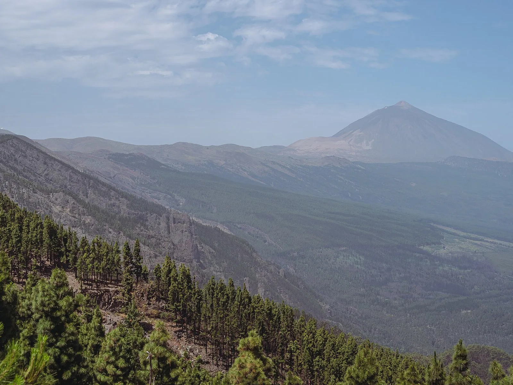
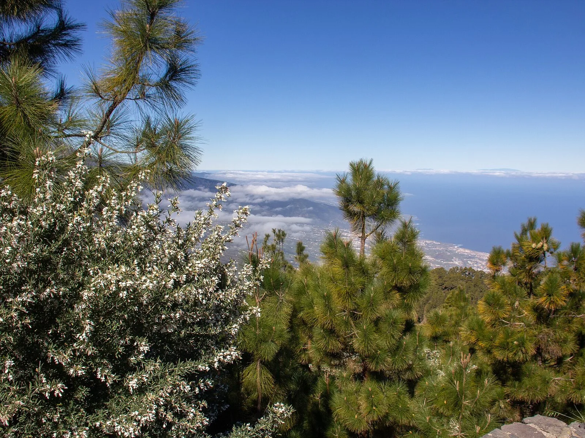
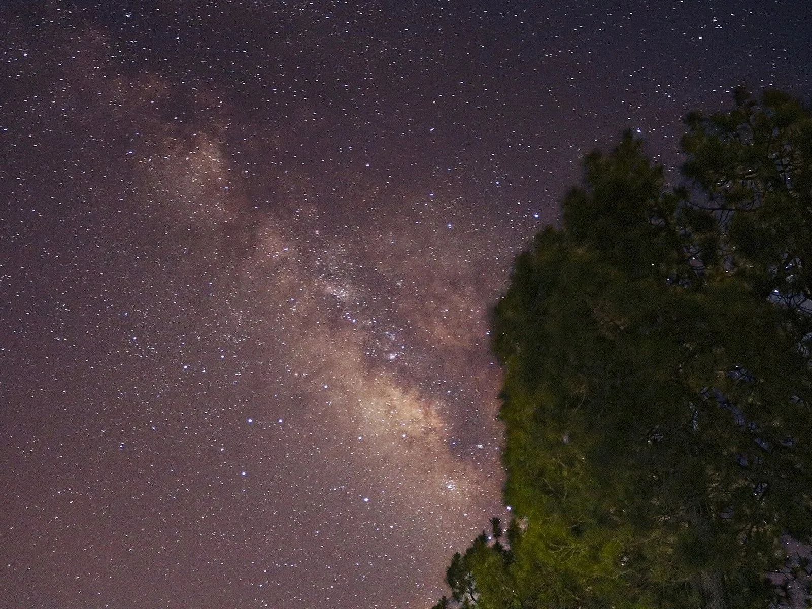

A **más de 1.800 metros** de altura, en plena cumbre de Tenerife, hay un mirador que mucha gente pasa de largo camino del Teide. Es el **Mirador de Chipeque**, y desde él tienes el **Teide** de frente, el **mar de nubes** a tus pies y, en días claros, hasta la silueta de **La Palma** en el horizonte.

En un vistazo<h2>Lo que vas a encontrar</h2>

<b>🌋</b>Vistas al Teide

<b>☁️</b>Mar de nubes

<b>⭐</b>Cielos estrellados

<b>⛰️</b>1.800 metros

<b>🌲</b>Secreto

Puedes ver cómo es en [este reel de Instagram](https://www.instagram.com/reel/DHCAhKOoGQG/), grabado en Tenerife.

Qué ver<h2>Qué vas a ver</h2>

<ol class="guide__grid guide__grid--cuenca">
<li class="gcard reveal">
01

<h3>El Teide de frente</h3>
A unos <strong>1.800 metros</strong>, con el valle de La Orotava a tus pies y el Teide enfrente.

</li>
<li class="gcard reveal">
02

<h3>El mar de nubes</h3>
Cuando soplan los alisios, ves un <strong>manto blanco</strong> por debajo de ti. Rodeado de pinar canario.

</li>
<li class="gcard reveal">
03

<h3>Las estrellas</h3>
Por la altura y la poca luz, es un gran sitio para ver la <strong>Vía Láctea</strong> en verano. Lleva abrigo.

</li>
</ol>

## Lo básico

- **Dónde:** en la carretera **TF-24** (carretera de La Esperanza), hacia el **km 26**, camino del Teide.
- **Altura:** alrededor de **1.800-1.900 metros**.
- **Precio:** **gratis**, sin reserva.
- **Cuánto se tarda:** una parada de **15-30 minutos**, o una tarde entera si vienes a ver el atardecer o las estrellas.

## Vistas al Teide y al mar de nubes

Desde Chipeque miras hacia el **valle de La Orotava** con el **Teide** enfrente. Los días en que los **alisios** forman el mar de nubes sobre la costa norte, ves un manto blanco por debajo de ti y el volcán asomando por encima. Es uno de esos lugares donde el paisaje cambia por completo según el día y la hora.

El mirador está dentro del **Paisaje Protegido de Las Lagunetas**, rodeado de **pinar canario**.

> **Mi consejo:** muy cerca, a unos 100 metros, está el **Mirador de Chimague**, que mira hacia el **valle de Güímar**, al otro lado de la isla. Haz los dos en la misma parada.

## Atardecer y estrellas

- **Atardecer:** el sol se esconde detrás del Teide y tiñe el mar de nubes de naranja y rosa.
- **De noche:** por la altura y la poca contaminación lumínica, es un sitio estupendo para ver **estrellas** y la Vía Láctea en verano.

## Qué llevar

- **Abrigo**, aunque abajo haga calor: a 1.800 metros la temperatura puede bajar mucho, sobre todo al atardecer y de noche.
- **Linterna** si vas de noche.
- **Trípode**, si quieres fotos de estrellas o del atardecer.

## Respeta el mirador

Chipeque se ha hecho popular y a veces aparece **basura** en la zona. Llévate todo lo que traigas y no salgas de los caminos: es un espacio protegido.

## Cómo llegar

Desde **La Laguna**, sube por la **TF-24** hacia La Esperanza y el Teide. Hacia el **km 26**, el mirador queda a un lado de la carretera (si bajas desde el Teide, a la izquierda), con un pequeño aparcamiento. Desde **Santa Cruz** o La Laguna son unos **40 minutos**. Si vas de noche, conduce con cuidado: hay curvas y a veces niebla. Puedes ver la ubicación en [Google Maps](https://www.google.com/maps/search/?api=1&query=Mirador%20de%20Chipeque%2C%20Tenerife).

<!--actividades-->

## Qué más hacer en la zona

- **Seguir hasta el Teide**: la TF-24 te lleva directamente al Parque Nacional. Te lo cuento todo en [subir al Teide](/blog/teide.html).
- **El bosque de La Esperanza**, con pinares y áreas recreativas por el camino.
- Más Tenerife: el [Arco de Tajao](/blog/arco-de-tajao-tenerife.html) en el sur, el [Lago Martiánez](/blog/lago-martianez-puerto-de-la-cruz.html) en Puerto de la Cruz o el [Barranco del Infierno](/blog/barranco-del-infierno-tenerife.html).

<!--faq-->

¿Conocías el Mirador de Chipeque? Sígueme en Instagram como [@chenoaventuras](https://www.instagram.com/chenoaventuras/) para descubrir más rincones de Canarias, y échale un vistazo al resto del blog.

Fotos de Wikimedia Commons: <a href="https://commons.wikimedia.org/wiki/File:20250704_Mirador_de_Chipeque_01.jpg" target="_blank" rel="noopener">Flocci Nivis</a> (CC BY 4.0) · <a href="https://commons.wikimedia.org/wiki/File:At_Tenerife_2019_024.jpg" target="_blank" rel="noopener">Mike Peel</a> (CC BY-SA 4.0) · <a href="https://commons.wikimedia.org/wiki/File:V%C3%ADa_L%C3%A1ctea_desde_el_Mirador_de_Chipeque.jpg" target="_blank" rel="noopener">Ele.photo</a> (CC BY-SA 4.0).

