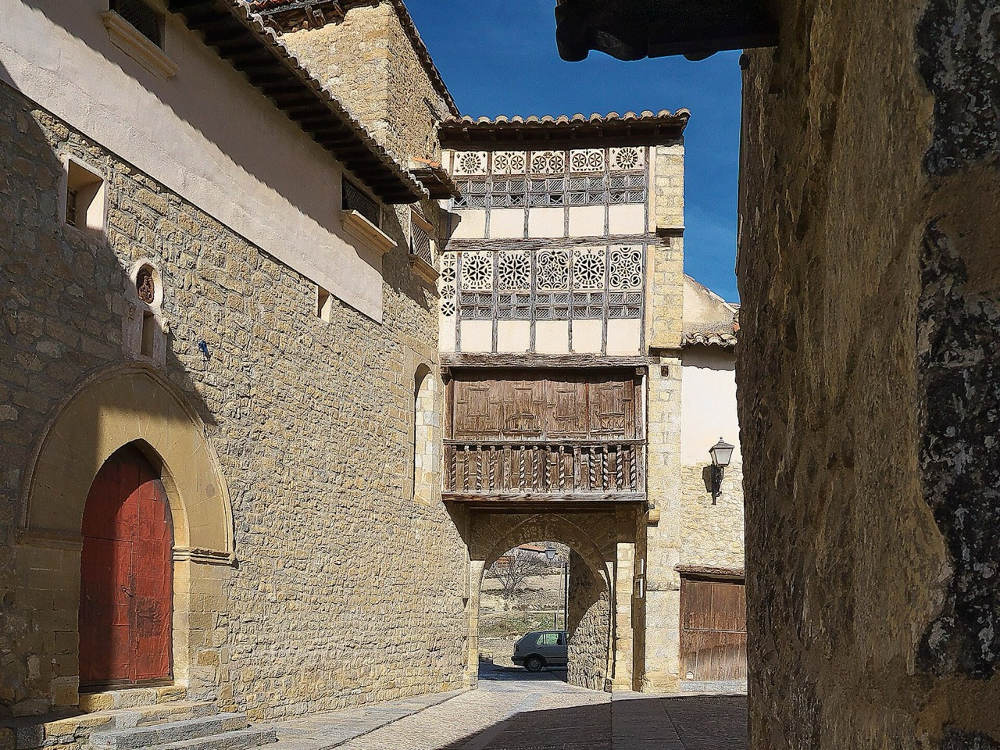
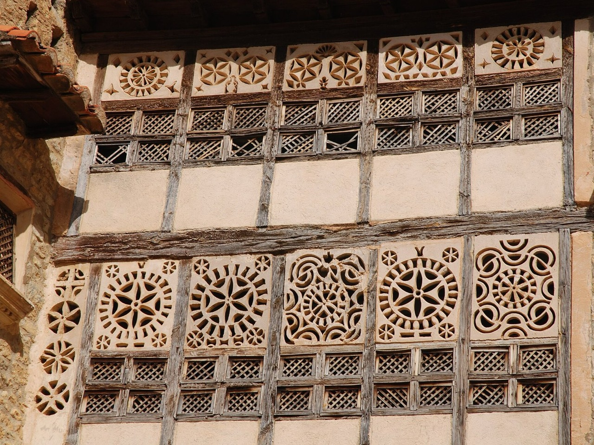
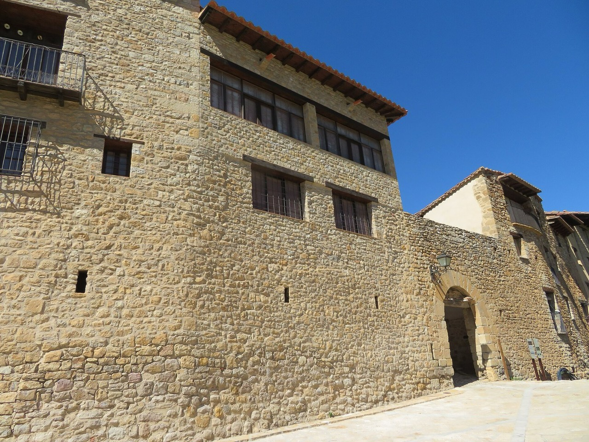
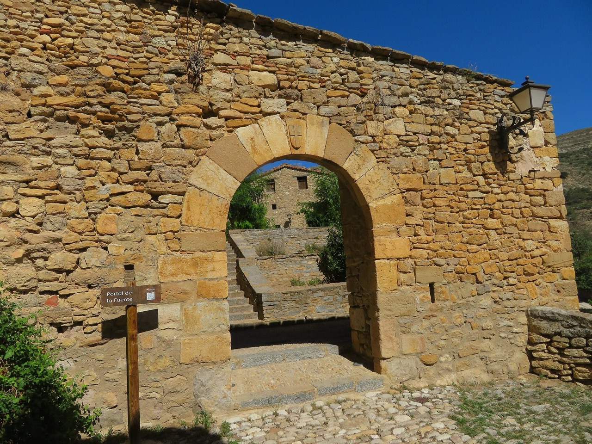
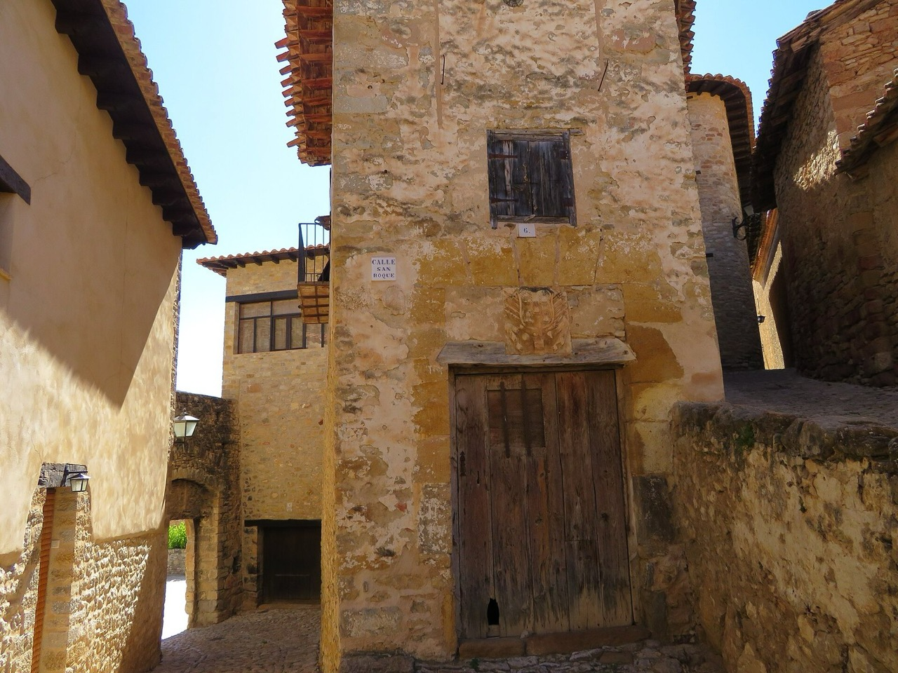
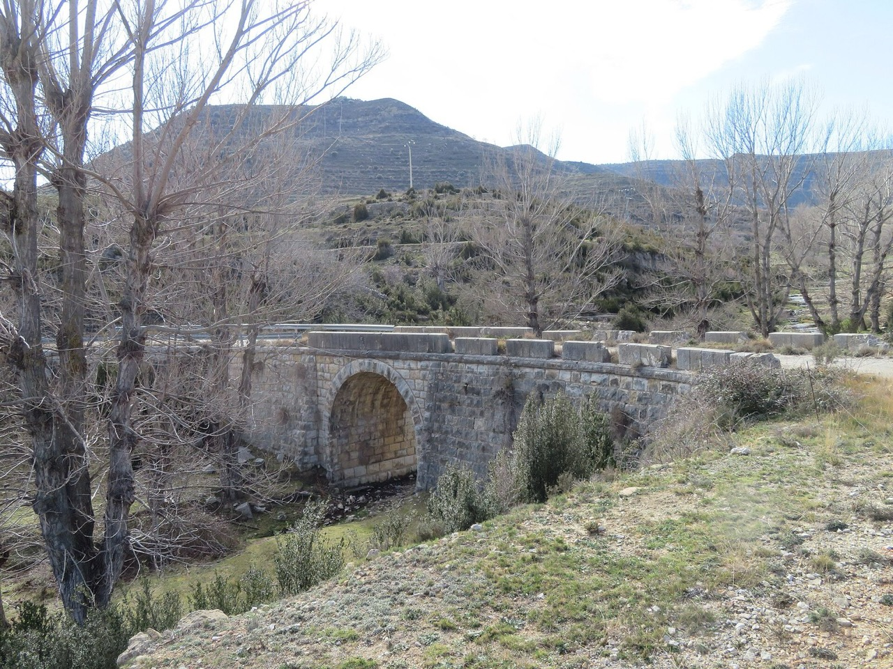

En el **Maestrazgo de Teruel**, en mitad de montes y barrancos, un pueblo entero de piedra sigue encerrado en su **muralla del siglo XIII**. Es **Mirambel**, y se entra por el **Portal de las Monjas**, con unas **celosías de yeso** preciosas por las que las monjas miraban a la calle sin ser vistas. Está entre los **Pueblos más bonitos de España**.

Te cuento qué ver 👇

En un vistazo<h2>Lo que vas a encontrar</h2>

<b>🏰</b>Muralla del XIII

<b>🪟</b>Celosías de yeso

<b>🪨</b>Calles de piedra

<b>🎬</b>Tierra y libertad

<b>⛰️</b>Maestrazgo

Antes de ir<h2>Lo básico de Mirambel</h2>

<h3>📍 Dónde está</h3>
En el <strong>Maestrazgo</strong> de Teruel, a media hora de Morella.

<h3>⏱️ Tiempo</h3>
Unas <strong>dos horas</strong> para recorrerlo con calma.

<h3>🚗 Aparcar</h3>
<strong>Fuera de la muralla</strong>. Dentro se va a pie.

Qué ver<h2>Qué ver en Mirambel</h2>

<ol class="guide__grid guide__grid--cuenca">
<li class="gcard reveal">
01

<h3>El Portal de las Monjas</h3>
La entrada principal, con <strong>tres pisos de galerías</strong> encima. Pegado está el convento de las agustinas, del siglo XVI.

</li>
<li class="gcard reveal">
02

<h3>Las celosías</h3>
Dibujos geométricos de <strong>yeso</strong>. Por aquí miraba la priora sin que nadie la viera.

</li>
<li class="gcard reveal">
03

<h3>La muralla</h3>
Del <strong>siglo XIII</strong> y casi entera. Muchas casas se apoyan en ella y forman parte del muro.

</li>
<li class="gcard reveal">
04

<h3>Los portales</h3>
Además del de las Monjas, hay otros portales como el <strong>de la Fuente</strong>. Búscalos todos.

</li>
<li class="gcard reveal">
05

<h3>Las calles</h3>
Casas nobles de piedra, aleros de madera y <strong>silencio</strong>. Mirambel tiene muy pocos vecinos.

</li>
<li class="gcard reveal">
06

<h3>El puente del camino real</h3>
A las afueras, un puente de piedra sobre el <strong>barranco de Toro Negro</strong>. Paseo tranquilo entre chopos.

</li>
</ol>

Cómo llegar<h2>Cómo llegar a Mirambel</h2>

En coche, a unos <strong>30-40 minutos de Morella</strong> (Castellón). Desde <strong>Teruel</strong> o <strong>Castellón</strong>, unas dos horas por carreteras de montaña. Deja el coche fuera de la muralla.

<a class="btn guide__mapbtn" href="https://www.google.com/maps/dir/?api=1&destination=40.5868,-0.3418" target="_blank" rel="noopener"><svg class="ico" viewBox="0 0 24 24" width="15" height="15" aria-hidden="true" fill="currentColor"><path d="M12 2a7 7 0 0 0-7 7c0 5.25 7 13 7 13s7-7.75 7-13a7 7 0 0 0-7-7zm0 9.5a2.5 2.5 0 1 1 0-5 2.5 2.5 0 0 1 0 5z"/></svg> Cómo llegar en Google Maps</a>

Muy cerca tienes <a href="/blog/morella-que-ver.html">Morella</a>. Y en la provincia, <a href="/blog/rubielos-de-mora.html">Rubielos de Mora</a>, <a href="/blog/que-ver-en-matarrana.html">el Matarraña</a> y <a href="/blog/teruel-que-ver.html">Teruel</a>.

Consejos de Cheno<h2>Para disfrutarlo al máximo</h2><ul><li><b>Entra por el Portal de las Monjas</b> y mira hacia arriba.</li><li><b>Ve en primavera u otoño</b> en invierno hace mucho frío y nieva a veces.</li><li><b>Combínalo con Morella</b> está a media hora.</li></ul>

<!--actividades-->

<!--faq-->

<h2>¿Te gustan estos planes?</h2>
Sígueme en Instagram como <a href="https://www.instagram.com/chenoaventuras/" target="_blank" rel="noopener">@chenoaventuras</a>: subo escapadas como esta cada semana.
<a class="btn guide__btn" href="/blog.html">Ver más planes en el blog</a>

Información consultada en noviembre de 2026 (Turismo de España, Turismo de Aragón y Comarca del Maestrazgo). Los horarios y precios cambian: confírmalos antes de ir. Fotos de Wikimedia Commons: <a href="https://commons.wikimedia.org/wiki/File:Mirambel_(Teruel).jpg" target="_blank" rel="noopener">Juan Emilio Prades Bel</a> (CC BY 4.0), <a href="https://commons.wikimedia.org/wiki/File:Portal_de_las_Monjas,_Mirambel.jpg" target="_blank" rel="noopener">José Luis Filpo Cabana</a> (CC BY 3.0), <a href="https://commons.wikimedia.org/wiki/File:Mirambel,_celos%C3%ADas.JPG" target="_blank" rel="noopener">FranchoBeltrán</a> (CC BY-SA 3.0 es), <a href="https://commons.wikimedia.org/wiki/File:Mirambel,_Portal_de_la_Fuente.jpg" target="_blank" rel="noopener">Juan Emilio Prades Bel</a> (CC BY 4.0), <a href="https://commons.wikimedia.org/wiki/File:Mirambel,_calle_San_Roque.jpg" target="_blank" rel="noopener">Juan Emilio Prades Bel</a> (CC BY 4.0), <a href="https://commons.wikimedia.org/wiki/File:Mirambel,_villa_amurallada.jpg" target="_blank" rel="noopener">Juan Emilio Prades Bel</a> (CC BY 4.0), <a href="https://commons.wikimedia.org/wiki/File:Puente_del_camino_real_sobre_el_Barranco_de_Toro_Negro,_Mirambel.jpg" target="_blank" rel="noopener">Juan Emilio Prades Bel</a> (CC BY 4.0).

