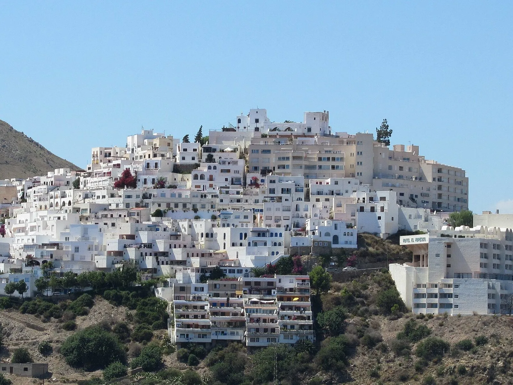
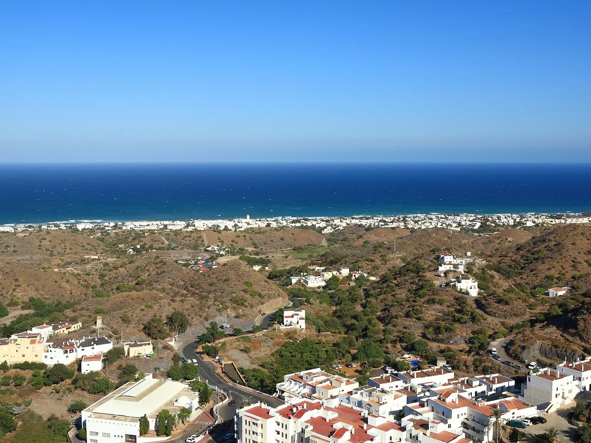
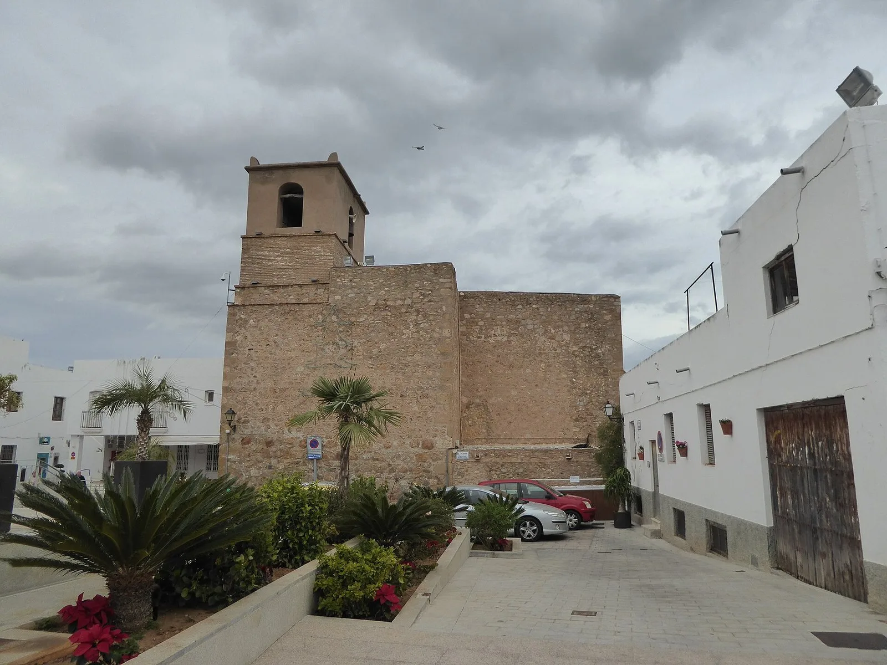
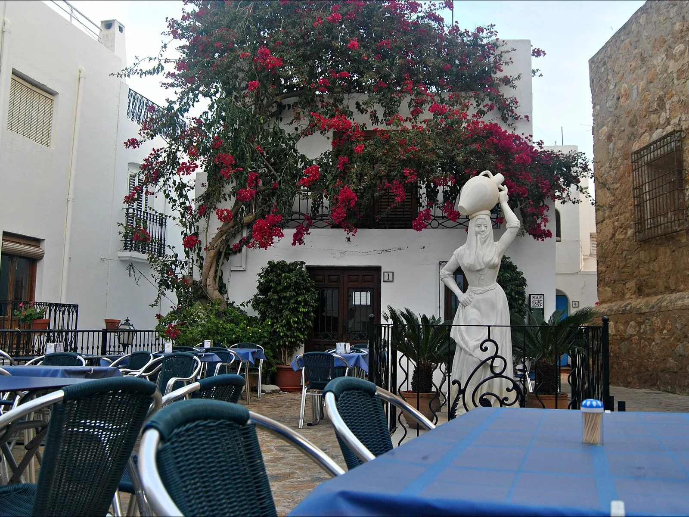
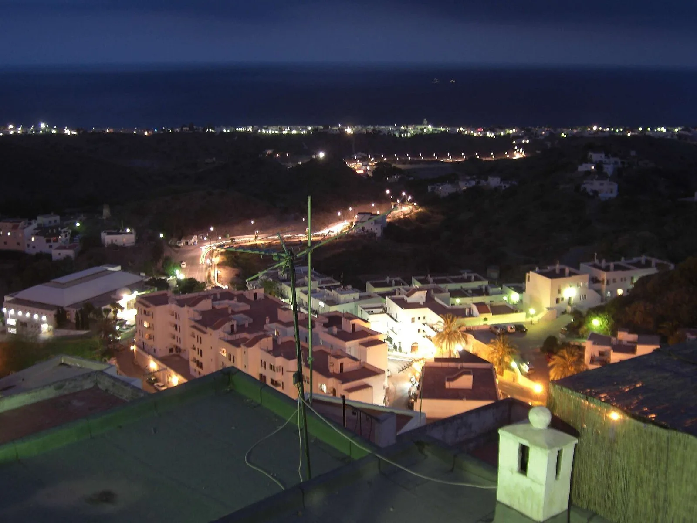
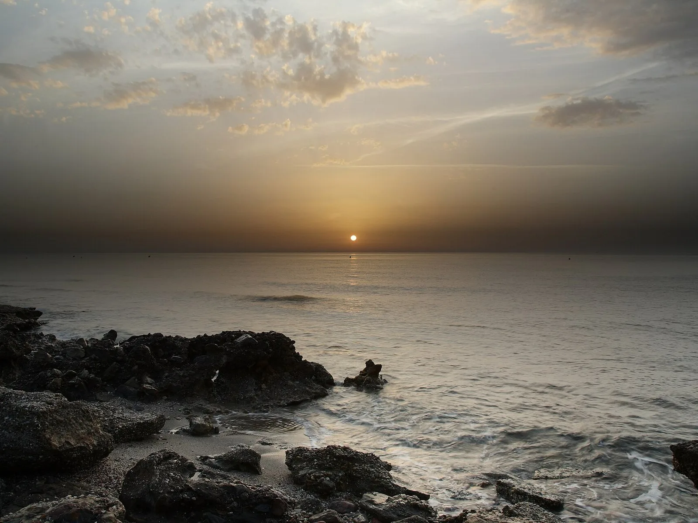

Desde la carretera, **Mojácar** parece un montón de cubos blancos apilados en lo alto de un cerro, con el mar detrás. Es uno de los pueblos más bonitos de Almería: calles empinadas llenas de buganvillas, miradores sobre la costa y una historia que mezcla moros, cristianos, artistas y hasta una leyenda que dice que **Walt Disney nació aquí**.

Te cuento qué ver, de dónde viene el famoso **indalo** y cómo organizar la visita 👇

En un vistazo<h2>Lo que vas a encontrar</h2>

<b>🏘️</b>Pueblo blanco

<b>🌅</b>Miradores

<b>⛲</b>Fuente Mora

<b>🧍</b>El indalo

<b>🏖️</b>17 km de playa

Antes de ir<h2>Lo básico de Mojácar</h2>

<h3>📍 Dónde está</h3>
En el <strong>Levante almeriense</strong>, a unos 2 km del mar. Está dividido en dos: <strong>Mojácar Pueblo</strong>, en el cerro, y <strong>Mojácar Playa</strong>, en la costa.

<h3>⏱️ Tiempo</h3>
Medio día para el pueblo. Un día entero si bajas a la playa.

<h3>☀️ Cuándo ir</h3>
Todo el año: en invierno hace buen tiempo y hay muy poca gente. En agosto se llena.

Qué ver<h2>Qué ver en Mojácar</h2>

<ol class="guide__grid guide__grid--cuenca">
<li class="gcard reveal">
01

<h3>El pueblo blanco</h3>
Piérdete por el <strong>barrio del Arrabal</strong> y las calles que suben al castillo: casas encaladas, puertas azules y macetas por todas partes.

</li>
<li class="gcard reveal">
02

<h3>El Mirador del Castillo</h3>
El punto más alto del pueblo, a unos <strong>175 metros</strong>. Del castillo queda poco, pero la vista de la costa y del valle es la mejor de Mojácar.

</li>
<li class="gcard reveal">
03

<h3>La iglesia de Santa María</h3>
Más que una iglesia parece un castillo: se construyó en el siglo XVI con muros gruesos para servir también de <strong>refugio</strong> ante los ataques piratas.

</li>
<li class="gcard reveal">
04

<h3>La Mojaquera</h3>
La estatua de una mujer con un cántaro recuerda a las mujeres que iban por agua a la fuente, muchas veces con la cara medio tapada, una costumbre que duró aquí siglos.

</li>
<li class="gcard reveal">
05

<h3>La Plaza Nueva</h3>
El centro de la vida del pueblo y otro gran mirador. Al anochecer, con las luces de la costa encendidas, es precioso.

</li>
<li class="gcard reveal">
06

<h3>Las playas</h3>
Unos <strong>17 km de costa</strong>. Hacia el sur hay calas más tranquilas, y junto al mar se levanta la <strong>Torre de Macenas</strong>, una torre vigía del siglo XVIII.

</li>
</ol>

Historia<h2>La Fuente Mora y el pacto de 1488</h2>

Junto a la parte baja del pueblo está la <strong>Fuente Mora</strong>, con sus chorros de agua bajo unos arcos. Es el lugar más importante de la historia de Mojácar: según la tradición, aquí se reunió en <strong>1488</strong> el último alcaide musulmán del pueblo con un enviado de los <strong>Reyes Católicos</strong> para pactar la entrega de Mojácar sin lucha. Una placa sobre la fuente recuerda el discurso del alcaide.

<h3>🧍 El indalo</h3>
Verás por todas partes una figura humana con los brazos abiertos y un arco sobre la cabeza. Viene de una <strong>pintura prehistórica</strong> de la Cueva de los Letreros, en Vélez Blanco, y en Mojácar se pintaba en las casas para protegerlas. En los años 50, un grupo de artistas, el <strong>Movimiento Indaliano</strong>, lo convirtió en el símbolo de toda Almería.

<h3>🐭 ¿Walt Disney, de Mojácar?</h3>
Una leyenda local cuenta que Walt Disney era hijo de una mojaquera que emigró a América. No hay ninguna prueba y la versión oficial es que nació en Chicago, pero en el pueblo la historia se sigue contando con cariño.

Cómo llegar<h2>Cómo llegar a Mojácar</h2>

En coche, por la <strong>A-7</strong> (autovía del Mediterráneo). Está a algo más de <strong>una hora de Almería</strong> y a una hora y media de Murcia. El pueblo tiene <strong>aparcamientos públicos</strong> en la entrada: deja ahí el coche, porque las calles son muy estrechas y empinadas.

<a class="btn guide__mapbtn" href="https://www.google.com/maps/dir/?api=1&destination=37.1405,-1.8513" target="_blank" rel="noopener"><svg class="ico" viewBox="0 0 24 24" width="15" height="15" aria-hidden="true" fill="currentColor"><path d="M12 2a7 7 0 0 0-7 7c0 5.25 7 13 7 13s7-7.75 7-13a7 7 0 0 0-7-7zm0 9.5a2.5 2.5 0 1 1 0-5 2.5 2.5 0 0 1 0 5z"/></svg> Cómo llegar en Google Maps</a>

Combínalo con las calas de <a href="/blog/cabo-de-gata-que-ver.html">Cabo de Gata</a>, la <a href="/blog/geoda-de-pulpi.html">Geoda de Pulpí</a> o el <a href="/blog/desierto-de-tabernas.html">desierto de Tabernas</a>. Tienes más planes en mi guía de <a href="/blog/almeria-que-ver.html">qué ver en Almería</a>.

Consejos de Cheno<h2>Para disfrutarlo al máximo</h2><ul><li><b>Calzado cómodo</b>: todo son cuestas y escaleras.</li><li><b>Sube al mirador al atardecer</b>: la luz sobre las casas blancas es preciosa.</li><li><b>Ven en invierno</b>: buen tiempo, sin colas y sin calor.</li><li><b>Busca indalos</b> en las puertas: es un juego estupendo con niños.</li></ul>

<!--actividades-->

<!--faq-->

<h2>¿Te gustan estos planes?</h2>
Sígueme en Instagram como <a href="https://www.instagram.com/chenoaventuras/" target="_blank" rel="noopener">@chenoaventuras</a>: subo escapadas como esta cada semana.
<a class="btn guide__btn" href="/blog.html">Ver más planes en el blog</a>

Información consultada en noviembre de 2026 (Los Pueblos Más Bonitos de España y webs de turismo de Andalucía). Fotos de Wikimedia Commons: <a href="https://commons.wikimedia.org/wiki/File:Los_montes_mojaqueros_-_MOJ%C3%81CAR_Pueblo_-_panoramio.jpg" target="_blank" rel="noopener">INDALOMANIA</a> (CC BY-SA 3.0) · <a href="https://commons.wikimedia.org/wiki/File:Moj%C3%A1car,_en_Almer%C3%ADa_(Espa%C3%B1a).jpg" target="_blank" rel="noopener">INDALOMANIA</a> (CC BY-SA 3.0) · <a href="https://commons.wikimedia.org/wiki/File:Mojacar_-_Vista_desde_el_pueblo_02.jpg" target="_blank" rel="noopener">Javier Perez Montes</a> (CC BY-SA 4.0) · <a href="https://commons.wikimedia.org/wiki/File:Iglesia_de_Santa_Maria,_Moj%C3%A1car_01.jpg" target="_blank" rel="noopener">Millars</a> (CC BY-SA 4.0) · <a href="https://commons.wikimedia.org/wiki/File:Statue_of_Mojaquera_-_Moj%C3%A1car_Spain.jpg" target="_blank" rel="noopener">Loco Steve</a> (CC BY-SA 2.0) · <a href="https://commons.wikimedia.org/wiki/File:Moj%C3%A1car_de_noche_-_by_night_-_panoramio.jpg" target="_blank" rel="noopener">INDALOMANIA</a> (CC BY-SA 3.0) · <a href="https://commons.wikimedia.org/wiki/File:Mojacar_-_Amanecer_en_la_playa_01.jpg" target="_blank" rel="noopener">Javier Perez Montes</a> (CC BY-SA 4.0).

