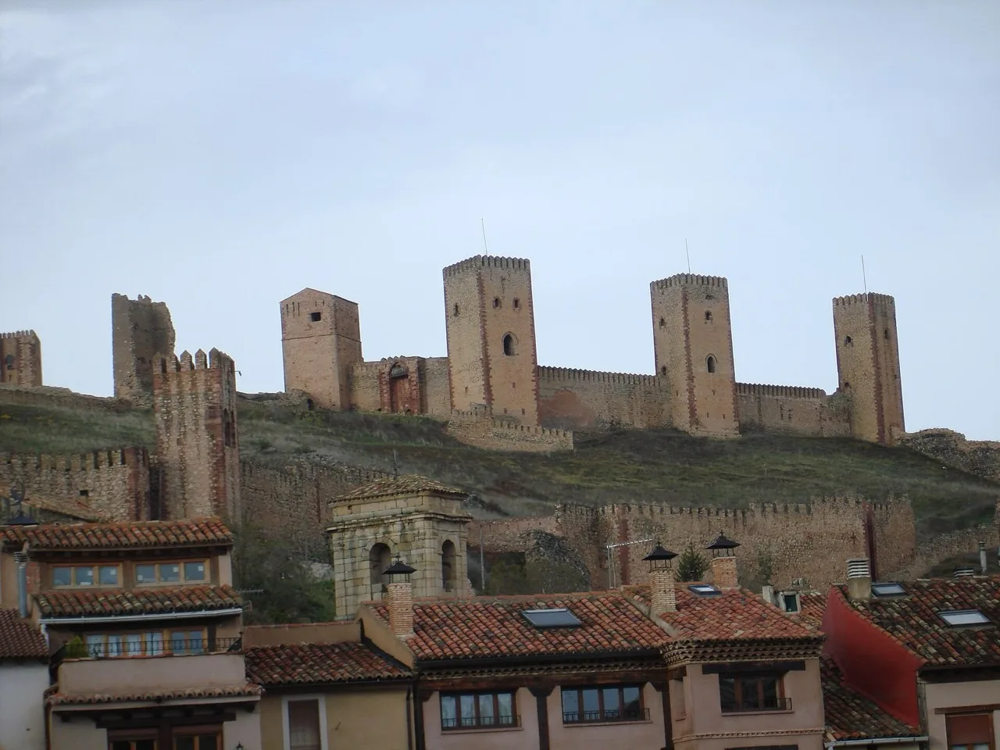
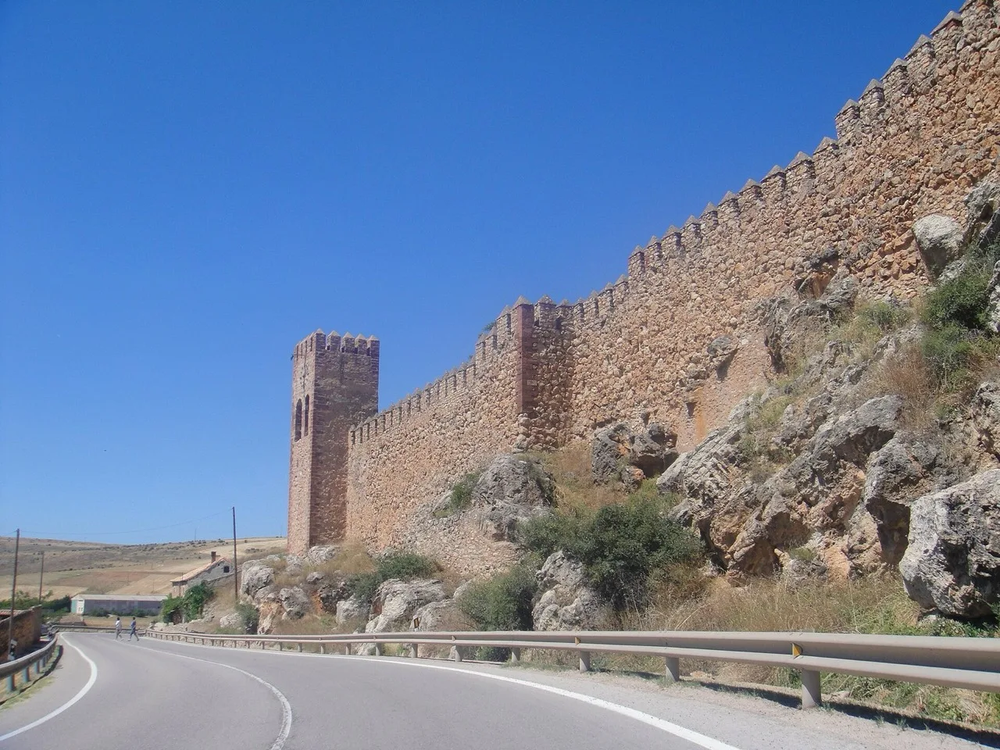
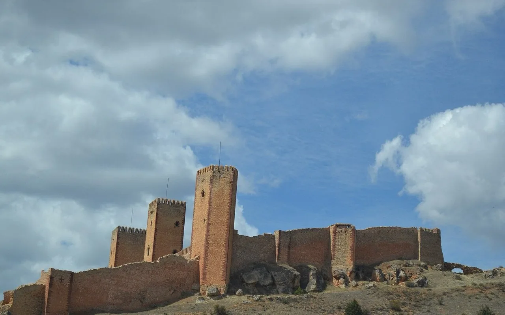
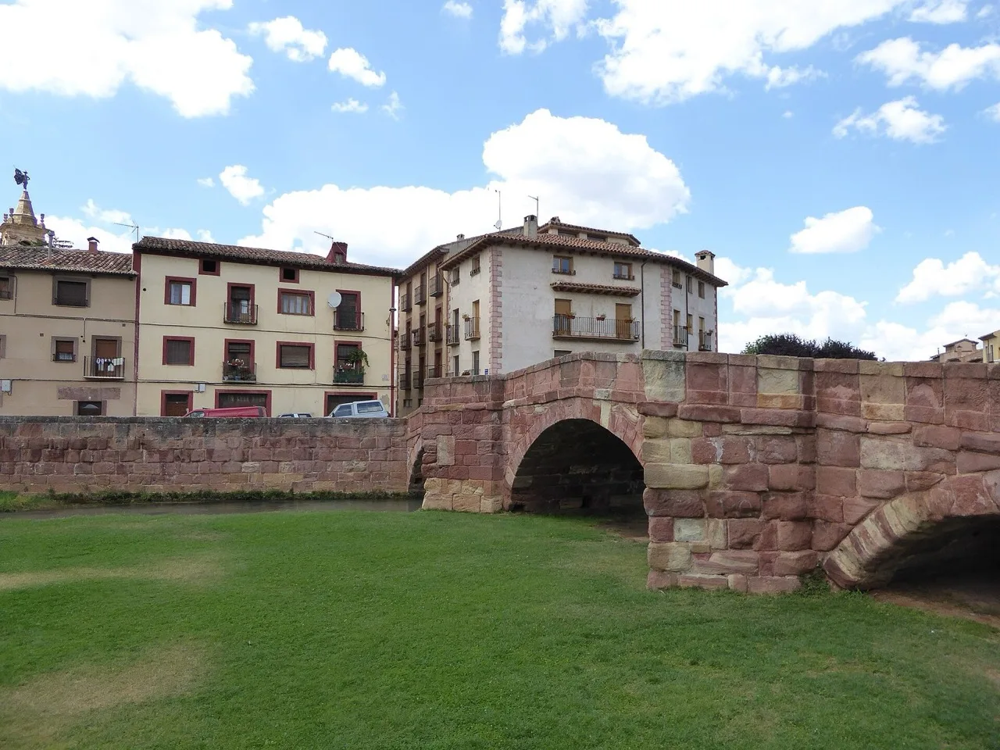
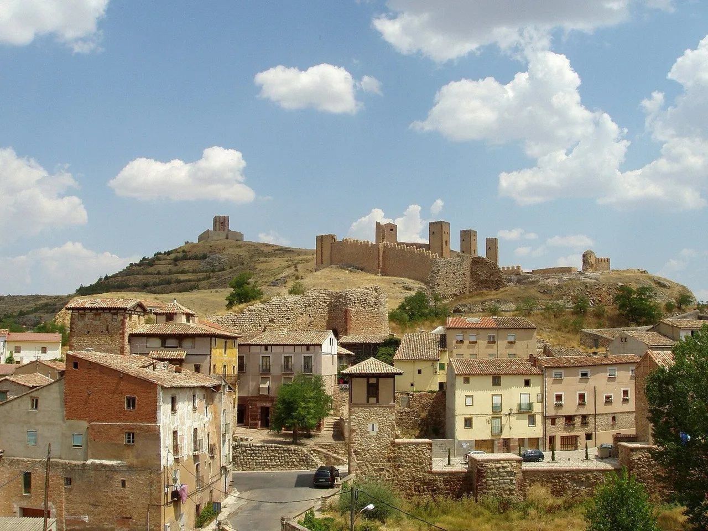

Hay castillos que se ven desde lejos, y luego está el de **Molina de Aragón**: una fortaleza enorme de **piedra rojiza** con torres por todas partes, en lo alto de un cerro de Guadalajara. Abajo, el pueblo tiene un **puente viejo** sobre el río Gallo y un casco histórico de palacios e iglesias. Es una de esas escapadas que sorprenden.

Te cuento qué ver 👇

En un vistazo<h2>Lo que vas a encontrar</h2>

<b>🏰</b>Castillo gigante

<b>🗼</b>Torre de Aragón

<b>🌉</b>Puente viejo

<b>🏘️</b>Casco histórico

<b>🪨</b>Geoparque

Antes de ir<h2>Lo básico de Molina</h2>

<h3>📍 Dónde está</h3>
En el este de <strong>Guadalajara</strong>, cerca del límite con Teruel.

<h3>⏱️ Tiempo</h3>
Medio día para el castillo y el pueblo. Un día si sumas el entorno.

<h3>🎟️ Visitas</h3>
Libres o guiadas, con entrada. En invierno, <strong>menos horarios</strong>: llama antes.

Qué ver<h2>Qué ver en Molina de Aragón</h2>

<ol class="guide__grid guide__grid--cuenca">
<li class="gcard reveal">
01

<h3>El castillo</h3>
Uno de los más grandes de España, con <strong>doble recinto</strong> y muchas torres cuadradas. Desde el pueblo se ve entero.

</li>
<li class="gcard reveal">
02

<h3>Las murallas</h3>
Largos lienzos de muralla bajan por el cerro. Al pasar por la carretera impresionan.

</li>
<li class="gcard reveal">
03

<h3>La Torre de Aragón</h3>
Una torre de planta <strong>pentagonal</strong> en lo más alto, unida al castillo por murallas. Fue reconstruida en el siglo XIX.

</li>
<li class="gcard reveal">
04

<h3>El puente viejo</h3>
Un puente de piedra sobre el <strong>río Gallo</strong>, la imagen más conocida del pueblo. Pasea por la orilla.

</li>
<li class="gcard reveal">
05

<h3>El casco histórico</h3>
Palacios, casonas e iglesias como <strong>Santa María del Conde</strong>. Recórrelo antes de subir al castillo.

</li>
</ol>

<h3>🗺️ El Señorío de Molina</h3>
Durante siglos, Molina fue la capital de un <strong>señorío</strong> con mucha independencia, en la frontera entre Castilla y Aragón. Por eso tiene un castillo tan grande y tanta historia.

Cómo llegar<h2>Cómo llegar a Molina de Aragón</h2>

En coche, a unas <strong>dos horas y cuarto de Madrid</strong> por la A-2. Desde <strong>Teruel</strong> o <strong>Albarracín</strong>, alrededor de una hora y media. Hay aparcamiento junto al casco histórico.

<a class="btn guide__mapbtn" href="https://www.google.com/maps/dir/?api=1&destination=40.8455,-1.8885" target="_blank" rel="noopener"><svg class="ico" viewBox="0 0 24 24" width="15" height="15" aria-hidden="true" fill="currentColor"><path d="M12 2a7 7 0 0 0-7 7c0 5.25 7 13 7 13s7-7.75 7-13a7 7 0 0 0-7-7zm0 9.5a2.5 2.5 0 1 1 0-5 2.5 2.5 0 0 1 0 5z"/></svg> Cómo llegar en Google Maps</a>

Por la zona tienes <a href="/blog/siguenza-que-ver.html">Sigüenza</a> y <a href="/blog/atienza-que-ver.html">Atienza</a>. Y hacia Teruel, <a href="/blog/albarracin-que-ver.html">Albarracín</a>.

Consejos de Cheno<h2>Para disfrutarlo al máximo</h2><ul><li><b>Llama a la oficina de turismo</b> antes de ir en invierno: las visitas al castillo son limitadas.</li><li><b>Abrígate</b> Molina es de lo más frío de España en invierno.</li><li><b>Ve al puente al atardecer</b> la piedra rojiza se enciende.</li></ul>

<!--actividades-->

<!--faq-->

<h2>¿Te gustan estos planes?</h2>
Sígueme en Instagram como <a href="https://www.instagram.com/chenoaventuras/" target="_blank" rel="noopener">@chenoaventuras</a>: subo escapadas como esta cada semana.
<a class="btn guide__btn" href="/blog.html">Ver más planes en el blog</a>

Información consultada en noviembre de 2026 (Turismo de Castilla-La Mancha y Turismo de España). Los horarios y precios cambian: confírmalos antes de ir. Fotos de Wikimedia Commons: <a href="https://commons.wikimedia.org/wiki/File:Castillo_de_Molina_de_Aragon.JPG" target="_blank" rel="noopener">Hibiscus7</a> (CC BY-SA 4.0), <a href="https://commons.wikimedia.org/wiki/File:Panor%C3%A1mica_Castillo_de_Molina_de_Arag%C3%B3n.jpg" target="_blank" rel="noopener">Cardenasjorge</a> (CC BY-SA 4.0), <a href="https://commons.wikimedia.org/wiki/File:Lienzo_de_la_muralla_del_castillo_de_Molina_de_Arag%C3%B3n.JPG" target="_blank" rel="noopener">Lancastermerrin88</a> (CC BY-SA 4.0), <a href="https://commons.wikimedia.org/wiki/File:Puente_Viejo,_Molina_de_Arag%C3%B3n_01.jpg" target="_blank" rel="noopener">Millars</a> (CC BY-SA 4.0), <a href="https://commons.wikimedia.org/wiki/File:Molina_de_Aragon,_Castillo.jpg" target="_blank" rel="noopener">Malopez 21</a> (CC BY-SA 4.0).

