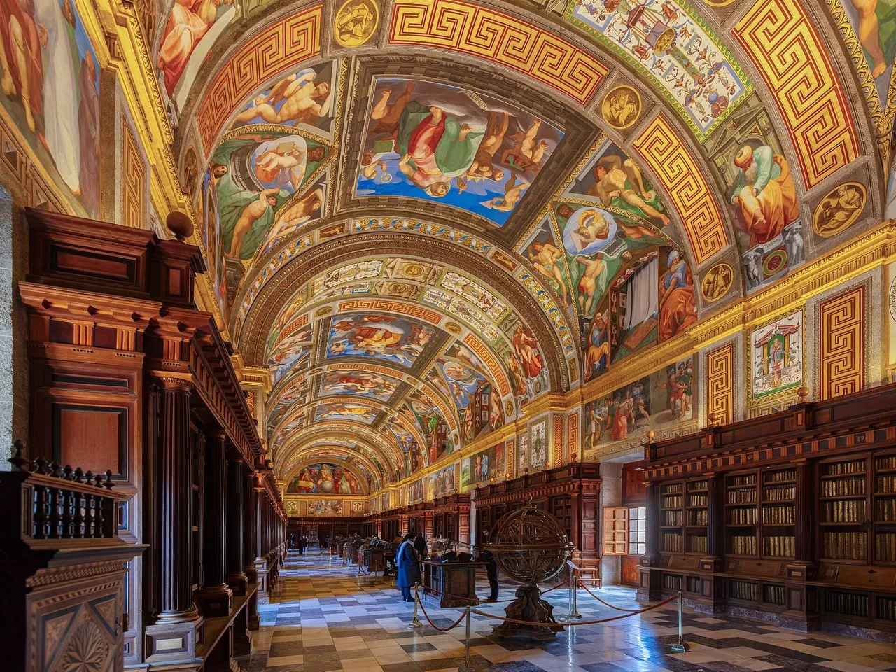
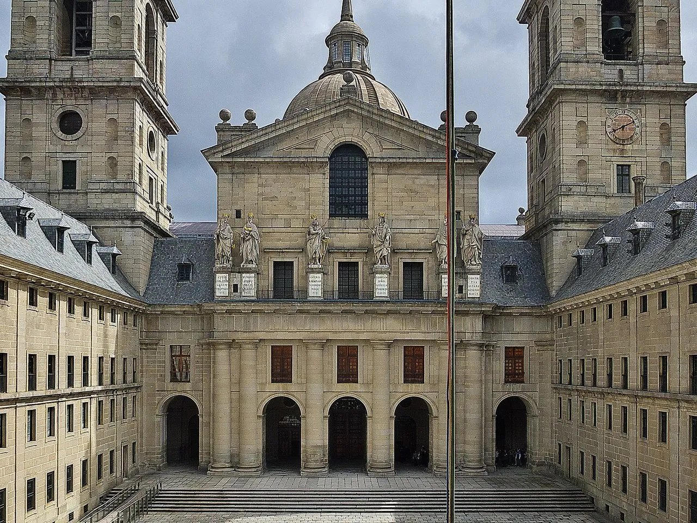
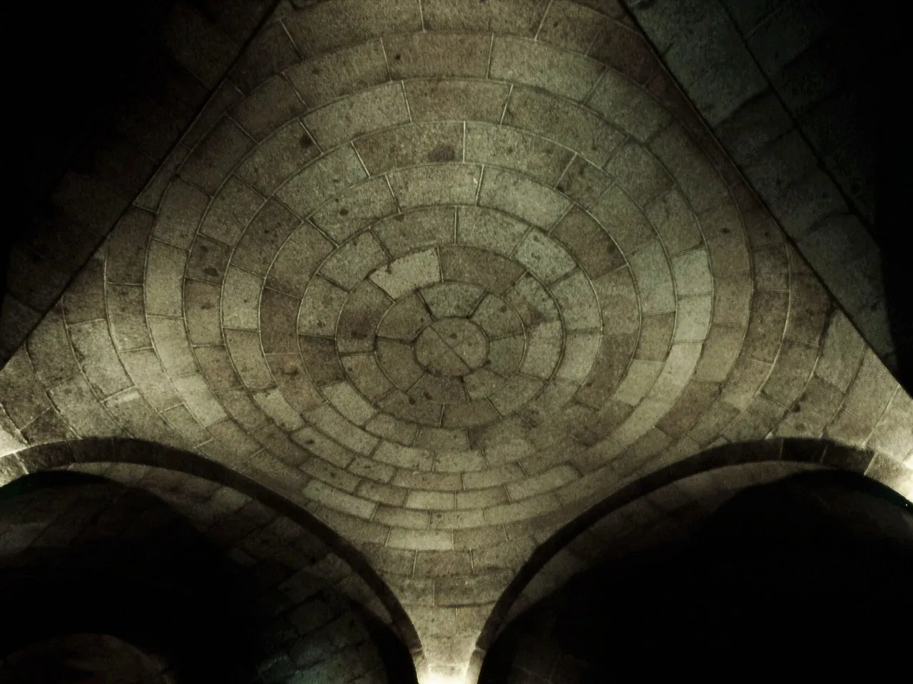
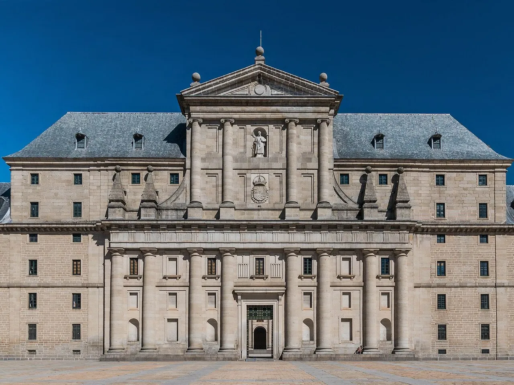
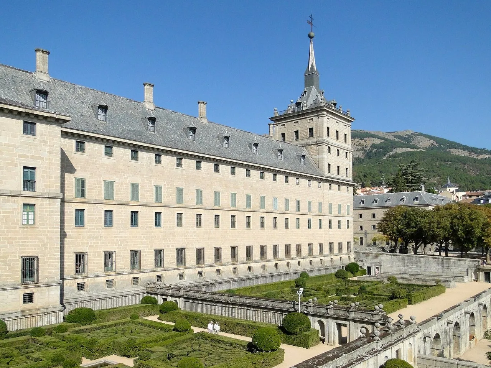
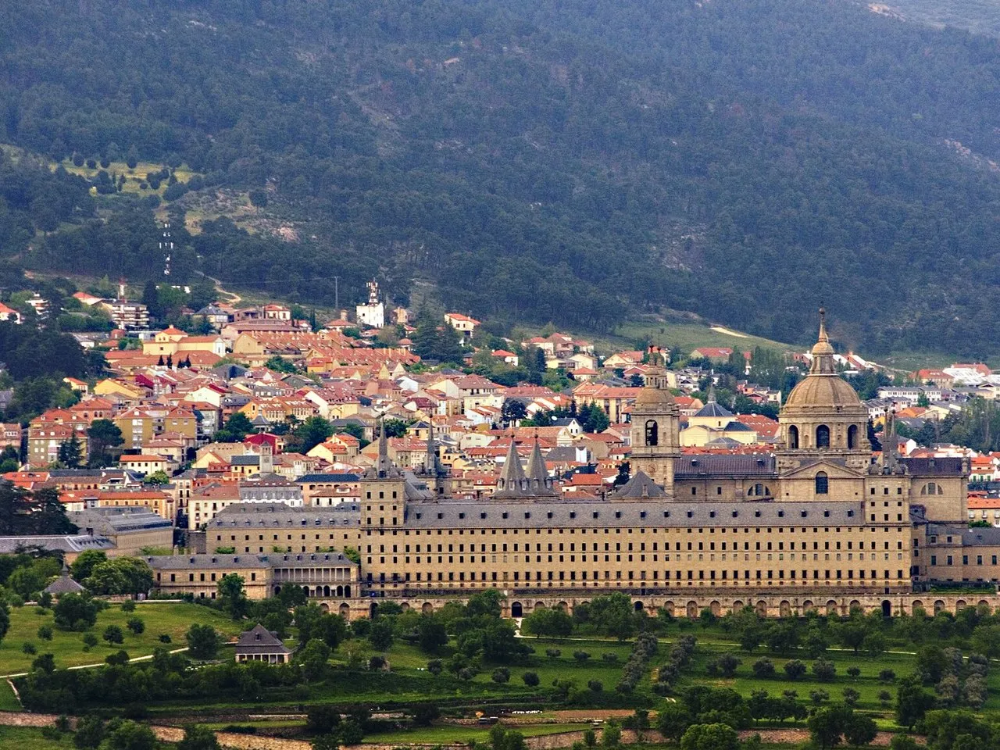

Un edificio inmenso de granito a los pies de la sierra de Guadarrama, una biblioteca con techos pintados que quita el aliento y el lugar donde descansan los reyes de España. El **Real Monasterio de San Lorenzo de El Escorial** resume el reinado de **Felipe II** y es **Patrimonio Mundial** desde 1984.

Te cuento cuánto cuesta, cuándo es gratis, el horario y qué ver dentro 👇

En un vistazo<h2>Lo que vas a encontrar</h2>

<b>📚</b>Biblioteca

<b>👑</b>Panteón de Reyes

<b>⛪</b>Basílica

<b>🏰</b>Palacios

<b>🆓</b>Gratis algunas tardes

Antes de ir<h2>Lo básico de El Escorial</h2>

<h3>🎟️ Precio</h3>
<strong>14 €</strong> la general y <strong>7 €</strong> la reducida. Guía, 8 € más; audioguía, 5 €.

<h3>🕙 Horario (octubre-marzo)</h3>
De <strong>martes a domingo, 10:00-18:00</strong>. Último acceso, 16:45. <strong>Cierra los lunes</strong>.

<h3>🆓 Gratis</h3>
De octubre a marzo, <strong>miércoles y domingos de 15:00 a 18:00</strong>. Los Museos de Pintura y Arquitectura, gratis hasta el 31 de diciembre de 2026.

<h3>⏱️ Tiempo</h3>
Cuenta con <strong>2-3 horas</strong> para verlo con calma: es enorme.

Qué ver<h2>Qué ver en el Monasterio de El Escorial</h2>

<ol class="guide__grid guide__grid--cuenca">
<li class="gcard reveal">
01

<h3>La Biblioteca</h3>
Para muchos, lo mejor de la visita: una sala larguísima con estanterías de madera y la <strong>bóveda pintada</strong> con las artes liberales.

</li>
<li class="gcard reveal">
02

<h3>El Patio de los Reyes y la Basílica</h3>
Por el <strong>Patio de los Reyes</strong> se entra a la <strong>Basílica</strong>, el corazón del monasterio, con su gran cúpula.

</li>
<li class="gcard reveal">
03

<h3>Los Panteones</h3>
Bajo la Basílica están el <strong>Panteón de Reyes</strong>, donde reposan los reyes de España, y el Panteón de Infantes. En la Basílica, fíjate también en la famosa <strong>bóveda plana</strong> de Juan de Herrera, bajo el coro.

</li>
<li class="gcard reveal">
04

<h3>Los palacios</h3>
El austero <strong>Palacio de los Austrias</strong>, donde vivió y murió Felipe II, el <strong>Palacio de los Borbones</strong> y la <strong>Sala de Batallas</strong>, con un enorme fresco.

</li>
<li class="gcard reveal">
05

<h3>Los jardines</h3>
El <strong>Jardín de los Frailes</strong>, junto a la fachada sur, con vistas a la sierra. De octubre a marzo abren de martes a domingo hasta las 18:00.

</li>
<li class="gcard reveal">
06

<h3>El pueblo y las Casitas</h3>
San Lorenzo de El Escorial merece un paseo. Y los fines de semana se pueden ver, solo con guía, la <strong>Casita del Príncipe</strong> y la <strong>Casita del Infante</strong>.

</li>
</ol>

<!--actividades-->

La historia<h2>El sueño de Felipe II</h2>

<strong>Felipe II</strong> mandó levantarlo para conmemorar la victoria de <strong>San Quintín</strong> (1557) y como panteón de su familia. Se construyó entre <strong>1563 y 1584</strong>, primero con <strong>Juan Bautista de Toledo</strong> y después con <strong>Juan de Herrera</strong>, que le dio su estilo sobrio, el «herreriano». Ocupa más de <strong>33.000 m²</strong> a 1.028 metros de altitud, en la ladera del monte Abantos, y es Patrimonio Mundial desde el <strong>2 de noviembre de 1984</strong>.

Cómo llegar<h2>Cómo llegar a El Escorial desde Madrid</h2>

<h3>🚌 En autobús</h3>
Líneas <strong>661 y 664</strong> desde el intercambiador de <strong>Moncloa</strong>.

<h3>🚆 En tren</h3>
<strong>Cercanías C-8</strong> hasta El Escorial. O, como plan especial, la <a href="https://www.civitatis.com/es/madrid/excursion-escorial-felipe-ii/?aid=110968" target="_blank" rel="noopener sponsored">excursión en el tren de Felipe II</a>.

<h3>🚗 En coche</h3>
A-6 hasta la <strong>salida 29</strong> y la M-505; o por la AP-6 hasta la salida 47 y la M-600.

<h3>🎟️ Entradas</h3>
Hay que llevarla comprada: online, en taquilla (frente a la fachada norte) o con la <a href="https://www.civitatis.com/es/el-escorial/entrada-monasterio-escorial/?aid=110968" target="_blank" rel="noopener sponsored">entrada de Civitatis</a>.

Consejos de Cheno<h2>Para disfrutarlo al máximo</h2><ul><li><b>Ve con guía o audioguía</b>: el edificio es enorme y sin explicaciones se pierde mucho. Hay una <a href="https://www.civitatis.com/es/el-escorial/tour-el-escorial-completo/?aid=110968" target="_blank" rel="noopener sponsored">visita guiada en español</a>.</li><li><b>Los lunes está cerrado</b>.</li><li><b>Sin mochila</b>: no es recomendable para la visita.</li><li><b>Abrígate en invierno</b>: dentro hace frío.</li><li><b>Combínalo con</b> el <a href="/blog/nieve-cerca-de-madrid.html">plan de nieve cerca de Madrid</a> o el resto de <a href="/blog/madrid-que-ver.html">Madrid</a>.</li></ul>

⛰️ Sierra arriba tienes <a href="/blog/los-molinos-que-ver.html">Los Molinos</a>, pueblo serrano candidato a pueblo de la Navidad de Ferrero Rocher 2026.

<!--faq-->

<h2>¿Te gustan estos planes?</h2>
Sígueme en Instagram como <a href="https://www.instagram.com/chenoaventuras/" target="_blank" rel="noopener">@chenoaventuras</a>: subo escapadas como esta cada semana.
<a class="btn guide__btn" href="/blog.html">Ver más planes en el blog</a>

Información consultada en noviembre de 2026 en la web de Patrimonio Nacional. Fotos de Wikimedia Commons: <a href="https://commons.wikimedia.org/wiki/File:Monasterio_de_El_Escorial_en_Madrid.jpg" target="_blank" rel="noopener">Zvonimir Stamenov</a> (CC BY-SA 4.0) · <a href="https://commons.wikimedia.org/wiki/File:Real_Monasterio_de_San_Lorenzo_de_El_Escorial,_Madrid,_Espa%C3%B1a,_2025-12-30,_DD_16-18_HDR.jpg" target="_blank" rel="noopener">Diego Delso</a> (CC BY-SA 4.0) · <a href="https://commons.wikimedia.org/wiki/File:Patio_de_los_Reyes._Monasterio_de_El_Escorial.jpg" target="_blank" rel="noopener">José Luis Filpo Cabana</a> (CC BY 3.0) · <a href="https://commons.wikimedia.org/wiki/File:C%C3%BApula_plana-Juan_de_Herrera.jpg" target="_blank" rel="noopener">T.F. Barandalla</a> (CC BY-SA 3.0) · <a href="https://commons.wikimedia.org/wiki/File:Facade_monastery_San_Lorenzo_de_El_Escorial_Spain.jpg" target="_blank" rel="noopener">Jebulon</a> (CC0) · <a href="https://commons.wikimedia.org/wiki/File:Monastery_of_El_Escorial_05.jpg" target="_blank" rel="noopener">Bernard Gagnon</a> (CC BY-SA 3.0) · <a href="https://commons.wikimedia.org/wiki/File:San_Lorenzo_del_Escorial_(fachada_sur)-emeritense.jpg" target="_blank" rel="noopener">emeritense</a> (CC BY-SA 2.0).

