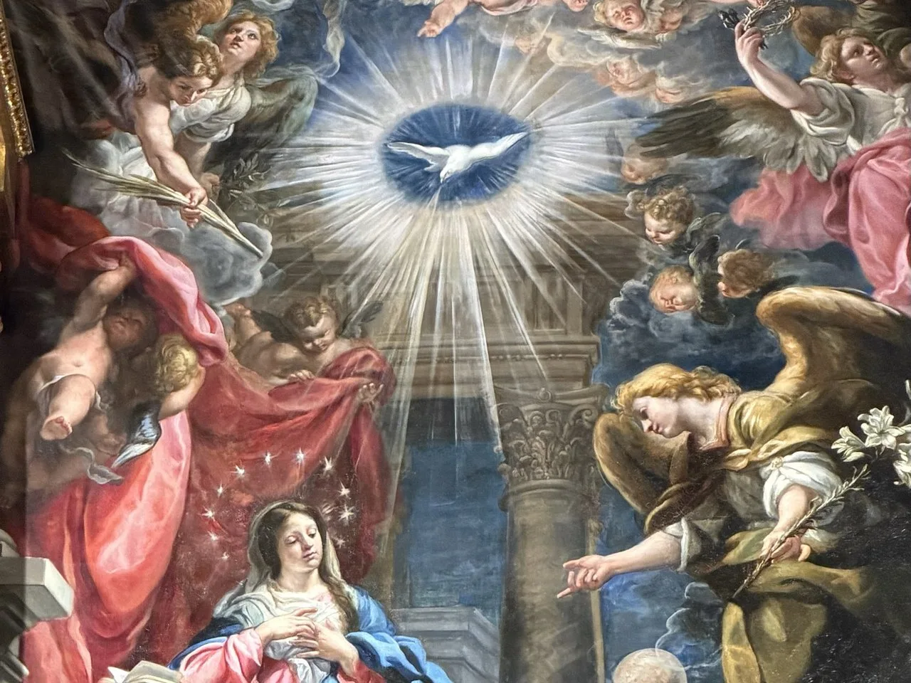
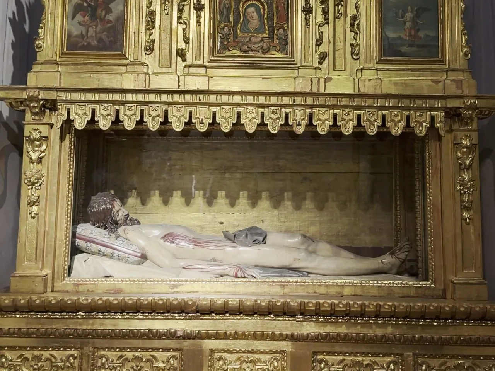
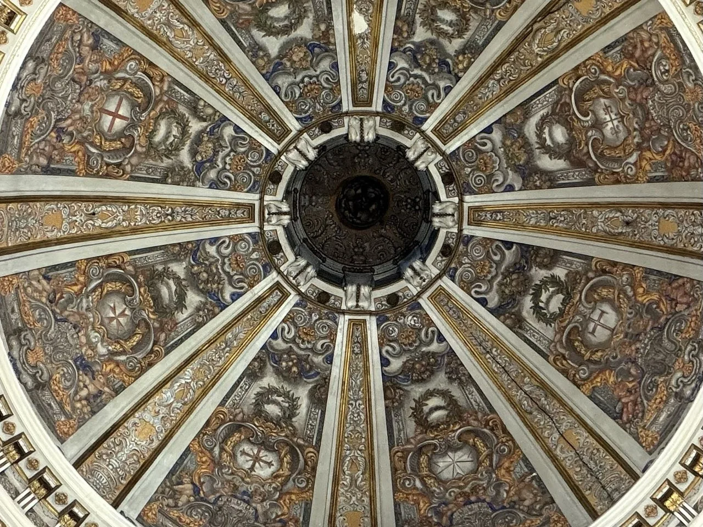
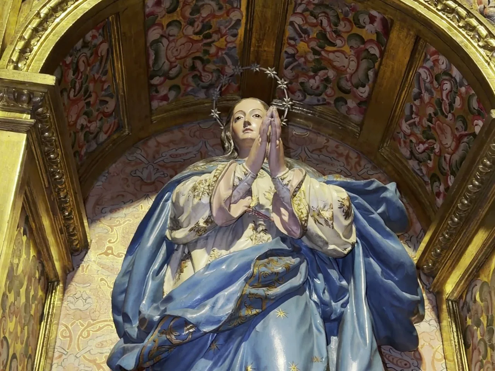

Desde la calle de San Roque parece una iglesia más de **Malasaña**. Dentro hay uno de los conjuntos barrocos más bonitos de Madrid: un **retablo de Claudio Coello**, un **Cristo yacente de Gregorio Fernández** y una cúpula pintada que obliga a mirar arriba. Además, para esta iglesia pintó **Velázquez** su famoso Cristo crucificado.

Estuvo cerrada al público durante mucho tiempo y ahora se puede visitar. Te cuento qué ver 👇

En un vistazo<h2>Lo que vas a encontrar</h2>

<b>🎨</b>Claudio Coello

<b>✝️</b>Gregorio Fernández

<b>⛪</b>Cúpula pintada

<b>🖼️</b>Velázquez

<b>🆓</b>Gratis domingos

Antes de ir<h2>Lo básico de San Plácido</h2>

<h3>📍 Dónde está</h3>
Calle de San Roque, 9, en <strong>Malasaña</strong>. Metro Noviciado, Santo Domingo o Callao.

<h3>🎟️ Precio</h3><ul class="guide__prices"><li>Visita guiada<b>10 €</b></li><li>Con San Antonio de los Alemanes<b>12 €</b></li><li>Domingos 15:00 (con reserva)<b>Gratis</b></li></ul>

<h3>🕐 Horario</h3>
Martes a sábado, 10:30-14:00 y 15:00-17:30. Domingo, 13:00-16:00. <strong>Lunes cerrado</strong>.

Qué ver<h2>Qué ver en San Plácido</h2>

<ol class="guide__grid guide__grid--cuenca">
<li class="gcard reveal">
01

<h3>La Anunciación de Claudio Coello</h3>
El gran cuadro del <strong>retablo mayor</strong>. Coello firmó también los dos retablos de los brazos del crucero.

</li>
<li class="gcard reveal">
02

<h3>El Cristo yacente</h3>
Una talla de <strong>Gregorio Fernández</strong>, uno de los grandes escultores del barroco español, en su urna dorada.

</li>
<li class="gcard reveal">
03

<h3>La cúpula</h3>
Frescos en la cúpula, el presbiterio y la nave. Algunas pinturas se atribuyen a <strong>Francisco de Ricci</strong>.

</li>
<li class="gcard reveal">
04

<h3>Los retablos laterales</h3>
Retablos dorados con tallas como esta <strong>Inmaculada</strong>. Fíjate en los detalles de cada capilla.

</li>
</ol>

Historia<h2>De convento benedictino a monumento</h2>

<ul class="guide__timeline">
<li><b>1641</b>Empiezan las obras de la iglesia, diseñada por <strong>fray Lorenzo de San Nicolás</strong>. Se terminan unos veinte años después.</li>
<li><b>1829</b>El <strong>Cristo crucificado de Velázquez</strong>, pintado para esta iglesia, pasa al Museo del Prado.</li>
<li><b>1943</b>La iglesia se declara <strong>Monumento Nacional</strong>.</li>
<li><b>2023</b>Se marchan las últimas religiosas del convento. Después, la iglesia se abre al público.</li>
</ul>

<h3>⛪ Combínala con San Antonio de los Alemanes</h3>
A pocos minutos andando está la iglesia de <a href="/blog/capilla-sixtina-madrilena-san-antonio-alemanes.html">San Antonio de los Alemanes</a>, la «Capilla Sixtina madrileña», con frescos de pared a pared. La entrada combinada (12 €) incluye las dos.

Cómo llegar<h2>Cómo llegar a San Plácido</h2>

Está en la <strong>calle de San Roque, 9</strong>, entre Malasaña y la Gran Vía. En metro: <strong>Noviciado</strong> (L2), <strong>Santo Domingo</strong> (L2) o <strong>Callao</strong> (L3 y L5).

<a class="btn guide__mapbtn" href="https://www.google.com/maps/dir/?api=1&destination=40.4229,-3.7058" target="_blank" rel="noopener"><svg class="ico" viewBox="0 0 24 24" width="15" height="15" aria-hidden="true" fill="currentColor"><path d="M12 2a7 7 0 0 0-7 7c0 5.25 7 13 7 13s7-7.75 7-13a7 7 0 0 0-7-7zm0 9.5a2.5 2.5 0 1 1 0-5 2.5 2.5 0 0 1 0 5z"/></svg> Cómo llegar en Google Maps</a>

Y si te quedas por el centro, mira mi guía de <a href="/blog/madrid-que-ver.html">qué ver en Madrid en dos días</a>.

Consejos de Cheno<h2>Para disfrutarla al máximo</h2><ul><li><b>Reserva la visita gratuita</b> del domingo con tiempo: tiene plazas limitadas.</li><li><b>Haz la combinada</b> con San Antonio de los Alemanes.</li><li><b>Mira arriba</b>: lo mejor está en la cúpula y las bóvedas.</li></ul>

<!--actividades-->

<!--faq-->

<h2>¿Te gustan estos planes?</h2>
Sígueme en Instagram como <a href="https://www.instagram.com/chenoaventuras/" target="_blank" rel="noopener">@chenoaventuras</a>: subo escapadas como esta cada semana.
<a class="btn guide__btn" href="/blog.html">Ver más planes en el blog</a>

Información consultada en noviembre de 2026 (esMadrid). Los horarios y precios pueden cambiar: confírmalos antes de ir. Fotos: Chenoaventuras.

