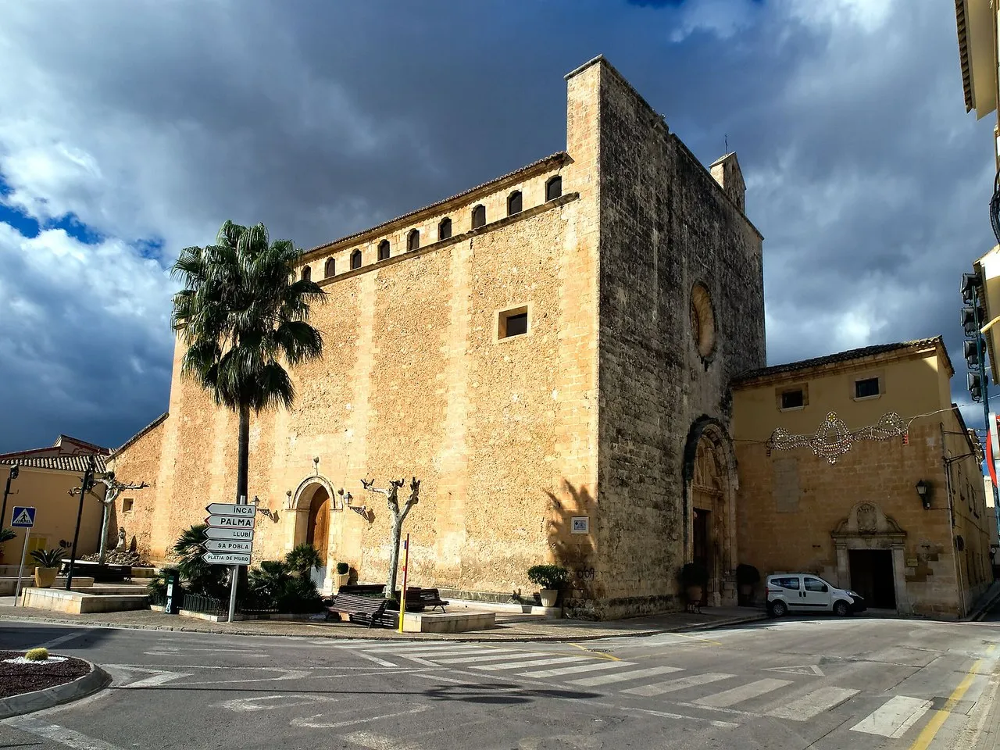
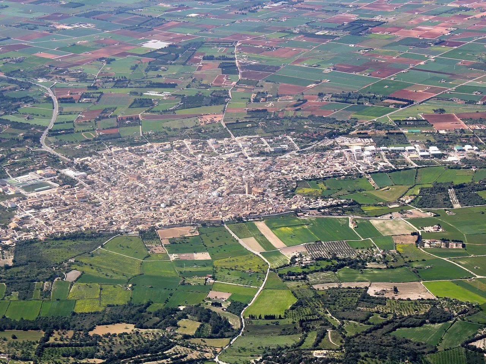
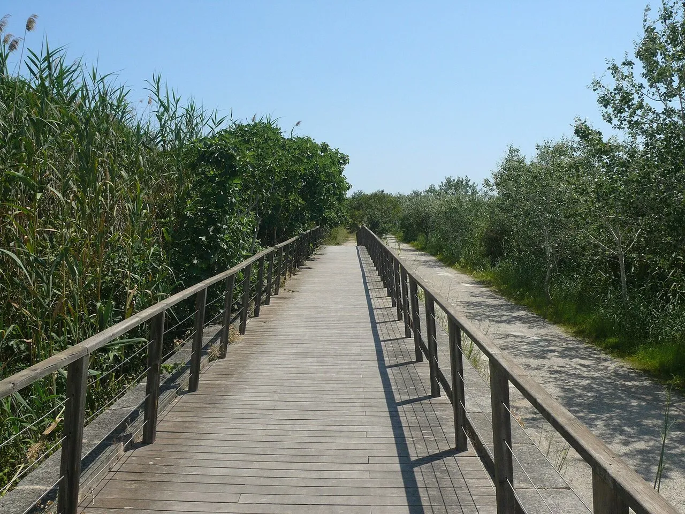
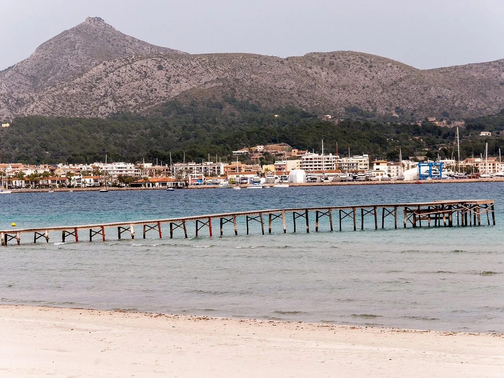

Un campanario que se ve desde toda la llanura, casas de piedra en el interior de la isla y, a pocos kilómetros, un humedal lleno de aves y una de las playas más largas de Mallorca. **Muro**, en el norte de **Mallorca**, combina pueblo tranquilo y naturaleza, y este año compite por ser el **pueblo de la Navidad de Ferrero Rocher**.

Te cuento qué ver y cuándo ir 👇

En un vistazo<h2>Lo que vas a encontrar</h2>

<b>⛪</b>Campanario gótico

<b>🦩</b>s'Albufera

<b>🏖️</b>Playa de Muro

<b>🔥</b>Sant Antoni

<b>🎄</b>Candidato Ferrero 2026

Antes de ir<h2>Lo básico de Muro</h2>

<h3>📍 Dónde está</h3>
En el <strong>norte de Mallorca</strong>, junto a la bahía de Alcúdia.

<h3>⏱️ Tiempo</h3>
<strong>Medio día</strong> para el pueblo y la Albufera; añade la playa en verano.

<h3>🔥 Mejor fecha</h3>
El <strong>16 y 17 de enero</strong>, por Sant Antoni.

<h3>🥟 Para comer</h3>
La <strong>espinagada</strong> de anguila, típica de Muro.

Qué ver<h2>Qué ver en Muro</h2>

<ol class="guide__grid guide__grid--cuenca">
<li class="gcard reveal">
01

<h3>Sant Joan Baptista</h3>
La gran iglesia gótica del pueblo, con un <strong>campanario separado</strong> que se une al templo por un pequeño puente y se ve desde toda la llanura.

</li>
<li class="gcard reveal">
02

<h3>El pueblo y su museo</h3>
Calles tranquilas de piedra, el antiguo convento de los Mínimos y el <strong>Museo Etnológico</strong>, en una casa del siglo XVII, para conocer la vida tradicional de Mallorca.

</li>
<li class="gcard reveal">
03

<h3>Parque Natural de s'Albufera</h3>
El <strong>humedal más importante de Mallorca</strong>, con pasarelas y observatorios para ver aves entre cañaverales.

</li>
<li class="gcard reveal">
04

<h3>La playa de Muro</h3>
Kilómetros de arena blanca y agua poco profunda en la <strong>bahía de Alcúdia</strong>, justo delante de s'Albufera.

</li>
</ol>

<!--actividades-->

<h3>🎄 Candidato a pueblo Ferrero Rocher</h3>
Muro representa a las <strong>Illes Balears</strong> en el concurso de la Navidad de Ferrero Rocher 2026. Mira cómo va y cómo votar en <a href="/blog/pueblo-navidad-ferrero-rocher-2026.html">el pueblo de la Navidad de Ferrero Rocher</a>.

Consejos de Cheno<h2>Para disfrutarlo al máximo</h2><ul><li><b>Lleva prismáticos</b> a s'Albufera.</li><li><b>Ve en enero</b> para vivir el Sant Antoni.</li><li><b>Desde el norte</b>, haz la <a href="https://www.civitatis.com/es/alcudia/excusion-soller-valldemosa/?aid=110968" target="_blank" rel="noopener sponsored">excursión a Sóller y Valldemossa</a>.</li><li><b>Combínalo con</b> más planes en <a href="/blog/mallorca-que-ver.html">Mallorca</a>.</li></ul>

<!--faq-->

<h2>¿Te gustan estos planes?</h2>
Sígueme en Instagram como <a href="https://www.instagram.com/chenoaventuras/" target="_blank" rel="noopener">@chenoaventuras</a>: subo escapadas como esta cada semana.
<a class="btn guide__btn" href="/blog.html">Ver más planes en el blog</a>

Información consultada en noviembre de 2026 en las webs de turismo de Muro, de las Illes Balears y de Turespaña. Fotos de Wikimedia Commons: <a href="https://commons.wikimedia.org/wiki/File:Muro,_en_Mallorca_(Baleares,_Espa%C3%B1a).jpg" target="_blank" rel="noopener">Chixoy</a> (CC BY-SA 3.0) · <a href="https://commons.wikimedia.org/wiki/File:MuroMallorca.jpg" target="_blank" rel="noopener">Araceli Merino</a> (CC BY-SA 3.0) · <a href="https://commons.wikimedia.org/wiki/File:Vista_a%C3%A8ria_de_Muro.JPG" target="_blank" rel="noopener">Chixoy</a> (CC BY-SA 3.0) · <a href="https://commons.wikimedia.org/wiki/File:S%27Albufera_de_Mallorca_42_(HS).jpg" target="_blank" rel="noopener">Harald Süpfle</a> (CC BY-SA 3.0) · <a href="https://commons.wikimedia.org/wiki/File:16-02-22-Playa-de-Muro-Mallorca-RalfR_RR26381.jpg" target="_blank" rel="noopener">Ralf Roletschek</a> (GFDL 1.2).

