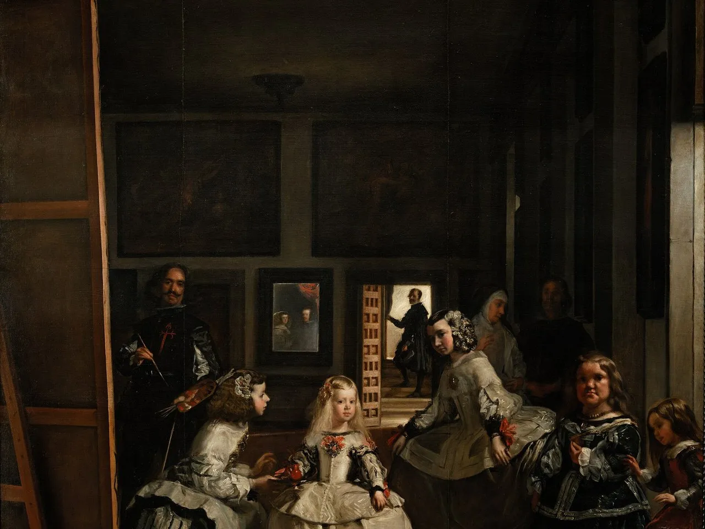
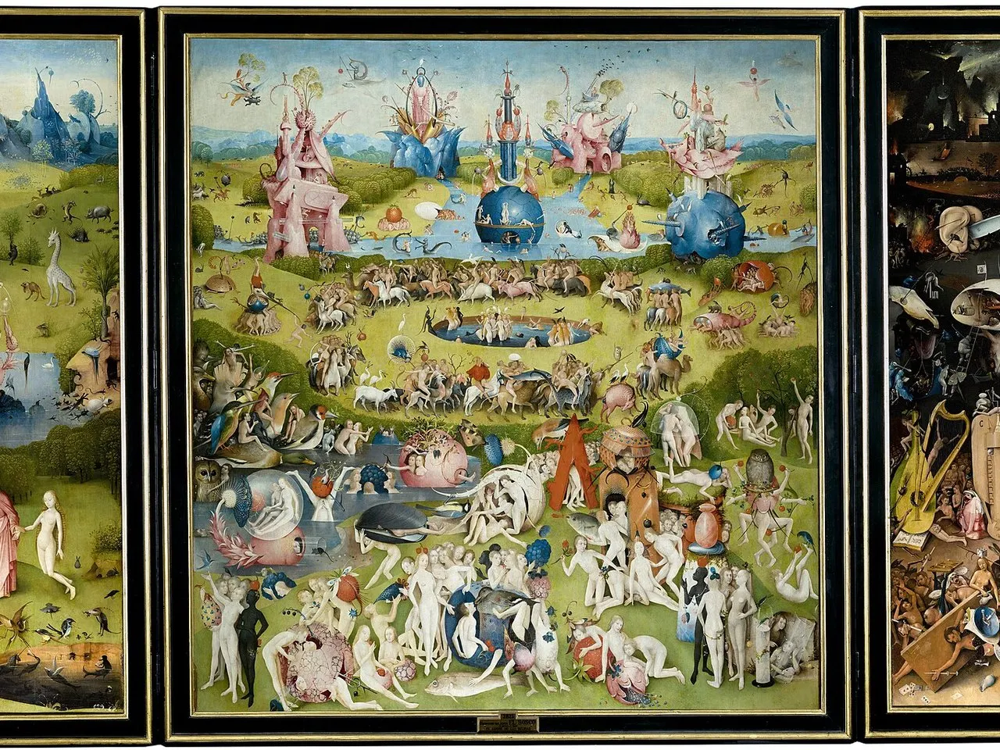
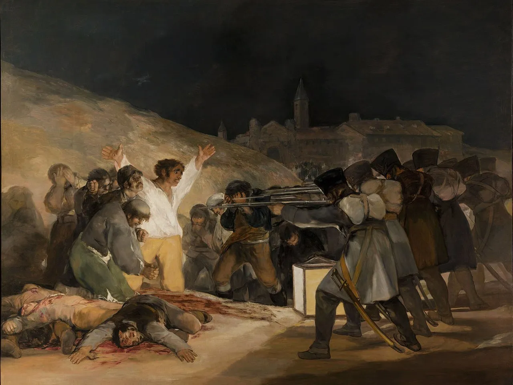
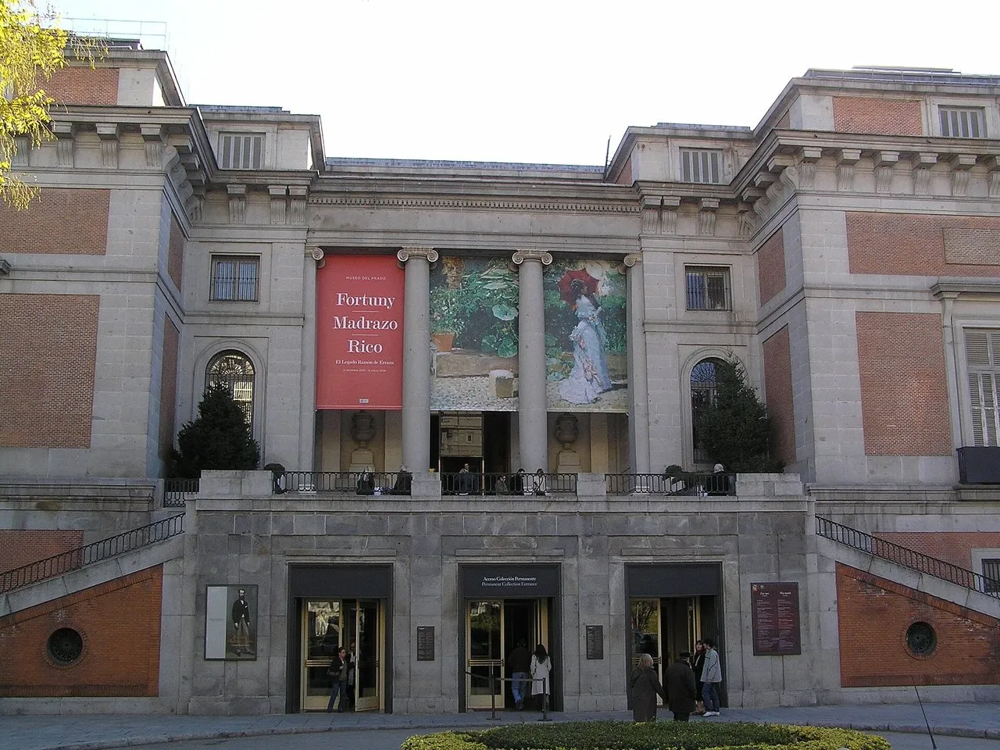

Las Meninas, el Jardín de las Delicias, los fusilamientos del Tres de Mayo… El **Museo del Prado** guarda algunos de los cuadros más famosos del mundo y es la visita imprescindible de **Madrid**. Y si vas en las dos últimas horas del día, **es gratis**.

Te cuento cuánto cuesta, cuándo no pagar, por qué puerta entrar y qué obras no te puedes perder 👇

En un vistazo<h2>Lo que vas a encontrar</h2>

<b>🖼️</b>Velázquez y Goya

<b>🎟️</b>Entrada 15 €

<b>🆓</b>Gratis 2 últimas horas

<b>🚇</b>Metro Estación del Arte

<b>🎧</b>Audioguía 5 €

Antes de ir<h2>Lo básico del Prado</h2>

<h3>🎟️ Precio</h3>
General <strong>15 €</strong>; reducida <strong>7,50 €</strong> (+65, carné joven, familia numerosa). Al comprar eliges un pase horario.

<h3>🆓 Gratis</h3>
Las <strong>dos últimas horas</strong>: 18:00-20:00 de lunes a sábado y 17:00-19:00 domingos y festivos, en taquilla hasta completar aforo.

<h3>🕙 Horario</h3>
Lunes a sábado <strong>10:00-20:00</strong>; domingos y festivos <strong>10:00-19:00</strong>. Último acceso, 30 minutos antes.

<h3>🚫 Cierra</h3>
<strong>1 de enero, 1 de mayo y 25 de diciembre</strong>. El 6 de enero, 24 y 31 de diciembre, solo de 10:00 a 14:00.

Precios<h2>Entradas del Prado y quién entra gratis</h2>

<strong>General:</strong> 15 €. <strong>Reducida:</strong> 7,50 € para mayores de 65, titulares del carné joven y miembros de familia numerosa.

<strong>Gratis:</strong> menores de 18 años, estudiantes de 18 a 25 años, estudiantes de arte de cualquier edad y personas con discapacidad, entre otros colectivos.

<strong>Extras:</strong> audioguía, 5 €; visita guiada, 10 € más; entrada con el libro del museo, 24 €.

También puedes reservar la <a href="https://www.civitatis.com/es/madrid/entrada-museo-prado/?aid=110968" target="_blank" rel="noopener sponsored">entrada al Prado en Civitatis</a> o una <a href="https://www.civitatis.com/es/madrid/visita-guiada-museo-prado/?aid=110968" target="_blank" rel="noopener sponsored">visita guiada</a> para ir directo a lo importante.

Qué ver<h2>Obras imprescindibles del Prado</h2>

<ol class="guide__grid guide__grid--cuenca">
<li class="gcard reveal">
01

<h3>Las Meninas, de Velázquez</h3>
La infanta Margarita con sus damas y el propio Velázquez pintando. Fíjate en el espejo del fondo: ahí aparecen los reyes.

</li>
<li class="gcard reveal">
02

<h3>El jardín de las Delicias, de El Bosco</h3>
Un tríptico lleno de personajes y criaturas imposibles. Podrías pasarte media hora descubriendo detalles.

</li>
<li class="gcard reveal">
03

<h3>El Tres de Mayo, de Goya</h3>
Los fusilamientos de 1808, uno de los cuadros más impactantes de la historia del arte. Cerca están también sus Pinturas Negras.

</li>
<li class="gcard reveal">
04

<h3>El edificio Villanueva</h3>
El edificio neoclásico del museo, con la estatua de Velázquez frente a la fachada principal y la de Goya junto a su puerta, donde están las taquillas.

</li>
</ol>

<!--actividades-->

Cómo llegar<h2>Cómo llegar y por qué puerta entrar</h2>

<h3>🚇 En metro</h3>
<strong>Estación del Arte</strong> (L1, a 800 m) o <strong>Banco de España</strong> (L2, a 650 m).

<h3>🚌 En autobús</h3>
Líneas <strong>001, 10, 14, 27, 34, 37, 45 y C03</strong>. En Cercanías, Atocha.

<h3>🚪 Puerta de Goya</h3>
<strong>Taquillas</strong> y acceso a la colección.

<h3>🚪 Puerta de los Jerónimos</h3>
Colección y <strong>exposiciones temporales</strong>; acceso preferente con movilidad reducida.

Consejos de Cheno<h2>Para disfrutarlo al máximo</h2><ul><li><b>Si vas gratis</b>, ponte en la cola un rato antes: en temporada alta se llena.</li><li><b>Haz una lista</b> de 8 o 10 obras: el museo es enorme y es mejor ver pocas bien.</li><li><b>Audioguía o guía</b>: cambia mucho entender lo que estás viendo.</li><li><b>Combínalo con</b> el <a href="/blog/palacio-real-de-madrid.html">Palacio Real</a> y <a href="/blog/madrid-que-ver.html">qué ver en Madrid</a>.</li></ul>

<!--faq-->

<h2>¿Te gustan estos planes?</h2>
Sígueme en Instagram como <a href="https://www.instagram.com/chenoaventuras/" target="_blank" rel="noopener">@chenoaventuras</a>: subo escapadas como esta cada semana.
<a class="btn guide__btn" href="/blog.html">Ver más planes en el blog</a>

Información consultada en noviembre de 2026 en la web oficial del Museo Nacional del Prado (horarios, tarifas y cómo llegar). Fotos de Wikimedia Commons: <a href="https://commons.wikimedia.org/wiki/File:Museo_del_Prado_2016_(25185969599).jpg" target="_blank" rel="noopener">Emilio J. Rodríguez Posada</a> (CC BY-SA 2.0) · <a href="https://commons.wikimedia.org/wiki/File:Puerta_de_Goya_del_Museo_del_Prado_(6_de_diciembre_de_2005,_Madrid).jpg" target="_blank" rel="noopener">Discasto</a> (CC BY-SA 4.0) · cuadros de Velázquez, El Bosco y Goya en <a href="https://commons.wikimedia.org/wiki/File:Las_Meninas,_by_Diego_Vel%C3%A1zquez,_from_Prado_in_Google_Earth.jpg" target="_blank" rel="noopener">dominio</a> <a href="https://commons.wikimedia.org/wiki/File:El_jard%C3%ADn_de_las_Delicias,_de_El_Bosco.jpg" target="_blank" rel="noopener">público</a> (<a href="https://commons.wikimedia.org/wiki/File:El_Tres_de_Mayo,_by_Francisco_de_Goya,_from_Prado_thin_black_margin.jpg" target="_blank" rel="noopener">Tres de Mayo</a>).

