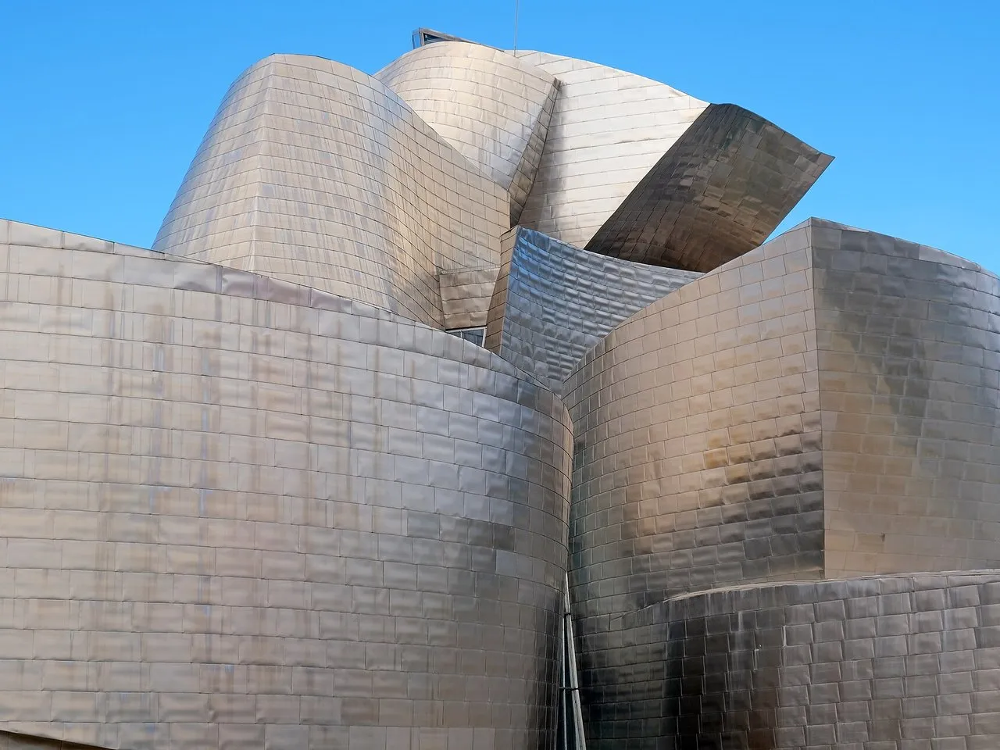
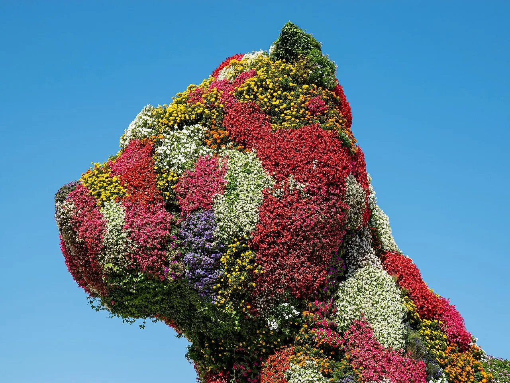
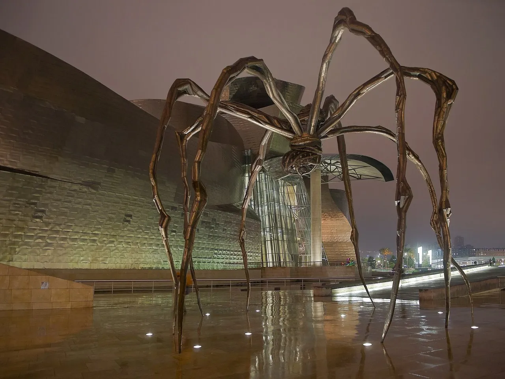
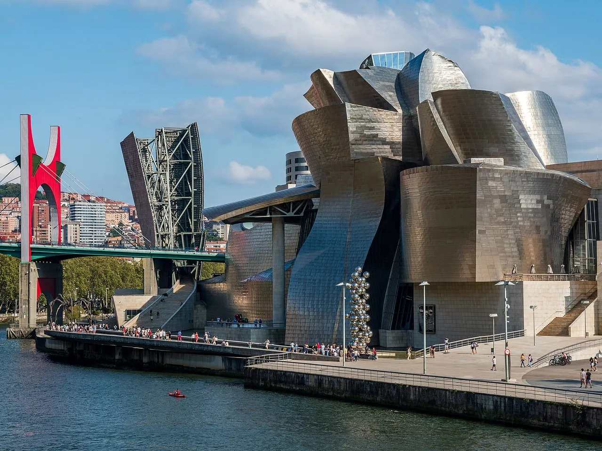
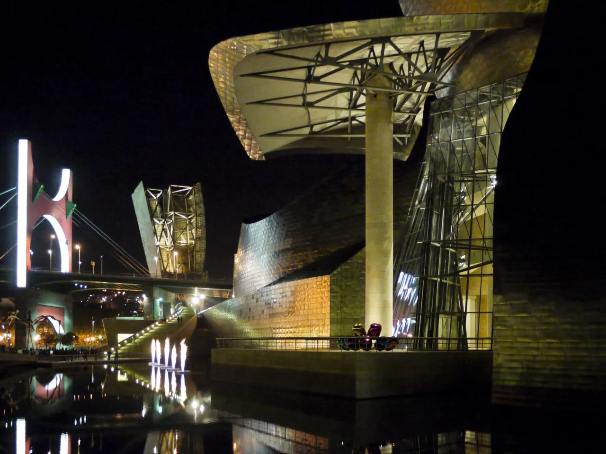
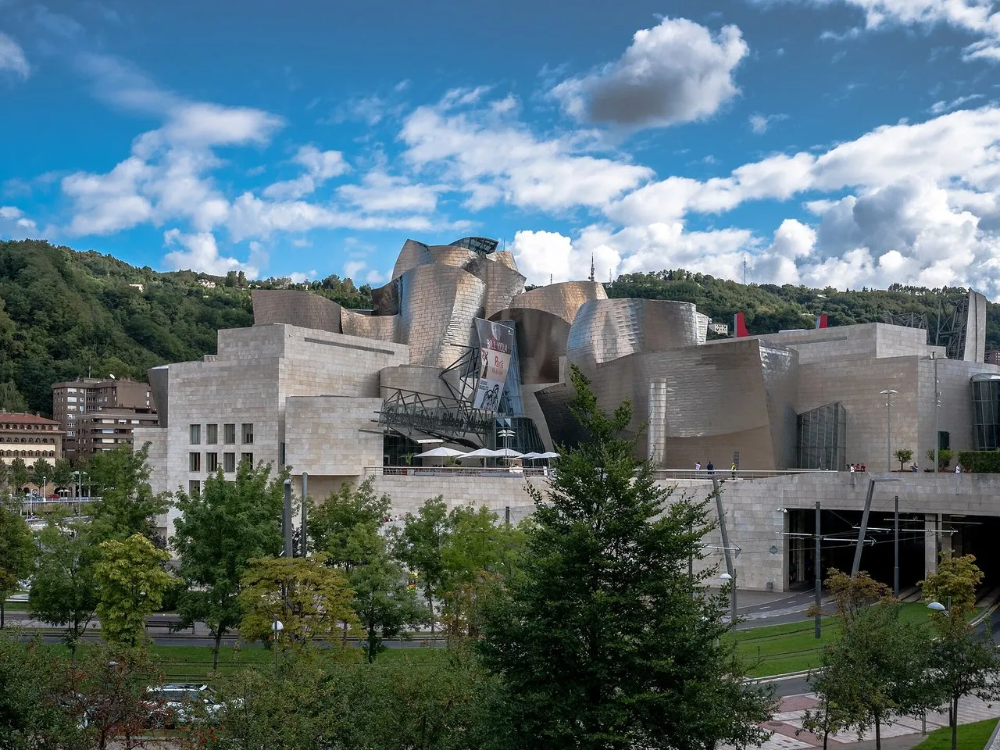

Un barco de titanio varado junto a la ría, un perro gigante cubierto de flores y una araña de nueve metros. El **Museo Guggenheim Bilbao**, de **Frank Gehry**, cambió la ciudad para siempre, y buena parte se disfruta gratis desde fuera.

Te cuento cuánto cuesta, el horario, qué ver gratis y cómo llegar 👇

En un vistazo<h2>Lo que vas a encontrar</h2>

<b>🏛️</b>Edificio de Gehry

<b>🐶</b>Puppy

<b>🕷️</b>Mamá

<b>🎧</b>Audioguía gratis

<b>👦</b>Menores de 18 gratis

Antes de ir<h2>Lo básico del Guggenheim</h2>

<h3>🎟️ Precio</h3>
<strong>15 €</strong> adultos; <strong>7,5 €</strong> estudiantes (18-25) y mayores de 65. <strong>Menores de 18, gratis</strong>.

<h3>🕙 Horario</h3>
De <strong>martes a domingo, 10:00-19:00</strong>. Lunes cerrado, salvo el 7 y 28 de diciembre y en verano.

<h3>🎧 Audioguía</h3>
<strong>Incluida</strong>: se escucha en el móvil escaneando un código QR.

<h3>🎄 Navidad</h3>
24 y 31 de diciembre, hasta las 17:00. Cerrado el 25 de diciembre y el 1 de enero.

Qué ver<h2>Qué ver en el Guggenheim Bilbao</h2>

<ol class="guide__grid guide__grid--cuenca">
<li class="gcard reveal">
01

<h3>El edificio de Gehry</h3>
Curvas de titanio, piedra y cristal que cambian de color con la luz. Por dentro, pasarelas curvas y ascensores de titanio y cristal.

</li>
<li class="gcard reveal">
02

<h3>Puppy</h3>
El perro gigante cubierto de flores de <strong>Jeff Koons</strong> (1992), a la entrada del museo. Se ve gratis.

</li>
<li class="gcard reveal">
03

<h3>Mamá</h3>
La araña gigante de <strong>Louise Bourgeois</strong> (1999), junto a la ría. De noche, iluminada, impresiona aún más.

</li>
<li class="gcard reveal">
04

<h3>La materia del tiempo</h3>
Dentro, bajo el puente de La Salve, la sala 104 guarda las enormes esculturas de acero de <strong>Richard Serra</strong> (1994-2005), por las que se camina.

</li>
<li class="gcard reveal">
05

<h3>El paseo de la ría</h3>
El exterior se recorre libremente, con obras de Chillida, Yves Klein y la escultura de niebla de Fujiko Nakaya. Al anochecer, el reflejo en la ría es precioso.

</li>
<li class="gcard reveal">
06

<h3>Las vistas desde arriba</h3>
Desde lo alto de los alrededores se entiende la forma de barco del edificio, con 24.000 m², 9.000 de ellos de exposición.

</li>
</ol>

<!--actividades-->

Cómo llegar<h2>Cómo llegar al Guggenheim</h2>

<h3>🚇 En metro</h3>
Parada <strong>Moyua</strong>, salida Ercilla-Guggenheim.

<h3>🚋 En tranvía</h3>
Parada <strong>Guggenheim</strong>, junto al museo.

<h3>🚌 En autobús</h3>
Líneas 01, 10, 13, 18 y A7 (parada Museo 1 / Henao).

<h3>🅿️ Aparcar</h3>
No tiene parking propio: los más cercanos están en la plaza Pío Baroja y la plaza Euskadi.

Consejos de Cheno<h2>Para disfrutarlo al máximo</h2><ul><li><b>Rodea el edificio antes de entrar</b>: lo de fuera es gratis y es medio museo.</li><li><b>Compra en la web oficial o con Civitatis</b>: la <a href="https://www.civitatis.com/es/bilbao/entradas-museo-guggenheim/?aid=110968" target="_blank" rel="noopener sponsored">entrada con audioguía</a> o la <a href="https://www.civitatis.com/es/bilbao/tour-museo-guggenheim/?aid=110968" target="_blank" rel="noopener sponsored">visita guiada</a>.</li><li><b>Con menores de 18</b>, entran gratis: plan perfecto en familia.</li><li><b>Combínalo con</b> <a href="/blog/bilbao-que-ver.html">qué ver en Bilbao</a> y una escapada a <a href="/blog/san-juan-de-gaztelugatxe.html">San Juan de Gaztelugatxe</a>.</li></ul>

<!--faq-->

<h2>¿Te gustan estos planes?</h2>
Sígueme en Instagram como <a href="https://www.instagram.com/chenoaventuras/" target="_blank" rel="noopener">@chenoaventuras</a>: subo escapadas como esta cada semana.
<a class="btn guide__btn" href="/blog.html">Ver más planes en el blog</a>

Información consultada en noviembre de 2026 en la web oficial del Museo Guggenheim Bilbao. Fotos de Wikimedia Commons (exterior): <a href="https://commons.wikimedia.org/wiki/File:Bilbao_-_Guggenheim_aurore.jpg" target="_blank" rel="noopener">PA</a> (CC BY-SA 4.0) · <a href="https://commons.wikimedia.org/wiki/File:Guggenheim_Museum_Bilbao_2.jpg" target="_blank" rel="noopener">kallerna</a> (CC BY-SA 4.0) · <a href="https://commons.wikimedia.org/wiki/File:Puppy_de_Jeff_Koons_--_2021_--_Bilbao,_Espa%C3%B1a.jpg" target="_blank" rel="noopener">José Ligero Loarte</a> (CC BY-SA 4.0) · <a href="https://commons.wikimedia.org/wiki/File:Maman_de_Louise_Bourgeois_-_Bilbao.jpg" target="_blank" rel="noopener">Didier Descouens</a> (CC BY-SA 4.0) · <a href="https://commons.wikimedia.org/wiki/File:Museo_Guggenheim_--_2021_--_Bilbao,_Euskadi,_Espa%C3%B1a.jpg" target="_blank" rel="noopener">José Ligero Loarte</a> (CC BY-SA 4.0) · <a href="https://commons.wikimedia.org/wiki/File:Museo_Guggenheim_Bilbao-night_view-river_side.jpg" target="_blank" rel="noopener">Xauxa</a> (CC BY-SA 3.0) · <a href="https://commons.wikimedia.org/wiki/File:Bilbao_-_Museo_Guggenheim_01.jpg" target="_blank" rel="noopener">Basotxerri</a> (CC BY-SA 4.0).

