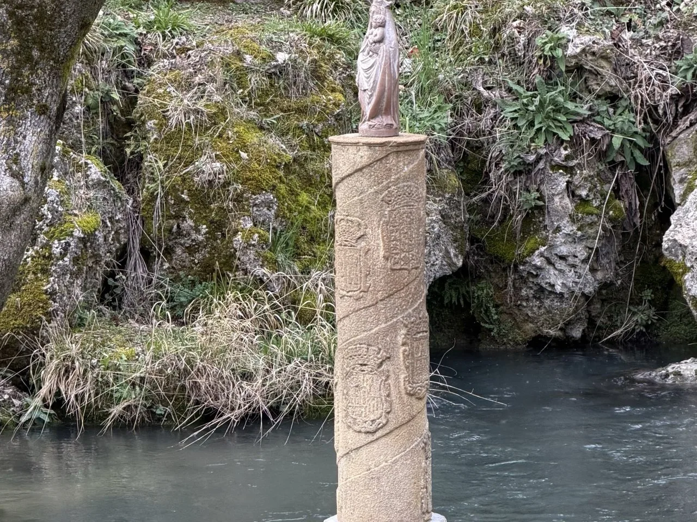
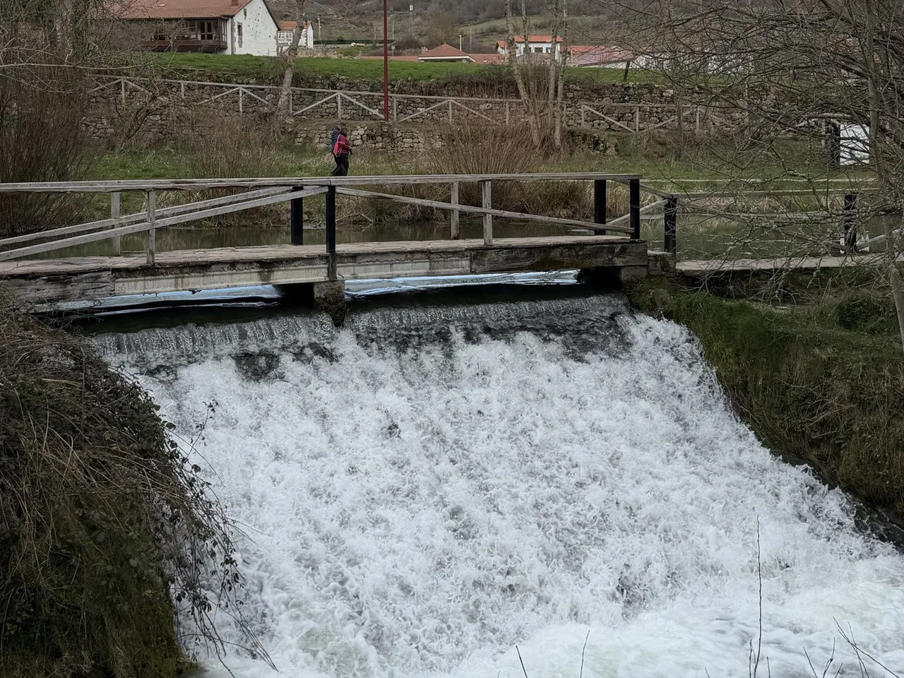
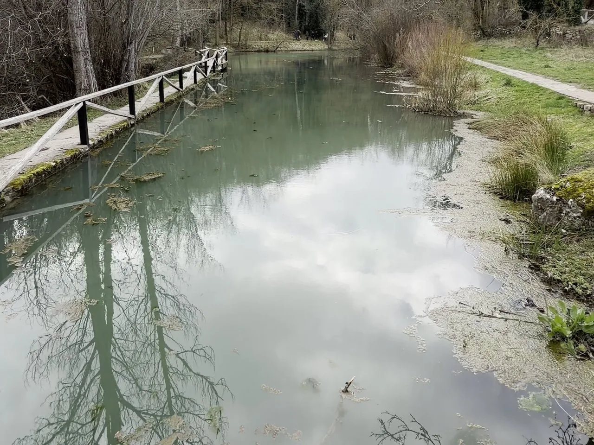
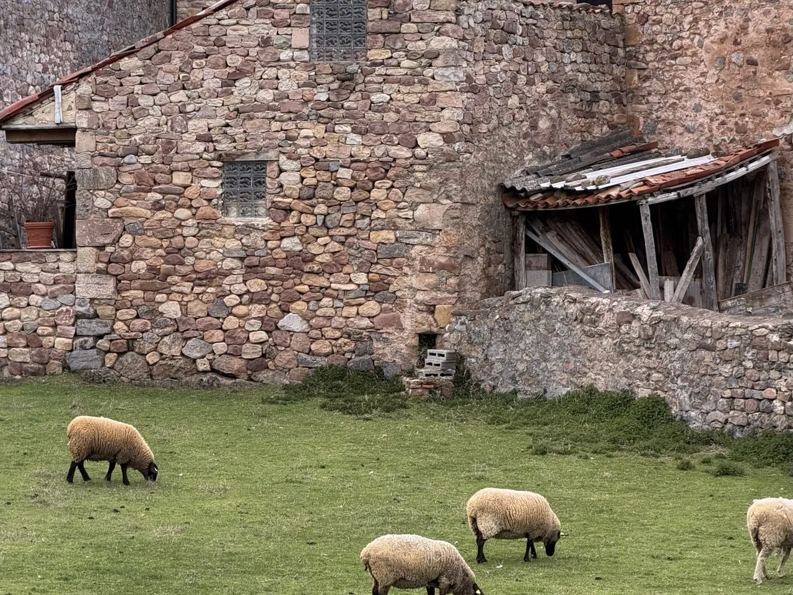
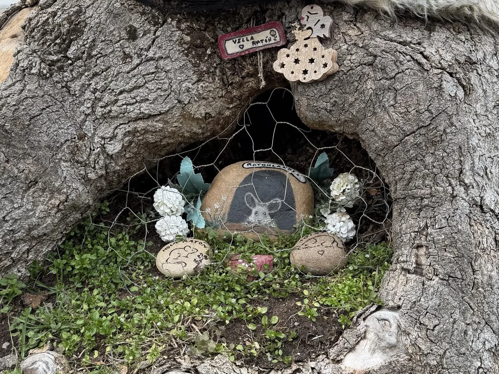

Uno de los ríos más importantes de España empieza aquí, en una **poza verde** rodeada de árboles. En **Fontibre**, a pocos minutos de **Reinosa**, brota el **Ebro**, que recorrerá unos **910 kilómetros** hasta el Mediterráneo. Es un paseo corto y bonito, con un pequeño misterio incluido: ¿nace de verdad aquí?

Te lo cuento 👇

En un vistazo<h2>Lo que vas a encontrar</h2>

<b>💧</b>La Fuentona

<b>🗿</b>Columna de la Virgen

<b>🌳</b>Paseo junto al río

<b>⛪</b>Iglesia románica

<b>📏</b>910 km de río

Antes de ir<h2>Lo básico</h2>

<h3>📍 Dónde está</h3>
En <strong>Fontibre</strong>, a pocos minutos en coche de Reinosa, en el sur de Cantabria.

<h3>⏱️ Tiempo</h3>
Unos 30 minutos para el nacimiento; <strong>una hora</strong> con el paseo y el pueblo.

<h3>🆓 Precio</h3>
Ver el nacimiento es <strong>gratis</strong> y no tiene horario.

Qué ver<h2>Qué ver en Fontibre</h2>

<ol class="guide__grid guide__grid--cuenca">
<li class="gcard reveal">
01

<h3>La Fuentona</h3>
La poza donde brota el agua, con una <strong>columna coronada por la Virgen del Pilar</strong>, patrona de Zaragoza, la gran ciudad del Ebro.

</li>
<li class="gcard reveal">
02

<h3>Los primeros metros</h3>
Justo después, el río ya baja con fuerza bajo <strong>pasarelas de madera</strong>. Con lluvia o deshielo, impresiona.

</li>
<li class="gcard reveal">
03

<h3>El paseo junto al río</h3>
Un camino llano entre árboles y aguas verdes. Hay zona de <strong>picnic</strong> junto al manantial.

</li>
<li class="gcard reveal">
04

<h3>El pueblo</h3>
Casas de piedra y prados con ovejas. La iglesia de <strong>San Félix</strong> conserva el ábside románico.

</li>
<li class="gcard reveal">
05

<h3>Detalles del camino</h3>
Troncos decorados con <strong>figuritas</strong> y rincones curiosos. A los niños les encanta buscarlos.

</li>
</ol>

<h3>💧 ¿Nace de verdad aquí?</h3>
La tradición dice que el Ebro nace en La Fuentona. Pero buena parte de su agua viene del río <strong>Híjar</strong>, que baja desde las montañas de <strong>Alto Campoo</strong>, se filtra bajo tierra y vuelve a salir aquí. Por eso hay quien dice que el «verdadero» nacimiento está más arriba. Fontibre sigue siendo el lugar simbólico.

Cómo llegar<h2>Cómo llegar al Nacimiento del Ebro</h2>

En coche, a <strong>pocos minutos de Reinosa</strong>. Desde Santander, alrededor de una hora por la A-67. Hay aparcamiento junto al nacimiento, a unos pasos de la poza.

<a class="btn guide__mapbtn" href="https://www.google.com/maps/dir/?api=1&destination=43.0081,-4.1803" target="_blank" rel="noopener"><svg class="ico" viewBox="0 0 24 24" width="15" height="15" aria-hidden="true" fill="currentColor"><path d="M12 2a7 7 0 0 0-7 7c0 5.25 7 13 7 13s7-7.75 7-13a7 7 0 0 0-7-7zm0 9.5a2.5 2.5 0 1 1 0-5 2.5 2.5 0 0 1 0 5z"/></svg> Cómo llegar en Google Maps</a>

Combínalo con el <a href="/blog/castillo-de-argueso.html">Castillo de Argüeso</a>, la <a href="/blog/maquina-leche-reinosa-cantabria.html">máquina de leche de Reinosa</a> o, ya en Palencia, <a href="/blog/aguilar-de-campoo-que-ver.html">Aguilar de Campoo</a>. Y si quieres ver dónde termina el río, mira mi guía del <a href="/blog/delta-del-ebro-que-ver.html">Delta del Ebro</a>.

Consejos de Cheno<h2>Para disfrutarlo al máximo</h2><ul><li><b>Ve en primavera</b> o después de llover: el río baja con más fuerza.</li><li><b>Lleva algo de comer</b> y aprovecha la zona de picnic.</li><li><b>Abrígate</b>: Campoo es frío casi todo el año.</li></ul>

<!--actividades-->

<!--faq-->

<h2>¿Te gustan estos planes?</h2>
Sígueme en Instagram como <a href="https://www.instagram.com/chenoaventuras/" target="_blank" rel="noopener">@chenoaventuras</a>: subo escapadas como esta cada semana.
<a class="btn guide__btn" href="/blog.html">Ver más planes en el blog</a>

Información consultada en noviembre de 2026. Fotos: Chenoaventuras.

