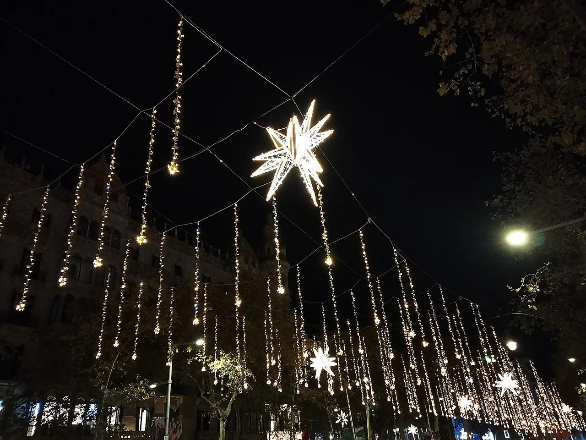
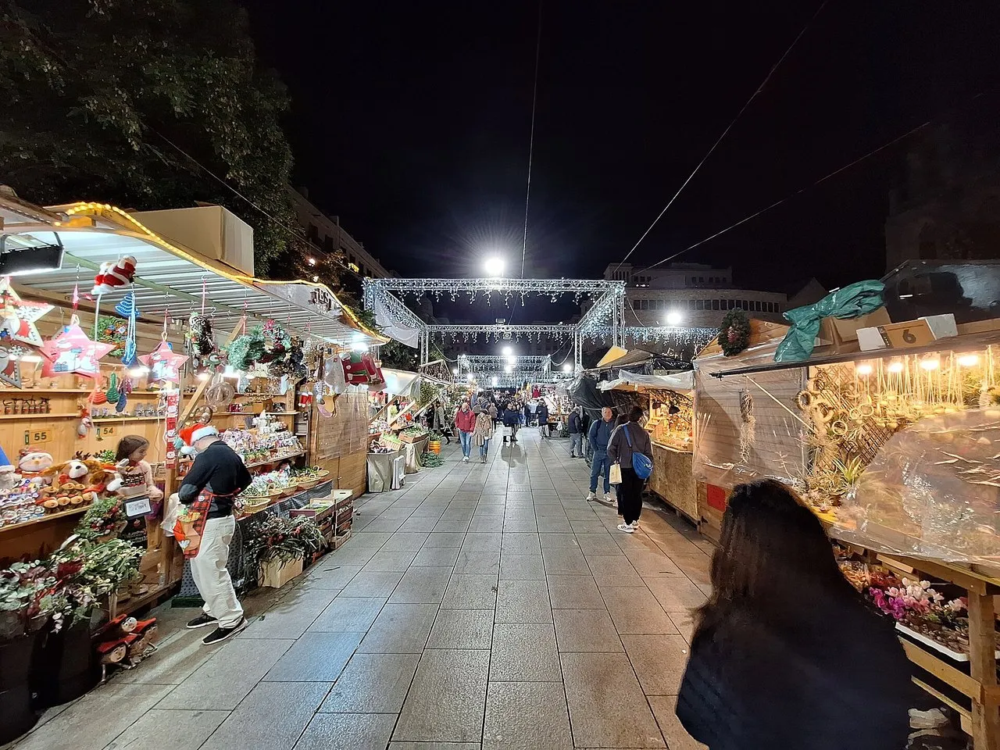
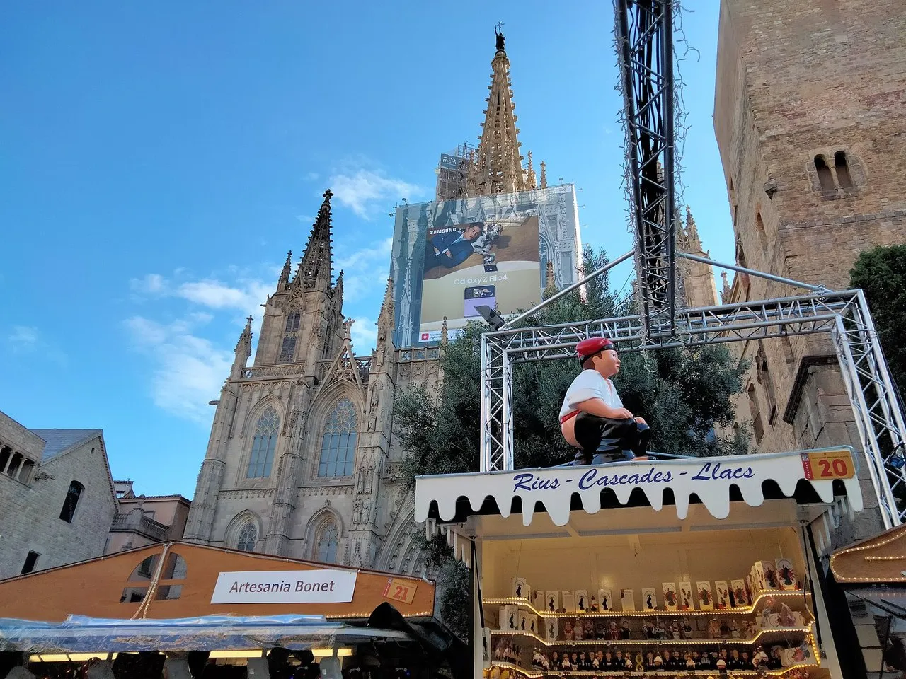
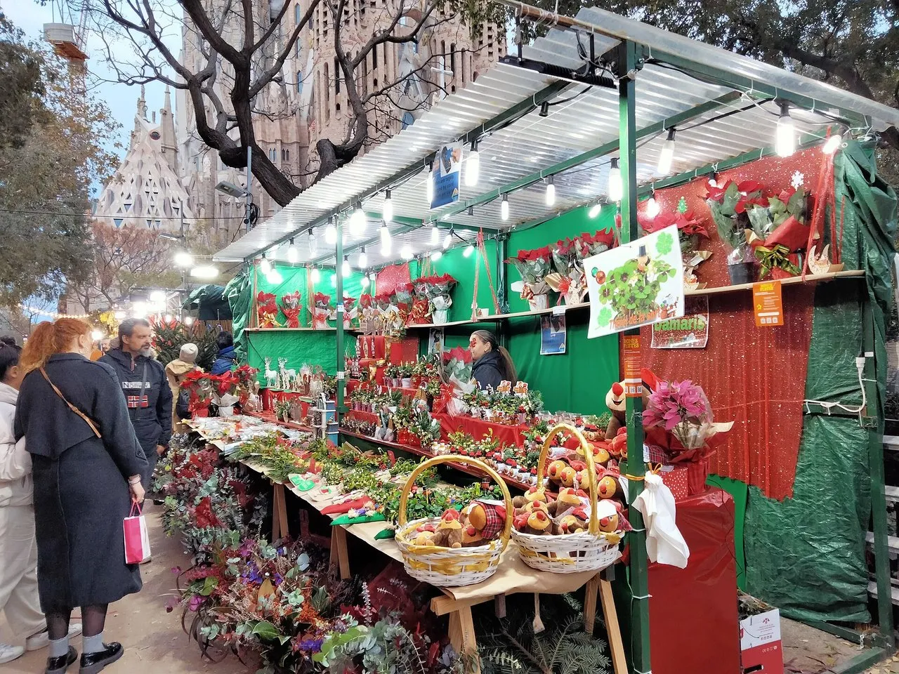
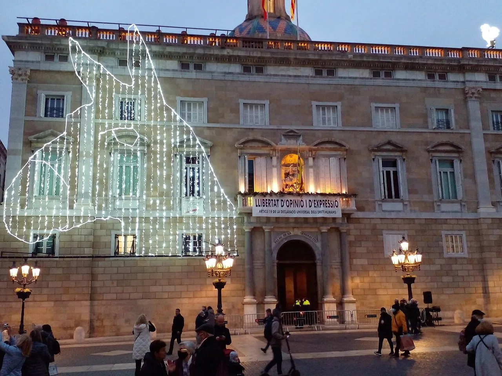
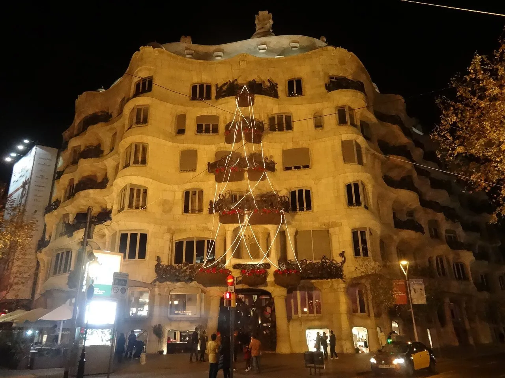

Barcelona en Navidad huele a castañas asadas, tiene un mercado de belenes con **240 años** de historia junto a la Catedral y unos personajes que no verás en ningún otro sitio: el **caganer** y el **Tió**. Las luces del **paseo de Gràcia** se encienden el **26 de noviembre**.

Te cuento las fechas oficiales de 2026, los horarios y qué ver 👇

En un vistazo<h2>Lo que vas a encontrar</h2>

<b>💡</b>Luces desde el 26 nov

<b>🎄</b>Fira de Santa Llúcia

<b>⛪</b>Mercado de la Sagrada Família

<b>✨</b>Proyección en Sant Jaume

<b>🪵</b>Tió gigante

Antes de ir<h2>Lo básico de la Navidad en Barcelona</h2>

<h3>📅 Cuándo</h3>
Del <strong>21 de noviembre</strong> (abre el mercado de la Sagrada Família) al <strong>6 de enero</strong>. Las luces se encienden el <strong>jueves 26 de noviembre</strong> a las 18:00.

<h3>🕔 Horario de las luces</h3>
De domingo a jueves, de <strong>17:30 a 01:00</strong>; viernes y sábados, hasta las <strong>02:00</strong>. El 24, 25 y 31 de diciembre y el 5 de enero, también hasta las 02:00.

<h3>💶 Precio</h3>
Casi todo es <strong>gratis</strong>: luces, mercados, la proyección de Sant Jaume y la cabalgata.

<h3>🚇 Cómo moverte</h3>
En <strong>metro</strong>: Passeig de Gràcia (L2, L3, L4) para las luces, Jaume I (L4) para la Catedral y Sant Jaume, y Sagrada Família (L2, L5).

Qué ver<h2>Los imprescindibles de la Navidad en Barcelona</h2>

<ol class="guide__grid guide__grid--cuenca">
<li class="gcard reveal">
01

<h3>Las luces del paseo de Gràcia</h3>
El encendido oficial es el <strong>26 de noviembre a las 18:00</strong>, entre las calles Rosselló y Provença, con entrada libre. Las luces duran hasta el 6 de enero.

</li>
<li class="gcard reveal">
02

<h3>La Fira de Santa Llúcia</h3>
El mercado navideño más antiguo de la ciudad, documentado desde <strong>1786</strong>. Del <strong>27 de noviembre al 23 de diciembre</strong>, de 10:00 a 21:00, en la avenida de la Catedral: 211 puestos de belenes, musgo, figuras y artesanía.

</li>
<li class="gcard reveal">
03

<h3>Caganers y el Tió gigante</h3>
En la Fira encontrarás caganers de todos los famosos imaginables. Y del <strong>4 al 19 de diciembre</strong>, un <strong>Tió gigante</strong> en el Pla de la Seu, delante de la Catedral.

</li>
<li class="gcard reveal">
04

<h3>El mercado de la Sagrada Família</h3>
Del <strong>21 de noviembre al 23 de diciembre</strong>, de 10:00 a 21:00, con más de 70 puestos a los pies del templo de Gaudí y un espacio infantil gratuito.

</li>
<li class="gcard reveal">
05

<h3>La plaza de Sant Jaume</h3>
En 2026, en vez de belén, «<strong>Postales de Navidad</strong>»: una proyección de Alba G. Corral sobre las fachadas del Ayuntamiento y la Generalitat. Del 26 de noviembre al 5 de enero, desde las 18:30 (sesiones con música a las 18:30, 19:30 y 20:30). No hay proyección el 30 de noviembre ni el 1, 3 y 10 de diciembre.

</li>
<li class="gcard reveal">
06

<h3>Gaudí de noche</h3>
Con las luces encendidas, el paseo de Gràcia es el mejor momento para ver la <strong>Casa Batlló</strong> y <strong>La Pedrera</strong> iluminadas, a pocos pasos una de otra.

</li>
</ol>

<!--actividades-->

Tradiciones<h2>Caganer y Tió: la Navidad más catalana</h2>

El <strong>caganer</strong> es una figurita que se esconde en un rincón del belén catalán, agachada y en plena faena. Hoy se hacen de futbolistas, políticos y famosos de todo el mundo, y es el recuerdo que más se lleva la gente de la Fira de Santa Llúcia.

<h3>🪵 El Tió de Nadal</h3>
Un tronco con cara, barretina y manta que los niños «alimentan» durante diciembre. En Nochebuena o Navidad lo golpean con palos mientras cantan para que «cague» regalos y dulces. Lo verás en todos los mercados, y en versión gigante delante de la Catedral.

Más planes<h2>Otras fechas de la Navidad en Barcelona 2026</h2>

<h3>⚓ Nadal al Port</h3>
Feria navideña en el <strong>Moll de la Fusta</strong>, del 27 de noviembre al 6 de enero.

<h3>🎶 Conciertos en Sant Jaume</h3>
<strong>12 de diciembre</strong> a las 19:00, concierto de Navidad de corales, y <strong>19 de diciembre</strong> a las 20:00, villancicos del Orfeó Manresà. Gratis.

<h3>🎅 Cabalgata de Papá Noel</h3>
El <strong>20 de diciembre</strong>, por la calle de Sants y Creu Coberta (27.ª edición).

<h3>👑 Reyes Magos</h3>
La cabalgata es la tarde del <strong>5 de enero</strong>. Consulta el recorrido en la web del Ayuntamiento cuando se publique.

Plan de Cheno<h2>La Navidad de Barcelona en un día</h2><ul><li><b>Mañana:</b> mercado de la Sagrada Família y, si tienes entrada, visita al templo.</li><li><b>Mediodía:</b> paseo por el Barrio Gótico y la Fira de Santa Llúcia, con el Tió gigante en el Pla de la Seu.</li><li><b>Atardecer:</b> plaza de Sant Jaume para la proyección (primera sesión a las 18:30).</li><li><b>Noche:</b> luces del paseo de Gràcia con la Casa Batlló y La Pedrera iluminadas. Si no quieres andar, súbete al <a href="https://www.civitatis.com/es/barcelona/autobus-navidad-barcelona/?aid=110968" target="_blank" rel="noopener sponsored">autobús navideño</a> o apúntate al <a href="https://www.civitatis.com/es/barcelona/tour-navidad-barcelona/?aid=110968" target="_blank" rel="noopener sponsored">free tour de Navidad</a>.</li></ul>

Consejos de Cheno<h2>Para disfrutarla al máximo</h2><ul><li><b>Evita los fines de semana por la tarde</b> en la Fira de Santa Llúcia: entre semana y por la mañana se pasea mucho mejor.</li><li><b>Ojo con los carteristas</b> en las zonas con más gente: lleva la mochila delante.</li><li><b>El 24 de diciembre la Fira ya ha cerrado</b>: si quieres comprar figuras, ve antes del 23.</li><li><b>Combínalo con</b> la <a href="/blog/barcelona-que-ver.html">guía de qué ver en Barcelona</a>.</li></ul>

🎄 <strong>Más Navidad en España:</strong> <a href="/blog/navidad-en-madrid.html">Madrid</a> · <a href="/blog/magicas-navidades-torrejon.html">Mágicas Navidades de Torrejón</a> · <a href="/blog/navidad-en-sevilla.html">Sevilla</a> · <a href="/blog/navidad-en-zaragoza.html">Zaragoza</a> · <a href="/blog/navidad-en-malaga.html">Málaga</a> · <a href="/blog/luces-navidad-vigo.html">luces de Vigo</a> · <a href="/blog/belen-viviente-buitrago-del-lozoya.html">Belén viviente de Buitrago</a> · <a href="/blog/pueblo-navidad-ferrero-rocher-2026.html">Pueblo Navidad Ferrero Rocher</a>.

<!--faq-->

<h2>¿Te gustan estos planes?</h2>
Sígueme en Instagram como <a href="https://www.instagram.com/chenoaventuras/" target="_blank" rel="noopener">@chenoaventuras</a>: subo escapadas como esta cada semana.
<a class="btn guide__btn" href="/blog.html">Ver más planes en el blog</a>

Información consultada en noviembre de 2026 en la Guía de Barcelona y en Info Barcelona (Ayuntamiento de Barcelona). Las fechas y horarios pueden cambiar: confírmalos antes de ir. Fotos de Wikimedia Commons: <a href="https://commons.wikimedia.org/wiki/File:058_Passeig_de_Gr%C3%A0cia_(Barcelona),_il%C2%B7luminaci%C3%B3_nadalenca.jpg" target="_blank" rel="noopener">Enric</a> (CC BY 4.0) · <a href="https://commons.wikimedia.org/wiki/File:118_Passeig_de_Gr%C3%A0cia_(Barcelona),_Nadal_2025.jpg" target="_blank" rel="noopener">Enric</a> (CC BY-SA 4.0) · <a href="https://commons.wikimedia.org/wiki/File:Fira_de_Santa_Ll%C3%BAcia_-_20231203_205945.jpg" target="_blank" rel="noopener">Pere López Brosa</a> (CC BY-SA 4.0) · <a href="https://commons.wikimedia.org/wiki/File:072_Fira_de_Santa_Ll%C3%BAcia,_av._de_la_Catedral_(Barcelona),_caganer,_amb_la_Catedral_al_fons.jpg" target="_blank" rel="noopener">Enric</a> (CC BY-SA 4.0) · <a href="https://commons.wikimedia.org/wiki/File:115_Fira_de_Nadal_de_la_Sagrada_Fam%C3%ADlia_(Barcelona),_pl._Sagrada_Fam%C3%ADlia,_Nadal_2024.jpg" target="_blank" rel="noopener">Enric</a> (CC BY-SA 4.0) · <a href="https://commons.wikimedia.org/wiki/File:Pla%C3%A7a_Sant_Jaume_Barcelona_Nadal_2021_-_1.jpg" target="_blank" rel="noopener">Judesba</a> (CC BY-SA 4.0) · <a href="https://commons.wikimedia.org/wiki/File:Casa_Mil%C3%A0_-_Christmas_lights_-_Barcelona.JPG" target="_blank" rel="noopener">Jordiferrer</a> (CC BY-SA 4.0).

