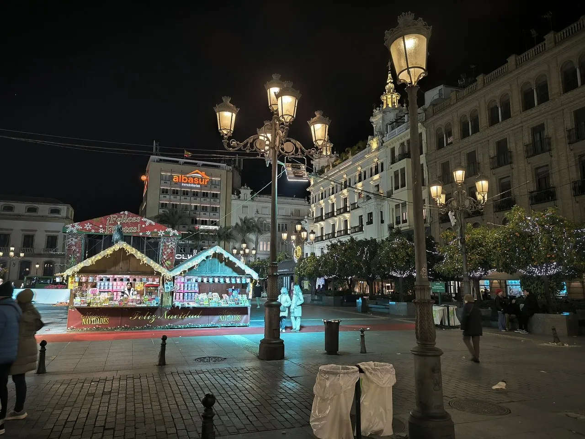
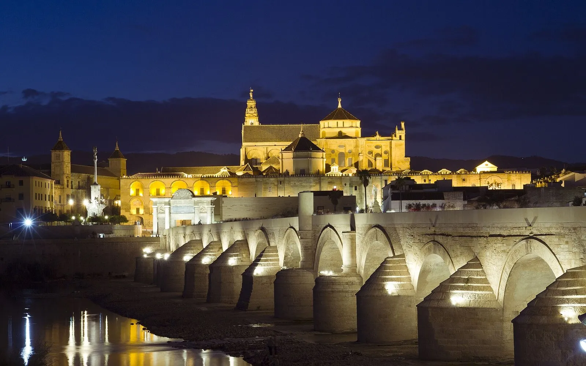
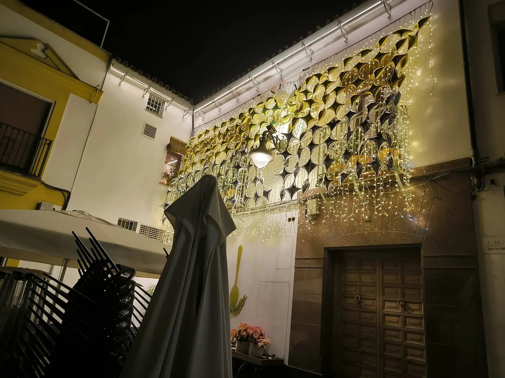

Arcos de luces, villancicos sonando entre las calles y la Mezquita-Catedral iluminada sobre el río. La **Navidad en Córdoba 2026** arranca el **jueves 3 de diciembre** con la inauguración del **Belén Municipal** y el **encendido de luces** en la calle **Cruz Conde**, con su famoso espectáculo de luz y sonido. Hay más de 400 actividades hasta Reyes.

Te cuento las fechas del programa oficial y qué no perderte 👇

En un vistazo<h2>Lo que vas a encontrar</h2>

<b>✨</b>Encendido el 3 de diciembre

<b>🎶</b>Luz y sonido en Cruz Conde

<b>🚁</b>Drones en la Ribera

<b>🌿</b>39 patios abiertos

<b>👑</b>Cabalgata el 5 de enero

Antes de ir<h2>Lo básico de la Navidad en Córdoba</h2>

<h3>📅 Encendido</h3>
<strong>3 de diciembre a las 19:00</strong> en Cruz Conde, junto a las Tendillas.

<h3>⭐ Belén Municipal</h3>
Se inaugura el <strong>3 de diciembre a las 17:30</strong>, antes del encendido.

<h3>🚁 Drones</h3>
<strong>7 de diciembre</strong> en la Ribera, pases a las 19:00 y a las 20:00.

<h3>💶 Precio</h3>
Las actividades del programa municipal son en la calle y <strong>gratis</strong>.

Qué ver<h2>Los planes imprescindibles</h2>

<ol class="guide__grid guide__grid--cuenca">
<li class="gcard reveal">
01

<h3>Cruz Conde y las Tendillas</h3>
El corazón de la Navidad: el <strong>espectáculo de luz y sonido</strong> de la calle Cruz Conde y la plaza de las Tendillas, donde se celebra la Nochevieja. Por la tarde se llena: llega con tiempo.

</li>
<li class="gcard reveal">
02

<h3>Drones sobre la Ribera</h3>
El <strong>7 de diciembre</strong>, espectáculo de drones con dos pases (19:00 y 20:00). Aprovecha para cruzar el <a href="/blog/mezquita-de-cordoba.html">Puente Romano frente a la Mezquita</a> iluminada.

</li>
<li class="gcard reveal">
03

<h3>Patios en Navidad</h3>
<strong>39 patios</strong> abren del 4 de diciembre a Nochebuena con música y baile. Una forma distinta de ver los <a href="/blog/cordoba-patios-juderia.html">patios de Córdoba</a>, sin las colas de mayo.

</li>
</ol>

Calendario<h2>Fechas clave de la Navidad en Córdoba 2026</h2>

<ul class="guide__prices"><li><strong>3 de diciembre</strong><b>Belén Municipal (17:30) y encendido en Cruz Conde (19:00)</b></li><li><strong>4 de diciembre - 24 de diciembre</strong><b>39 patios abiertos</b></li><li><strong>7 de diciembre</strong><b>Drones en la Ribera (19:00 y 20:00)</b></li><li><strong>18, 19 y 20 de diciembre</strong><b>Videomapping «La luz de la Navidad» en la Corredera (4 pases al día)</b></li><li><strong>31 de diciembre</strong><b>Campanadas infantiles (10:00-14:00) y Fin de Año (23:00-2:30) en las Tendillas</b></li><li><strong>5 de enero</strong><b>Cabalgata de Reyes, por la tarde</b></li><li><strong>6 de enero</strong><b>Cabalgatas en las barriadas</b></li></ul>
Además, hay zambombas, coros, campanilleros y pasacalles por los barrios, y cuentacuentos en el <strong>Palacio de Orive</strong>. Los horarios detallados de cada actividad se publican en la web del Ayuntamiento.

<!--actividades-->

Consejos de Cheno<h2>Para disfrutarlo al máximo</h2><ul><li><b>Mezquita por la mañana</b>, luces por la tarde: así lo ves todo en un día. Entradas y horarios en mi post de la <a href="/blog/mezquita-de-cordoba.html">Mezquita-Catedral</a>.</li><li><b>El puente del 7</b> es el día con más gente: drones, luces y patios a la vez.</li><li><b>Paseo de noche</b> por la Judería y la Ribera, con el Puente Romano iluminado.</li><li><b>Más ideas</b> para el día en <a href="/blog/cordoba-que-ver.html">qué ver en Córdoba</a>.</li></ul>

🎄 <strong>Más Navidad en España:</strong> <a href="/blog/navidad-en-madrid.html">Madrid</a> · <a href="/blog/cortylandia-2026.html">Cortylandia</a> · <a href="/blog/magicas-navidades-torrejon.html">Mágicas Navidades de Torrejón</a> · <a href="/blog/navidad-en-barcelona.html">Barcelona</a> · <a href="/blog/navidad-en-valencia.html">Valencia</a> · <a href="/blog/navidad-en-sevilla.html">Sevilla</a> · <a href="/blog/navidad-en-zaragoza.html">Zaragoza</a> · <a href="/blog/navidad-en-malaga.html">Málaga</a> · <a href="/blog/navidad-en-cordoba.html">Córdoba</a> · <a href="/blog/navidad-en-palma.html">Palma</a> · <a href="/blog/luces-navidad-vigo.html">luces de Vigo</a> · <a href="/blog/belen-viviente-buitrago-del-lozoya.html">Belén viviente de Buitrago</a> · <a href="/blog/pueblo-navidad-ferrero-rocher-2026.html">Pueblo Navidad Ferrero Rocher</a>.

<!--faq-->

<h2>¿Te gustan estos planes?</h2>
Sígueme en Instagram como <a href="https://www.instagram.com/chenoaventuras/" target="_blank" rel="noopener">@chenoaventuras</a>: subo escapadas como esta cada semana.
<a class="btn guide__btn" href="/blog.html">Ver más planes en el blog</a>

Programa presentado por el Ayuntamiento de Córdoba el 23 de noviembre de 2026 (nota recogida por Europa Press y Cordópolis). Los horarios de cada pase pueden cambiar: consúltalos en <a href="https://www.cordoba.es/" target="_blank" rel="noopener">cordoba.es</a>. Fotos de Wikimedia Commons de Navidades anteriores: <a href="https://commons.wikimedia.org/wiki/File:Christmas_in_Cordoba.jpg" target="_blank" rel="noopener">Edmundo Sáez</a> (CC BY-SA 4.0) · <a href="https://commons.wikimedia.org/wiki/File:Nadal_2024_a_la_Plaza_de_las_Tendillas,_C%C3%B3rdoba,_Spain.jpg" target="_blank" rel="noopener">Pitxiquin</a> (CC BY-SA 4.0) · <a href="https://commons.wikimedia.org/wiki/File:Decoraci%C3%B3_de_C%C3%B3rdoba_es_Navidad_2024.jpg" target="_blank" rel="noopener">Pitxiquin</a> (CC BY-SA 4.0) · <a href="https://commons.wikimedia.org/wiki/File:Cordoba_at_night.jpg" target="_blank" rel="noopener">jorcolma</a> (CC BY 2.0).

