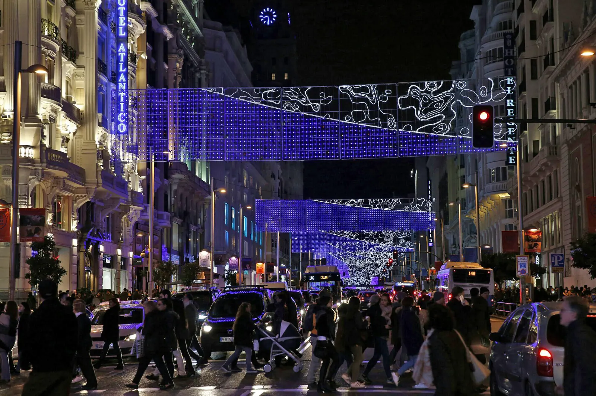
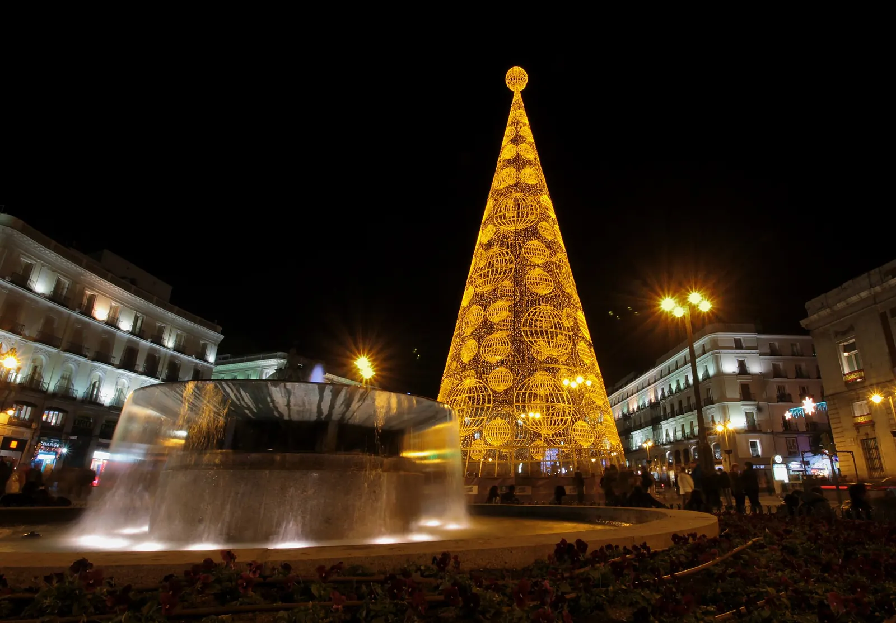
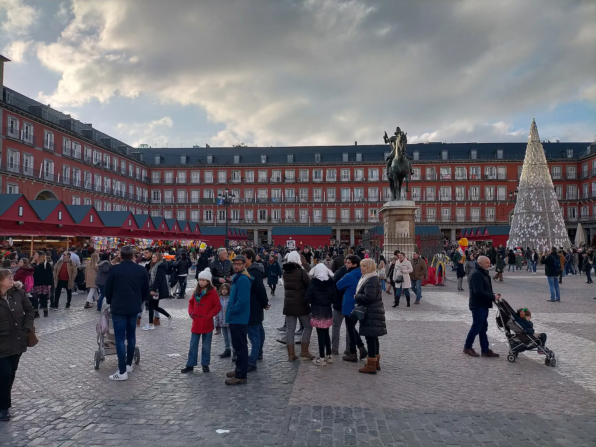
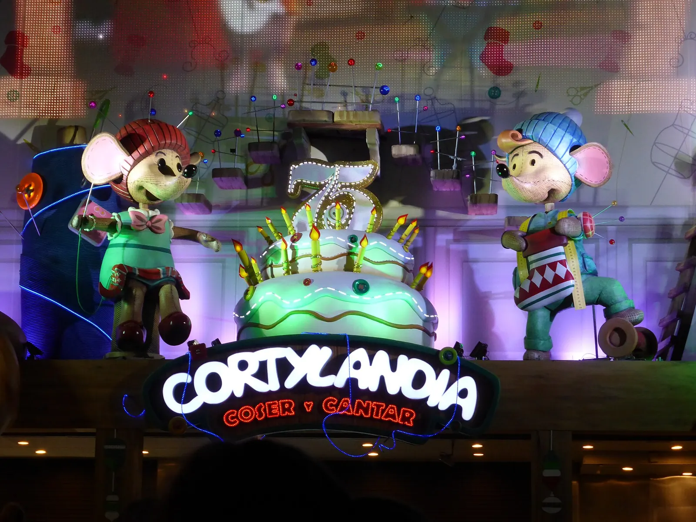
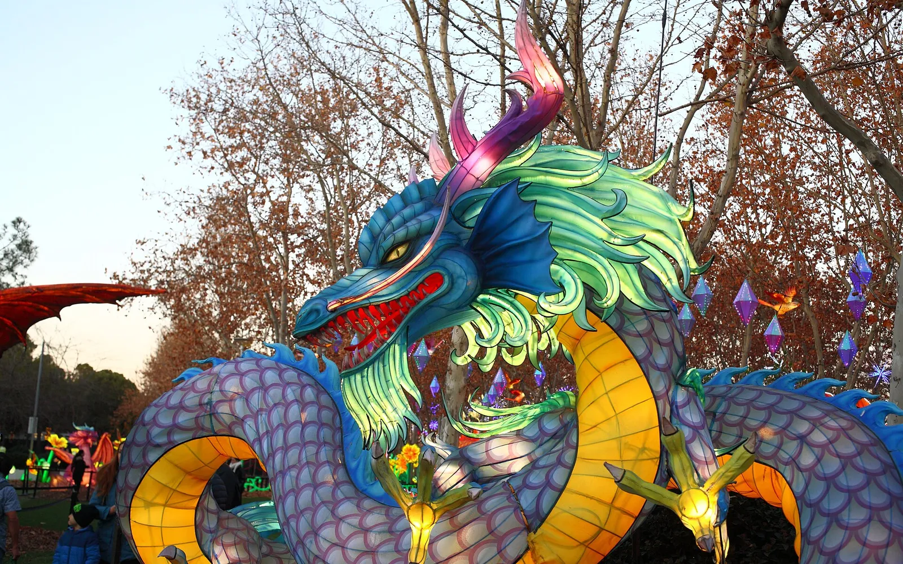

Madrid en Navidad tiene **más de 14 millones de bombillas**, muñecos que cantan en la fachada de unos grandes almacenes, un mercado de belenes en la Plaza Mayor y, a media hora en tren, un parque donde **Papá Noel vuela cada noche**.

Te cuento las fechas de 2026, qué es gratis, qué se paga y cómo verlo todo en un día 👇

En un vistazo<h2>Lo que vas a encontrar</h2>

<b>💡</b>Luces desde el 21 nov

<b>🎶</b>Cortylandia

<b>🛍️</b>Mercado de la Plaza Mayor

<b>⛸️</b>Pistas de hielo

<b>🎅</b>Mágicas Navidades

<b>👑</b>Cabalgata de Reyes

Antes de ir<h2>Lo básico de la Navidad en Madrid</h2>

<h3>📅 Cuándo</h3>
De <strong>mediados de noviembre al 6 de enero</strong>. Las luces se encienden el <strong>21 de noviembre</strong>.

<h3>💶 Precio</h3>
Casi todo es <strong>gratis</strong>: luces, Cortylandia, mercados y Cabalgata.

<h3>🚇 Cómo moverte</h3>
En <strong>metro y a pie</strong>. El centro se llena: deja el coche en casa.

<h3>💡 Mi consejo</h3>
Ve <strong>entre semana</strong>: los fines de semana de diciembre, Sol y Gran Vía están a rebosar.

Qué ver<h2>Los imprescindibles de la Navidad en Madrid</h2>

<ol class="guide__grid guide__grid--cuenca">
<li class="gcard reveal">
01

<h3>Las luces de Navidad</h3>
Gratis21 nov – 6 ene

Más de <strong>250 calles y plazas</strong> de los 21 distritos y más de <strong>14 millones de bombillas LED</strong>. Se encienden el <strong>sábado 21 de noviembre</strong> con un espectáculo en la plaza de Cibeles. Las imprescindibles: Gran Vía, la calle de Alcalá, la Puerta del Sol y la calle Mayor.

</li>
<li class="gcard reveal">
02

<h3>La Puerta del Sol</h3>
GratisLas campanadas, el 31

El kilómetro cero se llena de luces, y por la ciudad se instalan <strong>14 grandes abetos luminosos</strong> como el de la foto, de otra Navidad. Aquí se toman las uvas en Nochevieja con las campanadas del reloj de la Real Casa de Correos.

</li>
<li class="gcard reveal">
03

<h3>Mercado de Navidad de la Plaza Mayor</h3>
Entrada libreFinales nov – 31 dic

El mercadillo de toda la vida: <strong>104 casetas</strong> con belenes, adornos navideños y artículos de broma (pelucas y gorros incluidos). En 2025 abrió del 27 de noviembre al 31 de diciembre; las fechas de 2026 aún no están publicadas.

</li>
<li class="gcard reveal">
04

<h3>Cortylandia</h3>
GratisFinales nov – 5 ene

El espectáculo de muñecos animados que cantan en la fachada de <strong>El Corte Inglés de la calle Preciados</strong>, junto a Sol. Hay varios pases al día, de mañana y de tarde; los horarios de 2026 aún no están publicados. Llega unos minutos antes: se llena de familias.

</li>
<li class="gcard reveal">
05

<h3>Mágicas Navidades</h3>
De 5 a 10 €14 nov – 10 ene

El gran parque de Navidad de la Comunidad, en Torrejón de Ardoz: Papá Noel volando cada noche, pista de hielo sobre un lago, noria de 42 metros y esculturas de hielo. A 100 metros de la estación de Cercanías.

<a class="gbtn gbtn--reel" href="/blog/magicas-navidades-torrejon.html">Leer más</a>

</li>
</ol>

Patinar<h2>Pistas de hielo y mercadillos</h2>

<ul class="checklist" style="margin:0 0 1rem;"><li><strong>Pistas de hielo:</strong> las tradicionales son la de <strong>Matadero Madrid</strong>, la de la <strong>Galería de Cristal del Palacio de Cibeles</strong> y la de <strong>Plaza de España</strong>, dentro de La Navideña, que también tiene mercadillo. Sus fechas de 2026 están por confirmar.</li><li><strong>Feria de Artesanía de la Comunidad de Madrid:</strong> en el paseo de Recoletos, entre Colón y Cibeles, con más de 150 artesanos. En 2025 fue del 1 al 30 de diciembre.</li><li><strong>Otros puestos navideños:</strong> en la plaza de Juan Goytisolo, junto al Museo Reina Sofía, y en la plaza de Isabel II.</li></ul>

Calendario<h2>Fechas clave de la Navidad 2026 en Madrid</h2>

<ul class="checklist" style="margin:0 0 1rem;"><li><strong>14 de noviembre:</strong> abren las <a href="/blog/magicas-navidades-torrejon.html">Mágicas Navidades de Torrejón</a>.</li><li><strong>21 de noviembre:</strong> encendido de las luces, con espectáculo en Cibeles.</li><li><strong>Finales de noviembre:</strong> empiezan Cortylandia y el mercado de la Plaza Mayor.</li><li><strong>22 de diciembre:</strong> sorteo de la Lotería de Navidad en el Teatro Real.</li><li><strong>31 de diciembre:</strong> San Silvestre Vallecana y campanadas en la Puerta del Sol.</li><li><strong>5 de enero:</strong> Cabalgata de Reyes, de 18:00 a 21:00, por la Castellana hasta Cibeles.</li><li><strong>6 de enero:</strong> se apagan las luces.</li></ul>

<b>🎅</b>14 nov · Mágicas Navidades

<b>💡</b>21 nov · Luces

<b>🎟️</b>22 dic · Lotería

<b>🏃</b>31 dic · San Silvestre

<b>🍇</b>31 dic · Campanadas

<b>👑</b>5 ene · Cabalgata

<h3>🎟️ Con guía</h3>
Si prefieres que te lo cuenten, el <strong>tour navideño de Civitatis</strong> (unos 12,50 €, hora y media) recorre el mercado de la Plaza Mayor y Cortylandia, y en diciembre hay pases casi todos los días. Para ver las luces sin andar, el <strong>tuk-tuk eléctrico</strong> (desde 40 € por persona) pasa por Cibeles, el Prado y el Retiro con mantas para el frío. Los tienes abajo.

<!--actividades-->

Consejos de Cheno<h2>La Navidad de Madrid en un día</h2><ul><li><b>Mañana</b>: mercado de la Plaza Mayor y paseo por la calle Mayor hasta Sol.</li><li><b>Mediodía</b>: Cortylandia en la calle Preciados (llega 15 minutos antes del pase).</li><li><b>Tarde</b>: Mágicas Navidades de Torrejón, en Cercanías C-2 o C-7 desde Atocha.</li><li><b>O al anochecer</b>: luces de Gran Vía, Alcalá y Cibeles, a partir de las 18:00.</li><li><b>Para cerrar</b>: chocolate con churros en el centro.</li></ul>

<!--faq-->

<h2>¿Te gustan estos planes?</h2>
Sígueme en Instagram como <a href="https://www.instagram.com/chenoaventuras/" target="_blank" rel="noopener">@chenoaventuras</a>: subo escapadas como esta cada semana.
<a class="btn guide__btn" href="/blog.html">Ver más planes en el blog</a>

Información consultada el 2 de noviembre de 2026 en Turismo de Madrid (esmadrid.com) y en la web oficial de Mágicas Navidades. Varios horarios de 2026 están por confirmar: revísalos antes de ir. Fotos de Wikimedia Commons: <a href="https://commons.wikimedia.org/wiki/File%3ACalle_de_Alcal%C3%A1_%28Madrid%29_34.jpg" target="_blank" rel="noopener">Luis García (Zaqarbal)</a> (CC BY-SA 3.0) · <a href="https://commons.wikimedia.org/wiki/File%3APolic%C3%ADa_Municipal_de_Madrid_pone_en_marcha_la_campa%C3%B1a_de_seguridad_de_Navidad_2017-2018_01.jpg" target="_blank" rel="noopener">Diario de Madrid</a> (CC BY 4.0) · <a href="https://commons.wikimedia.org/wiki/File%3APuerta_del_Sol_%28Madrid%29_19.jpg" target="_blank" rel="noopener">Luis García (Zaqarbal)</a> (CC BY-SA 3.0 es) · <a href="https://commons.wikimedia.org/wiki/File%3AMercadillos_navide%C3%B1os_en_Madrid_en_diciembre_de_2022_10.jpg" target="_blank" rel="noopener">Emilio J. Rodríguez Posada</a> (CC BY-SA 4.0) · <a href="https://commons.wikimedia.org/wiki/File%3ACortylandia%2C_Coser_y_Cantar%2C_espect%C3%A1culo_infantil_de_las_Navidades_de_2016%2C_en_Madrid%2C_Espa%C3%B1a.jpg" target="_blank" rel="noopener">CARLOS TEIXIDOR CADENAS</a> (CC BY-SA 4.0) · <a href="https://commons.wikimedia.org/wiki/File:Magicas_Navidades_2024_-_Torrejon_de_Ardoz_-_Madrid_05.jpg" target="_blank" rel="noopener">Javier Perez Montes</a> (CC BY-SA 4.0).

