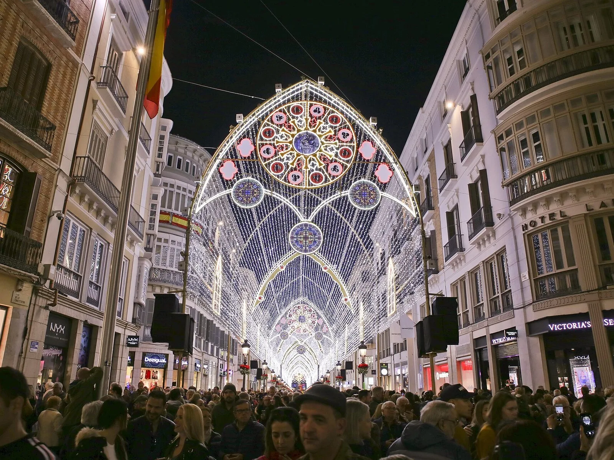
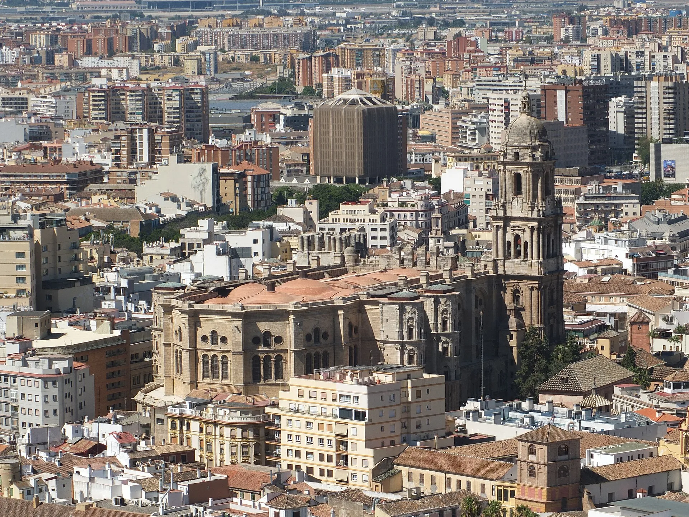
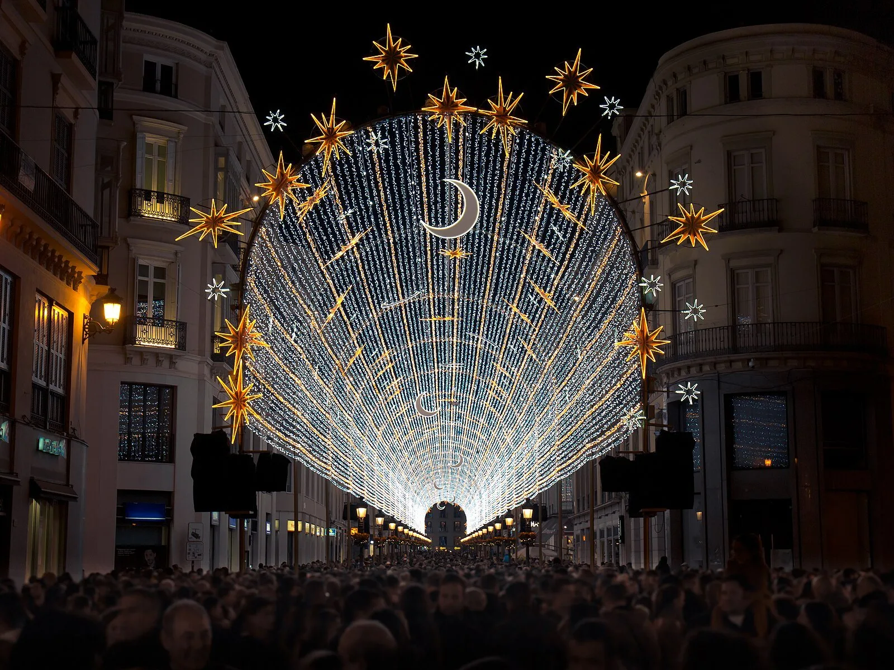
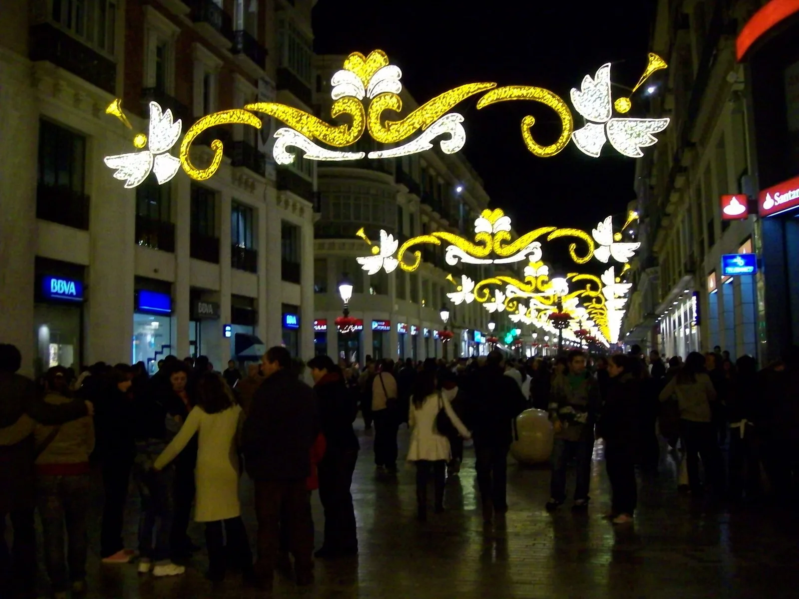

Cada Navidad, **calle Larios** se convierte en uno de los sitios más visitados de España: miles de personas esperan a que las luces se enciendan al ritmo de la música. En 2026 el **encendido es el viernes 27 de noviembre a las 18:30**, con un **concierto gratis de El Kanka**, y al día siguiente se estrena un **videomapping nuevo en la Catedral**. En total, **2,8 millones de luces LED** repartidas por unas 500 calles.

Te cuento los horarios de cada espectáculo y cómo verlo sin agobios 👇

En un vistazo<h2>Lo que vas a encontrar</h2>

<b>💡</b>Encendido el 27 nov

<b>🎶</b>Luz y música

<b>⛪</b>Videomapping

<b>🎄</b>Abeto de 18 m

<b>🆓</b>Gratis

Fechas 2026<h2>Calendario de la Navidad en Málaga</h2>

<ol class="guide__timeline">
<li><b>27 nov · 18:30</b>Encendido en calle Larios con El Kanka</li>
<li><b>28 nov</b>Estreno del videomapping de la Catedral</li>
<li><b>Cada día</b>Pases en Larios a las 18:30, 20:30 y 22:00</li>
<li><b>24 y 31 dic</b>Luces sin música, encendidas hasta las 6:00</li>
<li><b>4 ene</b>Último día de espectáculos</li>
</ol>

Qué ver<h2>Los imprescindibles de la Navidad en Málaga</h2>

<ol class="guide__grid guide__grid--cuenca">
<li class="gcard reveal">
01

<h3>El espectáculo de calle Larios</h3>
En 2026 repite el diseño <strong>«Natividad de luz»</strong>: 32 columnas con guirnaldas, 384 lazos rojos y 512 bolas que se encienden con música. Tres pases al día: <strong>18:30, 20:30 y 22:00</strong>.

</li>
<li class="gcard reveal">
02

<h3>El videomapping de la Catedral</h3>
Este año se llama <strong>«El cielo desciende»</strong>: una niña recorre la fauna y la flora malagueñas y termina con fuegos artificiales en 3D y música de órgano. Se proyecta en la torre sur, en la calle Molina Lario.

</li>
<li class="gcard reveal">
03

<h3>Arcos de luz y el gran abeto</h3>
Los arcos de luz llenan el centro, y al final de calle Larios, en la plaza de la Constitución, hay un <strong>abeto de 18 metros</strong> bajo el que se puede caminar.

</li>
<li class="gcard reveal">
04

<h3>El resto del centro</h3>
Hay <strong>19 calles y plazas</strong> con decoración nueva este año. Pasea por el centro histórico, la calle Granada y el entorno de la Alcazaba.

</li>
</ol>

Horarios<h2>Horario del alumbrado</h2>

<ul class="guide__prices"><li>Domingo a miércoles<b>18:30-24:00</b></li><li>Jueves, viernes, sábados y vísperas<b>18:30-2:00</b></li><li>24 y 31 de diciembre<b>Hasta las 6:00</b></li></ul>

<h3>👀 Para verlo sin agobios</h3>
El día del encendido y los sábados la calle Larios se llena hasta arriba. Si puedes, ve <strong>entre semana</strong> al pase de las <strong>22:00</strong>. Y llega con tiempo al videomapping: 10 minutos antes ya no hay buen sitio.

<!--actividades-->

Cómo llegar<h2>Cómo llegar a calle Larios</h2>

Calle Larios está en pleno centro, entre la Alameda Principal y la plaza de la Constitución. Ve en <strong>autobús, metro o Cercanías</strong> (estación de Málaga Centro-Alameda): el día del encendido se corta el tráfico en la Alameda y el Paseo del Parque, y aparcar es casi imposible.

<a class="btn guide__mapbtn" href="https://www.google.com/maps/dir/?api=1&destination=36.7193,-4.4213" target="_blank" rel="noopener"><svg class="ico" viewBox="0 0 24 24" width="15" height="15" aria-hidden="true" fill="currentColor"><path d="M12 2a7 7 0 0 0-7 7c0 5.25 7 13 7 13s7-7.75 7-13a7 7 0 0 0-7-7zm0 9.5a2.5 2.5 0 1 1 0-5 2.5 2.5 0 0 1 0 5z"/></svg> Cómo llegar en Google Maps</a>

Aprovecha el día para ver la <a href="/blog/alcazaba-de-malaga.html">Alcazaba y el Teatro Romano</a>, a dos minutos de la Catedral, y el resto de <a href="/blog/malaga-que-ver.html">qué ver en Málaga</a>. Si te gustan los planes de Navidad, mira también la <a href="/blog/navidad-en-madrid.html">Navidad en Madrid</a> y las <a href="/blog/luces-navidad-vigo.html">luces de Vigo</a>.

Consejos de Cheno<h2>Para disfrutarlo al máximo</h2><ul><li><b>Entre semana y al último pase</b>: mucha menos gente.</li><li><b>Combina Larios y la Catedral</b>: los pases están escalonados para ver los dos.</li><li><b>Ojo con los bolsos</b>: con tanta gente, mejor delante.</li><li><b>Cena después</b>: a las 21:00 los bares del centro están llenos.</li></ul>

🎄 <strong>Más Navidad en España:</strong> <a href="/blog/navidad-en-madrid.html">Madrid</a> · <a href="/blog/cortylandia-2026.html">Cortylandia</a> · <a href="/blog/magicas-navidades-torrejon.html">Mágicas Navidades de Torrejón</a> · <a href="/blog/navidad-en-barcelona.html">Barcelona</a> · <a href="/blog/navidad-en-sevilla.html">Sevilla</a> · <a href="/blog/navidad-en-cordoba.html">Córdoba</a> · <a href="/blog/navidad-en-valencia.html">Valencia</a> · <a href="/blog/navidad-en-palma.html">Palma</a> · <a href="/blog/navidad-en-zaragoza.html">Zaragoza</a> · <a href="/blog/luces-navidad-vigo.html">luces de Vigo</a> · <a href="/blog/belen-viviente-buitrago-del-lozoya.html">Belén viviente de Buitrago</a> · <a href="/blog/pueblo-navidad-ferrero-rocher-2026.html">Pueblo Navidad Ferrero Rocher</a>.

<!--faq-->

<h2>¿Te gustan estos planes?</h2>
Sígueme en Instagram como <a href="https://www.instagram.com/chenoaventuras/" target="_blank" rel="noopener">@chenoaventuras</a>: subo escapadas como esta cada semana.
<a class="btn guide__btn" href="/blog.html">Ver más planes en el blog</a>

Programa de 2026 anunciado por el Ayuntamiento de Málaga y recogido por la prensa (Qué!, 12 de noviembre de 2026). Puede cambiar: consúltalo en malaga.eu antes de ir. Las fotos de las luces son de años anteriores, con otros diseños. Fotos de Wikimedia Commons: <a href="https://commons.wikimedia.org/wiki/File:Navidad-malaga.jpg" target="_blank" rel="noopener">Ltwikipe</a> (CC BY-SA 4.0) · <a href="https://commons.wikimedia.org/wiki/File:Street_lighting_Malaga_christmas_(31784122642).jpg" target="_blank" rel="noopener">Hernán Piñera</a> (CC BY-SA 2.0) · <a href="https://commons.wikimedia.org/wiki/File:Calle_larios.jpg" target="_blank" rel="noopener">Dagxx</a> (CC BY-SA 4.0); foto de la Catedral, de mi guía de Málaga.

