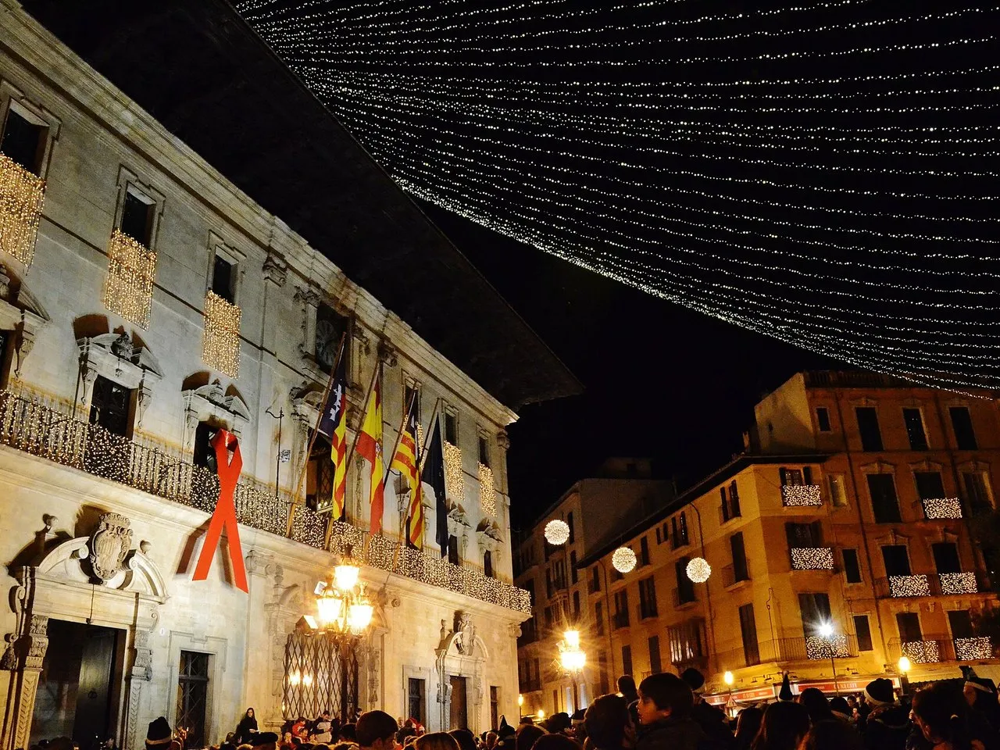
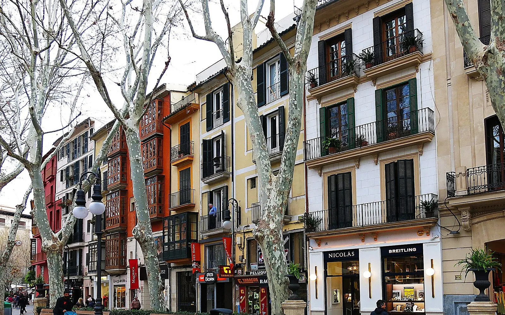
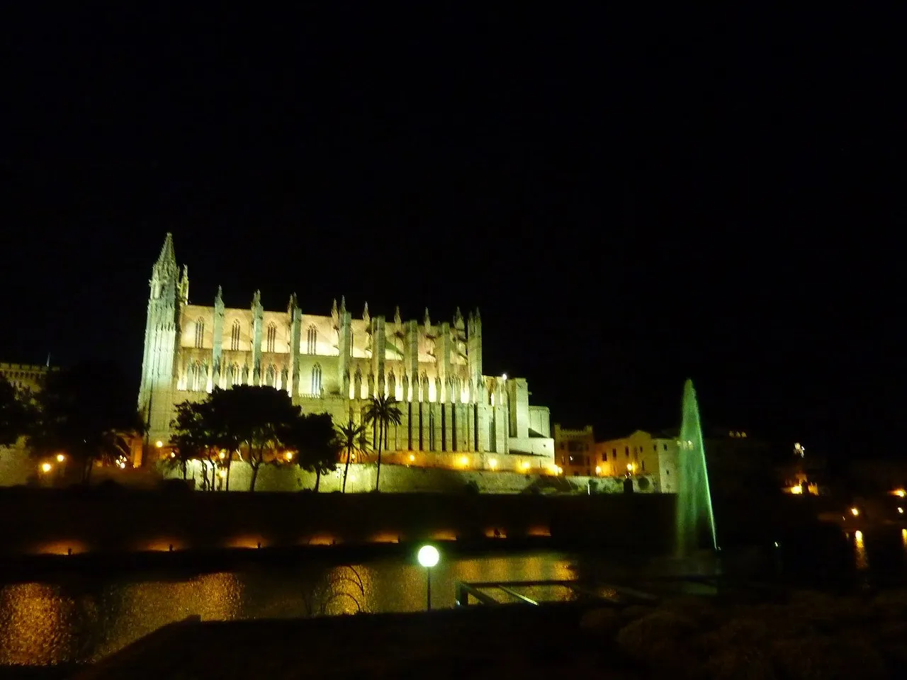
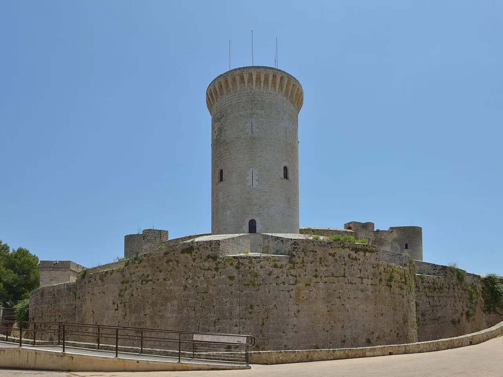

Calles con arcos de luces, el paseo del Born convertido en un túnel brillante y la catedral iluminada sobre el mar. Las luces de **Navidad en Palma** se encendieron el **21 de noviembre** y el programa del Ayuntamiento sigue hasta el **6 de enero**: mercados, belenes, Nochevieja en Cort y la Cabalgata de Reyes.

Te cuento las fechas y horarios oficiales y qué no perderte 👇

En un vistazo<h2>Lo que vas a encontrar</h2>

<b>✨</b>Luces hasta el 6 de enero

<b>🛍️</b>3 mercados navideños

<b>🌟</b>Belén de Cort

<b>🥂</b>Nochevieja en Cort

<b>👑</b>Cabalgata el 5 de enero

Antes de ir<h2>Lo básico de la Navidad en Palma</h2>

<h3>📅 Cuándo</h3>
Del <strong>21 de noviembre al 6 de enero</strong>. Las luces se encendieron en el Parc de la Mar.

<h3>🛍️ Mercados</h3>
<strong>Parc de les Estacions, Plaça Major y La Rambla</strong>, todos los días de 10:00 a 21:00.

<h3>🌟 Belén de Cort</h3>
En el Ayuntamiento, hasta el <strong>5 de enero</strong>.

<h3>👑 Reyes</h3>
Cabalgata el <strong>5 de enero a las 18:00</strong> desde el Moll Vell.

Qué ver<h2>Los planes imprescindibles</h2>

<ol class="guide__grid guide__grid--cuenca">
<li class="gcard reveal">
01

<h3>La plaza de Cort y su belén</h3>
El corazón de la Navidad: el <strong>Belén de Cort</strong> dentro del Ayuntamiento, la llegada de los Pajes Reales (3 de enero, 11:30) y la fiesta de Nochevieja.

</li>
<li class="gcard reveal">
02

<h3>Paseo por las luces</h3>
Del Born a Jaume III, la Rambla y las calles del centro. Por las tardes hay <strong>pajes, elfos, charangas y Papá Noel</strong> recorriendo las calles.

</li>
<li class="gcard reveal">
03

<h3>La Seu y el Parc de la Mar</h3>
Donde se encendieron las luces. De noche, la <strong>catedral iluminada</strong> reflejada en el lago es la postal navideña de Palma.

</li>
<li class="gcard reveal">
04

<h3>San Silvestre en Bellver</h3>
El <strong>26 de diciembre a las 11:00</strong>, en el castillo circular que vigila la bahía.

</li>
</ol>

Mercados<h2>Mercados de Navidad de Palma</h2>

<ul class="guide__prices"><li><strong>Parc de les Estacions</strong> (junto al árbol de Navidad): 21 nov-6 ene, 10:00-21:00</li><li><strong>Plaça Major</strong>: 21 nov-6 ene, 10:00-21:00</li><li><strong>La Rambla</strong>: 21 nov-6 ene, 10:00-21:00</li></ul>
En el Parc de les Estacions y la Plaça Major hay además talleres infantiles y <strong>pintacaras</strong> algunas tardes (por ejemplo, el 5 y el 11 de diciembre en la Plaça Major, de 16:00 a 18:00).

<!--actividades-->

Belenes<h2>Los belenes de Palma</h2>

<h3>🏛️ Belén de Cort</h3>
21 nov-5 ene. Laborables <strong>9:00-20:30</strong>; sábados, domingos y festivos <strong>10:00-20:00</strong>.

<h3>🎨 La Misericòrdia</h3>
Belén (6 dic-5 ene) y <strong>exposición de dioramas</strong> (8 dic-5 ene), de 10:00 a 21:00. Cierra 25 y 26 dic y 1 ene.

<h3>⛪ Consell de Mallorca</h3>
En el Palau del Consell, del <strong>5 de diciembre al 6 de enero</strong>, de 10:00 a 20:00.

<h3>🪖 Belenes tradicionales</h3>
XV Exposición en el Centro de Historia y Cultura Militar, del <strong>11 de diciembre al 5 de enero</strong> (domingos y festivos, cerrado).

Fechas clave<h2>Nochevieja y Reyes en Palma</h2>

<strong>31 de diciembre — Nochevieja en Cort:</strong> desde las 23:30, música con DJ; a las 00:00, campanadas; y fiesta de 00:05 a 02:00 en la plaza de Cort. Esa mañana, a las 12:00, se representa en Cort <strong>La Colcada</strong>.

<strong>3 de enero:</strong> llegada oficial de los <strong>Pajes Reales</strong> a la plaza de Cort, a las 11:30.

<strong>5 de enero — Cabalgata de Reyes:</strong> a las 18:00, con llegada de los Reyes al <strong>Moll Vell</strong> y recorrido por Antoni Maura, el Born, la Rambla, las avenidas, el paseo de Mallorca y Jaume III, hasta la plaza de la Reina. A las 21:00 saludan desde el balcón de Cort.

Consejos de Cheno<h2>Para disfrutarlo al máximo</h2><ul><li><b>Ve al atardecer</b>: ves la catedral con luz y luego las calles iluminadas.</li><li><b>Haz la ruta de belenes</b>: Cort, la Misericòrdia y el Consell están a un paseo.</li><li><b>Para la Cabalgata</b>, coge sitio pronto en el Born.</li><li><b>Aprovecha el día</b> para <a href="/blog/palma-de-mallorca-que-ver.html">ver Palma</a>: la catedral, la Almudaina o Bellver.</li></ul>

🎄 <strong>Más Navidad en España:</strong> <a href="/blog/navidad-en-madrid.html">Madrid</a> · <a href="/blog/magicas-navidades-torrejon.html">Mágicas Navidades de Torrejón</a> · <a href="/blog/navidad-en-barcelona.html">Barcelona</a> · <a href="/blog/navidad-en-valencia.html">Valencia</a> · <a href="/blog/navidad-en-sevilla.html">Sevilla</a> · <a href="/blog/navidad-en-zaragoza.html">Zaragoza</a> · <a href="/blog/navidad-en-malaga.html">Málaga</a> · <a href="/blog/luces-navidad-vigo.html">luces de Vigo</a> · <a href="/blog/belen-viviente-buitrago-del-lozoya.html">Belén viviente de Buitrago</a> · <a href="/blog/pueblo-navidad-ferrero-rocher-2026.html">Pueblo Navidad Ferrero Rocher</a>.

<!--faq-->

<h2>¿Te gustan estos planes?</h2>
Sígueme en Instagram como <a href="https://www.instagram.com/chenoaventuras/" target="_blank" rel="noopener">@chenoaventuras</a>: subo escapadas como esta cada semana.
<a class="btn guide__btn" href="/blog.html">Ver más planes en el blog</a>

Fechas, horarios y lugares sacados del <a href="https://palma.es/documents/39028/0/PROGRAMA+DE+NAVIDAD+2026.pdf/33b2a469-727c-fa99-4ef2-d5b7d2ec6dff" target="_blank" rel="noopener">programa oficial de Navidad 2026 del Ajuntament de Palma</a> (consultado en noviembre de 2026). El propio programa avisa de que las actividades pueden cambiar. Fotos de Wikimedia Commons: <a href="https://commons.wikimedia.org/wiki/File:Palma_de_Mallorca_in_Christmas.jpg" target="_blank" rel="noopener">Travelinho</a> (CC BY-SA 4.0) · <a href="https://commons.wikimedia.org/wiki/File:Fa%C3%A7ana_de_Cort_(Palma)_-_1.jpg" target="_blank" rel="noopener">Maria Rosa Ferre</a> (CC BY-SA 2.0) · <a href="https://commons.wikimedia.org/wiki/File:Catedral_de_Palma_de_noche_-_panoramio.jpg" target="_blank" rel="noopener">Mariano Asensio</a> (CC BY-SA 3.0) · <a href="https://commons.wikimedia.org/wiki/File:Bellver_Castle_Palma_de_Mallorca_Donjon.jpg" target="_blank" rel="noopener">Wolfgang Moroder</a> (CC BY-SA 3.0) · <a href="https://commons.wikimedia.org/wiki/File:011_Passeig_del_Born_(Palma).jpg" target="_blank" rel="noopener">Enric</a> (CC BY-SA 4.0).

