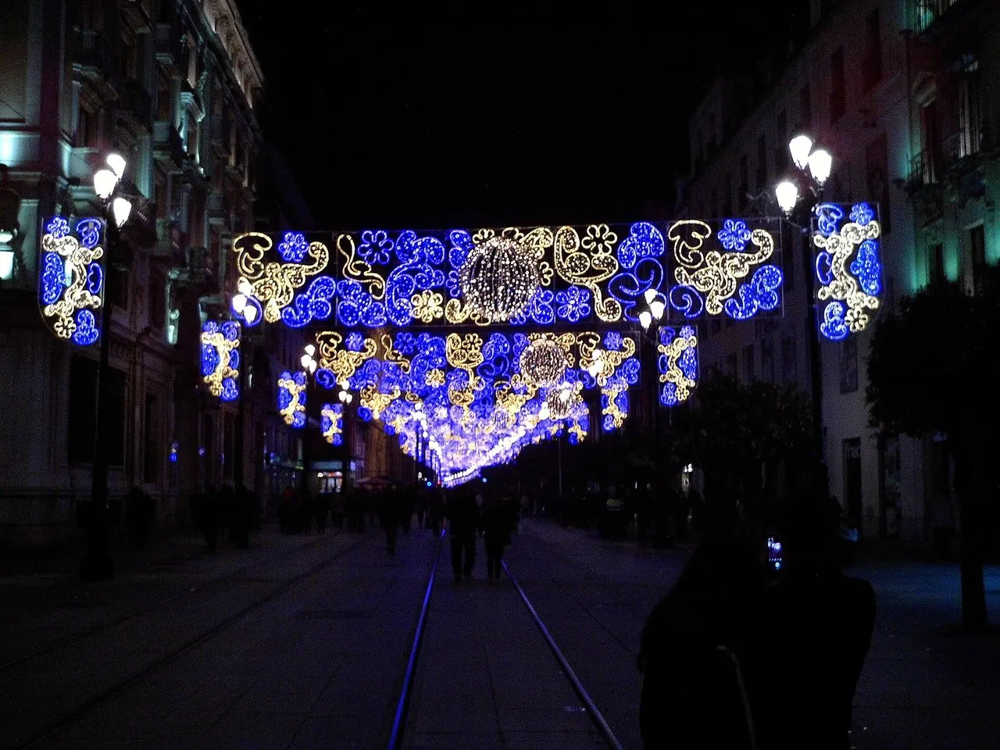
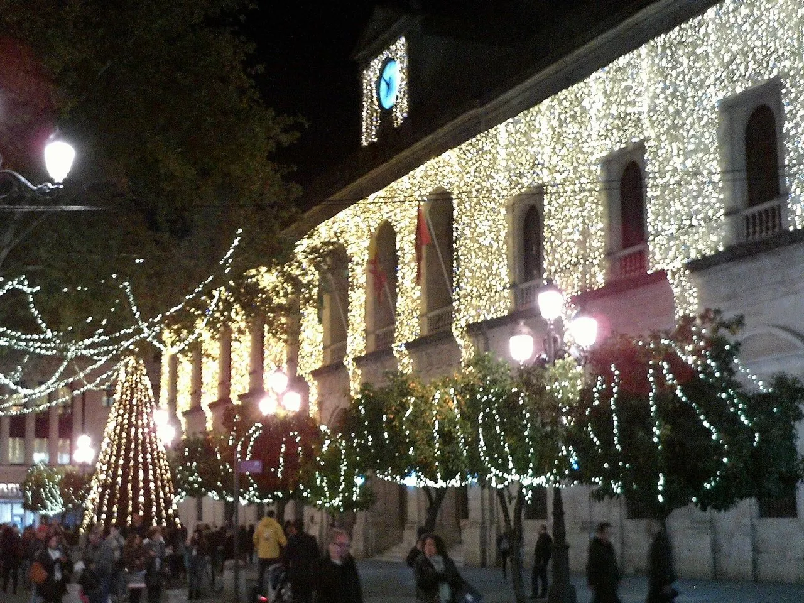
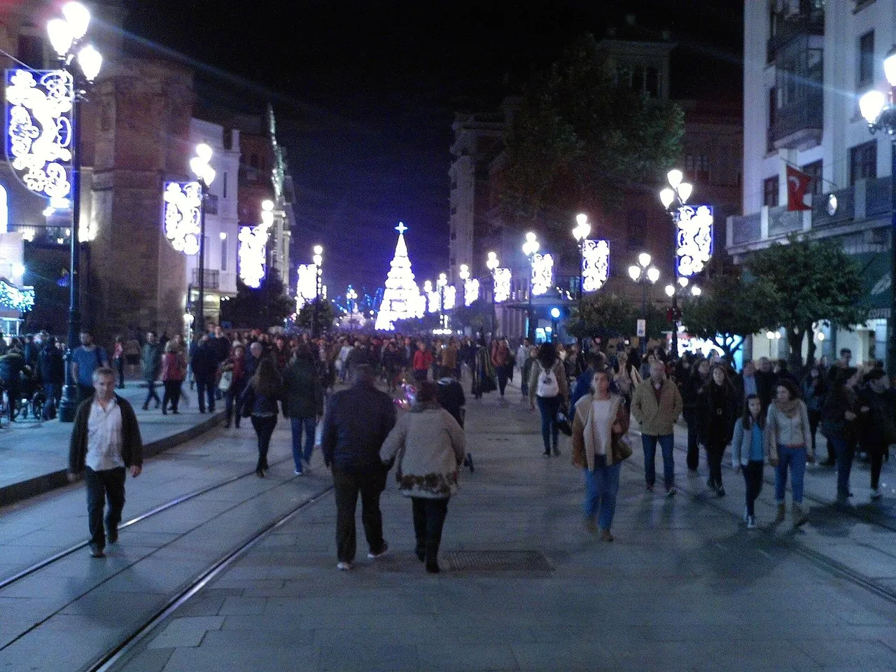
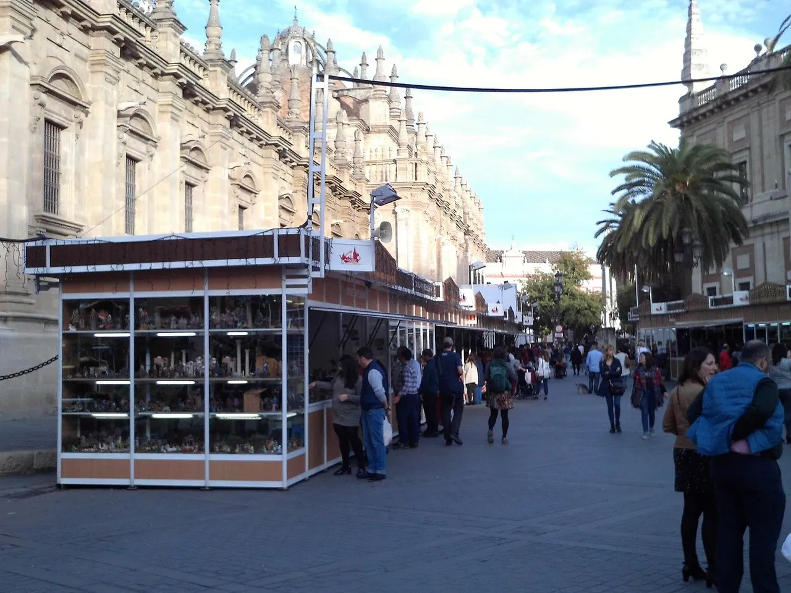
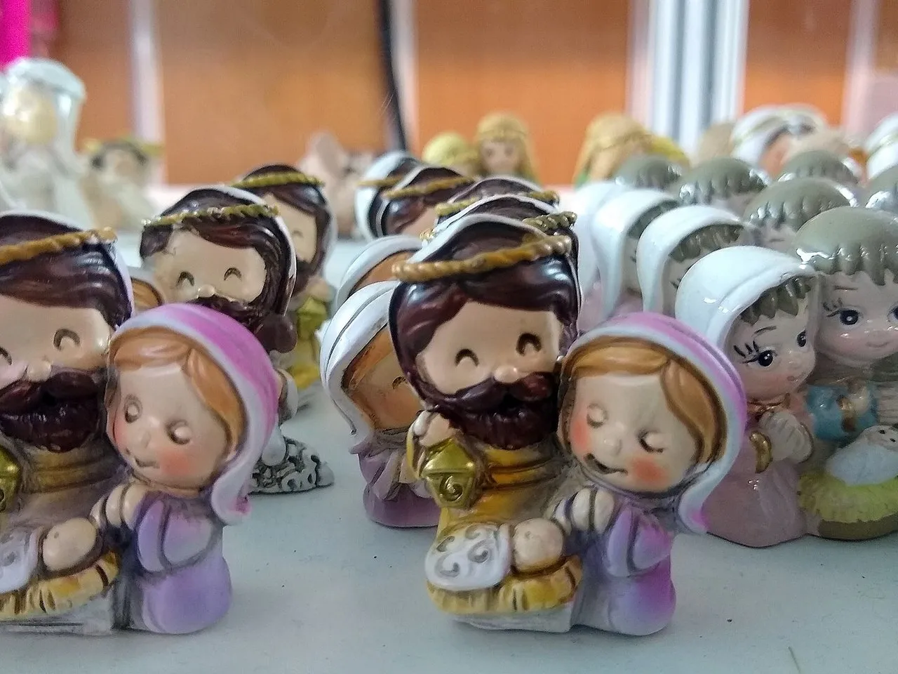

Más de **9 millones de luces LED** en 316 calles, un espectáculo de luz sobre el Ayuntamiento y un belén de figuras de hasta **9 metros** junto al Palacio de San Telmo. **Sevilla** enciende la Navidad el **27 de noviembre**.

Te cuento las fechas oficiales de 2026, los horarios y qué no perderte 👇

En un vistazo<h2>Lo que vas a encontrar</h2>

<b>💡</b>Luces desde el 27 nov

<b>🎆</b>Mapping en San Francisco

<b>⭐</b>Belén gigante

<b>🎄</b>Feria del Belén

<b>⛸️</b>Pista de hielo

Antes de ir<h2>Lo básico de la Navidad en Sevilla</h2>

<h3>📅 Cuándo</h3>
Luces y mapping del <strong>27 de noviembre al 5 de enero</strong>. La Feria del Belén abre antes, a principios de noviembre.

<h3>🕡 Horario de las luces</h3>
Todos los días de <strong>18:30 a 01:00</strong>. En <strong>Nochevieja</strong>, hasta las 08:00 del 1 de enero.

<h3>💶 Precio</h3>
Casi todo es <strong>gratis</strong>: luces, mapping, belenes, la feria y los conciertos del Alcázar. Se paga la pista de hielo.

<h3>🚶 Cómo moverte</h3>
A pie: Avenida de la Constitución, plaza de San Francisco, la Catedral y la Avenida de Roma están a menos de 15 minutos andando entre sí.

Qué ver<h2>Los imprescindibles de la Navidad en Sevilla</h2>

<ol class="guide__grid guide__grid--cuenca">
<li class="gcard reveal">
01

<h3>El encendido en la Avenida</h3>
El <strong>27 de noviembre</strong>, la «<strong>Noche de la luz</strong>» en la Avenida de la Constitución, con Niña Pastori. En total, más de 9,2 millones de LED y 3.151 motivos navideños repartidos por la ciudad.

</li>
<li class="gcard reveal">
02

<h3>El mapping de San Francisco</h3>
Un espectáculo de luz de unos <strong>15 minutos</strong> sobre la fachada del Ayuntamiento, que este año cuenta la historia de la Casa Consistorial. <strong>Seis pases diarios entre las 18:30 y las 22:15</strong>.

</li>
<li class="gcard reveal">
03

<h3>Paseo por el centro iluminado</h3>
El centro entero se llena de luces: en toda la ciudad son 316 calles y plazas iluminadas, de 18:30 a 01:00.

</li>
<li class="gcard reveal">
04

<h3>La Feria del Belén</h3>
Puestos de belenismo andaluz junto a la Catedral, en la Avenida de la Constitución esquina con Fray Ceferino González. Abierta, según la prensa local, hasta el <strong>22-23 de diciembre</strong>.

</li>
<li class="gcard reveal">
05

<h3>Figuras para tu belén</h3>
En la feria encontrarás desde figuras clásicas de barro hasta versiones infantiles, musgo, casitas y todo lo necesario para montar el belén en casa.

</li>
</ol>

Más planes<h2>Más Navidad en Sevilla</h2>

<h3>⭐ Belén gigante de San Telmo</h3>
En la <strong>Avenida de Roma</strong>, a los pies del Palacio de San Telmo: 15 figuras luminosas de entre <strong>4 y 9 metros</strong>, siete de ellas nuevas en 2026.

<h3>🏰 Navidad en el Real Alcázar</h3>
<strong>Dulces de convento</strong> del 4 al 7 de diciembre (acceso libre por el Patio de Banderas), <strong>conciertos navideños gratis</strong> del 10 al 13 de diciembre a las 20:00 y <strong>zambombas</strong> el 22 de diciembre en el Salón de los Tapices.

<h3>⛸️ Pista de hielo</h3>
<strong>Xtmas Ice</strong>, en el Pabellón 3 de Fibes desde el <strong>4 de diciembre</strong>: pista de 30 x 40 metros para adultos y otra infantil.

<h3>🎠 Xtmas Park</h3>
También en <strong>Fibes</strong>, del 4 de diciembre al 9 de enero, con entrada gratuita.

<!--actividades-->

Plan de Cheno<h2>La Navidad de Sevilla en una tarde</h2><ul><li><b>17:00:</b> Feria del Belén y alrededores de la Catedral, con la última luz del día.</li><li><b>18:30:</b> se encienden las luces: paseo por la Avenida de la Constitución.</li><li><b>19:00:</b> plaza de San Francisco para ver uno de los pases del mapping.</li><li><b>20:00:</b> bajada hasta la Avenida de Roma para el belén gigante de San Telmo.</li><li><b>Noche:</b> tapas en el centro o un <a href="https://www.civitatis.com/es/sevilla/tour-nocturno-sevilla/?aid=110968" target="_blank" rel="noopener sponsored">tour nocturno de misterios y leyendas</a> por el barrio de Santa Cruz.</li></ul>

Consejos de Cheno<h2>Para disfrutarla al máximo</h2><ul><li><b>Evita los fines de semana y el puente de diciembre</b> en San Francisco: entre semana se ve el mapping mucho mejor.</li><li><b>Llega unos minutos antes del pase</b> y colócate de frente a la fachada del Ayuntamiento.</li><li><b>Compra dulces de convento</b> en el Alcázar del 4 al 7 de diciembre: es la forma más fácil de probarlos todos.</li><li><b>Combínalo con</b> la <a href="/blog/sevilla-que-ver.html">guía de qué ver en Sevilla</a>.</li></ul>

🎄 <strong>Más Navidad en España:</strong> <a href="/blog/navidad-en-valencia.html">Valencia</a> · <a href="/blog/navidad-en-madrid.html">Madrid</a> · <a href="/blog/magicas-navidades-torrejon.html">Mágicas Navidades de Torrejón</a> · <a href="/blog/navidad-en-barcelona.html">Barcelona</a> · <a href="/blog/navidad-en-zaragoza.html">Zaragoza</a> · <a href="/blog/navidad-en-malaga.html">Málaga</a> · <a href="/blog/luces-navidad-vigo.html">luces de Vigo</a> · <a href="/blog/belen-viviente-buitrago-del-lozoya.html">Belén viviente de Buitrago</a> · <a href="/blog/pueblo-navidad-ferrero-rocher-2026.html">Pueblo Navidad Ferrero Rocher</a>.

<!--faq-->

<h2>¿Te gustan estos planes?</h2>
Sígueme en Instagram como <a href="https://www.instagram.com/chenoaventuras/" target="_blank" rel="noopener">@chenoaventuras</a>: subo escapadas como esta cada semana.
<a class="btn guide__btn" href="/blog.html">Ver más planes en el blog</a>

Información consultada en noviembre de 2026 en la web del Ayuntamiento de Sevilla (sección Navidad 2026); la Feria del Belén, en prensa local. Las fechas y horarios pueden cambiar: confírmalos antes de ir. Fotos de Wikimedia Commons, de <a href="https://commons.wikimedia.org/wiki/User:CarlosVdeHabsburgo" target="_blank" rel="noopener">CarlosVdeHabsburgo</a> (CC BY-SA 4.0): <a href="https://commons.wikimedia.org/wiki/File:Plaza_de_San_Francisco_Navidad_03.jpg" target="_blank" rel="noopener">1</a> · <a href="https://commons.wikimedia.org/wiki/File:Av_Constituci%C3%B3n_Navidad.jpg" target="_blank" rel="noopener">2</a> · <a href="https://commons.wikimedia.org/wiki/File:Ayuntamiento_de_Sevilla_Navidad.jpg" target="_blank" rel="noopener">3</a> · <a href="https://commons.wikimedia.org/wiki/File:XXIV_Feria_del_Bel%C3%A9n_Sevilla_02.jpg" target="_blank" rel="noopener">4</a> · <a href="https://commons.wikimedia.org/wiki/File:Feria_del_Bel%C3%A9n_2019.jpg" target="_blank" rel="noopener">5</a> · <a href="https://commons.wikimedia.org/wiki/File:Avenida_en_Navidad.jpg" target="_blank" rel="noopener">6</a>.

