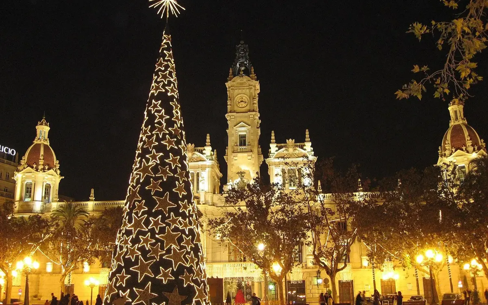
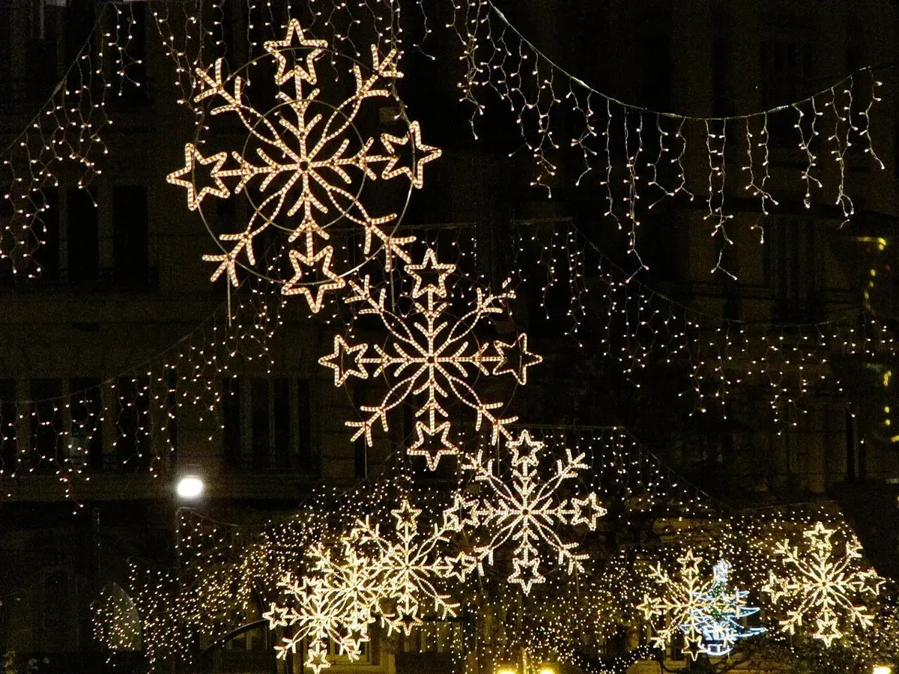
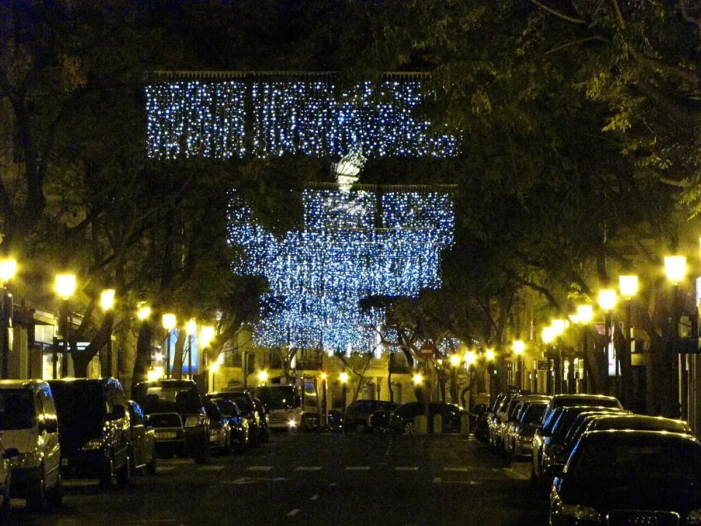
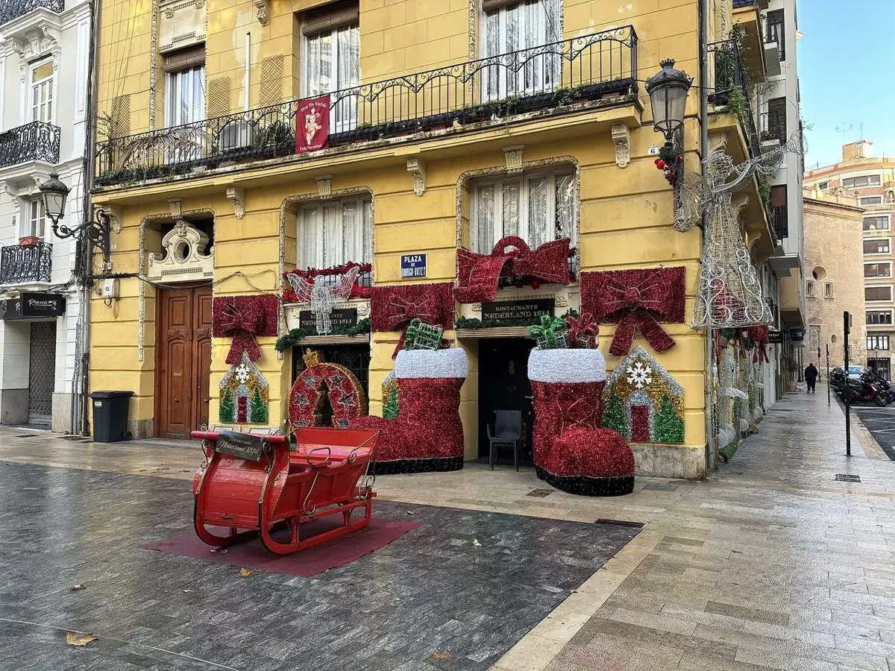

Un árbol gigante frente al Ayuntamiento, calles llenas de luces y el puerto con un barco donde los niños entregan su carta. **Valencia** enciende la Navidad el **viernes 4 de diciembre de 2026**, casi dos semanas más tarde que el año pasado.

Te cuento las fechas clave, qué tener en cuenta y los mejores planes 👇

En un vistazo<h2>Lo que vas a encontrar</h2>

<b>💡</b>Encendido 4 dic

<b>🎄</b>Árbol del Ayuntamiento

<b>⛵</b>Barco navideño

<b>🏃</b>San Silvestre 30 dic

<b>👑</b>Cabalgata 5 ene

Antes de ir<h2>Lo básico de la Navidad en Valencia</h2>

<h3>📅 Cuándo</h3>
Encendido el <strong>4 de diciembre</strong> en la plaza del Ayuntamiento. El bando de Navidad va del <strong>20 de noviembre al 6 de enero</strong>.

<h3>🕖 Hora del encendido</h3>
Según la prensa local, entre las <strong>19:00 y las 20:00</strong>, con espectáculo musical. Llega con tiempo: la plaza se llena.

<h3>🚫 No lleves</h3>
Bicis, patinetes, vidrio, latas ni objetos voluminosos: no se puede entrar con ellos en la plaza el día del encendido ni en Nochevieja.

<h3>🚌 Cómo moverte</h3>
En metro o andando. Los días de más gente, de <strong>17:00 a 22:00</strong>, se corta el tráfico en el centro y <strong>21 líneas de la EMT</strong> cambian su recorrido.

Qué ver<h2>Los imprescindibles de la Navidad en Valencia</h2>

<ol class="guide__grid guide__grid--cuenca">
<li class="gcard reveal">
01

<h3>La plaza del Ayuntamiento</h3>
El corazón de la Navidad valenciana: el gran <strong>árbol</strong>, la decoración y el encendido del <strong>4 de diciembre</strong>. A mediados de noviembre ya se estaban montando una pista de hielo y un tiovivo, según la prensa local.

</li>
<li class="gcard reveal">
02

<h3>Paseo de luces por el centro</h3>
Desde la plaza del Ayuntamiento, sigue por San Vicente Mártir hasta la <strong>plaza de la Reina</strong> y la Catedral, y por la calle de la Paz. Es el recorrido con más ambiente.

</li>
<li class="gcard reveal">
03

<h3>Los barrios iluminados</h3>
Las luces llegan también a avenidas y barrios como <strong>Ruzafa</strong>. Entre semana se pasea mucho más tranquilo que los fines de semana de diciembre.

</li>
<li class="gcard reveal">
04

<h3>Rincones decorados</h3>
Fachadas con lazos, trineos y botas gigantes: el centro se llena de rincones para hacerse fotos.

</li>
</ol>

Fechas clave<h2>Calendario de la Navidad en Valencia 2026-2027</h2>

<h3>💡 4 de diciembre</h3>
<strong>Encendido de luces</strong> y del árbol en la plaza del Ayuntamiento.

<h3>⛵ Desde el 4 de diciembre</h3>
<a href="https://www.civitatis.com/es/valencia/barco-navidad-valencia/?aid=110968" target="_blank" rel="noopener sponsored">Barco navideño</a> en el puerto, desde 10 €: Papá Noel hasta el 25 de diciembre y el rey <strong>Melchor</strong> del 26 de diciembre al 4 de enero.

<h3>🏃 30 de diciembre</h3>
<strong>San Silvestre</strong>, con paso por San Vicente Mártir hasta la plaza del Ayuntamiento.

<h3>🥂 31 de diciembre</h3>
<strong>Nochevieja</strong> en la plaza del Ayuntamiento. Ese día los cortes empiezan a las 10:00, porque por la mañana hay <strong>campanadas infantiles</strong>.

<h3>👑 5 de enero</h3>
<strong>Cabalgata de Reyes</strong> por la tarde, por Navarro Reverter, la Porta de la Mar, la calle de la Paz y San Vicente Mártir.

<h3>📍 Días de más ambiente</h3>
27 y 28 de noviembre, 5, 12 y 13 de diciembre y del <strong>18 de diciembre al 6 de enero</strong>: son los días con cortes de tráfico en el centro.

<!--actividades-->

Plan de Cheno<h2>Un día de Navidad en Valencia</h2><ul><li><b>Mañana:</b> Mercado Central, la Lonja y la Catedral, con la <a href="/blog/valencia-que-ver.html">guía de qué ver en Valencia</a>.</li><li><b>Mediodía:</b> paella o arroz en el centro o en la Malvarrosa.</li><li><b>Tarde:</b> con niños, el <a href="https://www.civitatis.com/es/valencia/barco-navidad-valencia/?aid=110968" target="_blank" rel="noopener sponsored">barco navideño</a> del puerto o el <a href="/blog/oceanografic-valencia.html">Oceanogràfic</a>.</li><li><b>Al anochecer:</b> plaza del Ayuntamiento y paseo de luces hasta la plaza de la Reina.</li><li><b>Noche:</b> un <a href="https://www.civitatis.com/es/valencia/tour-misterios-leyendas-valencia/?aid=110968" target="_blank" rel="noopener sponsored">tour de misterios y leyendas</a> por el casco antiguo.</li></ul>

Consejos de Cheno<h2>Para disfrutarla al máximo</h2><ul><li><b>El día del encendido</b>, ve en metro y llega al menos una hora antes.</li><li><b>Entre semana</b> se ven las luces sin agobios; los fines de semana de diciembre, el centro se llena.</li><li><b>Consulta la app de la EMT</b> antes de coger el autobús por la tarde.</li><li><b>Escápate</b> a la <a href="/blog/albufera-valencia.html">Albufera</a> para ver el atardecer, o al <a href="/blog/bioparc-valencia.html">Bioparc</a> con niños.</li></ul>

🎄 <strong>Más Navidad en España:</strong> <a href="/blog/navidad-en-madrid.html">Madrid</a> · <a href="/blog/magicas-navidades-torrejon.html">Mágicas Navidades de Torrejón</a> · <a href="/blog/navidad-en-barcelona.html">Barcelona</a> · <a href="/blog/navidad-en-sevilla.html">Sevilla</a> · <a href="/blog/navidad-en-zaragoza.html">Zaragoza</a> · <a href="/blog/navidad-en-malaga.html">Málaga</a> · <a href="/blog/luces-navidad-vigo.html">luces de Vigo</a> · <a href="/blog/belen-viviente-buitrago-del-lozoya.html">Belén viviente de Buitrago</a> · <a href="/blog/pueblo-navidad-ferrero-rocher-2026.html">Pueblo Navidad Ferrero Rocher</a>.

<!--faq-->

<h2>¿Te gustan estos planes?</h2>
Sígueme en Instagram como <a href="https://www.instagram.com/chenoaventuras/" target="_blank" rel="noopener">@chenoaventuras</a>: subo escapadas como esta cada semana.
<a class="btn guide__btn" href="/blog.html">Ver más planes en el blog</a>

Información consultada en noviembre de 2026: fecha y hora del encendido en prensa local (El Español, Valencia Extra, El Periòdic), que cita al Ayuntamiento; cortes de tráfico, Nochevieja, San Silvestre y Cabalgata, en el bando municipal de Navidad 2026. El Ayuntamiento aún no ha publicado el programa completo: confirma fechas y horarios antes de ir. Fotos de Wikimedia Commons: <a href="https://commons.wikimedia.org/wiki/File:Ayuntamiento_de_Valencia_en_Navidad_(2008).jpg" target="_blank" rel="noopener">Alberto Ceballos</a> (CC BY-SA 2.0) · <a href="https://commons.wikimedia.org/wiki/File:Valencia_Christmas_-_Flickr_-_treegrow.jpg" target="_blank" rel="noopener">Katja Schulz</a> (CC BY 2.0) · <a href="https://commons.wikimedia.org/wiki/File:Valencia_Christmas_-_Flickr_-_treegrow_(1).jpg" target="_blank" rel="noopener">Katja Schulz</a> (CC BY 2.0) · <a href="https://commons.wikimedia.org/wiki/File:Decoraciones_navide%C3%B1as_diversas_en_Valencia_Ciudad_11.jpg" target="_blank" rel="noopener">19Tarrestnom65</a> (CC BY-SA 4.0).

