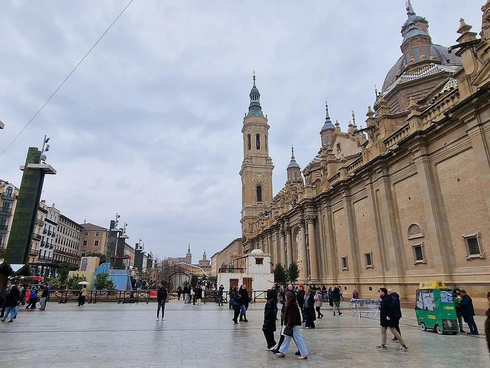
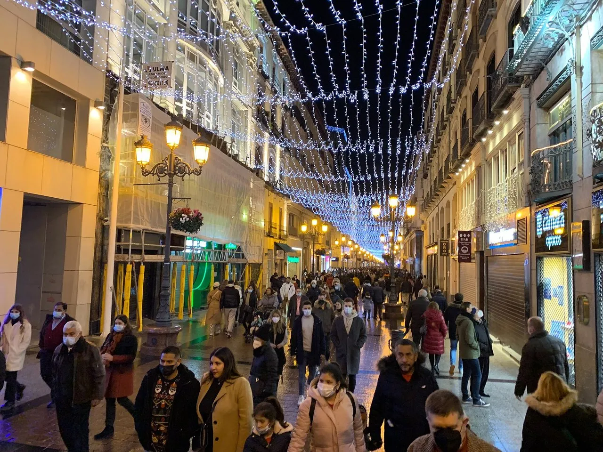
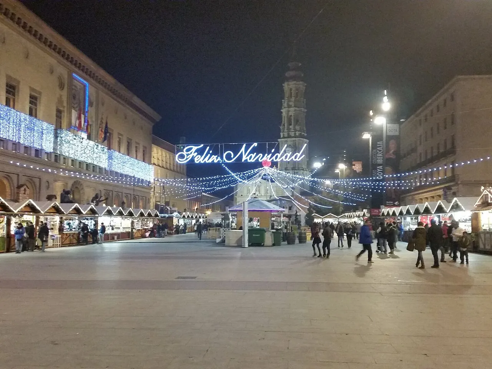
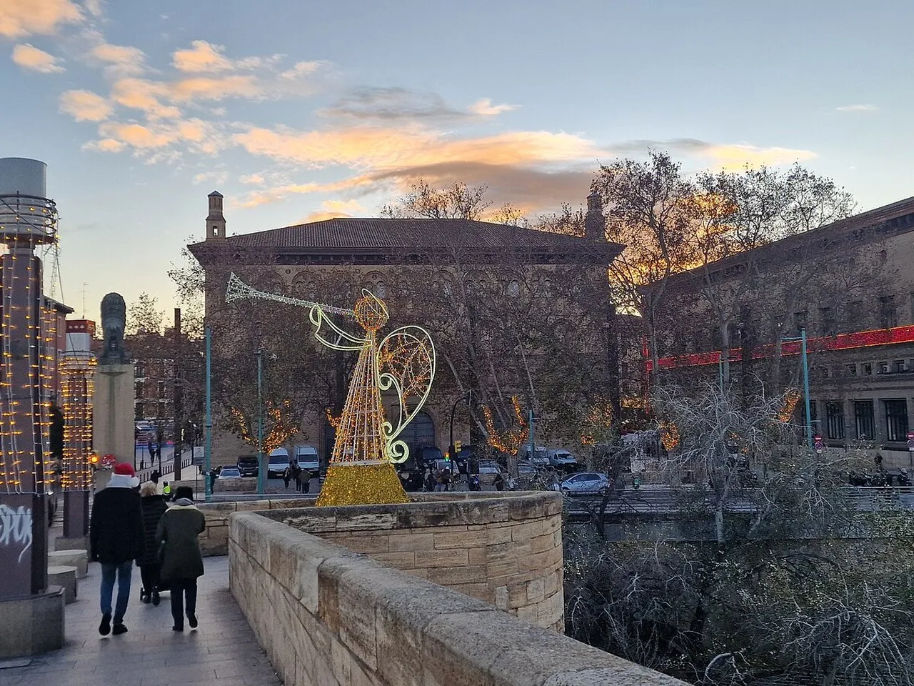
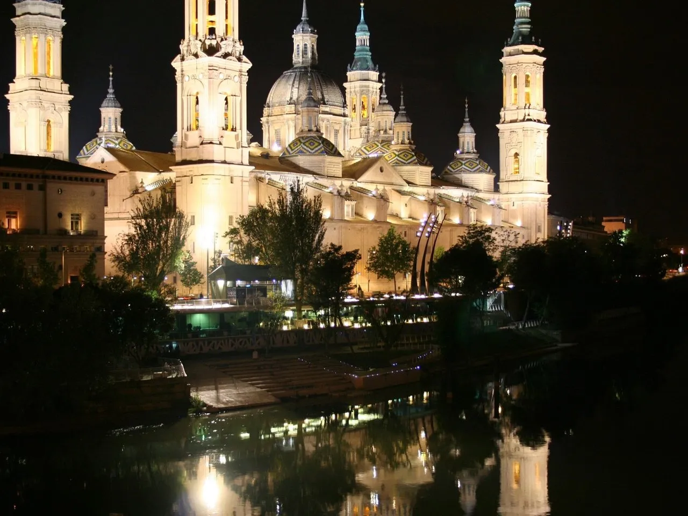

Un belén de **más de mil metros cuadrados** con figuras a tamaño real delante de la **Basílica del Pilar**, una pista de hielo en la misma plaza y las uvas con orquesta en Nochevieja. **Zaragoza** enciende la Navidad el **27 de noviembre**.

Te cuento las fechas oficiales de 2026, los horarios y qué ver 👇

En un vistazo<h2>Lo que vas a encontrar</h2>

<b>⭐</b>Belén gigante

<b>💡</b>Luces desde el 27 nov

<b>⛸️</b>Pista de hielo

<b>🛍️</b>Mercados

<b>👑</b>Nueva cabalgata

Antes de ir<h2>Lo básico de la Navidad en Zaragoza</h2>

<h3>📅 Cuándo</h3>
Del <strong>27 de noviembre al 6 de enero</strong>. El encendido es el viernes 27 por la tarde en el paseo Independencia.

<h3>⭐ Horario del belén</h3>
De <strong>11:00 a 14:00</strong> y de <strong>16:00 a 21:00</strong>, con horarios especiales en Nochebuena, Navidad, Nochevieja, Año Nuevo y el 5 de enero.

<h3>📍 Dónde</h3>
Casi todo pasa en la <strong>plaza del Pilar</strong>: belén, pista de hielo, muestra navideña y uvas. El otro foco es el <strong>paseo Independencia</strong> y la plaza Aragón.

<h3>💶 Precio</h3>
Las luces, los mercados y las uvas son <strong>gratis</strong>. Se pagan la pista de hielo y la nueva atracción «La Estrella» (5 €).

Qué ver<h2>Los imprescindibles de la Navidad en Zaragoza</h2>

<ol class="guide__grid guide__grid--cuenca">
<li class="gcard reveal">
01

<h3>El belén de la plaza del Pilar</h3>
El «<strong>Belén de Judea</strong>»: más de mil metros cuadrados en forma de abanico, un centenar de figuras a tamaño real, el Palacio de Herodes, un zoco de mercaderes y oficios aragoneses. En 2026, <strong>nuevo establo y animales a tamaño natural</strong>.

</li>
<li class="gcard reveal">
02

<h3>Las luces y el Corredor de la Luz</h3>
El <strong>27 de noviembre</strong>, pasacalles por el paseo Independencia hasta la plaza Aragón, donde se enciende la Navidad. Este año se amplía el <strong>Corredor de la Luz</strong> y estrenan decoración la calle Alfonso y el paseo Independencia.

</li>
<li class="gcard reveal">
03

<h3>Muestra navideña y pista de hielo</h3>
En la plaza del Pilar, puestos navideños de lunes a viernes de 11:00 a 15:30 y de 16:30 a 22:00 (sábados y festivos, hasta las 23:00), junto a la <strong>pista de hielo</strong> cubierta más grande de la ciudad.

</li>
<li class="gcard reveal">
04

<h3>Paseo por el Ebro</h3>
Al caer la tarde, cruza el <strong>Puente de Piedra</strong> con la decoración navideña y vuelve con la Basílica del Pilar iluminada al otro lado del río.

</li>
<li class="gcard reveal">
05

<h3>Las uvas en el Pilar</h3>
En <strong>Nochevieja</strong>, la plaza del Pilar despide el año con la <strong>Orquesta Impakto</strong> desde las 23:00.

</li>
</ol>

<!--actividades-->

Más planes<h2>Más Navidad en Zaragoza 2026</h2>

<h3>🌿 Winter Garden</h3>
Mercado gourmet en el <strong>Parque Grande José Antonio Labordeta</strong> (paseo San Sebastián), del 27 de noviembre al 5 de enero. Hasta el 20 de diciembre abre viernes por la tarde y fines de semana; del 21 de diciembre, todos los días de 11:00 a 14:00 y de 17:00 a 21:00.

<h3>🌟 La Estrella</h3>
Nuevo espectáculo de luz en el <strong>Jardín Botánico</strong> del Parque Grande, a <strong>5 €</strong> por persona (1 € va a la asociación ARAELA).

<h3>🛍️ Mercado de la plaza Aragón</h3>
Del <strong>5 de diciembre al 6 de enero</strong>, de 11:00 a 14:30 y de 17:00 a 21:00; vísperas y festivos, de 11:00 a 23:00.

<h3>✉️ Buzón Real</h3>
En el zaguán del Ayuntamiento, en la plaza del Pilar, para dejar la carta a los Reyes. Allí mismo hay un belén artístico de la Asociación de Amigos del Belén.

<h3>👑 Nueva Cabalgata de Reyes</h3>
Recorrido más largo: del Colegio San Agustín por Tenor Fleta, avenida Goya, paseo Teruel, Hernán Cortés, César Augusto, Coso y calle Alfonso hasta la plaza del Pilar.

<h3>🚂 Tren de los Reyes Magos</h3>
Sale de la estación de Delicias durante las vacaciones escolares. Consulta días y horarios en la web municipal.

Plan de Cheno<h2>La Navidad de Zaragoza en un día</h2><ul><li><b>Mañana:</b> belén de la plaza del Pilar a primera hora (abre a las 11:00) y <a href="https://www.civitatis.com/es/zaragoza/visita-guiada-basilica-pilar/?aid=110968" target="_blank" rel="noopener sponsored">visita guiada a la Basílica del Pilar</a>.</li><li><b>Mediodía:</b> tapeo por El Tubo, o un <a href="https://www.civitatis.com/es/zaragoza/tour-tapas-zaragoza/?aid=110968" target="_blank" rel="noopener sponsored">tour de tapas</a>.</li><li><b>Tarde:</b> pista de hielo y muestra navideña en la plaza del Pilar.</li><li><b>Atardecer:</b> Puente de Piedra y vuelta por la calle Alfonso y el paseo Independencia con las luces encendidas.</li><li><b>Noche:</b> <a href="https://www.civitatis.com/es/zaragoza/free-tour-misterios-leyendas-zaragoza/?aid=110968" target="_blank" rel="noopener sponsored">free tour de misterios y leyendas</a> por el casco antiguo.</li></ul>

Consejos de Cheno<h2>Para disfrutarla al máximo</h2><ul><li><b>Ve al belén entre semana y por la mañana</b>: por la tarde y en el puente de diciembre hay colas.</li><li><b>Abrígate</b>: el cierzo en la plaza del Pilar se nota mucho en diciembre.</li><li><b>Ojo con los horarios especiales</b> del belén en Nochebuena, Navidad, Nochevieja y Reyes.</li><li><b>Combínalo con</b> la <a href="/blog/zaragoza-que-ver.html">guía de qué ver en Zaragoza</a>.</li></ul>

🎄 <strong>Más Navidad en España:</strong> <a href="/blog/navidad-en-madrid.html">Madrid</a> · <a href="/blog/magicas-navidades-torrejon.html">Mágicas Navidades de Torrejón</a> · <a href="/blog/navidad-en-barcelona.html">Barcelona</a> · <a href="/blog/navidad-en-sevilla.html">Sevilla</a> · <a href="/blog/navidad-en-valencia.html">Valencia</a> · <a href="/blog/navidad-en-malaga.html">Málaga</a> · <a href="/blog/luces-navidad-vigo.html">luces de Vigo</a> · <a href="/blog/belen-viviente-buitrago-del-lozoya.html">Belén viviente de Buitrago</a> · <a href="/blog/pueblo-navidad-ferrero-rocher-2026.html">Pueblo Navidad Ferrero Rocher</a>.

<!--faq-->

<h2>¿Te gustan estos planes?</h2>
Sígueme en Instagram como <a href="https://www.instagram.com/chenoaventuras/" target="_blank" rel="noopener">@chenoaventuras</a>: subo escapadas como esta cada semana.
<a class="btn guide__btn" href="/blog.html">Ver más planes en el blog</a>

Información consultada en noviembre de 2026 en la web del Ayuntamiento de Zaragoza (portal de Navidad y nota de prensa del 19 de noviembre). Las fechas y horarios pueden cambiar: confírmalos antes de ir. Fotos de Wikimedia Commons: <a href="https://commons.wikimedia.org/wiki/File:Zaragoza_-_Mercadillo_de_Navidad.jpg" target="_blank" rel="noopener">Ecelan</a> (CC BY-SA 4.0) · <a href="https://commons.wikimedia.org/wiki/File:Zaragoza_en_Navidad.jpeg" target="_blank" rel="noopener">Robot8A</a> (CC BY-SA 4.0) · <a href="https://commons.wikimedia.org/wiki/File:Zaragoza_-_Plaza_del_Pilar_-_Bel%C3%A9n_navide%C3%B1o.jpg" target="_blank" rel="noopener">Ecelan</a> (CC BY-SA 4.0) · <a href="https://commons.wikimedia.org/wiki/File:Zaragoza_-_Puente_de_Piedra_-_Iluminaci%C3%B3n_Navidad_2025.jpg" target="_blank" rel="noopener">Ecelan</a> (CC BY-SA 4.0) · <a href="https://commons.wikimedia.org/wiki/File:Basilica_del_Pilar_de_noche.jpg" target="_blank" rel="noopener">Robles Aurora</a> (CC BY-SA 3.0 es).

