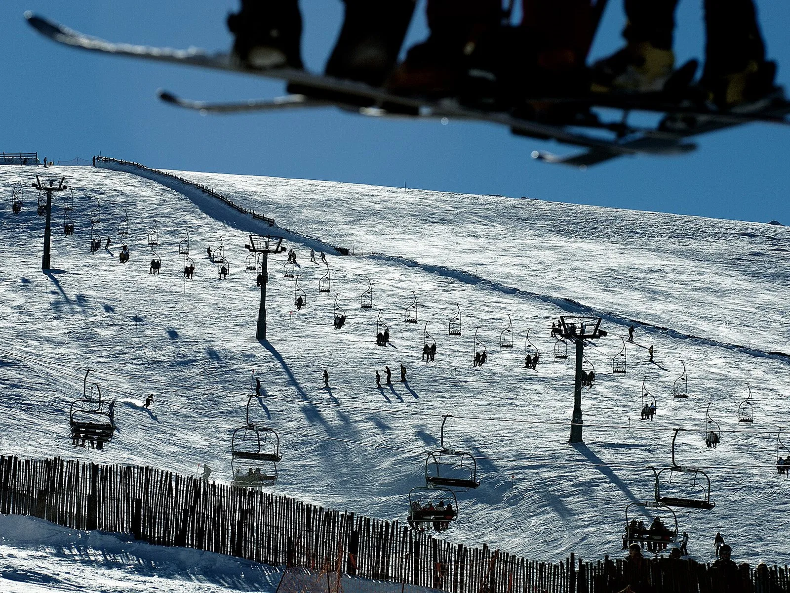
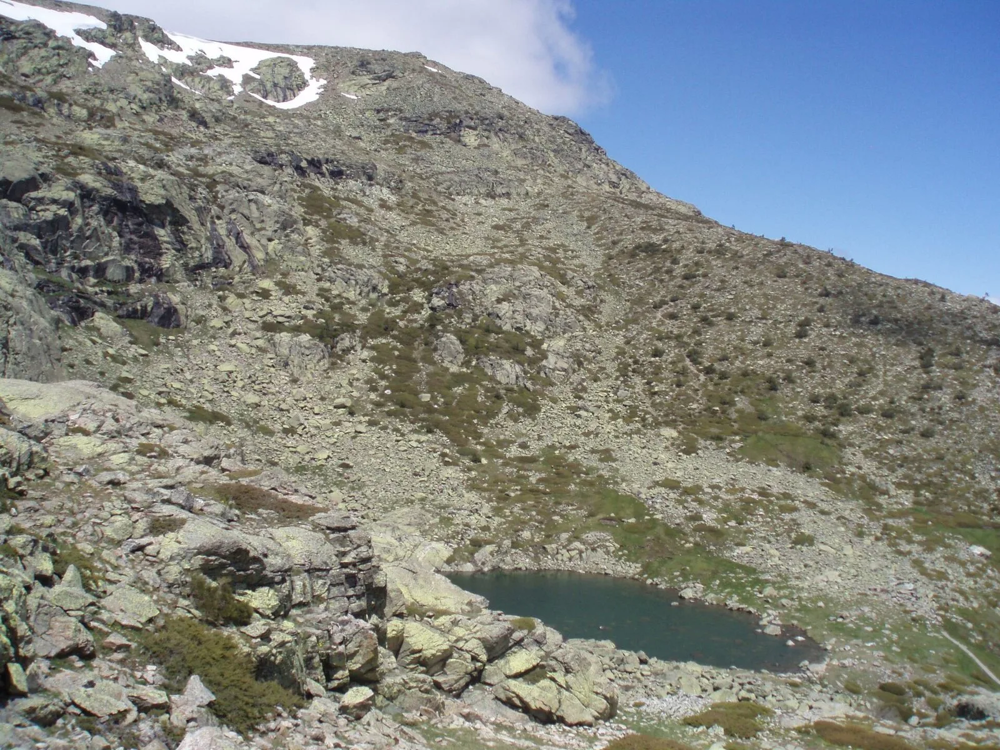
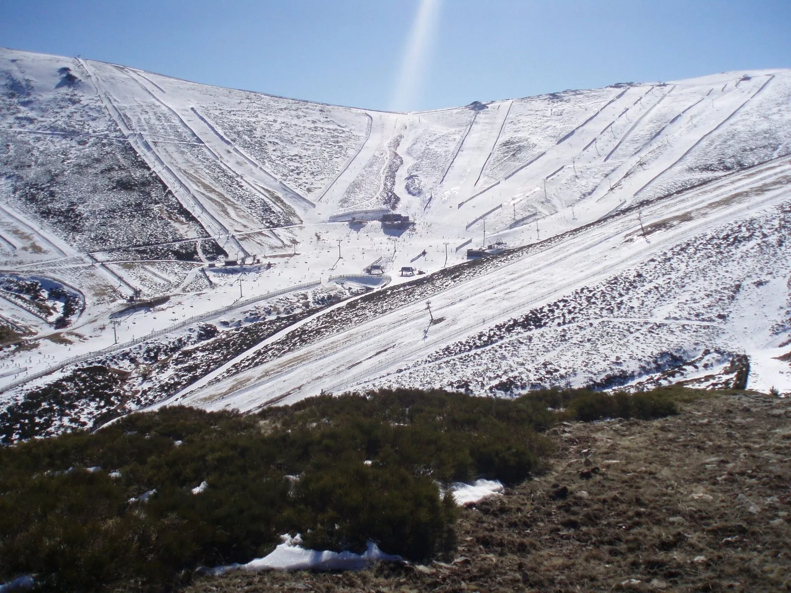
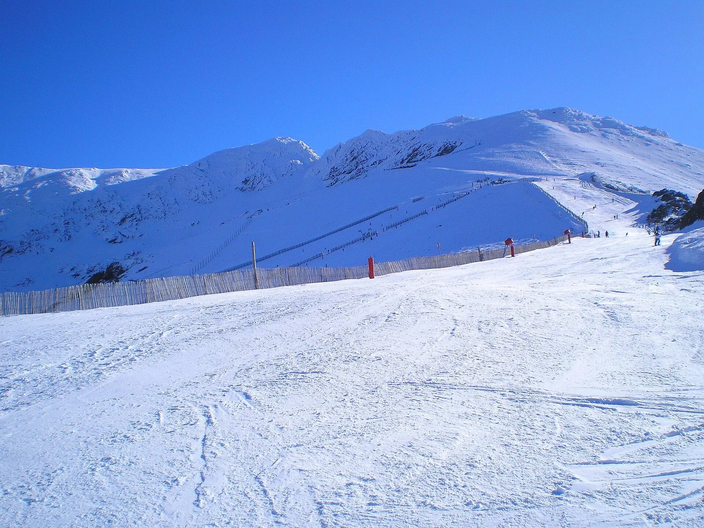

Cuando nieva en la sierra, medio Madrid quiere subir a verla. La buena noticia: tienes nieve a **poco más de una hora** del centro. La mala: los días de nevada las carreteras se colapsan y muchos se quedan a mitad de camino. Te cuento los mejores sitios, cómo llegar y los trucos para no pasarte el día en un atasco 👇

En un vistazo<h2>Lo que vas a encontrar</h2>

<b>❄️</b>Nieve a 1 hora

<b>⛷️</b>Esquí

<b>🏔️</b>Peñalara

<b>🚌</b>Bus desde Moncloa

<b>⚠️</b>Normas del Parque

Antes de ir<h2>Lo que tienes que saber</h2>

<h3>🚗 Atascos</h3>
Los días de nevada en fin de semana, la <strong>DGT corta los accesos</strong> cuando se llenan los aparcamientos. Sal muy temprano o ve entre semana.

<h3>⛓️ Cadenas</h3>
Lleva <strong>cadenas o neumáticos de invierno</strong>. Mira el estado de las carreteras en la DGT antes de salir.

<h3>🌲 Parque Nacional</h3>
Gran parte de la sierra es <strong>Parque Nacional de Guadarrama</strong>: no te salgas de los caminos y no te lleves nada.

Dónde ir<h2>Los mejores sitios para ver nieve</h2>

<ol class="guide__grid guide__grid--cuenca">
<li class="gcard reveal">
01

<h3>Puerto de Navacerrada</h3>
A <strong>1.858 metros</strong>, el clásico de toda la vida. Tiene estación de esquí, pero su continuidad está en duda: confirma si abre antes de ir a esquiar. Para ver la nieve y pasear, sigue siendo una buena opción.

</li>
<li class="gcard reveal">
02

<h3>Puerto de Cotos y Peñalara</h3>
A unos 1.830 metros, es la puerta de <strong>Peñalara</strong>, el pico más alto de la sierra. Con nieve, las rutas a la Laguna Grande son preciosas, pero llévate ropa y calzado de montaña.

</li>
<li class="gcard reveal">
03

<h3>Valdesquí</h3>
La estación de esquí más activa de Madrid, en el término de Rascafría. Si vas a esquiar o a dar clases, es la apuesta más segura. El aparcamiento se llena muy pronto.

</li>
<li class="gcard reveal">
04

<h3>La Pinilla</h3>
En <strong>Segovia</strong>, cerca de Riaza, a una hora y media de Madrid. Una estación familiar y con menos agobios que la sierra madrileña.

</li>
</ol>

Sin coche<h2>Cómo subir a la nieve en transporte público</h2>

<ul class="checklist" style="margin:0 0 1rem;"><li><strong>Autobús 691</strong>: sale del intercambiador de <strong>Moncloa</strong> hacia el Puerto de Navacerrada y Valdesquí. Los días de nieve se llena: ve en los primeros.</li><li><strong>Otros puertos</strong>: si solo quieres pisar nieve, los puertos de <strong>Navafría</strong> y <strong>Canencia</strong> suelen tener menos gente que Navacerrada.</li><li><strong>Tren de Cotos (C-9)</strong>: está <strong>cerrado por obras</strong> desde mayo de 2024 y Adif prevé terminarlas a finales de 2026. Mientras tanto hay un autobús sustitutivo entre Cercedilla y Cotos que puede suspenderse con nieve.</li></ul>

<h3>🛷 Trineos y muñecos</h3>
Deslízate solo donde esté permitido y nunca junto a la carretera. No dejes basura ni uses bolsas de plástico como trineo: se rompen y acaban por el monte.

Si buscas una estación grande para un fin de semana, mira <a href="/blog/sierra-nevada-esqui.html">Sierra Nevada</a> o <a href="/blog/baqueira-beret.html">Baqueira Beret</a>. Y si prefieres pueblos con encanto cerca de la sierra, tienes <a href="/blog/buitrago-del-lozoya-que-ver.html">Buitrago del Lozoya</a> y <a href="/blog/pueblos-de-colores-segovia.html">los pueblos de colores de Segovia</a>, junto a La Pinilla.

Consejos de Cheno<h2>Para disfrutarlo al máximo</h2><ul><li><b>Entre semana</b>: la diferencia de gente es enorme.</li><li><b>Sal antes de las 8</b> si vas en fin de semana.</li><li><b>Ropa impermeable</b> y guantes de repuesto para los niños.</li><li><b>Depósito lleno</b>: en los atascos de vuelta se gasta mucho.</li><li><b>Mira las webcams</b> de las estaciones antes de salir.</li></ul>

<!--faq-->

<h2>¿Te gustan estos planes?</h2>
Sígueme en Instagram como <a href="https://www.instagram.com/chenoaventuras/" target="_blank" rel="noopener">@chenoaventuras</a>: subo escapadas como esta cada semana.
<a class="btn guide__btn" href="/blog.html">Ver más planes en el blog</a>

Información consultada en noviembre de 2026 (Nevasport, Lugares de Nieve, Infobae y Trenvista). La situación de la estación de Navacerrada y del tren de Cotos puede cambiar en cualquier momento: confírmala antes de ir. Fotos de Wikimedia Commons: <a href="https://commons.wikimedia.org/wiki/File:Valdeski_(3378419091).jpg" target="_blank" rel="noopener">Daniel Lombraña González</a> (CC BY-SA 2.0) · <a href="https://commons.wikimedia.org/wiki/File:MADRID_060122_MXALX_107_(5786452695).jpg" target="_blank" rel="noopener">PromoMadrid</a> (CC BY-SA 2.0) · <a href="https://commons.wikimedia.org/wiki/File:Cima_y_laguna_de_Pe%C3%B1alara.JPG" target="_blank" rel="noopener">Miguel303xm</a> (CC BY 3.0) · <a href="https://commons.wikimedia.org/wiki/File:P1271381.JPG" target="_blank" rel="noopener">Miguel303xm</a> (CC BY 3.0) · <a href="https://commons.wikimedia.org/wiki/File:La_Pinilla-Perif%C3%A9rico-Alto_de_las_Mesas.jpg" target="_blank" rel="noopener">Carlos Delgado</a> (CC BY-SA 3.0).

