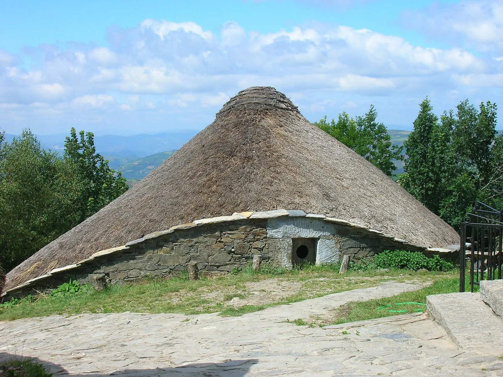
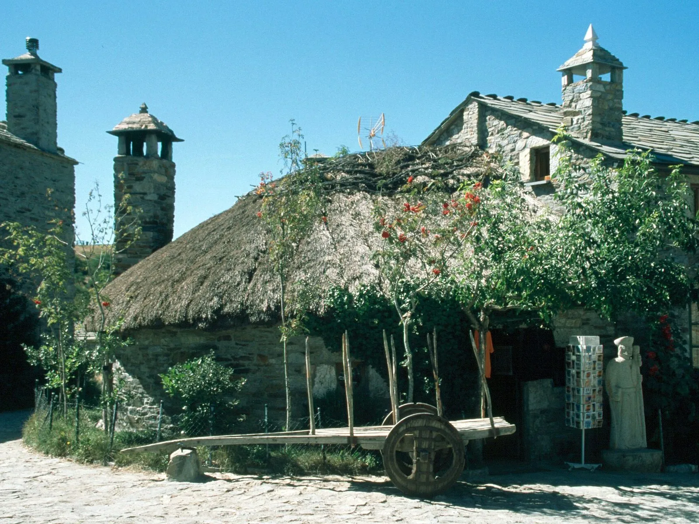
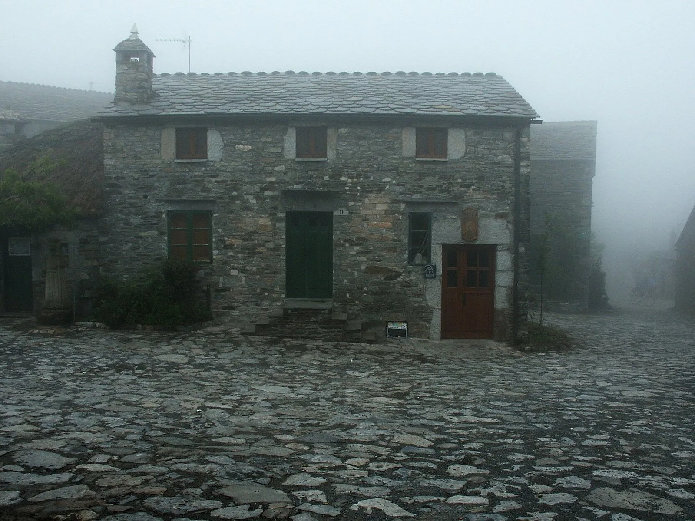
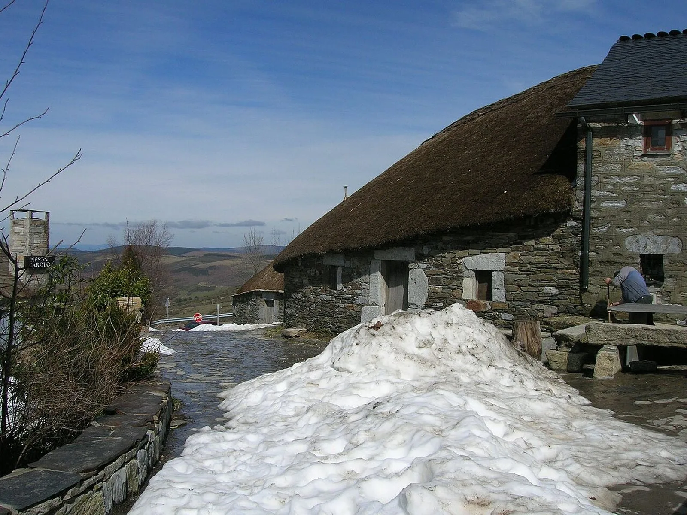
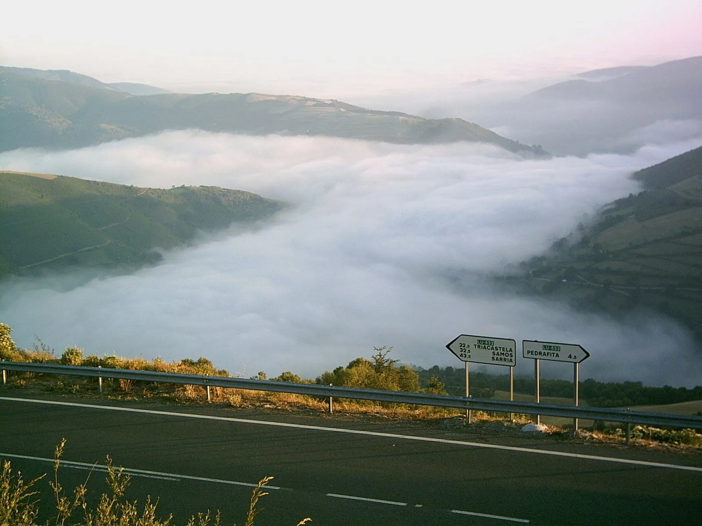
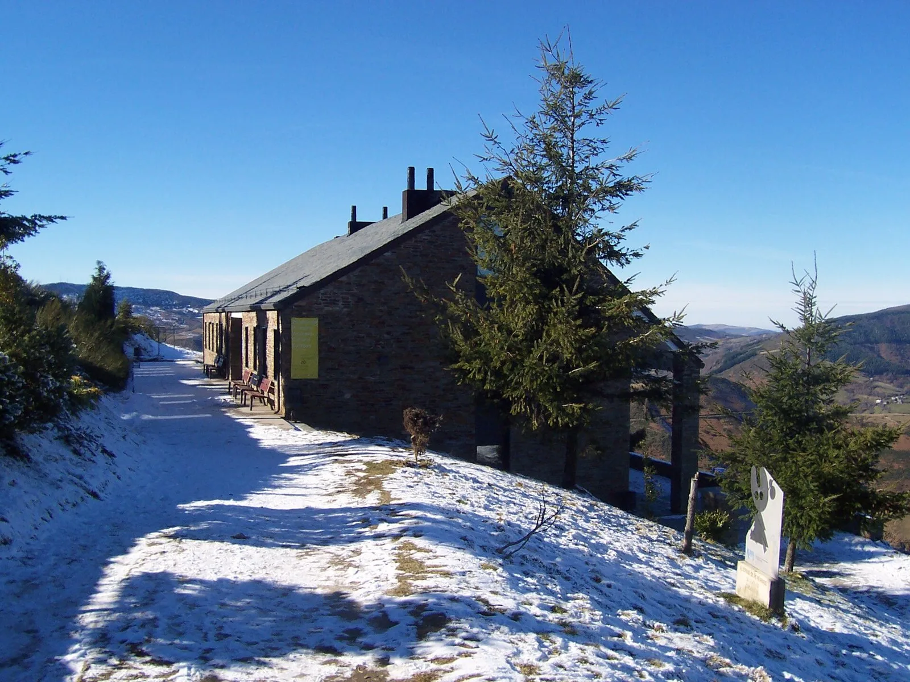

En lo alto de un puerto a unos **1.300 metros**, justo donde el Camino Francés entra en Galicia, hay una aldea de piedra que parece sacada de otro siglo. **O Cebreiro** tiene **pallozas** con techo de paja, una iglesia del siglo IX que guarda un cáliz de leyenda y unas vistas sobre las montañas que en invierno se cubren de **nieve** y, muchas mañanas, de un **mar de nubes**.

Te cuento qué ver, cuándo ir y cómo llegar 👇

En un vistazo<h2>Lo que vas a encontrar</h2>

<b>🛖</b>Pallozas

<b>⛪</b>Iglesia del s. IX

<b>🏆</b>El cáliz del milagro

<b>❄️</b>Nieve en invierno

<b>🧀</b>Queso do Cebreiro

Antes de ir<h2>Lo básico de O Cebreiro</h2>

<h3>📍 Dónde está</h3>
En el municipio de <strong>Pedrafita do Cebreiro</strong> (Lugo), en la sierra entre los Ancares y O Courel, junto al límite con León.

<h3>⏱️ Tiempo</h3>
Un par de horas para la aldea. Si haces alguna ruta corta por los alrededores, medio día.

<h3>❄️ En invierno</h3>
Nieva a menudo y hace mucho frío. Es cuando está más bonita, pero <strong>mira el estado de la carretera</strong> y lleva cadenas.

Qué ver<h2>Qué ver en O Cebreiro</h2>

<ol class="guide__grid guide__grid--cuenca">
<li class="gcard reveal">
01

<h3>Las pallozas</h3>
Casas de planta redonda con techo cónico de <strong>paja de centeno</strong>, de origen muy antiguo. Dentro vivían juntas la familia y los animales, que daban calor en invierno.

</li>
<li class="gcard reveal">
02

<h3>El museo etnográfico</h3>
Una de las pallozas es hoy un <strong>museo</strong>: ves cómo se vivía dentro, con la cocina de leña, los aperos y el establo.

</li>
<li class="gcard reveal">
03

<h3>La aldea de piedra</h3>
Calles empedradas, casas de pizarra y piedra, y mucha niebla: es habitual que la aldea amanezca dentro de una nube.

</li>
<li class="gcard reveal">
04

<h3>O Cebreiro con nieve</h3>
En invierno las pallozas aparecen rodeadas de nieve, con las montañas blancas al fondo. Si te pilla nevando, la estampa es de postal.

</li>
<li class="gcard reveal">
05

<h3>El mar de nubes</h3>
Muchas mañanas los valles quedan cubiertos de niebla y desde el puerto ves un <strong>mar de nubes</strong> con las cumbres asomando.

</li>
<li class="gcard reveal">
06

<h3>El Camino de Santiago</h3>
Es la primera parada del Camino Francés en Galicia. Verás peregrinos todo el año y el <strong>albergue</strong> a la entrada de la aldea.

</li>
</ol>

Historia y leyenda<h2>La iglesia, el milagro y las flechas amarillas</h2>

La iglesia de <strong>Santa María la Real</strong> es <strong>prerrománica</strong>, del siglo IX, y se considera la iglesia más antigua del Camino de Santiago que sigue en uso. Dentro se guardan el <strong>cáliz y la patena del Santo Milagro</strong>: cuenta la tradición que, hacia el año 1300, durante una misa a la que solo acudió un campesino en plena tormenta, el pan y el vino se convirtieron en carne y sangre. Muchos lo relacionan con el cáliz del <strong>escudo de Galicia</strong> y con la leyenda del Santo Grial.

<h3>➡️ El cura de las flechas amarillas</h3>
Junto a la iglesia hay un busto de <strong>Elías Valiña</strong>, párroco de O Cebreiro. En los años 80 empezó a pintar <strong>flechas amarillas</strong> para señalar el Camino de Santiago, y hoy son el símbolo que guía a cientos de miles de peregrinos.

<h3>🧀 Prueba el queso</h3>
El <strong>queso do Cebreiro</strong>, con forma de gorro de cocinero, tiene denominación de origen. Pídelo con miel en cualquiera de los mesones de la aldea.

Cómo llegar<h2>Cómo llegar a O Cebreiro</h2>

En coche, por la <strong>A-6</strong> (Madrid-A Coruña): sal en <strong>Pedrafita do Cebreiro</strong> y sube unos 4 km por la <strong>LU-633</strong>. Está a algo más de una hora de Lugo y a unos 45 minutos de Ponferrada. Hay aparcamiento a la entrada de la aldea.

<strong>En invierno:</strong> consulta el estado de las carreteras antes de salir: con nieve puede exigirse el uso de cadenas.

<a class="btn guide__mapbtn" href="https://www.google.com/maps/dir/?api=1&destination=42.7078,-7.0434" target="_blank" rel="noopener"><svg class="ico" viewBox="0 0 24 24" width="15" height="15" aria-hidden="true" fill="currentColor"><path d="M12 2a7 7 0 0 0-7 7c0 5.25 7 13 7 13s7-7.75 7-13a7 7 0 0 0-7-7zm0 9.5a2.5 2.5 0 1 1 0-5 2.5 2.5 0 0 1 0 5z"/></svg> Cómo llegar en Google Maps</a>

Si sigues hacia el oeste, tienes la muralla romana de <a href="/blog/lugo-que-ver.html">Lugo</a> y <a href="/blog/portomarin.html">Portomarín</a>, otra parada clásica del Camino. Hacia el este, en León, están <a href="/blog/las-medulas.html">Las Médulas</a> y el <a href="/blog/castillo-templario-ponferrada.html">castillo templario de Ponferrada</a>.

Consejos de Cheno<h2>Para disfrutarlo al máximo</h2><ul><li><b>Abrígate</b>: aunque abajo haga bueno, arriba hace frío y viento.</li><li><b>Ve temprano</b>: para pillar el mar de nubes.</li><li><b>Respeta a los peregrinos</b>: el albergue y la iglesia son parte del Camino.</li><li><b>Come caldo gallego y queso con miel</b> en un mesón de la aldea.</li></ul>

<!--actividades-->

<!--faq-->

<h2>¿Te gustan estos planes?</h2>
Sígueme en Instagram como <a href="https://www.instagram.com/chenoaventuras/" target="_blank" rel="noopener">@chenoaventuras</a>: subo escapadas como esta cada semana.
<a class="btn guide__btn" href="/blog.html">Ver más planes en el blog</a>

Información consultada en noviembre de 2026 en webs de turismo de Galicia y del Camino de Santiago. Los horarios del museo etnográfico cambian según la temporada. Fotos de Wikimedia Commons: <a href="https://commons.wikimedia.org/wiki/File:O_Cebreiro_(396389867).jpg" target="_blank" rel="noopener">José Antonio Gil Martínez</a> (CC BY 2.0) · <a href="https://commons.wikimedia.org/wiki/File:O_Cebreiro_(396389642).jpg" target="_blank" rel="noopener">José Antonio Gil Martínez</a> (CC BY 2.0) · <a href="https://commons.wikimedia.org/wiki/File:Palloza_en_O_Cebreiro_(Lugo).JPG" target="_blank" rel="noopener">SanchoPanzaXXI</a> (CC BY-SA 3.0) · <a href="https://commons.wikimedia.org/wiki/File:O_Cebreiro-10-Palloza-2001-gje.jpg" target="_blank" rel="noopener">Gerd Eichmann</a> (CC BY-SA 4.0) · <a href="https://commons.wikimedia.org/wiki/File:O_Cebreiro_Wohnhaus_bei_Nebel.jpg" target="_blank" rel="noopener">Willyman</a> (CC BY-SA 4.0) · <a href="https://commons.wikimedia.org/wiki/File:O%27_Cebreiro_-_panoramio.jpg" target="_blank" rel="noopener">dinamicline</a> (CC BY-SA 3.0) · <a href="https://commons.wikimedia.org/wiki/File:Albergue_do_Cebreiro,_Pedrafita_do_Cebreiro.jpg" target="_blank" rel="noopener">amaianos</a> (CC BY 2.0).

