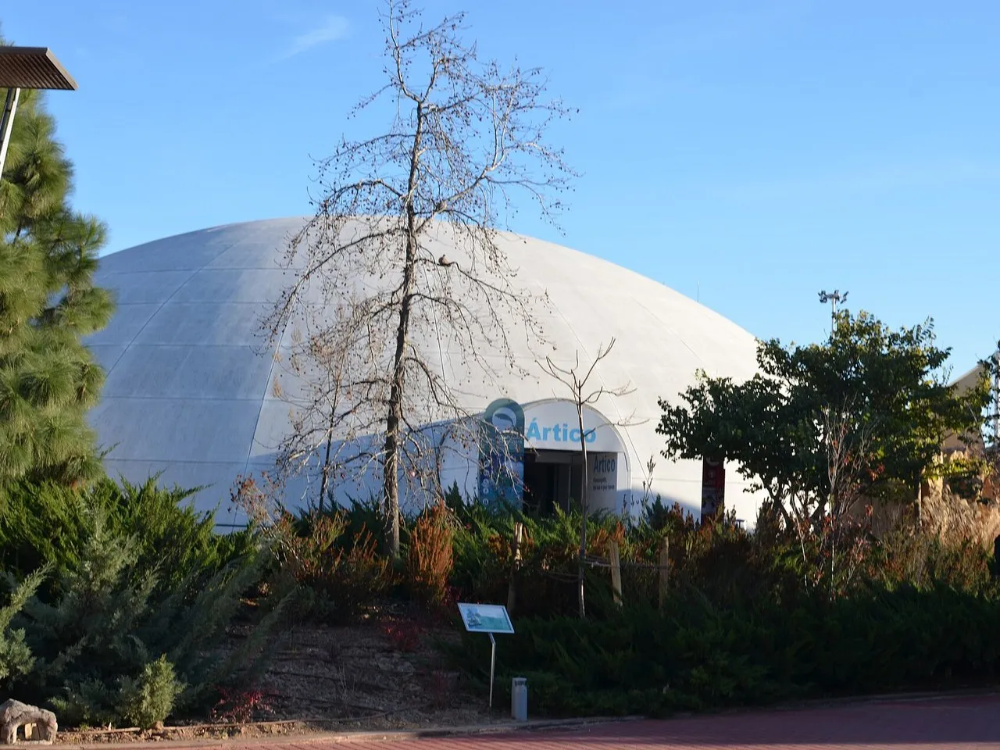
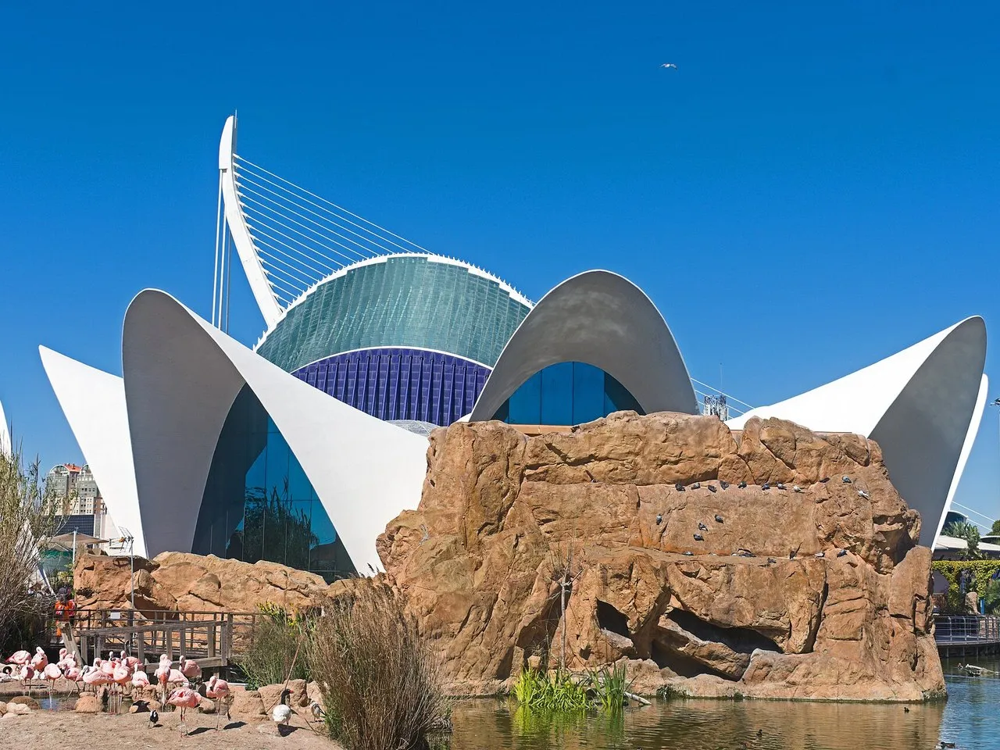
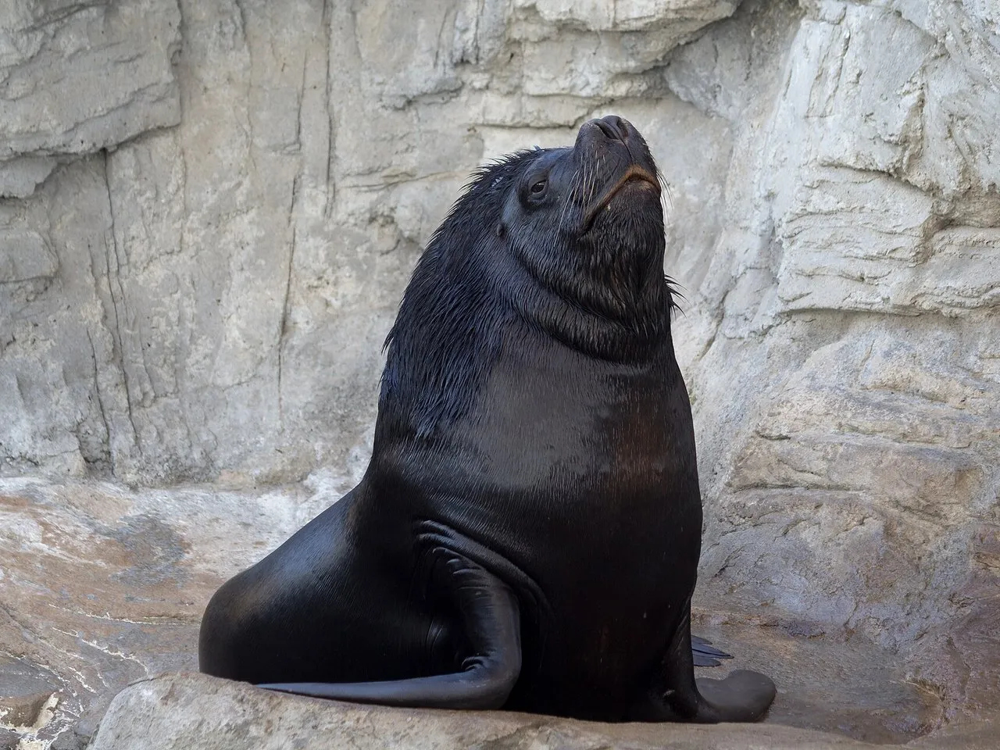
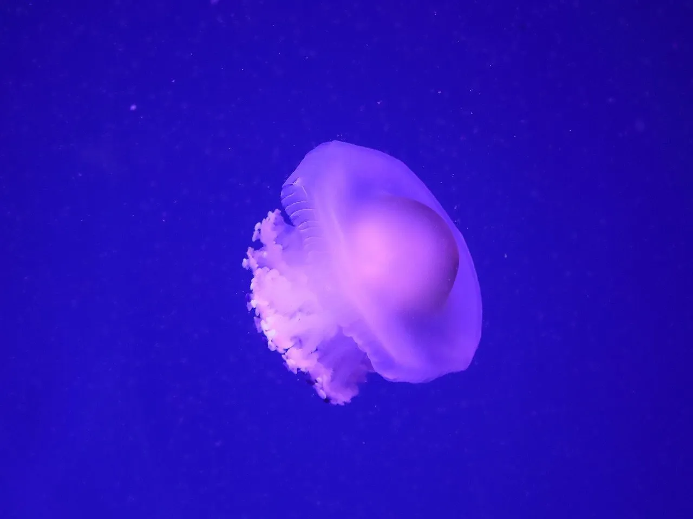
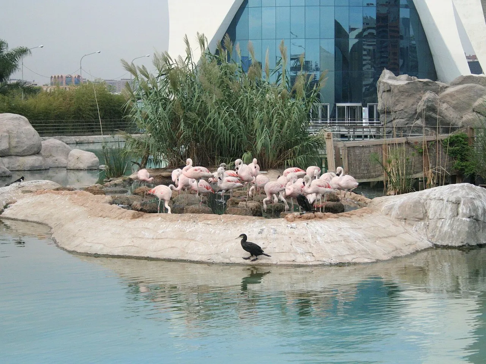

Belugas, tiburones nadando sobre tu cabeza en un túnel de cristal y edificios blancos con forma de nenúfar. El **Oceanogràfic de Valencia** se presenta como el **acuario más grande de Europa**, con más de **35.000 animales**, y es la parada estrella de la **Ciudad de las Artes y las Ciencias**.

Te cuento cuánto cuesta, el horario, cómo ahorrar con las combinadas y cómo llegar 👇

En un vistazo<h2>Lo que vas a encontrar</h2>

<b>🐳</b>Belugas

<b>🦈</b>Túnel de tiburones

<b>🐬</b>Delfines incluidos

<b>🐧</b>Ártico y Antártico

<b>🅿️</b>Parking 800 plazas

Antes de ir<h2>Lo básico del Oceanogràfic</h2>

<h3>🎟️ Precio</h3>
Cambia según el día: general de unos <strong>36 a 43 €</strong>; infantil (4-12) y mayores de 65, de unos <strong>27 a 32 €</strong>. Menores de 4, gratis.

<h3>🕙 Horario</h3>
Desde las <strong>10:00</strong>; el cierre varía según el día. Taquillas, una hora antes.

<h3>⏱️ Duración</h3>
De <strong>3 a 4 horas</strong>. Ve con tiempo para los pases de delfines.

<h3>💡 Ahorra</h3>
Las <strong>entradas combinadas</strong> con el Hemisfèric o el Museu de les Ciències salen mejor que por separado.

Qué ver<h2>Qué ver en el Oceanogràfic</h2>

<ol class="guide__grid guide__grid--cuenca">
<li class="gcard reveal">
01

<h3>El Ártico y las belugas</h3>
Bajo esta cúpula viven <strong>las únicas belugas de Europa</strong>, según el acuario. También hay pingüinos en la zona antártica.

</li>
<li class="gcard reveal">
02

<h3>Edificios blancos y el túnel</h3>
Sus edificios con forma de nenúfar esconden la zona de Océanos, con lo que el acuario llama <strong>el túnel submarino más largo de Europa</strong>: tiburones y rayas nadando sobre tu cabeza.

</li>
<li class="gcard reveal">
03

<h3>Los mamíferos marinos</h3>
Lobos marinos y otros mamíferos marinos. Y la <strong>presentación de delfines</strong> en el Ágora del Mar, incluida en la entrada.

</li>
<li class="gcard reveal">
04

<h3>Las medusas</h3>
Uno de los rincones más hipnóticos: tanques oscuros con medusas iluminadas.

</li>
<li class="gcard reveal">
05

<h3>El aviario y los humedales</h3>
Una gran cúpula de malla donde vuelan aves de los humedales: se pasea entre ellas.

</li>
<li class="gcard reveal">
06

<h3>Los exteriores</h3>
Entre edificio y edificio, lagos con <strong>flamencos</strong> y aves acuáticas. Y unas 780 especies repartidas por todo el recinto.

</li>
</ol>

<!--actividades-->

Cómo llegar<h2>Cómo llegar al Oceanogràfic</h2>

<h3>🚇 En metro</h3>
<strong>Línea 10</strong> de Metrovalencia, parada <strong>Oceanogràfic</strong>.

<h3>🚌 En autobús</h3>
Líneas <strong>15 y 95</strong> de la EMT. También hay Valenbisi.

<h3>🅿️ Parking</h3>
Subterráneo, <strong>800 plazas</strong>. Con entrada, tarifa plana desde <strong>7 €/día</strong> (8 € en temporada alta); sin entrada, 2,30 €/hora.

<h3>🎟️ Entradas</h3>
Se compran online o con la <a href="https://www.civitatis.com/es/valencia/entrada-oceanografic/?aid=110968" target="_blank" rel="noopener sponsored">entrada de Civitatis</a>. Para ver más: <a href="https://www.civitatis.com/es/valencia/entrada-ciudad-artes-ciencias/?aid=110968" target="_blank" rel="noopener sponsored">entrada a la Ciudad de las Artes</a>.

Consejos de Cheno<h2>Para disfrutarlo al máximo</h2><ul><li><b>Mira los pases de delfines</b> al entrar y organiza la visita en torno a ellos.</li><li><b>Entre semana y fuera de vacaciones</b> la entrada es más barata y hay menos gente.</li><li><b>Combínalo</b> con el Hemisfèric o el Museu de les Ciències el mismo día o al siguiente.</li><li><b>Hay extras</b> de pago (audioguía 4 €, cine 4D 3 €), pero no son necesarios.</li><li><b>Más Valencia:</b> la <a href="/blog/valencia-que-ver.html">guía de Valencia</a> y la <a href="/blog/albufera-valencia.html">Albufera</a>.</li></ul>

🦍 <strong>Otro plan con animales:</strong> el <a href="/blog/bioparc-valencia.html">Bioparc Valencia</a>.

<!--faq-->

<h2>¿Te gustan estos planes?</h2>
Sígueme en Instagram como <a href="https://www.instagram.com/chenoaventuras/" target="_blank" rel="noopener">@chenoaventuras</a>: subo escapadas como esta cada semana.
<a class="btn guide__btn" href="/blog.html">Ver más planes en el blog</a>

Información consultada en noviembre de 2026 en la web oficial del Oceanogràfic (tarifas, FAQ, cómo llegar). Los precios cambian según el día: confírmalos al comprar. Fotos de Wikimedia Commons: <a href="https://commons.wikimedia.org/wiki/File:L%27Oceanografic,_Valencia,_Spain_1_-_Jan_07.jpg" target="_blank" rel="noopener">Diliff</a> (CC BY-SA 3.0) · <a href="https://commons.wikimedia.org/wiki/File:L%27Oceanogr%C3%A0fic_Artico_Valencia_2019.jpg" target="_blank" rel="noopener">Steven Lek</a> (CC BY-SA 4.0) · <a href="https://commons.wikimedia.org/wiki/File:Valencia_L%27Oceanogr%C3%A0fic_Restaurant_building.jpg" target="_blank" rel="noopener">Ymblanter</a> (CC BY-SA 4.0) · <a href="https://commons.wikimedia.org/wiki/File:Southern_sea_lion,_L%27Oceanogr%C3%A0fic_(1).jpg" target="_blank" rel="noopener">Katie Chan</a> (CC BY-SA 4.0) · <a href="https://commons.wikimedia.org/wiki/File:Rhizostoma_pulmo_in_Oceanogr%C3%A0fic_Valencia.jpg" target="_blank" rel="noopener">Esniom</a> (CC BY-SA 4.0) · <a href="https://commons.wikimedia.org/wiki/File:Valencia_Aviari_L%27Oceanogr%C3%A0fic_from_the_bridge.jpg" target="_blank" rel="noopener">Ymblanter</a> (CC BY-SA 4.0) · <a href="https://commons.wikimedia.org/wiki/File:Animales_L%27Oceanogr%C3%A0fic_05.jpg" target="_blank" rel="noopener">MiguelAlanCS</a> (CC BY-SA 4.0).

