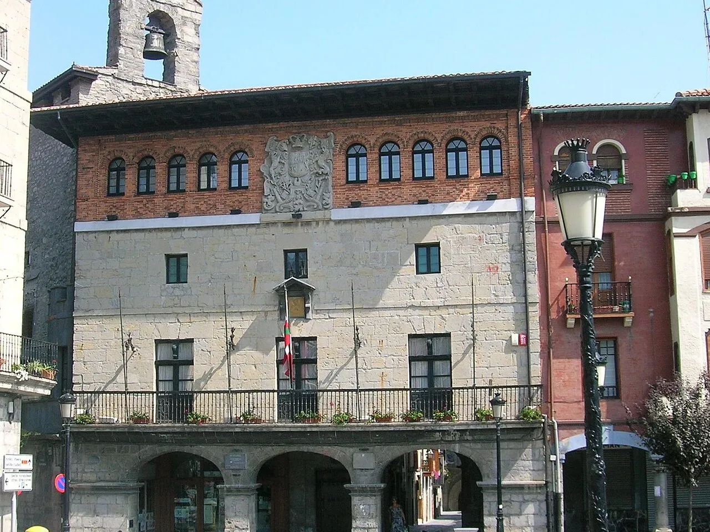
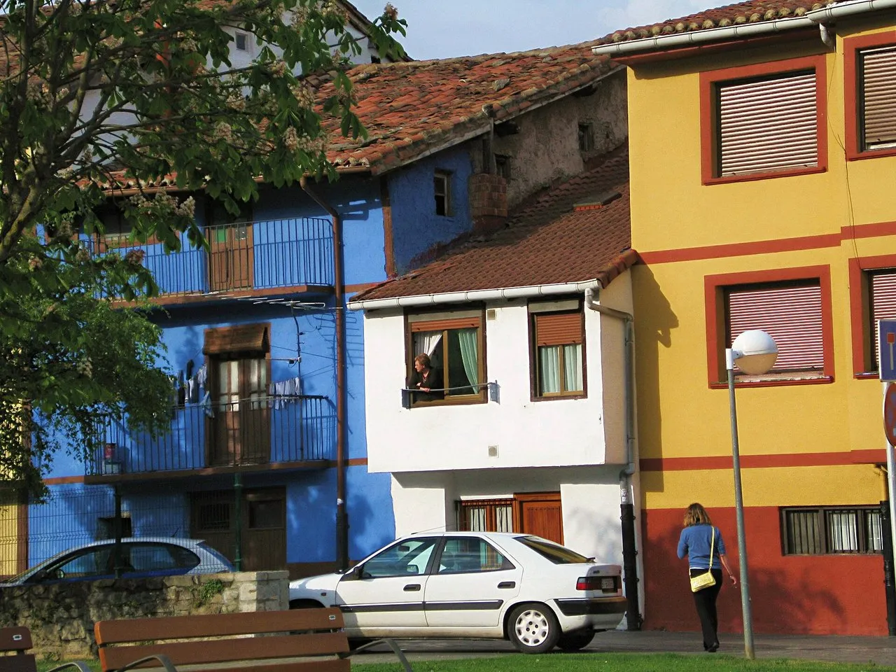
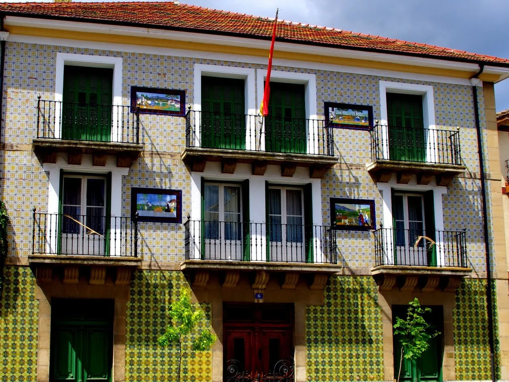
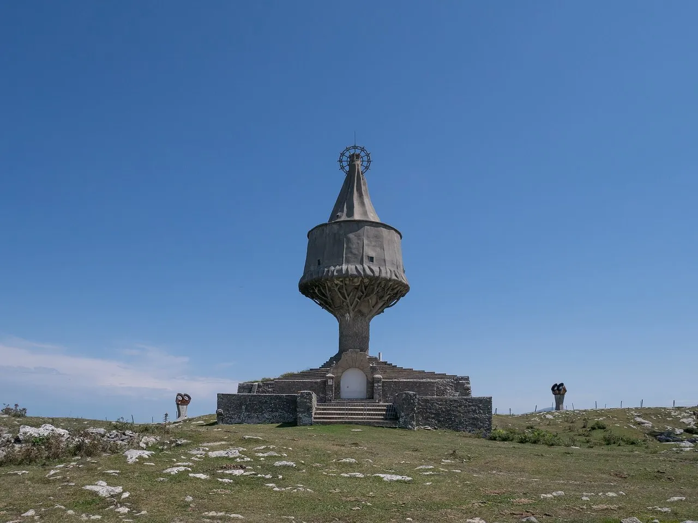

Una plaza con soportales, una muralla medieval que asoma entre las casas y, sobre el pueblo, la sierra Salvada con una de las cascadas más espectaculares de España. **Urduña/Orduña** es la **única ciudad de Bizkaia**, rodeada por Álava y Burgos, y este año compite por ser el **pueblo de la Navidad de Ferrero Rocher**.

Te cuento qué ver y qué hacer alrededor 👇

En un vistazo<h2>Lo que vas a encontrar</h2>

<b>🏛️</b>Plaza de los Fueros

<b>🧱</b>Muralla medieval

<b>💧</b>Salto del Nervión

<b>⛰️</b>Sierra Salvada

<b>🎄</b>Candidato Ferrero 2026

Antes de ir<h2>Lo básico de Orduña</h2>

<h3>📍 Dónde está</h3>
Al sur de Bizkaia, a los pies de la <strong>sierra Salvada</strong>, rodeada por Álava y Burgos.

<h3>⏱️ Tiempo</h3>
<strong>Medio día</strong> para el casco; un día con el salto del Nervión.

<h3>💧 El salto</h3>
Solo lleva agua <strong>tras lluvias o deshielo</strong>: invierno y primavera son la mejor época.

<h3>🏅 Patrimonio</h3>
Casco histórico <strong>conjunto histórico-monumental</strong> desde 1997.

Qué ver<h2>Qué ver en Urduña/Orduña</h2>

<ol class="guide__grid guide__grid--cuenca">
<li class="gcard reveal">
01

<h3>La Plaza de los Fueros</h3>
El corazón de la ciudad, con soportales para el antiguo mercado, la <strong>Casa Consistorial</strong> y <strong>La Aduana</strong>, edificio neoclásico de finales del siglo XVIII.

</li>
<li class="gcard reveal">
02

<h3>El casco histórico y la muralla</h3>
Conjunto histórico-monumental desde <strong>1997</strong>. La muralla llegó a medir 1,8 km y aún queda en pie el 65 %, sobre todo junto a la iglesia gótica de <strong>Santa María</strong> (siglo XV).

</li>
<li class="gcard reveal">
03

<h3>Casas y palacios</h3>
Fachadas llamativas como esta de azulejos y palacios como el renacentista <strong>Ortés de Velasco</strong>, el de Mimenza o el barroco Díaz de Pimienta.

</li>
<li class="gcard reveal">
04

<h3>La sierra Salvada</h3>
Rutas a cimas como el <strong>Txarlazo</strong>, Tologorri o Solaiera, y muy cerca, subiendo el puerto, el mirador del <strong>salto del Nervión</strong>.

</li>
</ol>

<!--actividades-->

<h3>🎄 Candidato a pueblo Ferrero Rocher</h3>
Urduña/Orduña representa al <strong>País Vasco</strong> en el concurso de la Navidad de Ferrero Rocher 2026. Mira cómo va y cómo votar en <a href="/blog/pueblo-navidad-ferrero-rocher-2026.html">el pueblo de la Navidad de Ferrero Rocher</a>.

Consejos de Cheno<h2>Para disfrutarlo al máximo</h2><ul><li><b>Sube al mirador del <a href="/blog/salto-del-nervion.html">salto del Nervión</a></b> después de días de lluvia.</li><li><b>Busca la muralla</b> en los alrededores de Santa María.</li><li><b>Lleva abrigo</b>: arriba en el monte Santiago hace mucho más frío.</li><li><b>Combínalo con</b> <a href="/blog/bilbao-que-ver.html">Bilbao</a> o Vitoria.</li></ul>

<!--faq-->

<h2>¿Te gustan estos planes?</h2>
Sígueme en Instagram como <a href="https://www.instagram.com/chenoaventuras/" target="_blank" rel="noopener">@chenoaventuras</a>: subo escapadas como esta cada semana.
<a class="btn guide__btn" href="/blog.html">Ver más planes en el blog</a>

Información consultada en noviembre de 2026 en Turismo Euskadi. Fotos de Wikimedia Commons: <a href="https://commons.wikimedia.org/wiki/File:Ordu%C3%B1a_-_La_Antigua_02.jpg" target="_blank" rel="noopener">Basotxerri</a> (CC BY-SA 4.0) · <a href="https://commons.wikimedia.org/wiki/File:Ayunta_Ordu%C3%B1a_1.jpg" target="_blank" rel="noopener">Javier Mediavilla Ezquibela</a> (CC BY 2.5) · <a href="https://commons.wikimedia.org/wiki/File:La_Boca_en_Ordu%C3%B1a_-_panoramio.jpg" target="_blank" rel="noopener">wyup</a> (CC BY-SA 3.0) · <a href="https://commons.wikimedia.org/wiki/File:Tiled_house,_Ordu%C3%B1a_-_panoramio.jpg" target="_blank" rel="noopener">Tim Tregenza</a> (CC BY-SA 3.0) · <a href="https://commons.wikimedia.org/wiki/File:Ordu%C3%B1a_-_Txarlazo_07.jpg" target="_blank" rel="noopener">Basotxerri</a> (CC BY-SA 4.0).

