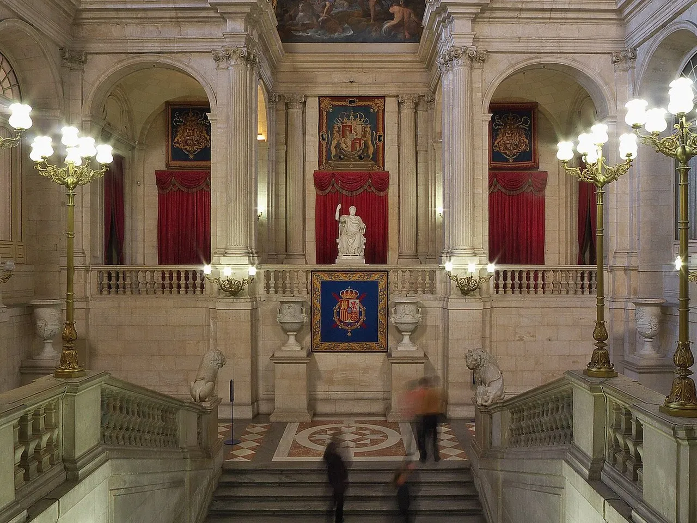
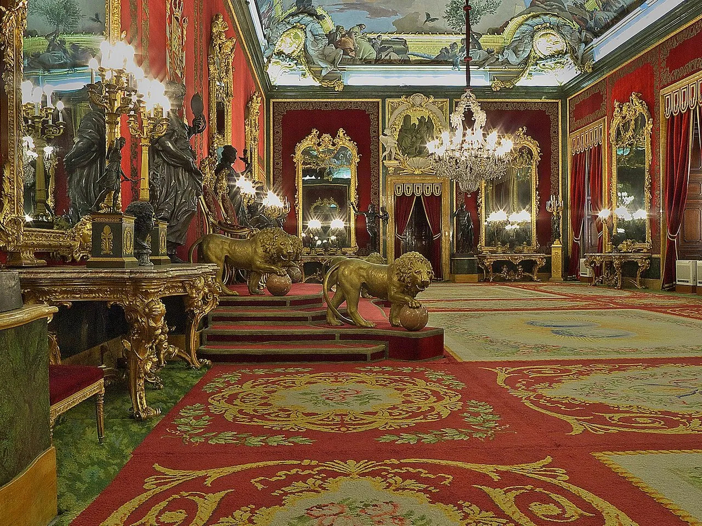
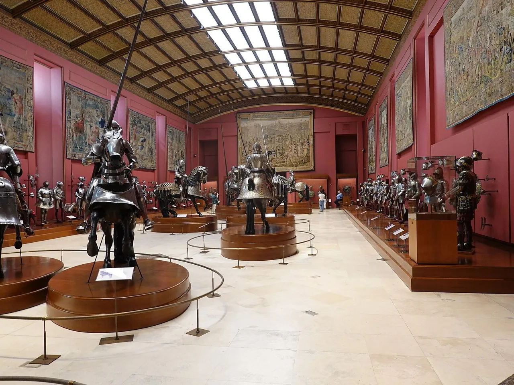
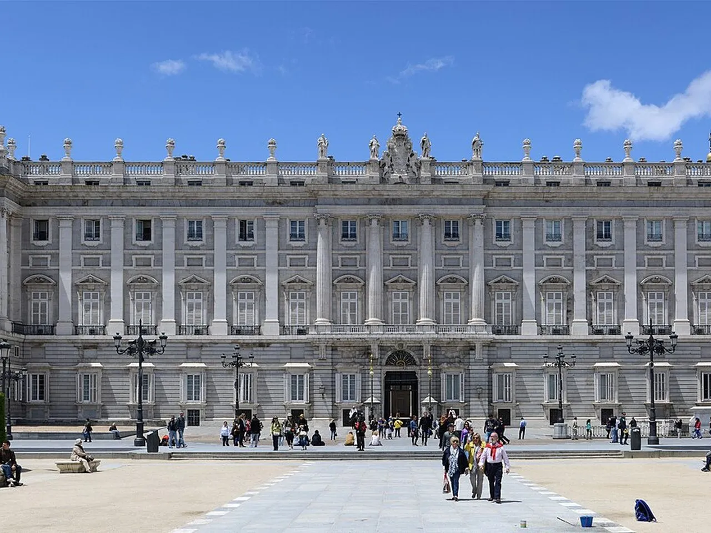
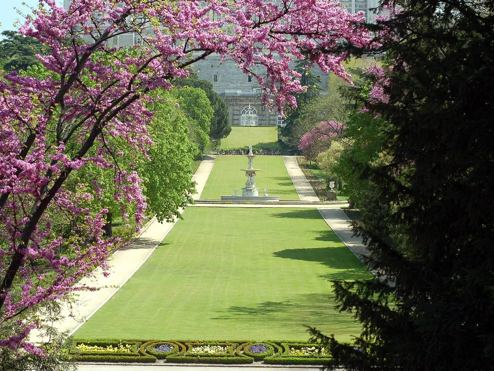
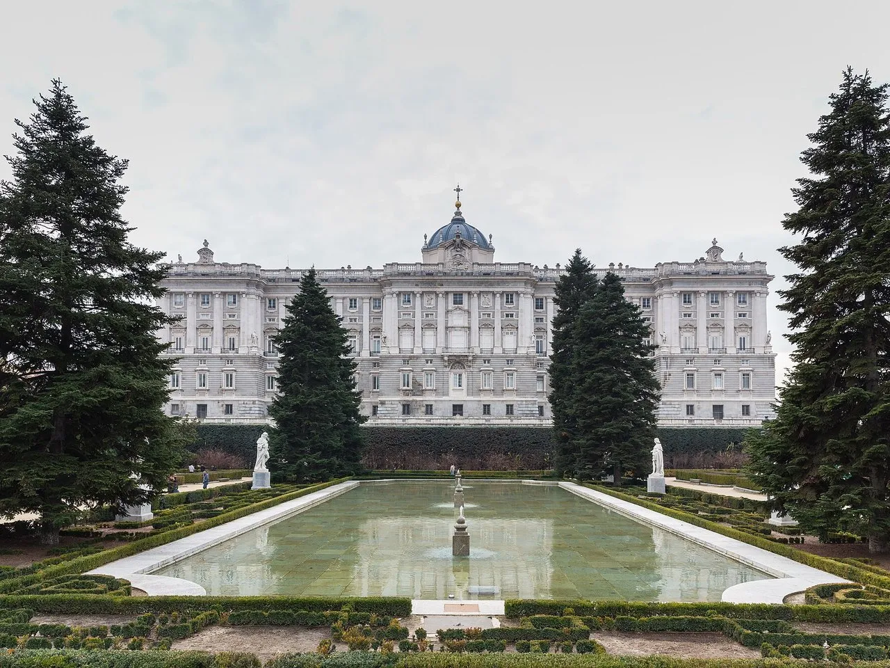

Más de **135.000 metros cuadrados**, salones de seda y oro, una armería con armaduras de reyes y una escalera que deja sin palabras. El **Palacio Real de Madrid** es uno de los palacios más grandes y mejor conservados de Europa, y una de las pocas residencias oficiales de jefes de Estado abiertas al público.

Te cuento cuánto cuesta, cuándo es gratis, el horario y qué no te puedes perder 👇

En un vistazo<h2>Lo que vas a encontrar</h2>

<b>👑</b>Salón del Trono

<b>⚔️</b>Real Armería

<b>🏛️</b>Escalera Principal

<b>🌳</b>Jardines gratis

<b>🆓</b>Gratis algunas tardes

Antes de ir<h2>Lo básico del Palacio Real</h2>

<h3>🎟️ Precio</h3>
<strong>18 €</strong> la básica y <strong>9 €</strong> la reducida. Con la Galería de las Colecciones Reales, <strong>24 €</strong>.

<h3>🕙 Horario</h3>
Lunes a sábado, <strong>10:00-18:00</strong> (octubre-marzo) o <strong>10:00-19:00</strong> (abril-septiembre). Domingos, 10:00-16:00.

<h3>🆓 Gratis</h3>
De <strong>lunes a jueves</strong>, de 16:00 a 18:00 en invierno y de 17:00 a 19:00 en verano. Sin Real Cocina.

<h3>⚠️ Compra antes</h3>
El aforo es limitado y la taquilla vende poco: mejor entrada online. Puede cerrar por <strong>actos oficiales</strong>.

Qué ver<h2>Qué ver en el Palacio Real de Madrid</h2>

<ol class="guide__grid guide__grid--cuenca">
<li class="gcard reveal">
01

<h3>La Escalera Principal</h3>
El arranque de la visita: una escalera monumental de mármol, con leones y techos pintados, que anuncia lo que viene.

</li>
<li class="gcard reveal">
02

<h3>El Salón del Trono</h3>
Terciopelo rojo, espejos, lámparas de cristal y los leones dorados junto al trono. Es la sala más famosa del palacio.

</li>
<li class="gcard reveal">
03

<h3>La Real Armería</h3>
Armaduras de reyes y caballos, espadas y escudos: una de las colecciones de armas más importantes del mundo.

</li>
<li class="gcard reveal">
04

<h3>La plaza de la Armería</h3>
La gran explanada entre el palacio y la catedral de la Almudena, con vistas a la Casa de Campo.

</li>
<li class="gcard reveal">
05

<h3>Los jardines del Campo del Moro</h3>
Bajo la fachada oeste, con entrada <strong>gratuita</strong>: de 10:00 a 18:00 de octubre a marzo, y hasta las 20:00 o más en verano.

</li>
<li class="gcard reveal">
06

<h3>Los jardines de Sabatini</h3>
Al norte del palacio, con estanques y setos recortados. Al atardecer, una de las vistas más bonitas del edificio.

</li>
</ol>

<!--actividades-->

La historia<h2>Sobre las ruinas de un alcázar</h2>

El palacio se levantó en el siglo XVIII donde estaba el antiguo <strong>Alcázar de los Austrias</strong>, destruido por un incendio en la Nochebuena de 1734. <strong>Felipe V</strong> encargó uno nuevo, de piedra, y <strong>Carlos III</strong> fue el primer rey que vivió en él. Hoy es la residencia oficial de la Jefatura del Estado, aunque solo se usa para ceremonias, y recibe cerca de <strong>1,5 millones de visitantes</strong> al año.

Cómo llegar<h2>Cómo llegar al Palacio Real</h2>

<h3>🚇 En metro</h3>
Líneas <strong>2 y 5</strong>, estación <strong>Ópera</strong>. También queda cerca Príncipe Pío.

<h3>🚪 Entrada</h3>
Por la <strong>explanada de la Almudena</strong>, esquina con la calle Bailén.

<h3>🎟️ Entradas</h3>
Online en Patrimonio Nacional o con la <a href="https://www.civitatis.com/es/madrid/entrada-palacio-real-madrid/?aid=110968" target="_blank" rel="noopener sponsored">entrada de Civitatis</a>.

<h3>🧭 Con guía</h3>
La <a href="https://www.civitatis.com/es/madrid/visita-guiada-palacio-real/?aid=110968" target="_blank" rel="noopener sponsored">visita guiada sin colas</a> o la de <a href="https://www.civitatis.com/es/madrid/palacio-real-catedral-almudena/?aid=110968" target="_blank" rel="noopener sponsored">Palacio Real y Almudena</a>.

Consejos de Cheno<h2>Para disfrutarlo al máximo</h2><ul><li><b>Si vas gratis</b>, llega antes de la hora: se forman colas largas.</li><li><b>Mira si hay actos oficiales</b>: ese día puede cerrar.</li><li><b>Fotos sin flash</b> y sin palo selfie.</li><li><b>Termina en los jardines</b> de Sabatini o el Campo del Moro, que son gratis.</li><li><b>En Navidad</b>, combínalo con las luces: mira la <a href="/blog/navidad-en-madrid.html">guía de Navidad en Madrid</a>. Y más planes en <a href="/blog/madrid-que-ver.html">qué ver en Madrid</a>.</li></ul>

<!--faq-->

<h2>¿Te gustan estos planes?</h2>
Sígueme en Instagram como <a href="https://www.instagram.com/chenoaventuras/" target="_blank" rel="noopener">@chenoaventuras</a>: subo escapadas como esta cada semana.
<a class="btn guide__btn" href="/blog.html">Ver más planes en el blog</a>

Información consultada en noviembre de 2026 en la web de Patrimonio Nacional. Fotos de Wikimedia Commons: <a href="https://commons.wikimedia.org/wiki/File:Palacio_Real_de_Madrid_-_13.jpg" target="_blank" rel="noopener">Carlos Delgado</a> (CC BY-SA 3.0) · <a href="https://commons.wikimedia.org/wiki/File:Palacio_Real_de_Madrid._Escalera_principal.jpg" target="_blank" rel="noopener">José Luis Filpo Cabana</a> (CC BY 3.0) · <a href="https://commons.wikimedia.org/wiki/File:Sal%C3%B3n_del_Trono._Palacio_Real_de_Madrid.jpg" target="_blank" rel="noopener">José Luis Filpo Cabana</a> (CC BY 3.0) · <a href="https://commons.wikimedia.org/wiki/File:Real_Armer%C3%ADa_de_Madrid_02.jpg" target="_blank" rel="noopener">Joseolgon</a> (CC BY 4.0) · <a href="https://commons.wikimedia.org/wiki/File:Madrid_May_2014-35a.jpg" target="_blank" rel="noopener">Alvesgaspar</a> (CC BY-SA 3.0) · <a href="https://commons.wikimedia.org/wiki/File:Campo_del_Moro_(Madrid)_04.jpg" target="_blank" rel="noopener">Bjaglin</a> (CC BY 2.0) · <a href="https://commons.wikimedia.org/wiki/File:Palacio_Real,_Madrid,_Espa%C3%B1a,_2014-12-27,_DD_09.JPG" target="_blank" rel="noopener">Diego Delso</a> (CC BY-SA 4.0).

