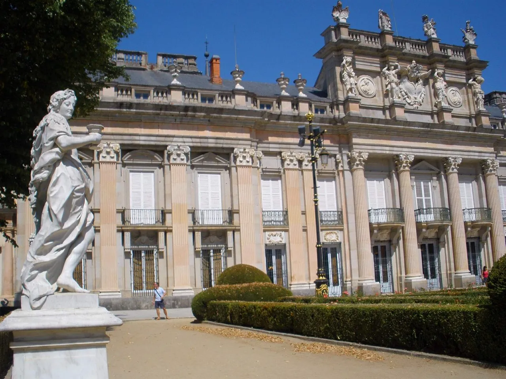
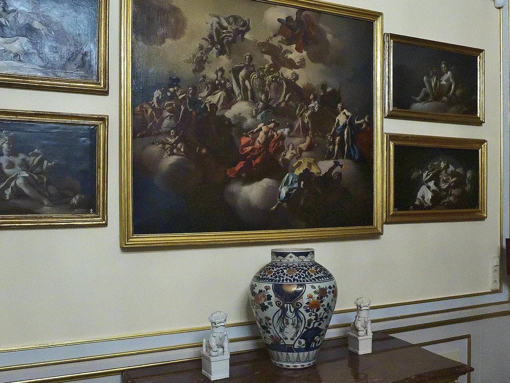
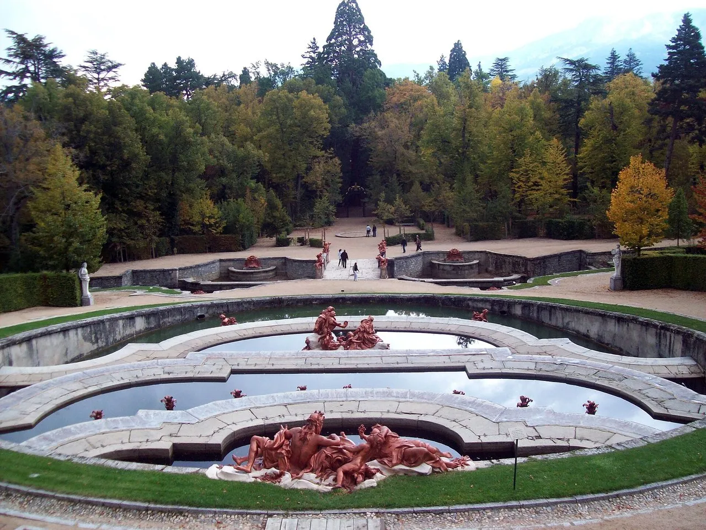
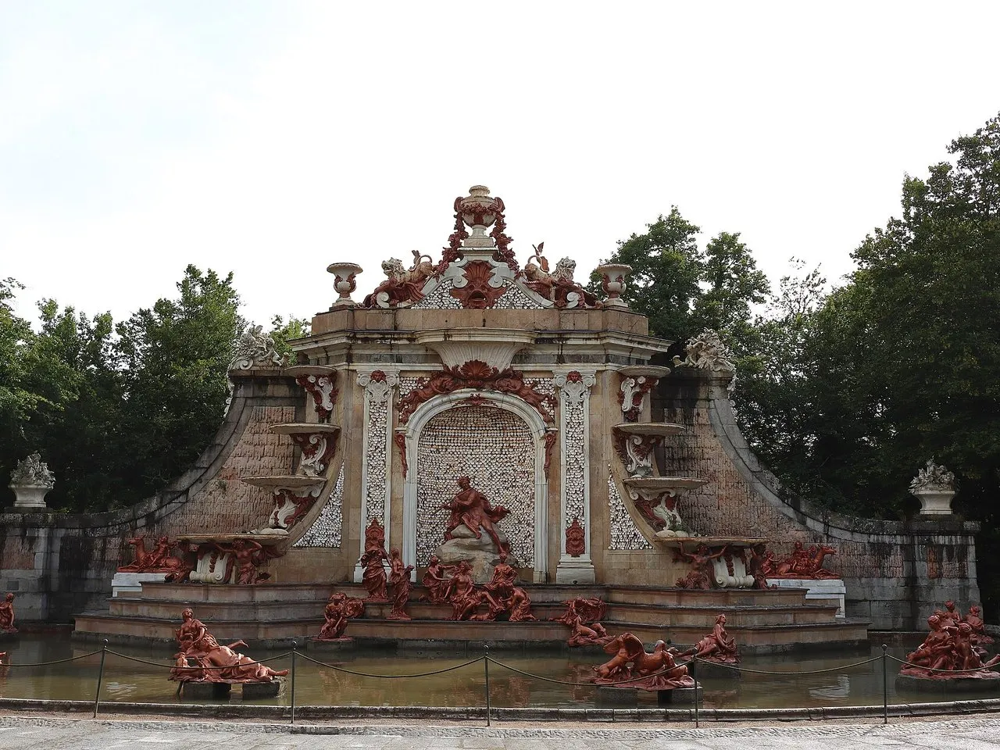
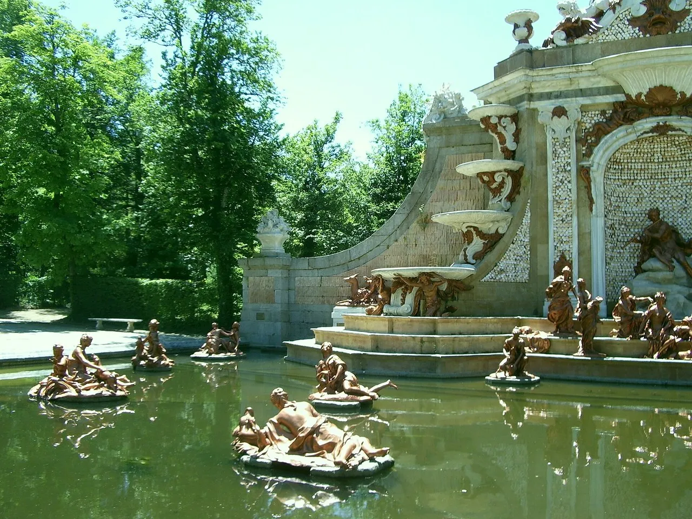
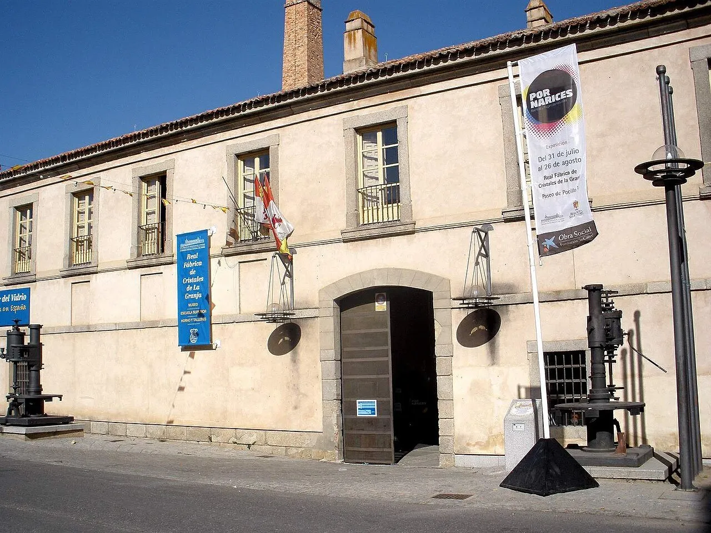

Un palacio de estilo francés a los pies de la sierra de Guadarrama, jardines con esculturas por todas partes y fuentes que lanzan el agua a decenas de metros. El **Palacio Real de La Granja de San Ildefonso** fue el capricho de **Felipe V**, que quería recordar el Versalles de su infancia.

Te cuento cuánto cuesta, cuándo es gratis, el horario de los jardines y cómo llegar 👇

En un vistazo<h2>Lo que vas a encontrar</h2>

<b>🏰</b>Palacio barroco

<b>🌳</b>Jardines gratis

<b>⛲</b>Fuentes monumentales

<b>🎨</b>Pinturas reales

<b>🆓</b>Gratis algunas tardes

Antes de ir<h2>Lo básico de La Granja</h2>

<h3>🎟️ Precio</h3>
Palacio <strong>9 €</strong> (reducida 4 €). Jardines, <strong>gratis</strong>. Fuentes monumentales, 5 €.

<h3>🕙 Horario</h3>
De <strong>martes a domingo</strong>, 10:00-18:00 (octubre-marzo) y 10:00-19:00 (abril-septiembre). <strong>Lunes cerrado</strong>.

<h3>🆓 Gratis</h3>
<strong>Miércoles y domingos</strong> desde las 15:00.

<h3>⚠️ Ahora mismo</h3>
El <strong>Museo de Tapices</strong> está cerrado por obras; a cambio se han abierto tres salas con pinturas de Felipe V e Isabel de Farnesio.

Qué ver<h2>Qué ver en La Granja de San Ildefonso</h2>

<ol class="guide__grid guide__grid--cuenca">
<li class="gcard reveal">
01

<h3>El palacio</h3>
Residencia de verano y lugar de retiro de <strong>Felipe V</strong>, el primer Borbón, que se enamoró de este sitio en 1717.

</li>
<li class="gcard reveal">
02

<h3>Las salas y sus pinturas</h3>
Salones como la Sala de Mármoles, y ahora tres salas nuevas con la colección de pinturas de Felipe V e Isabel de Farnesio.

</li>
<li class="gcard reveal">
03

<h3>Los jardines</h3>
Paseos, estanques y decenas de esculturas entre bosques. Son <strong>gratuitos</strong> y abren todos los días.

</li>
<li class="gcard reveal">
04

<h3>Los Baños de Diana</h3>
La fuente más espectacular de los jardines. En temporada se puede ver funcionando, incluso en horario nocturno (3 €).

</li>
<li class="gcard reveal">
05

<h3>Las fuentes monumentales</h3>
Funcionan solo en la <strong>temporada de fuentes</strong>, en primavera y verano y fechas señaladas. Verlas cuesta 5 €.

</li>
<li class="gcard reveal">
06

<h3>La Real Fábrica de Cristales</h3>
En el pueblo, la antigua fábrica real de vidrio, hoy museo, con demostraciones de soplado de vidrio.

</li>
</ol>

<!--actividades-->

Jardines<h2>Horario de los jardines de La Granja</h2>

<h3>❄️ Noviembre-febrero</h3>
Todos los días, <strong>10:00-18:00</strong>.

<h3>🍂 Octubre y marzo</h3>
Todos los días, <strong>10:00-18:30</strong>.

<h3>🌸 Abril, mayo, septiembre y 1-15 de junio</h3>
Todos los días, <strong>10:00-20:00</strong>.

<h3>☀️ 16 de junio - agosto</h3>
Todos los días, <strong>10:00-21:00</strong>.

Cómo llegar<h2>Cómo llegar a La Granja</h2>

<h3>🚗 En coche</h3>
Desde Madrid, A-6/AP-6/AP-61 hasta Segovia y la <strong>M-601</strong> hasta San Ildefonso; o la M-601 desde Villalba, cruzando la sierra.

<h3>🚄 En tren + bus</h3>
AVE o regional hasta <strong>Segovia</strong> y autobús de <strong>Linecar</strong> a San Ildefonso.

<h3>🚌 En autobús</h3>
Autobuses <strong>Avanza</strong> Madrid-Segovia y, desde Segovia, Linecar.

<h3>🎟️ Entradas</h3>
En las taquillas del Patio de Coches o con la <a href="https://www.civitatis.com/es/segovia/entrada-palacio-granja-san-ildefonso/?aid=110968" target="_blank" rel="noopener sponsored">entrada de Civitatis</a>. Con guía: <a href="https://www.civitatis.com/es/segovia/visita-guiada-palacio-real-granja/?aid=110968" target="_blank" rel="noopener sponsored">visita al palacio</a>.

Consejos de Cheno<h2>Para disfrutarlo al máximo</h2><ul><li><b>Dedica tiempo a los jardines</b>: son enormes y gratis. Hay un <a href="https://www.civitatis.com/es/segovia/free-tour-jardines-palacio-la-granja/?aid=110968" target="_blank" rel="noopener sponsored">free tour por los jardines</a>.</li><li><b>Abrígate en invierno</b>: está a casi 1.200 m y en la sierra hace frío.</li><li><b>Si quieres ver las fuentes</b>, mira antes el calendario de la temporada.</li><li><b>Combínalo con</b> <a href="/blog/acueducto-de-segovia.html">Segovia</a> y su <a href="/blog/alcazar-de-segovia.html">Alcázar</a>, a 20 minutos.</li></ul>

<!--faq-->

<h2>¿Te gustan estos planes?</h2>
Sígueme en Instagram como <a href="https://www.instagram.com/chenoaventuras/" target="_blank" rel="noopener">@chenoaventuras</a>: subo escapadas como esta cada semana.
<a class="btn guide__btn" href="/blog.html">Ver más planes en el blog</a>

Información consultada en noviembre de 2026 en la web de Patrimonio Nacional. Fotos de Wikimedia Commons: <a href="https://commons.wikimedia.org/wiki/File:Palacio_y_Jardines_de_la_Granja,_vista_frontal.jpg" target="_blank" rel="noopener">Miguel Ángel García</a> (CC BY 2.0) · <a href="https://commons.wikimedia.org/wiki/File:San_Ildefonso_-_Palacio_Real_de_la_Granja_5.jpg" target="_blank" rel="noopener">Zarateman</a> (CC BY-SA 3.0) · <a href="https://commons.wikimedia.org/wiki/File:Sala_del_Tocador_de_la_Reina_(detalle),_Palacio_Real_de_la_Granja_de_San_Ildefonso.jpg" target="_blank" rel="noopener">Jl FilpoC</a> (CC BY-SA 4.0) · <a href="https://commons.wikimedia.org/wiki/File:Jardines_de_la_Granja.jpg" target="_blank" rel="noopener">Urbanista77</a> (CC BY-SA 4.0) · <a href="https://commons.wikimedia.org/wiki/File:Fuente_de_los_Ba%C3%B1os_de_Diana,_la_Granja_de_San_Ildefonso,_26.jpg" target="_blank" rel="noopener">Malopez 21</a> (CC BY-SA 4.0) · <a href="https://commons.wikimedia.org/wiki/File:%C2%AE_M.D._PALACIO_REAL_LA_GRANJA_DE_SAN_ILDEFONSO_FUENTES_-_panoramio_-_Concepcion_AMAT_ORTA%E2%80%A6_(25).jpg" target="_blank" rel="noopener">Concepción Amat Orta</a> (CC BY 3.0) · <a href="https://commons.wikimedia.org/wiki/File:San_Ildefonso_-_Real_Fabrica_de_Cristales_de_la_Granja_001.JPG" target="_blank" rel="noopener">Zarateman</a> (CC0).

