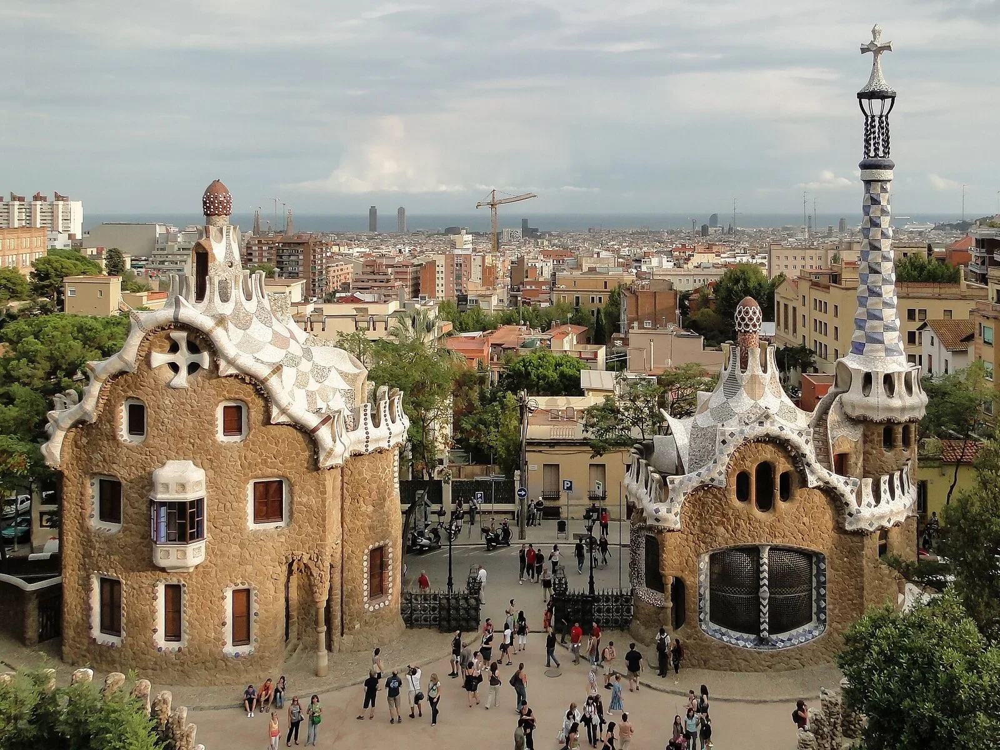
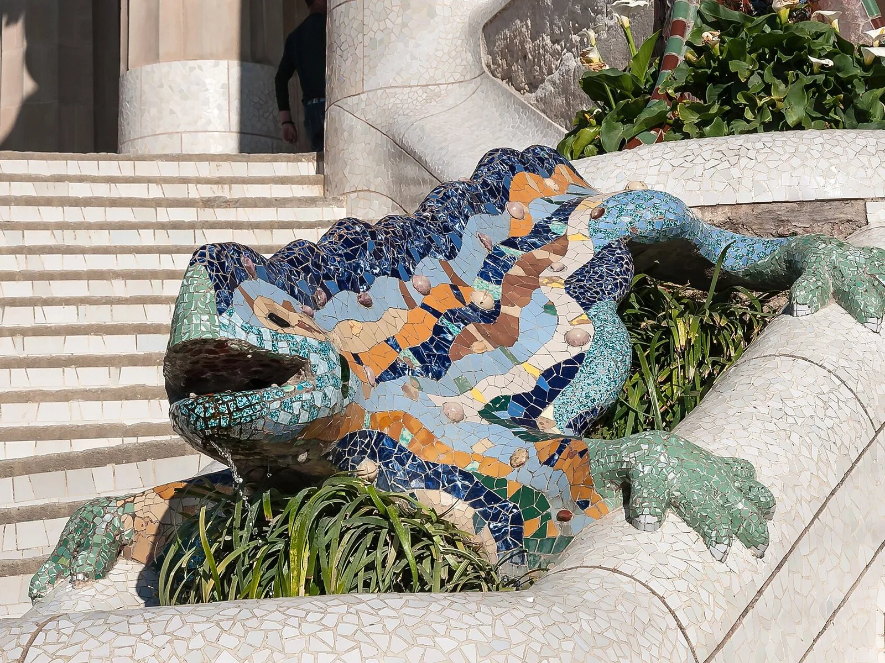
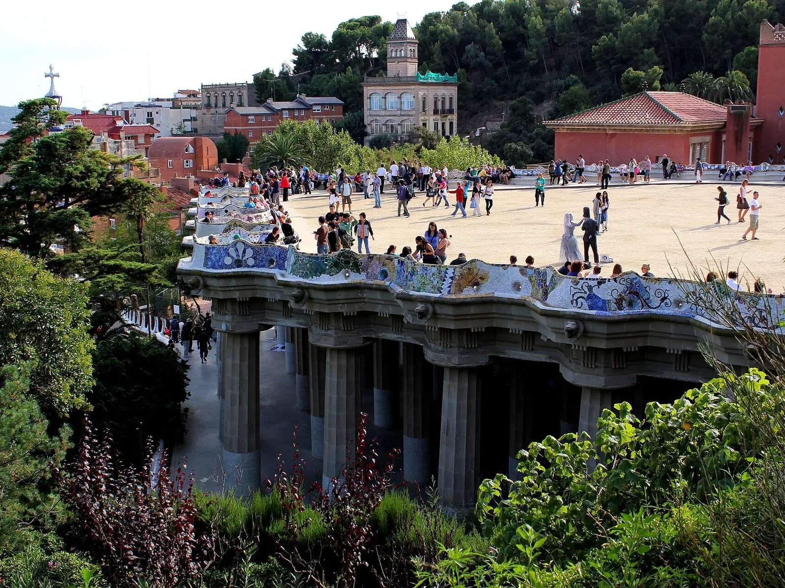
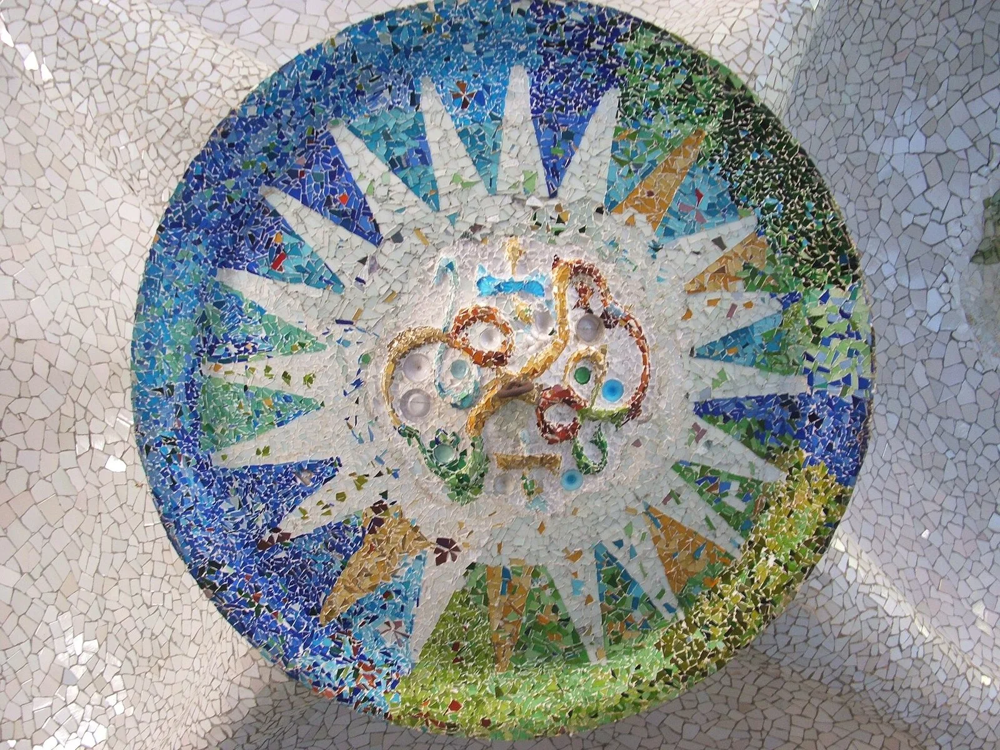
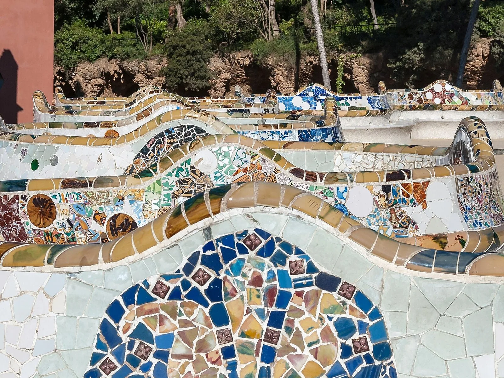
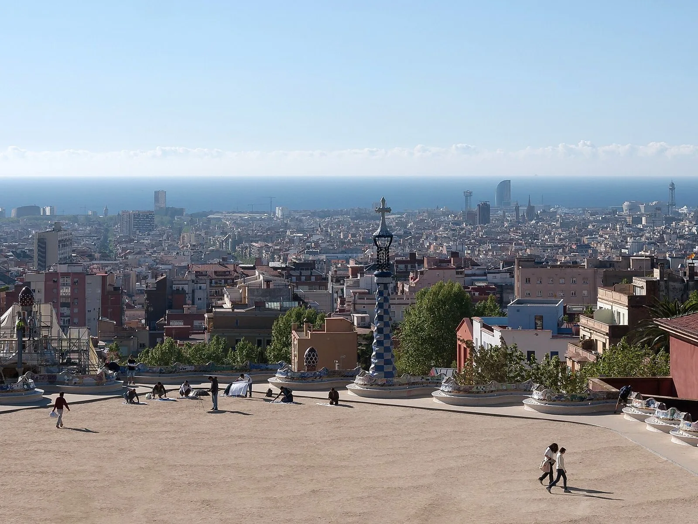

El **Park Güell** iba a ser una **urbanización de lujo**: el empresario Eusebi Güell encargó a Gaudí, en 1900, una ciudad jardín para la burguesía de Barcelona en lo alto de una colina. Se planearon unas 60 parcelas… y solo se construyeron **dos casas**. El negocio fracasó, el Ayuntamiento compró los terrenos y hoy es uno de los parques más visitados del mundo y **Patrimonio de la Humanidad** desde 1984.

Te cuento cuánto cuesta en 2026, qué ver dentro y cómo organizarte para no quedarte sin entrada 👇

En un vistazo<h2>Lo que vas a encontrar</h2>

<b>🦎</b>El dragón

<b>🪑</b>Banco ondulante

<b>🏛️</b>86 columnas

<b>🏙️</b>Vistas de Barcelona

<b>🎟️</b>18 €

Antes de ir<h2>Entradas y horarios 2026</h2>

<h3>🎟️ Entradas</h3>
La <strong>Zona Monumental</strong> es de pago y con <strong>hora reservada</strong>. Cómprala online: se agota.

<ul class="guide__prices"><li>General<b>18 €</b></li><li>7-12 años y mayores de 65<b>13,50 €</b></li><li>Menores de 7 años<b>Gratis</b></li></ul>

<h3>🕒 Horario</h3>
Abre todos los días desde las <strong>9:30</strong>. En invierno cierra hacia las <strong>17:30-18:00</strong> y en verano, más tarde. La última entrada es una hora antes.

<h3>🆓 Lo gratis</h3>
Los <strong>jardines y el bosque</strong> que rodean la zona de pago son de acceso libre, incluido el mirador del Turó de les Tres Creus.

La visita<h2>Qué ver en el Park Güell</h2>
Todo esto está dentro de la Zona Monumental.

<ol class="guide__grid guide__grid--cuenca">
<li class="gcard reveal">
01

<h3>Los pabellones de entrada</h3>
Dos casitas con tejados que parecen de cuento: eran la portería y la casa del guarda. A muchos les recuerdan a la casita de Hansel y Gretel.

</li>
<li class="gcard reveal">
02

<h3>El dragón</h3>
El símbolo del parque: una salamandra (o dragón) de <strong>trencadís</strong>, el mosaico de trozos de cerámica rota, en mitad de la escalinata. Siempre hay cola para la foto.

</li>
<li class="gcard reveal">
03

<h3>La Sala Hipóstila</h3>
Un bosque de <strong>86 columnas</strong> que sostiene la plaza de arriba. Iba a ser el <strong>mercado</strong> de la urbanización.

</li>
<li class="gcard reveal">
04

<h3>Los medallones del techo</h3>
Mira hacia arriba en la Sala Hipóstila: hay soles y lunas de mosaico. Los hizo <strong>Josep Maria Jujol</strong>, el colaborador de Gaudí, con trozos de platos, tazas y botellas.

</li>
<li class="gcard reveal">
05

<h3>El banco ondulante</h3>
Serpentea alrededor de toda la gran plaza. Las curvas no son solo estéticas: crean rincones para charlar en grupo.

</li>
<li class="gcard reveal">
06

<h3>La Plaza de la Naturaleza</h3>
Una explanada enorme con <strong>vistas a toda Barcelona</strong> y al mar. Su suelo recoge el agua de lluvia y la lleva por dentro de las columnas a un depósito.

</li>
</ol>

Curiosidades<h2>Lo que no te cuentan del Park Güell</h2>

<ul class="checklist" style="margin:0 0 1rem;"><li><strong>Gaudí vivió aquí:</strong> se mudó a una de las dos casas construidas en 1906 y vivió en ella casi veinte años. Hoy es la <strong>Casa-Museo Gaudí</strong>, con entrada aparte.</li><li><strong>Un parque con «Park» en inglés:</strong> Güell lo escribió así porque se inspiraba en las ciudades jardín inglesas.</li><li><strong>Una ingeniería oculta:</strong> el agua de la plaza baja por dentro de las columnas hasta una gran cisterna bajo la Sala Hipóstila.</li><li><strong>Gratis hasta 2013:</strong> hasta entonces se podía entrar libremente a todo el parque; el pago se puso para controlar las aglomeraciones.</li></ul>

<!--actividades-->

Cómo llegar<h2>Cómo llegar al Park Güell</h2>

<strong>En metro:</strong> línea 3 (verde) hasta <strong>Lesseps</strong> o <strong>Vallcarca</strong>, y después unos 20 minutos a pie cuesta arriba. Desde Vallcarca hay escaleras mecánicas en parte del camino.

<strong>En autobús:</strong> el <strong>24</strong> te deja cerca de la entrada de la carretera del Carmel, sin apenas cuestas.

No vayas en coche: alrededor del parque casi no se puede aparcar.

<a class="btn guide__mapbtn" href="https://www.google.com/maps/dir/?api=1&destination=41.4145,2.1527" target="_blank" rel="noopener"><svg class="ico" viewBox="0 0 24 24" width="15" height="15" aria-hidden="true" fill="currentColor"><path d="M12 2a7 7 0 0 0-7 7c0 5.25 7 13 7 13s7-7.75 7-13a7 7 0 0 0-7-7zm0 9.5a2.5 2.5 0 1 1 0-5 2.5 2.5 0 0 1 0 5z"/></svg> Cómo llegar en Google Maps</a><a class="btn guide__mapbtn btn--ghost" href="https://parkguell.barcelona/" target="_blank" rel="noopener"><svg class="ico" viewBox="0 0 24 24" width="15" height="15" aria-hidden="true" fill="none" stroke="currentColor" stroke-width="2" stroke-linecap="round" stroke-linejoin="round"><path d="M7 3v3M17 3v3M4 9h16M5 5h14a1 1 0 0 1 1 1v13a1 1 0 0 1-1 1H5a1 1 0 0 1-1-1V6a1 1 0 0 1 1-1z"/></svg> Entradas oficiales</a>

Completa el día con la <a href="/blog/sagrada-familia.html">Sagrada Familia</a>, a unos 25 minutos en autobús, o sube al atardecer a los <a href="/blog/bunkers-del-carmel.html">Búnkers del Carmel</a>, que están muy cerca. Tienes más ideas en mi guía de <a href="/blog/barcelona-que-ver.html">qué ver en Barcelona</a>.

Consejos de Cheno<h2>Para disfrutarlo al máximo</h2><ul><li><b>Primera hora</b>: a las 9:30 hay menos gente y mejor luz para el dragón.</li><li><b>Compra en la web oficial</b>: evita reventas más caras.</li><li><b>Sube después al Turó de les Tres Creus</b>: es gratis y tiene la mejor vista.</li><li><b>Calzado cómodo</b>: todo son cuestas.</li><li><b>Llega puntual</b>: entras en la franja horaria que has reservado.</li></ul>

🐉 <strong>Más Gaudí:</strong> la <a href="/blog/casa-batllo.html">Casa Batlló</a>.

<!--faq-->

<h2>¿Te gustan estos planes?</h2>
Sígueme en Instagram como <a href="https://www.instagram.com/chenoaventuras/" target="_blank" rel="noopener">@chenoaventuras</a>: subo escapadas como esta cada semana.
<a class="btn guide__btn" href="/blog.html">Ver más planes en el blog</a>

Información consultada en noviembre de 2026. Los precios y horarios cambian por temporadas: confírmalos en parkguell.barcelona antes de ir. Fotos de Wikimedia Commons: <a href="https://commons.wikimedia.org/wiki/File:Park_G%C3%BCell_-_50030738311.jpg" target="_blank" rel="noopener">Jorge Franganillo</a> (CC BY 2.0) · <a href="https://commons.wikimedia.org/wiki/File:Barcelona_Parc_G%C3%BCell_el_drac.jpg" target="_blank" rel="noopener">Isiwal</a> (CC BY-SA 3.0) · <a href="https://commons.wikimedia.org/wiki/File:Barcelona_parc_G%C3%BCell_la_placa_2013_04.jpg" target="_blank" rel="noopener">Isiwal</a> (CC BY-SA 3.0) · <a href="https://commons.wikimedia.org/wiki/File:Barcelona_parc_G%C3%BCell_la_placa_benches.jpg" target="_blank" rel="noopener">Isiwal</a> (CC BY-SA 3.0) · <a href="https://commons.wikimedia.org/wiki/File:Park_G%C3%BCell_02.jpg" target="_blank" rel="noopener">Bernard Gagnon</a> (CC BY-SA 3.0) · <a href="https://commons.wikimedia.org/wiki/File:Mosaics_of_Park_G%C3%BCell_Barcelona_28.jpg" target="_blank" rel="noopener">ABruszik</a> (CC BY-SA 4.0) · <a href="https://commons.wikimedia.org/wiki/File:Park_G%C3%BCell_-_panoramio.jpg" target="_blank" rel="noopener">Manuel pino</a> (CC BY-SA 3.0).

