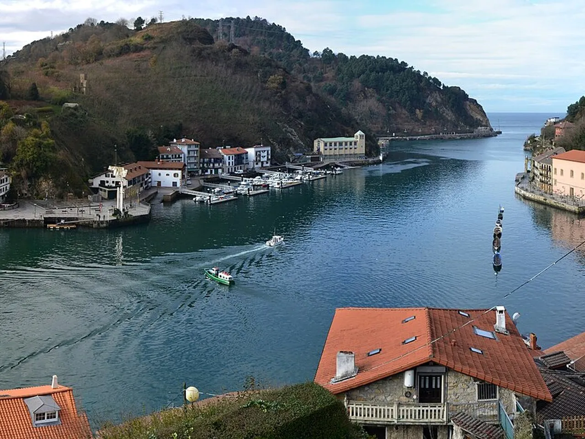
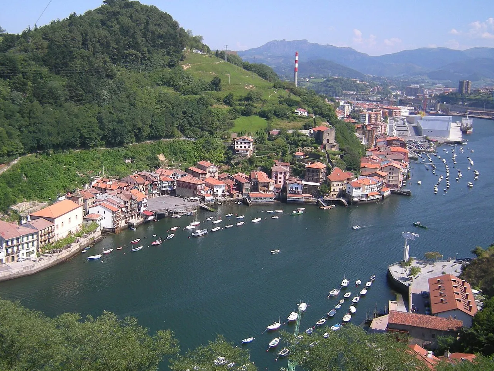
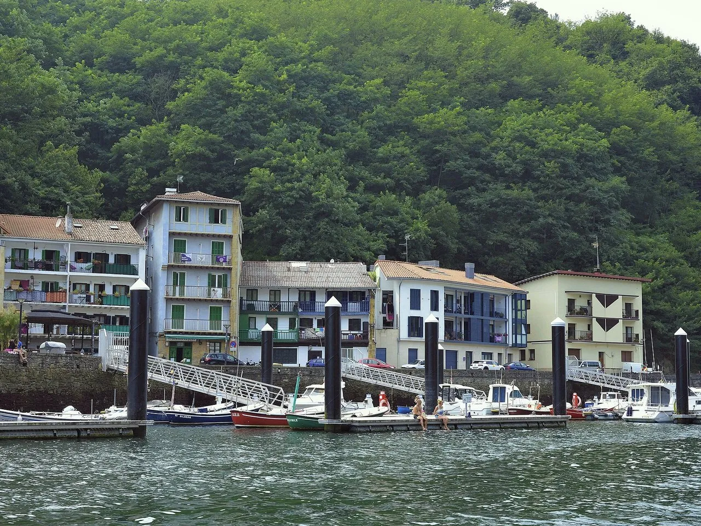
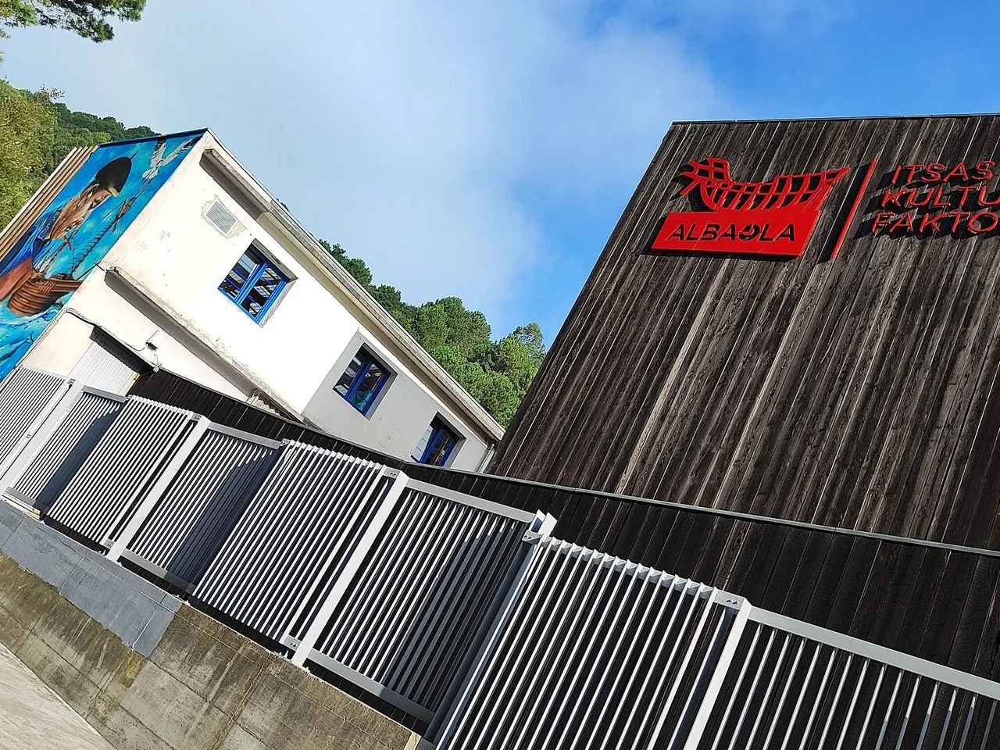
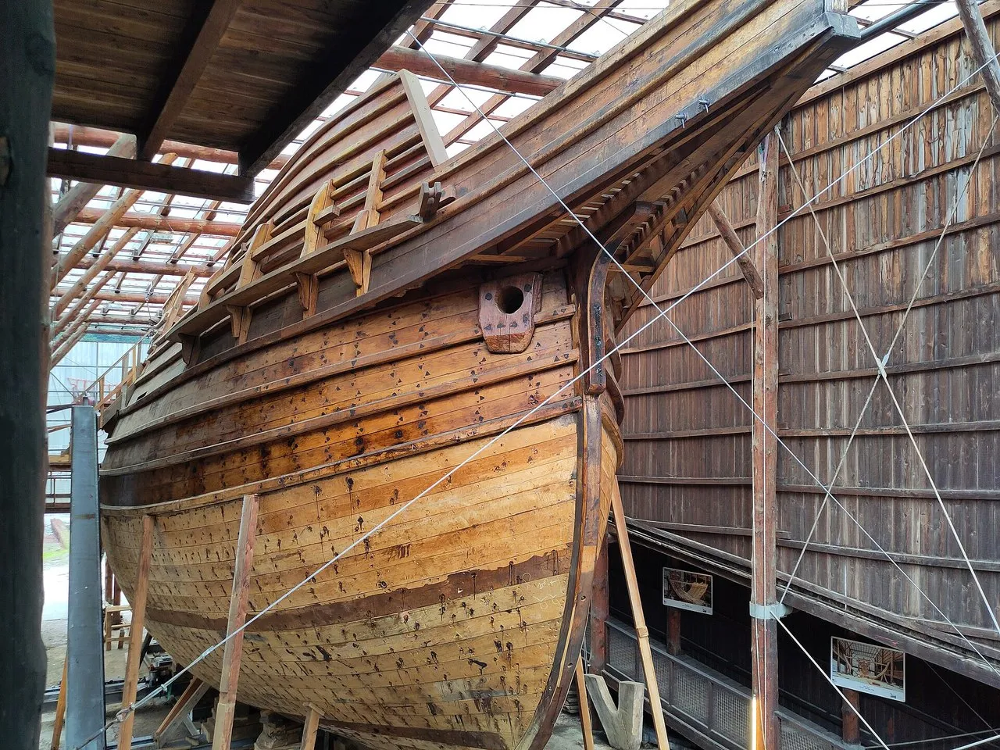
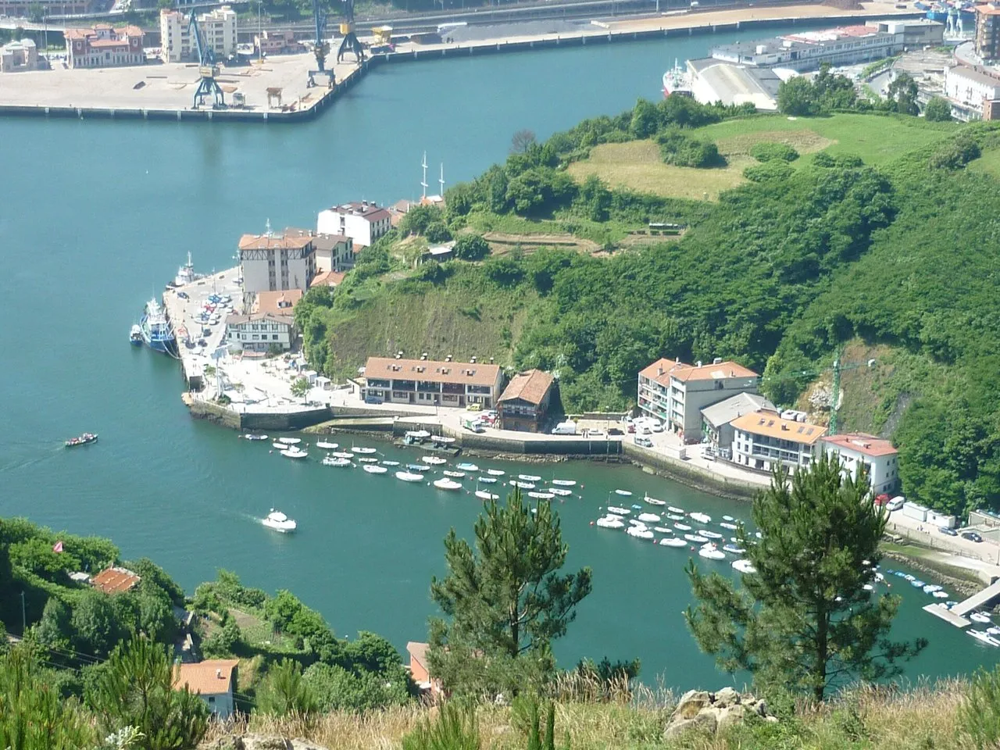

Casas de colores colgadas sobre el agua, una sola calle que recorre el pueblo de punta a punta y una barquita que cruza el canal a cada rato. **Pasaia**, a un paso de **San Sebastián**, es uno de los puertos más bonitos del Cantábrico, y en sus astilleros están construyendo un **ballenero del siglo XVI**.

Te cuento qué ver, cómo cruzar en barca y cómo llegar 👇

En un vistazo<h2>Lo que vas a encontrar</h2>

<b>🏘️</b>Calle única

<b>🚤</b>Barca entre orillas

<b>⛵</b>Nao San Juan

<b>🐟</b>Pescado fresco

<b>🚌</b>Cerca de Donostia

Antes de ir<h2>Lo básico de Pasaia</h2>

<h3>📍 Dónde está</h3>
Pegado a <strong>San Sebastián</strong>, en una bahía cerrada. Tiene varios barrios: <strong>Donibane</strong> (San Juan), <strong>San Pedro</strong>, Trintxerpe y Antxo.

<h3>🚤 La barca</h3>
Une <strong>San Pedro y Donibane</strong> todos los días del año: la forma más bonita de pasar de una orilla a otra.

<h3>⛵ Albaola</h3>
Visita libre <strong>10 €</strong>, guiada <strong>14 €</strong>. Cierra los lunes.

<h3>⏱️ Tiempo</h3>
<strong>Medio día</strong>: paseo por Donibane, barca, Albaola y comida en el puerto.

Qué ver<h2>Qué ver en Pasaia</h2>

<ol class="guide__grid guide__grid--cuenca">
<li class="gcard reveal">
01

<h3>La bocana</h3>
El estrecho canal que comunica la bahía con el mar, con San Pedro a un lado y Donibane al otro. Por aquí entran los barcos al puerto.

</li>
<li class="gcard reveal">
02

<h3>Pasai Donibane y su calle única</h3>
El barrio más bonito se recorre por <strong>una sola calle</strong> que pasa bajo las casas, entre plazas y soportales, hasta la punta del canal. La casa Hugoenea lleva el nombre de <strong>Victor Hugo</strong>.

</li>
<li class="gcard reveal">
03

<h3>Pasai San Pedro</h3>
La otra orilla, más marinera, con su puerto pesquero y restaurantes de pescado. Desde aquí sale la barca a Donibane.

</li>
<li class="gcard reveal">
04

<h3>Albaola</h3>
La <strong>factoría marítima vasca</strong>: un astillero-museo donde se construyen barcos tradicionales como se hacía hace siglos.

</li>
<li class="gcard reveal">
05

<h3>La nao San Juan</h3>
Réplica científica de un <strong>ballenero vasco del siglo XVI</strong>, cuyo pecio apareció en 1978 en <strong>Red Bay</strong> (Canadá). Ver el casco de madera de cerca impresiona.

</li>
<li class="gcard reveal">
06

<h3>Las vistas desde arriba</h3>
Desde los montes de alrededor se ve la bahía entera, con el canal abriéndose al mar. Buen final antes de bajar a comer.

</li>
</ol>

<!--actividades-->

Albaola<h2>Horario y precios de Albaola</h2>

<h3>❄️ Invierno</h3>
De finales de septiembre a finales de junio: martes y domingos, <strong>10:00-14:00</strong>; de miércoles a sábado, <strong>10:00-14:00 y 15:00-18:00</strong>. Lunes cerrado.

<h3>☀️ Verano</h3>
De martes a domingo, <strong>10:00-14:00 y 15:00-19:00</strong>. Lunes cerrado.

<h3>🎟️ Precios</h3>
Libre <strong>10 €</strong> (reducida 7 €); guiada <strong>14 €</strong> (reducida 11 €). Menores de 6 años, gratis.

<h3>🚫 Cierra</h3>
El 24, 25 y 31 de diciembre y el 1 y 6 de enero. No tiene aparcamiento propio.

Cómo llegar<h2>Cómo llegar a Pasaia</h2>

<h3>🚌 En autobús</h3>
Línea <strong>E09</strong> desde la calle Okendo (Donostia) hasta <strong>Pasai San Pedro</strong>; de ahí, 15 minutos llanos a Albaola.

<h3>🚆 En tren</h3>
Hasta la estación de <strong>Herrera</strong> (Renfe o Euskotren). Desde allí hay un buen paseo hasta Albaola.

<h3>🚗 En coche</h3>
Por la AP-8/GI-20, salida 5 a San Pedro. A Donibane se llega por Errenteria y Lezo. Mejor transporte público: aparcar es difícil.

<h3>⛵ Desde el mar</h3>
El <a href="https://www.civitatis.com/es/san-sebastian/paseo-barco-bahia-concha-pasajes/?aid=110968" target="_blank" rel="noopener sponsored">paseo en barco por La Concha y Pasajes</a> sale de San Sebastián y entra por la bocana.

Consejos de Cheno<h2>Para disfrutarlo al máximo</h2><ul><li><b>Haz el recorrido en este orden</b>: bus a San Pedro, Albaola, barca a Donibane y paseo por su calle.</li><li><b>Come pescado</b> en cualquiera de los dos barrios: es puerto pesquero.</li><li><b>Si vas sin coche</b>, la <a href="https://www.civitatis.com/es/san-sebastian/hondarribia-san-juan-san-pedro/?aid=110968" target="_blank" rel="noopener sponsored">excursión a Hondarribia, San Juan y San Pedro</a> lo junta todo en un día.</li><li><b>Más Gipuzkoa:</b> <a href="/blog/san-sebastian-que-ver.html">San Sebastián</a>, <a href="/blog/hondarribia-que-ver.html">Hondarribia</a> y <a href="/blog/getaria-que-ver.html">Getaria</a>.</li></ul>

<!--faq-->

<h2>¿Te gustan estos planes?</h2>
Sígueme en Instagram como <a href="https://www.instagram.com/chenoaventuras/" target="_blank" rel="noopener">@chenoaventuras</a>: subo escapadas como esta cada semana.
<a class="btn guide__btn" href="/blog.html">Ver más planes en el blog</a>

Información consultada en noviembre de 2026 en la web del Ayuntamiento de Pasaia y la de Albaola. Fotos de Wikimedia Commons: <a href="https://commons.wikimedia.org/wiki/File:Pasai_Donibane,_Euskal_Herria.jpg" target="_blank" rel="noopener">FreeCat</a> (CC BY 3.0) · <a href="https://commons.wikimedia.org/wiki/File:Pasai_San_Pedro_-_Pasai_Donibane,_Euskal_Herria.jpg" target="_blank" rel="noopener">Euskaldunaa</a> (CC BY-SA 4.0) · <a href="https://commons.wikimedia.org/wiki/File:Pasai_San_Pedro-2020_(2).jpg" target="_blank" rel="noopener">Alberto-g-rovi</a> (CC BY 3.0) · <a href="https://commons.wikimedia.org/wiki/File:Albaola,_Factoria_Mar%C3%ADtima_Vasca.jpg" target="_blank" rel="noopener">Mentxuwiki</a> (CC BY-SA 4.0) · <a href="https://commons.wikimedia.org/wiki/File:San_Joan_baleontziaren_erreplika.jpg" target="_blank" rel="noopener">Txapisotegi</a> (CC BY-SA 4.0) · <a href="https://commons.wikimedia.org/wiki/File:Pasai_San_Pedro_Arrokaundietatik.jpg" target="_blank" rel="noopener">Ketari</a> (CC BY-SA 3.0).

