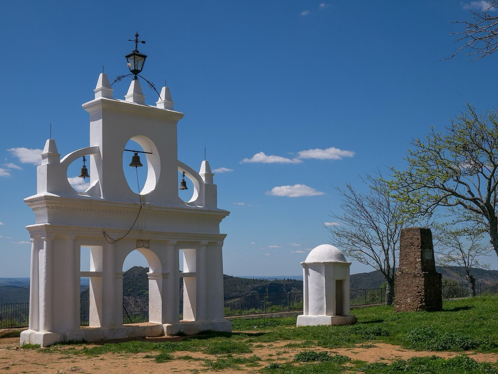
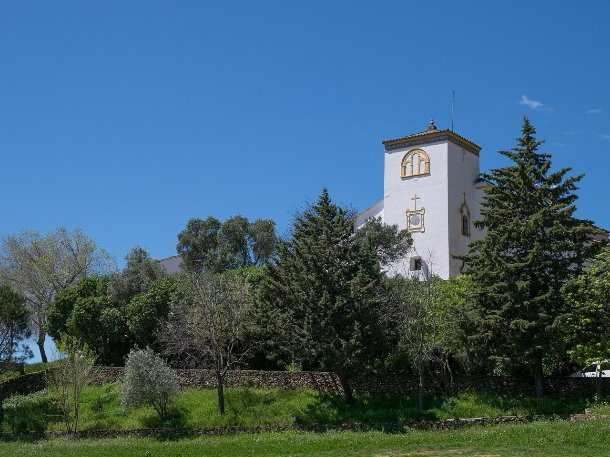
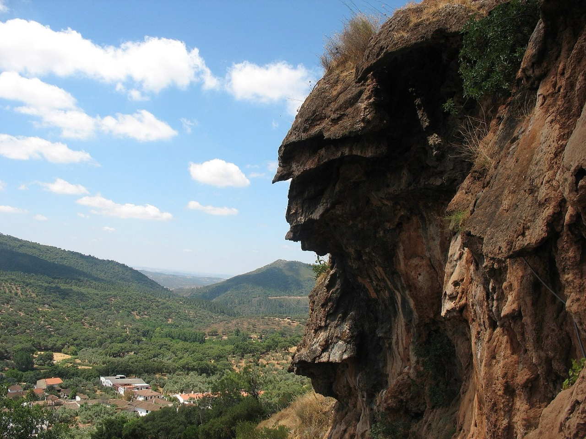
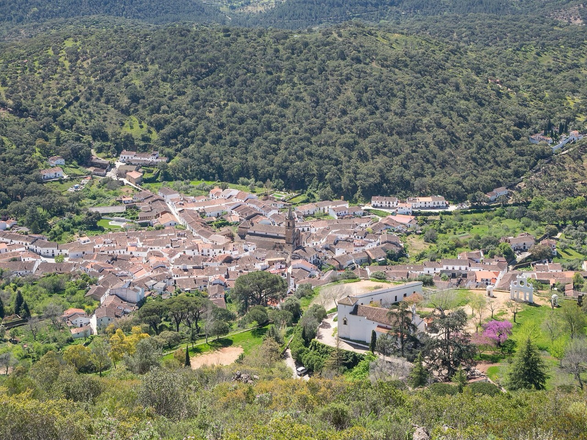
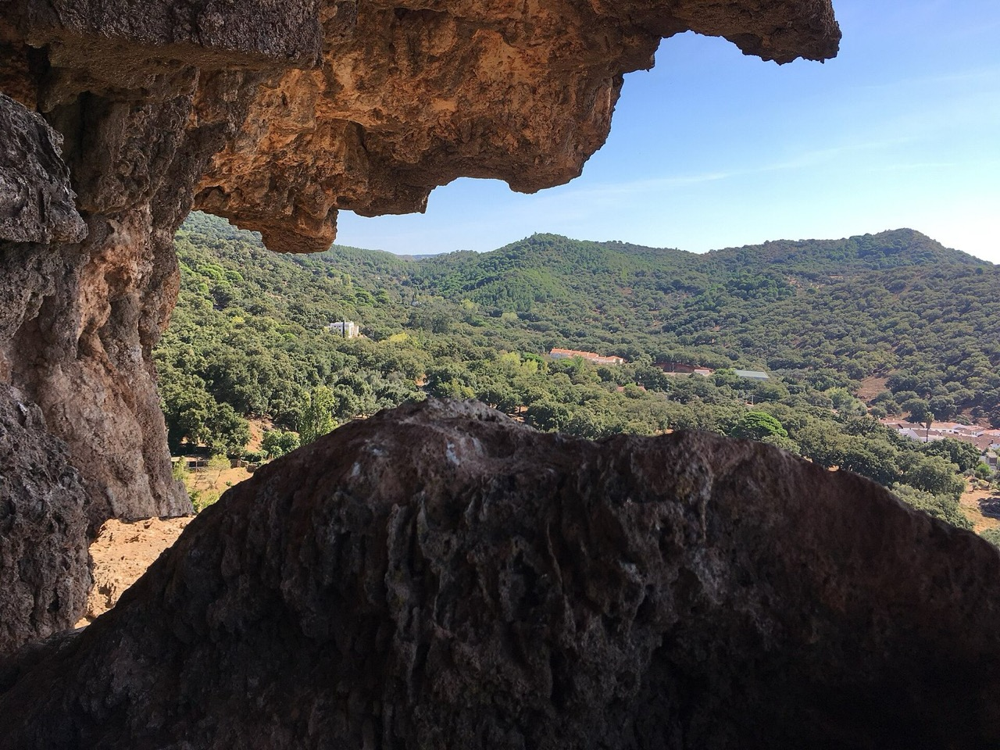

Encima del pueblo de **Alájar**, en plena **Sierra de Aracena**, una gran roca hace de balcón sobre los bosques de encinas y castaños. Es la **Peña de Arias Montano**, con una ermita, unos **campanarios blancos** y vistas que llegan muy lejos. Aquí se retiraba a estudiar **Benito Arias Montano**, hombre de confianza de **Felipe II**.

Te cuento qué ver 👇

En un vistazo<h2>Lo que vas a encontrar</h2>

<b>🔔</b>Campanarios blancos

<b>⛪</b>Ermita

<b>🏞️</b>Vistas a la sierra

<b>🪨</b>Rocas y cuevas

<b>📚</b>Arias Montano

Antes de ir<h2>Lo básico de la Peña</h2>

<h3>📍 Dónde está</h3>
Encima de <strong>Alájar</strong>, a unos 15 minutos en coche de Aracena.

<h3>⏱️ Tiempo</h3>
Una hora para los miradores y la ermita. Más si bajas andando al pueblo.

<h3>🆓 Precio</h3>
Subir a la peña es <strong>gratis</strong>.

Qué ver<h2>Qué ver en la Peña de Arias Montano</h2>

<ol class="guide__grid guide__grid--cuenca">
<li class="gcard reveal">
01

<h3>Los campanarios</h3>
Una espadaña <strong>blanca con campanas</strong> y pequeños templetes, al borde del mirador. La foto clásica de la peña.

</li>
<li class="gcard reveal">
02

<h3>La ermita de la Reina de los Ángeles</h3>
El centro de la romería del <strong>8 de septiembre</strong>, la más multitudinaria de la comarca.

</li>
<li class="gcard reveal">
03

<h3>La peña</h3>
Roca rojiza con <strong>formas curiosas</strong> y pequeñas cuevas. Se dice que Arias Montano estudiaba en estos rincones.

</li>
<li class="gcard reveal">
04

<h3>Las vistas de Alájar</h3>
El pueblo blanco a tus pies, rodeado de <strong>bosque</strong>. Es uno de los mejores miradores de la sierra.

</li>
<li class="gcard reveal">
05

<h3>Las dehesas</h3>
Desde las rocas se ven las <strong>dehesas</strong> donde se crían los cerdos ibéricos del jamón de la zona.

</li>
</ol>

Cómo llegar<h2>Cómo llegar a la Peña de Arias Montano</h2>

En coche, desde <strong>Aracena</strong>, unos 15 minutos hasta Alájar, y desde allí una carretera corta sube a la peña. Desde <strong>Sevilla</strong>, alrededor de una hora y media. Hay aparcamiento arriba.

<a class="btn guide__mapbtn" href="https://www.google.com/maps/dir/?api=1&destination=37.8735,-6.656" target="_blank" rel="noopener"><svg class="ico" viewBox="0 0 24 24" width="15" height="15" aria-hidden="true" fill="currentColor"><path d="M12 2a7 7 0 0 0-7 7c0 5.25 7 13 7 13s7-7.75 7-13a7 7 0 0 0-7-7zm0 9.5a2.5 2.5 0 1 1 0-5 2.5 2.5 0 0 1 0 5z"/></svg> Cómo llegar en Google Maps</a>

Combínalo con <a href="/blog/aracena-que-ver.html">Aracena</a> y la <a href="/blog/gruta-de-las-maravillas-aracena.html">Gruta de las Maravillas</a>, o con <a href="/blog/almonaster-la-real.html">Almonaster la Real</a>.

Consejos de Cheno<h2>Para disfrutarlo al máximo</h2><ul><li><b>Sube al atardecer</b> la luz sobre la sierra es preciosa.</li><li><b>Baja a Alájar andando</b> hay senderos entre la peña y el pueblo.</li><li><b>Prueba el jamón</b> estás en plena tierra del ibérico.</li></ul>

<!--actividades-->

<!--faq-->

<h2>¿Te gustan estos planes?</h2>
Sígueme en Instagram como <a href="https://www.instagram.com/chenoaventuras/" target="_blank" rel="noopener">@chenoaventuras</a>: subo escapadas como esta cada semana.
<a class="btn guide__btn" href="/blog.html">Ver más planes en el blog</a>

Información consultada en noviembre de 2026 (Junta de Andalucía e Instituto Andaluz del Patrimonio Histórico). Los horarios y precios cambian: confírmalos antes de ir. Fotos de Wikimedia Commons: <a href="https://commons.wikimedia.org/wiki/File:20230406_121007_Arias_Montano.jpg" target="_blank" rel="noopener">80kmh</a> (CC BY 4.0), <a href="https://commons.wikimedia.org/wiki/File:Al%C3%A1jar_-_La_Pe%C3%B1a_03.jpg" target="_blank" rel="noopener">Basotxerri</a> (CC BY-SA 4.0), <a href="https://commons.wikimedia.org/wiki/File:Al%C3%A1jar_-_La_Pe%C3%B1a_05.jpg" target="_blank" rel="noopener">Basotxerri</a> (CC BY-SA 4.0), <a href="https://commons.wikimedia.org/wiki/File:Pe%C3%B1a_de_Arias_Montano_-_Antiguo_edificio_tob%C3%A1ceo_3.jpg" target="_blank" rel="noopener">PePeEfe</a> (CC BY-SA 4.0), <a href="https://commons.wikimedia.org/wiki/File:Al%C3%A1jar_02.jpg" target="_blank" rel="noopener">Basotxerri</a> (CC BY-SA 4.0), <a href="https://commons.wikimedia.org/wiki/File:Dehesas_desde_la_Pe%C3%B1a_de_Alajar.jpg" target="_blank" rel="noopener">PNSAPA</a> (CC BY-SA 4.0).

