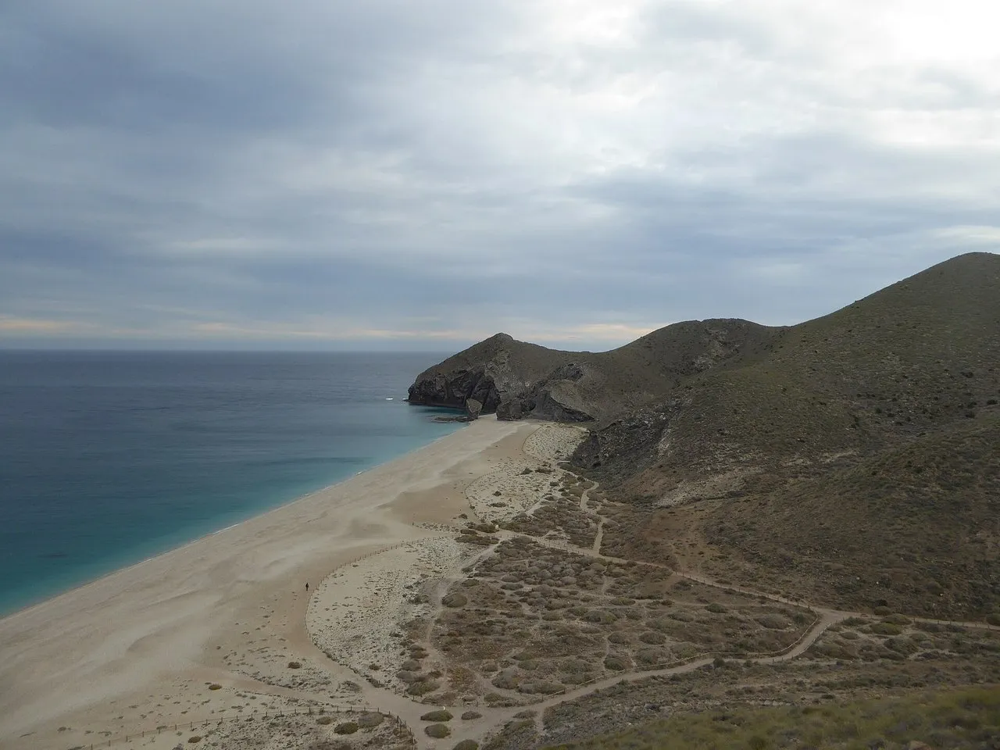
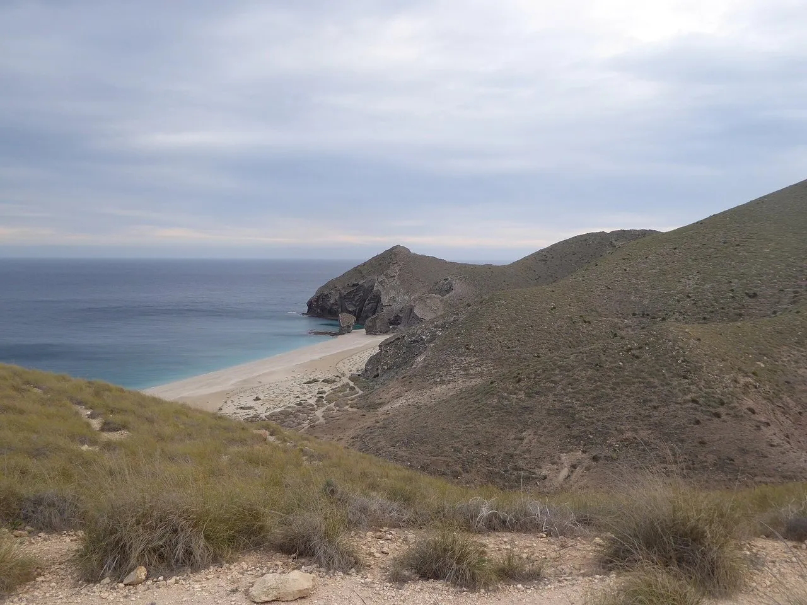
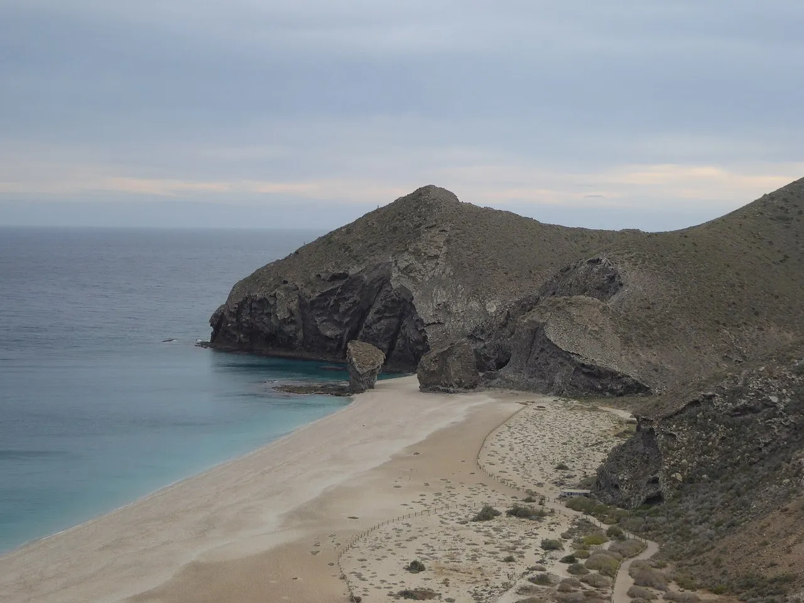
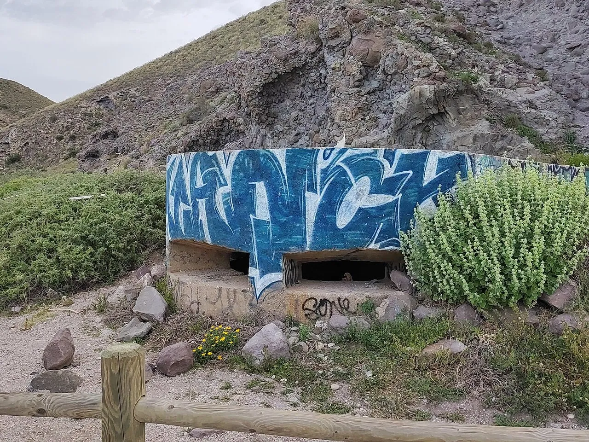
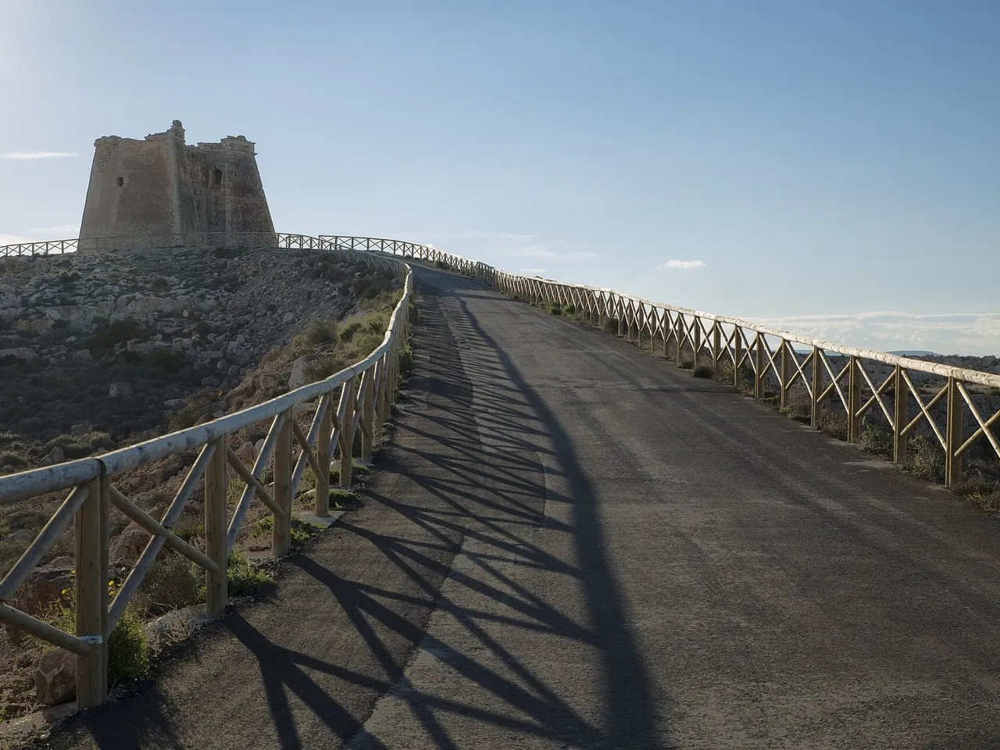
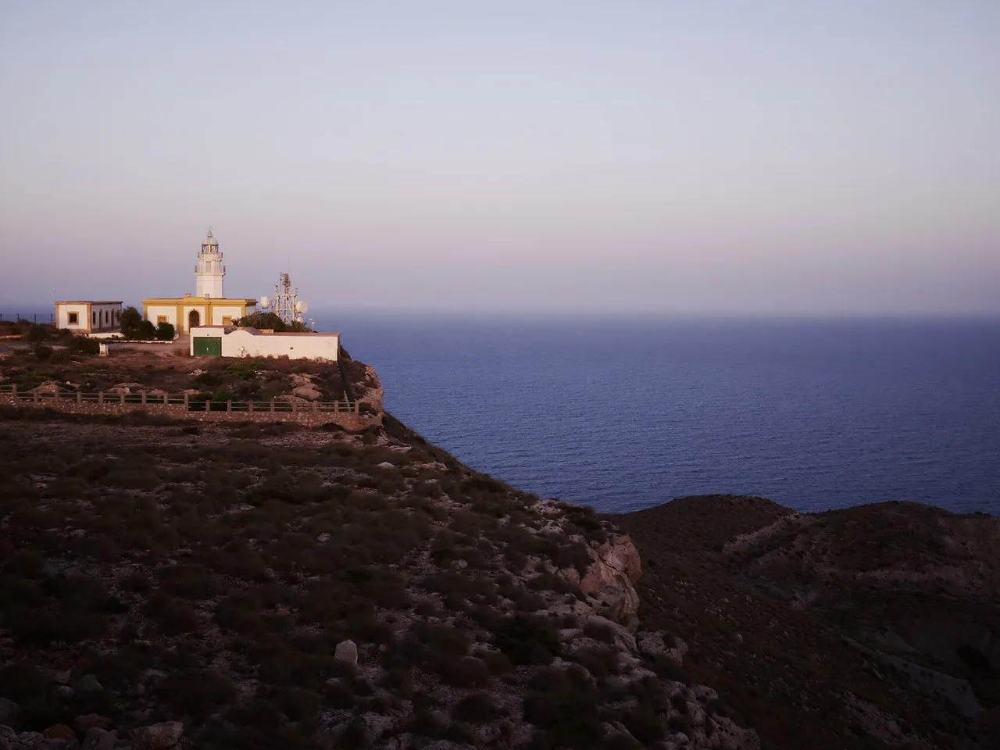

Más de un kilómetro de arena y grava blanca, agua transparente que pasa del turquesa al azul y ni un solo edificio a la vista. La **Playa de los Muertos**, en **Carboneras**, es de las playas salvajes más bonitas del **Parque Natural de Cabo de Gata-Níjar**, y se gana a pie.

Te cuento cómo llegar, la bajada, qué llevar y qué ver cerca 👇

En un vistazo<h2>Lo que vas a encontrar</h2>

<b>🏖️</b>Playa virgen

<b>💧</b>Agua cristalina

<b>🥾</b>Bajada a pie

<b>🚫</b>Sin servicios

<b>🗼</b>Mesa de Roldán

Antes de ir<h2>Lo básico de la Playa de los Muertos</h2>

<h3>📍 Dónde está</h3>
A unos <strong>2 km del puerto de Carboneras</strong>, junto a la carretera <strong>AL-5106</strong> hacia Agua Amarga.

<h3>📏 Cómo es</h3>
Unos <strong>1.160 m de largo</strong> y 70 de ancho, de <strong>grava fina y arena blanca</strong>, con oleaje moderado.

<h3>🚫 Sin servicios</h3>
Ni chiringuitos, ni duchas, ni sombra. Lleva <strong>agua, comida y sombrilla</strong>.

<h3>🅿️ Aparcamiento</h3>
Junto a la carretera, arriba. En verano <strong>suele ser de pago</strong> y se llena: llega temprano.

Qué ver<h2>Qué ver en la Playa de los Muertos</h2>

<ol class="guide__grid guide__grid--cuenca">
<li class="gcard reveal">
01

<h3>La playa desde arriba</h3>
La primera vista desde el sendero ya merece el viaje: una lengua de arena clara entre montes volcánicos y el agua cambiando de color.

</li>
<li class="gcard reveal">
02

<h3>La bajada</h3>
Un camino de tierra con pendiente y piedra suelta. Se baja rápido; la <strong>subida de vuelta</strong> al sol cuesta más.

</li>
<li class="gcard reveal">
03

<h3>Los promontorios volcánicos</h3>
En los extremos de la playa, promontorios de roca volcánica oscura. Junto a las rocas el agua es más clara: lleva gafas de <strong>snorkel</strong>.

</li>
<li class="gcard reveal">
04

<h3>El búnker</h3>
Junto al camino queda un antiguo <strong>búnker</strong> de vigilancia de la costa, hoy cubierto de grafitis.

</li>
<li class="gcard reveal">
05

<h3>La torre de la Mesa de Roldán</h3>
Muy cerca, sobre un antiguo volcán, una <strong>torre vigía</strong> con un mirador espectacular sobre la costa.

</li>
<li class="gcard reveal">
06

<h3>El faro de la Mesa de Roldán</h3>
Junto a la torre, el faro. Al atardecer, la luz sobre el mar es de lo mejor de esta costa.

</li>
</ol>

<!--actividades-->

Cómo llegar<h2>Cómo llegar a la Playa de los Muertos</h2>

Desde <strong>Carboneras</strong>, toma la carretera <strong>AL-5106</strong> hacia Agua Amarga: el aparcamiento de la playa está junto a la carretera, a unos 2 km del puerto deportivo. Desde allí se baja a pie por el sendero.

<strong>Desde el mar:</strong> sin bajadas ni subidas, puedes ver esta costa en un <a href="https://www.civitatis.com/es/carboneras/paseo-barco-calas-cabo-gata/?aid=110968" target="_blank" rel="noopener sponsored">paseo en yate por las calas de Cabo de Gata</a> o en <a href="https://www.civitatis.com/es/carboneras/paseo-catamaran-cabo-de-gata/?aid=110968" target="_blank" rel="noopener sponsored">catamarán</a> desde Carboneras, o remando con un <a href="https://www.civitatis.com/es/agua-amarga/kayak-snorkel-cabo-gata/?aid=110968" target="_blank" rel="noopener sponsored">tour en kayak desde Agua Amarga</a>.

<a class="btn guide__mapbtn" href="https://www.google.com/maps/dir/?api=1&destination=Playa+de+los+Muertos+Carboneras" target="_blank" rel="noopener"><svg class="ico" viewBox="0 0 24 24" width="15" height="15" aria-hidden="true" fill="currentColor"><path d="M12 2a7 7 0 0 0-7 7c0 5.25 7 13 7 13s7-7.75 7-13a7 7 0 0 0-7-7zm0 9.5a2.5 2.5 0 1 1 0-5 2.5 2.5 0 0 1 0 5z"/></svg> Cómo llegar a la Playa de los Muertos</a>

Consejos de Cheno<h2>Para disfrutarla al máximo</h2><ul><li><b>Llega pronto en verano</b>: el aparcamiento se llena a media mañana.</li><li><b>Escarpines</b>: la grava fina quema y se clava.</li><li><b>No dejes nada a la vista en el coche</b>.</li><li><b>Sube al atardecer a la Mesa de Roldán</b> antes de volver.</li><li><b>Más Cabo de Gata:</b> la <a href="/blog/cabo-de-gata-que-ver.html">guía de Cabo de Gata</a> y <a href="/blog/mojacar-que-ver.html">Mojácar</a>, a media hora.</li></ul>

<!--faq-->

<h2>¿Te gustan estos planes?</h2>
Sígueme en Instagram como <a href="https://www.instagram.com/chenoaventuras/" target="_blank" rel="noopener">@chenoaventuras</a>: subo escapadas como esta cada semana.
<a class="btn guide__btn" href="/blog.html">Ver más planes en el blog</a>

Información consultada en noviembre de 2026 (medidas y servicios: Turespaña, spain.info). Las condiciones del aparcamiento cambian cada temporada. Fotos de Wikimedia Commons: <a href="https://commons.wikimedia.org/wiki/File:Playa_de_los_Muertos_14.jpg" target="_blank" rel="noopener">Millars</a> (CC BY-SA 4.0) · <a href="https://commons.wikimedia.org/wiki/File:Playa_de_los_Muertos_11.jpg" target="_blank" rel="noopener">Millars</a> · <a href="https://commons.wikimedia.org/wiki/File:Playa_de_los_Muertos_10.jpg" target="_blank" rel="noopener">Millars</a> · <a href="https://commons.wikimedia.org/wiki/File:Playa_de_los_Muertos_13.jpg" target="_blank" rel="noopener">Millars</a> · <a href="https://commons.wikimedia.org/wiki/File:B%C3%BAnker_de_la_playa_de_los_Muertos.jpg" target="_blank" rel="noopener">Josi</a> (CC BY-SA 4.0) · <a href="https://commons.wikimedia.org/wiki/File:Torre_Mesa_Rold%C3%A1n_en_Carboneras_(Almer%C3%ADa).jpg" target="_blank" rel="noopener">Enlasnubesdealmeria</a> (CC0) · <a href="https://commons.wikimedia.org/wiki/File:Faro_de_Mesa_Rold%C3%A1n_(Carboneras).jpg" target="_blank" rel="noopener">Nicolas Vigier</a> (CC0).

