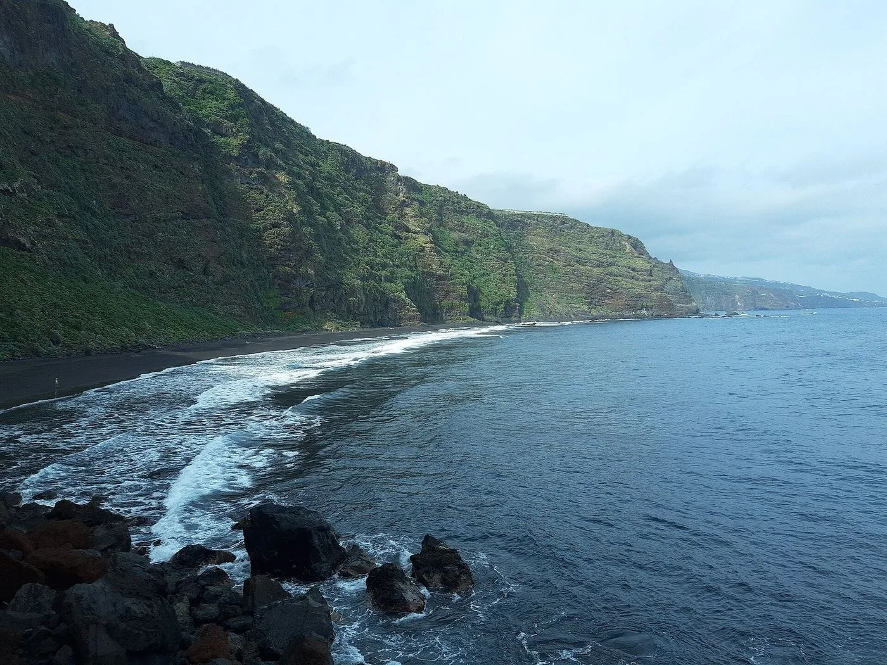
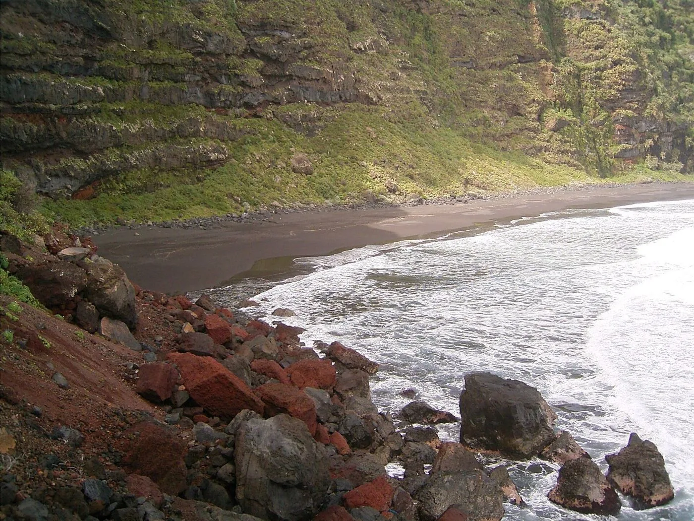
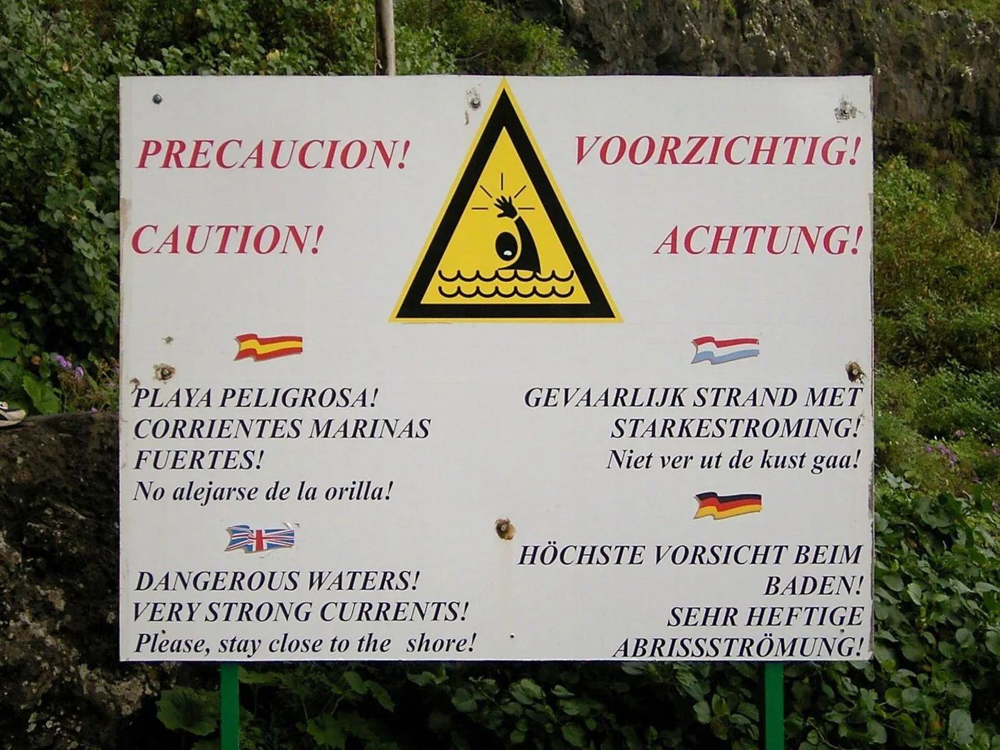
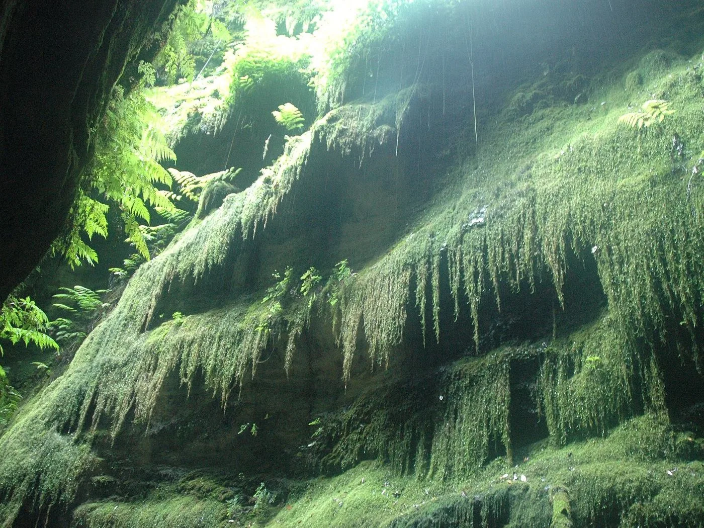

Arena negra, olas grandes y un acantilado verde que cae casi vertical al mar. La **playa de Nogales**, en la costa noreste de **La Palma**, es una de las más fotogénicas y salvajes de la isla.

Te cuento cómo llegar, qué riesgos tiene y qué ver por la zona 👇

En un vistazo<h2>Lo que vas a encontrar</h2>

<b>🖤</b>Arena negra

<b>🌊</b>Oleaje fuerte

<b>⛰️</b>Acantilado verde

<b>🚶</b>Sendero de 500 m

<b>⚠️</b>Playa peligrosa

Antes de ir<h2>Lo básico de Nogales</h2>

<h3>📍 Dónde está</h3>
En <strong>Puntallana</strong>, costa noreste de La Palma.

<h3>🚶 Acceso</h3>
Unos <strong>500 m a pie</strong> desde el aparcamiento, con escaleras.

<h3>⚠️ Mar</h3>
Oleaje y corrientes fuertes: <strong>mejor desde la orilla</strong>.

El sitio<h2>Una playa salvaje</h2>

Nogales es una playa de <strong>arena negra volcánica</strong> encajada entre acantilados cubiertos de vegetación verde y expuesta al Atlántico del norte, que le manda olas grandes casi todo el año. Hay pocos servicios y el acceso es a pie, y eso la mantiene tranquila y con aspecto de rincón escondido. Pero también la hace delicada: en la entrada, un cartel avisa de que el agua es peligrosa y de las fuertes corrientes.

Qué ver<h2>Qué ver en Nogales y alrededores</h2>

<ol class="guide__grid guide__grid--cuenca">
<li class="gcard reveal">
01

<h3>El oleaje</h3>
Las olas llegan largas y potentes hasta la orilla. Es el espectáculo de la playa, y también su peligro.

</li>
<li class="gcard reveal">
02

<h3>Rocas rojas y arena negra</h3>
El contraste de colores: arena negra, rocas rojizas de origen volcánico y la pared verde del acantilado.

</li>
<li class="gcard reveal">
03

<h3>El cartel de aviso</h3>
Antes de bajar, lee el cartel. Si hay oleaje, quédate cerca de la orilla y no te metas más allá de las rodillas.

</li>
<li class="gcard reveal">
04

<h3>El Cubo de La Galga</h3>
A pocos kilómetros, un barranco de laurisilva con paredes tapizadas de musgo y helechos, muy distinto al paisaje de la playa.

</li>
</ol>

Seguridad<h2>Cuidado con el baño y con el acantilado</h2>

Disfruta de Nogales desde la arena y, si te bañas, hazlo solo con el mar tranquilo, y mejor si hay socorrista. No te acerques a la base del acantilado: el Ayuntamiento de Puntallana ha cerrado la playa en alguna ocasión por <strong>desprendimientos</strong>, así que respeta los avisos y consulta el estado antes de bajar.

Cómo llegar<h2>Cómo llegar a la playa de Nogales</h2>

<strong>En coche:</strong> desde Santa Cruz de La Palma, por la <strong>LP-1</strong> hacia el norte hasta Puntallana y las indicaciones a la playa. Calcula unos 20 minutos.

<strong>A pie:</strong> desde el aparcamiento, unos 500 metros de sendero y escaleras hasta la arena.

<strong>Antes de ir:</strong> consulta si la playa está abierta y cómo está el mar; lleva agua y crema.

<a class="btn guide__mapbtn" href="https://www.google.com/maps/search/?api=1&query=Playa%20de%20Nogales%2C%20Puntallana%2C%20La%20Palma" target="_blank" rel="noopener"><svg class="ico" viewBox="0 0 24 24" width="15" height="15" aria-hidden="true" fill="currentColor"><path d="M12 2a7 7 0 0 0-7 7c0 5.25 7 13 7 13s7-7.75 7-13a7 7 0 0 0-7-7zm0 9.5a2.5 2.5 0 1 1 0-5 2.5 2.5 0 0 1 0 5z"/></svg> Cómo llegar en Google Maps</a>

Sigue la costa norte con el <a href="/blog/charco-azul-la-palma.html">Charco Azul</a> y el <a href="/blog/bosque-de-los-tilos.html">Bosque de Los Tilos</a>. Más planes en <a href="/blog/que-hacer-en-la-palma.html">qué hacer en La Palma</a>.

Consejos de Cheno<h2>Para disfrutarlo al máximo</h2><ul><li><b>Mira el mar</b> antes de bajar y no des la espalda al oleaje.</li><li><b>Baja con calzado cerrado:</b> hay escaleras y piedra suelta.</li><li><b>Respeta los avisos:</b> puede cerrarse por desprendimientos.</li><li><b>Lleva agua y crema:</b> no hay servicios.</li><li><b>Combínala</b> con Los Tilos y el Charco Azul en un mismo día.</li></ul>

<h2>¿Te gustan estos planes?</h2>
Sígueme en Instagram como <a href="https://www.instagram.com/chenoaventuras/" target="_blank" rel="noopener">@chenoaventuras</a>: subo escapadas como esta cada semana.
<a class="btn guide__btn" href="/blog.html">Ver más planes en el blog</a>

Información consultada en noviembre de 2026. Los accesos, cierres y permisos cambian a menudo: consúltalos en las webs oficiales del Cabildo de La Palma y del Parque Nacional antes de ir. Fotos de Wikimedia Commons: <a href="https://commons.wikimedia.org/wiki/File:Playa_de_Nogales,_La_Palma,_overview.jpg" target="_blank" rel="noopener">Gerda Arendt</a> (CC0) · <a href="https://commons.wikimedia.org/wiki/File:Playa_de_Nogales,_La_Palma,_surf.jpg" target="_blank" rel="noopener">Gerda Arendt</a> (CC0) · <a href="https://commons.wikimedia.org/wiki/File:Puntallana_-_Playa_de_Nogales_01_ies.jpg" target="_blank" rel="noopener">Frank Vincentz</a> (CC BY-SA 3.0) · <a href="https://commons.wikimedia.org/wiki/File:Puntallana_-_Playa_de_Nogales_04_ies.jpg" target="_blank" rel="noopener">Frank Vincentz</a> (CC BY-SA 3.0) · <a href="https://commons.wikimedia.org/wiki/File:Cubo_de_la_Galga-Puntallana-La_Palma.jpg" target="_blank" rel="noopener">Yann from Madrid, Spain</a> (CC BY 2.0).

