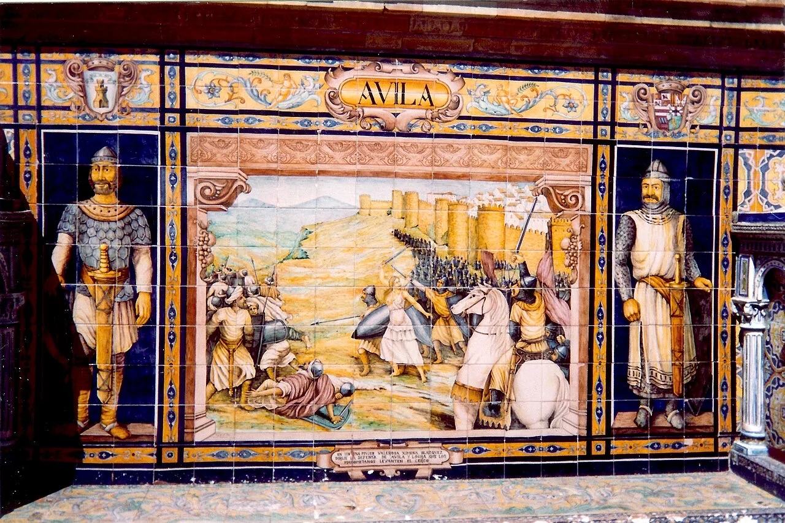
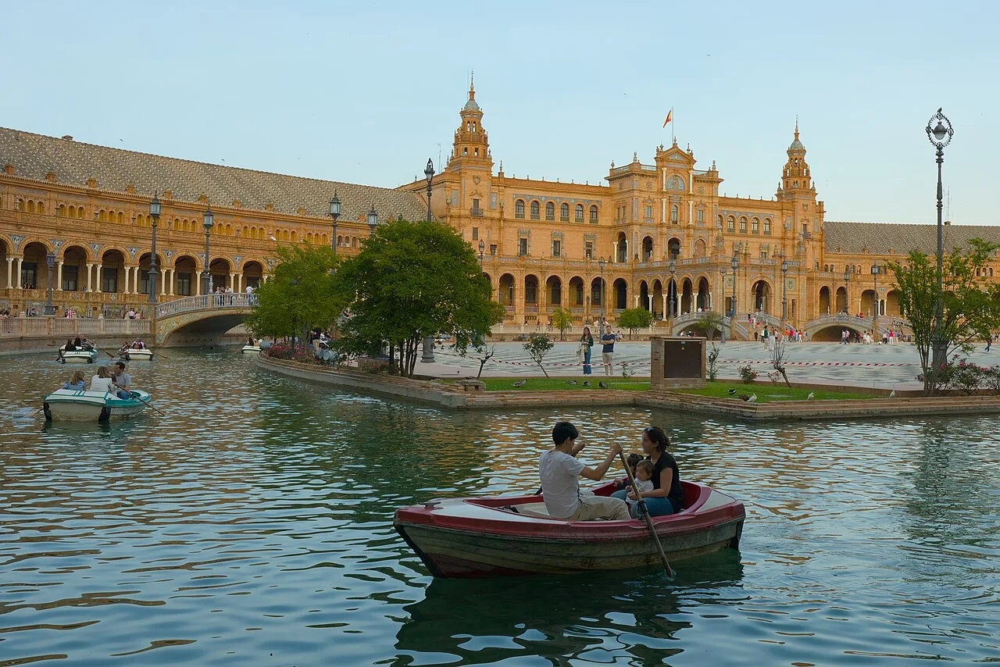
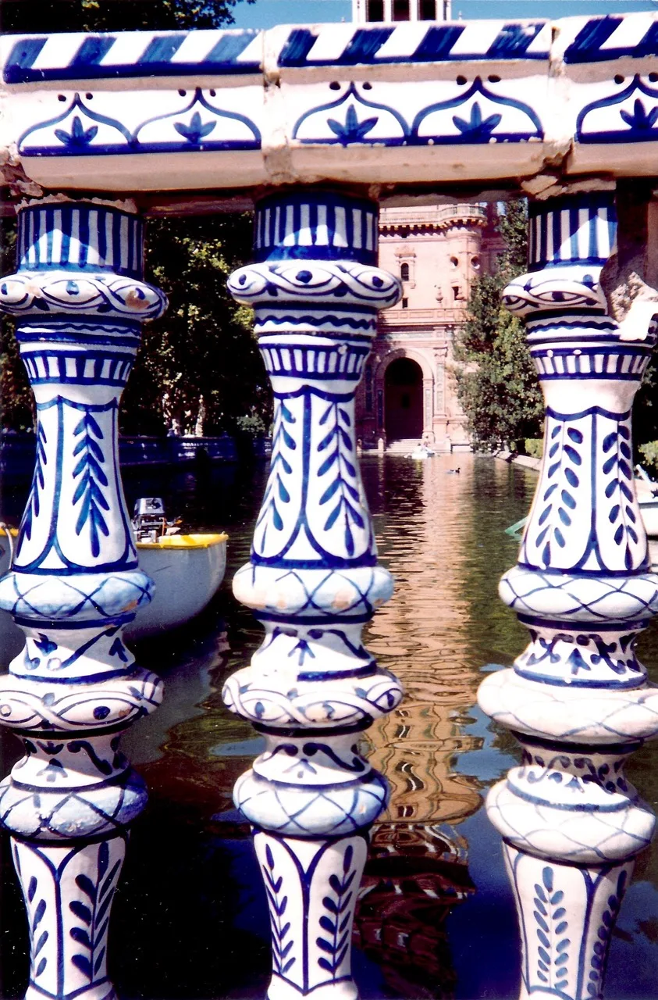
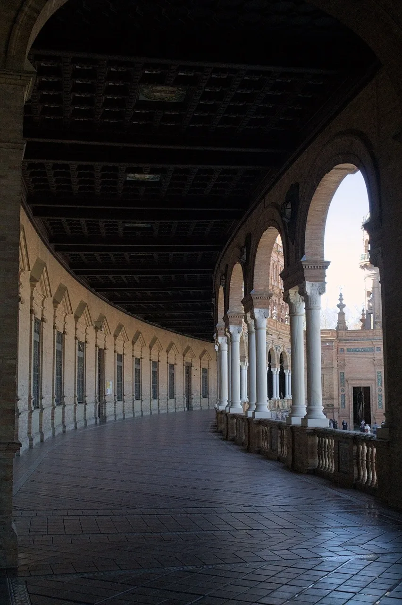
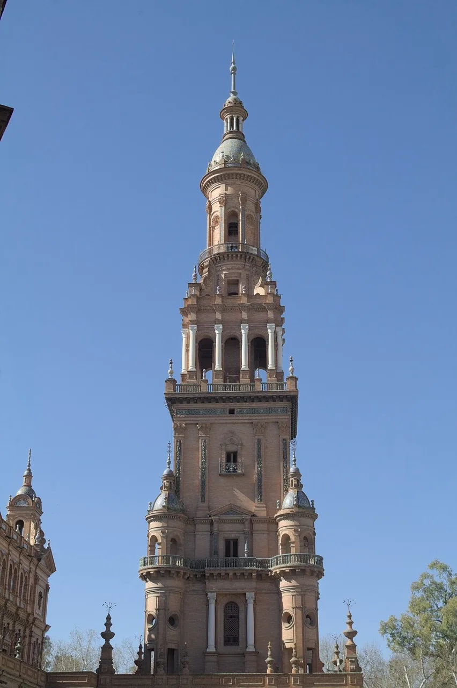
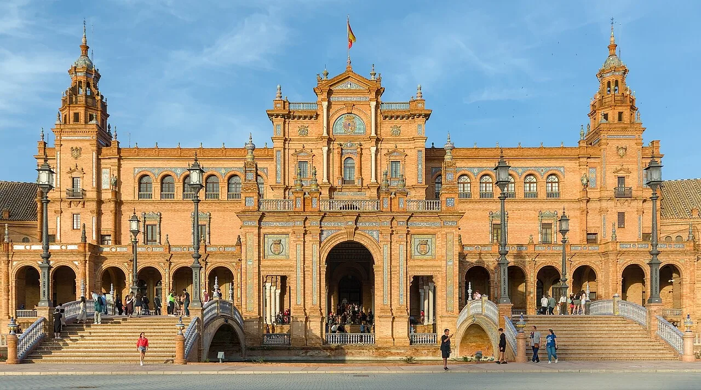

Hay sitios que salen en todas las fotos de Sevilla, y la **Plaza de España** es el número uno. Un semicírculo enorme de ladrillo y azulejo, con torres, puentes, un canal donde puedes remar en barca… y tanto aire de palacio de cuento que **hasta Star Wars la eligió para rodar**.

Te cuento sus curiosidades, qué no te puedes perder y lo que tienes que saber antes de ir 👇

En un vistazo<h2>Lo que vas a encontrar</h2>

<b>🌉</b>Cuatro puentes

<b>🚣</b>Barcas

<b>🪐</b>Star Wars

<b>🖼️</b>Bancos de provincias

<b>🏛️</b>Galería

Antes de ir<h2>Lo básico de la Plaza de España</h2>

<h3>🎟️ Precio</h3>
A día de hoy, <strong>la entrada es gratis</strong>. El Ayuntamiento ha planteado cobrar a los turistas, así que conviene mirarlo antes de ir.

<h3>🕒 Horario</h3>
Abre a diario, normalmente de <strong>8:00 a 22:00</strong>. Por la noche se cierra para protegerla.

<h3>🚣 Las barcas</h3>
Puedes alquilar una <strong>barca de remos</strong> y recorrer el canal. El precio lo marca el servicio de alquiler en el propio embarcadero.

Un poco de historia<h2>Construida para una exposición</h2>

La plaza la diseñó el arquitecto sevillano <strong>Aníbal González</strong> para la <strong>Exposición Iberoamericana de 1929</strong>. Su forma de semicírculo es simbólica: representa a España «abrazando» a sus antiguos territorios de América, hacia donde mira, en dirección al río Guadalquivir.

<h3>🎬 La plaza de Star Wars</h3>
En <strong>«Star Wars: Episodio II – El ataque de los clones»</strong> (2002), la Plaza de España aparece como un palacio del planeta <strong>Naboo</strong>: Anakin y Padmé pasean por su galería. Antes ya había salido en <strong>«Lawrence de Arabia»</strong>, haciendo de cuartel británico en El Cairo.

Cómo se hizo<h2>Una obra de años para la Exposición de 1929</h2>

Aníbal González proyectó la plaza para la <strong>Exposición Iberoamericana de 1929</strong>, la gran cita con la que Sevilla quiso mostrarse al mundo, y la concibió como el edificio estrella del certamen, de ladrillo visto, cerámica y hierro forjado. Las obras fueron largas y las fuentes no coinciden en cuándo empezaron (se citan 1914 y la década de 1920). Lo que sí consta es que González dimitió en <strong>1926</strong> sin verla terminada y que la acabó el arquitecto <strong>Vicente Traver</strong>, en <strong>1928</strong>. Es el mejor ejemplo del estilo <strong>regionalista</strong> que Aníbal González impulsó en la Sevilla de principios del siglo XX, y se nota en los detalles: cada azulejo y cada barandilla de cerámica forman parte del decorado.

Tras casi un siglo de uso, el Ayuntamiento la sometió a una restauración integral entre <strong>2007 y 2010</strong> para recuperar la cerámica y las fachadas.

Qué ver<h2>Las curiosidades de la Plaza de España</h2>
Detalles en los que mucha gente ni se fija.

<ol class="guide__grid guide__grid--cuenca">
<li class="gcard reveal">
01

<h3>Los bancos de las provincias</h3>
A lo largo del semicírculo hay un banco de azulejos por cada provincia, con su mapa y una escena de su historia. Buscar el tuyo es casi obligatorio.

</li>
<li class="gcard reveal">
02

<h3>El canal y las barcas</h3>
Un canal de unos 500 metros recorre la plaza y se puede navegar en barca de remos.

</li>
<li class="gcard reveal">
03

<h3>Los cuatro puentes</h3>
Cruzan el canal y representan los cuatro antiguos reinos de España. Fíjate en las barandillas de cerámica.

</li>
<li class="gcard reveal">
04

<h3>La galería</h3>
Recorre el edificio por dentro de los soportales: es el pasillo por el que caminan Anakin y Padmé en Star Wars.

</li>
<li class="gcard reveal">
05

<h3>Las torres</h3>
Dos torres de estilo barroco cierran la plaza por los extremos. Se ven desde todo el parque de María Luisa.

</li>
<li class="gcard reveal">
06

<h3>El edificio central</h3>
Hoy alberga dependencias oficiales, pero su fachada de ladrillo y cerámica es la foto más clásica de Sevilla.

</li>
</ol>

<!--actividades-->

Cómo llegar<h2>Cómo llegar a la Plaza de España</h2>

Está junto al <strong>Parque de María Luisa</strong>, a unos 15-20 minutos andando desde la Catedral. También puedes llegar en <strong>metro</strong> (parada Prado de San Sebastián) o en el <strong>tranvía</strong> hasta Prado.

Lo ideal es combinarla con un paseo por el parque de María Luisa, que está justo al lado.

<a class="btn guide__mapbtn" href="https://www.google.com/maps/dir/?api=1&destination=Plaza+de+España+Sevilla" target="_blank" rel="noopener"><svg class="ico" viewBox="0 0 24 24" width="15" height="15" aria-hidden="true" fill="currentColor"><path d="M12 2a7 7 0 0 0-7 7c0 5.25 7 13 7 13s7-7.75 7-13a7 7 0 0 0-7-7zm0 9.5a2.5 2.5 0 1 1 0-5 2.5 2.5 0 0 1 0 5z"/></svg> Cómo llegar en Google Maps</a>

Consejos de Cheno<h2>Para disfrutarla al máximo</h2><ul><li><b>Ve a primera hora o al atardecer</b>: con menos gente y una luz preciosa sobre el ladrillo.</li><li><b>Sube a la galería superior</b>: desde los balcones tienes la mejor vista de toda la plaza.</li><li><b>Busca tu provincia</b>: y hazte la foto en su banco.</li><li><b>Evita las horas centrales en verano</b>: en julio y agosto el calor en la plaza es muy fuerte.</li></ul>

<!--faq-->

<h2>¿Te gustan estos planes?</h2>
Sígueme en Instagram como <a href="https://www.instagram.com/chenoaventuras/" target="_blank" rel="noopener">@chenoaventuras</a>: subo escapadas como esta cada semana.
<a class="btn guide__btn" href="/blog.html">Ver más planes en el blog</a>

Información consultada en octubre de 2026. El horario y la posible entrada para turistas pueden cambiar: compruébalos antes de ir. Fotos de Wikimedia Commons: <a href="https://commons.wikimedia.org/wiki/File%3APlaza_de_Espa%C3%B1a_%28Sevilla%29_-_01.jpg" target="_blank" rel="noopener">Carlos Delgado</a> (CC BY-SA 4.0) · <a href="https://commons.wikimedia.org/wiki/File%3ASevilla_-_Plaza_de_Espa%C3%B1a_-_1.jpg" target="_blank" rel="noopener">Benjamin Smith</a> (CC BY-SA 4.0) · <a href="https://commons.wikimedia.org/wiki/File%3APlaza_de_Espa%C3%B1a%2C_Sevilla_Octubre_1999_-_06.jpg" target="_blank" rel="noopener">Infrogmation</a> (CC BY-SA 4.0) · <a href="https://commons.wikimedia.org/wiki/File%3ASevilla_-_Plaza_de_Espa%C3%B1a_-_south_tower.jpg" target="_blank" rel="noopener">o_andras</a> (CC BY-SA 4.0) · <a href="https://commons.wikimedia.org/wiki/File:Plaza_de_Espa%C3%B1a,_Sevilla_Octubre_1999_-_03.jpg" target="_blank" rel="noopener">Infrogmation</a> (CC BY-SA 4.0) · <a href="https://commons.wikimedia.org/wiki/File:Sevilla_-_Plaza_de_Espa%C3%B1a_-_hallway.jpg" target="_blank" rel="noopener">o_andras</a> (CC BY-SA 4.0) · <a href="https://commons.wikimedia.org/wiki/File:Sevilla_-_Plaza_de_Espa%C3%B1a_-_3.jpg" target="_blank" rel="noopener">Benjamin Smith</a> (CC BY-SA 4.0).

