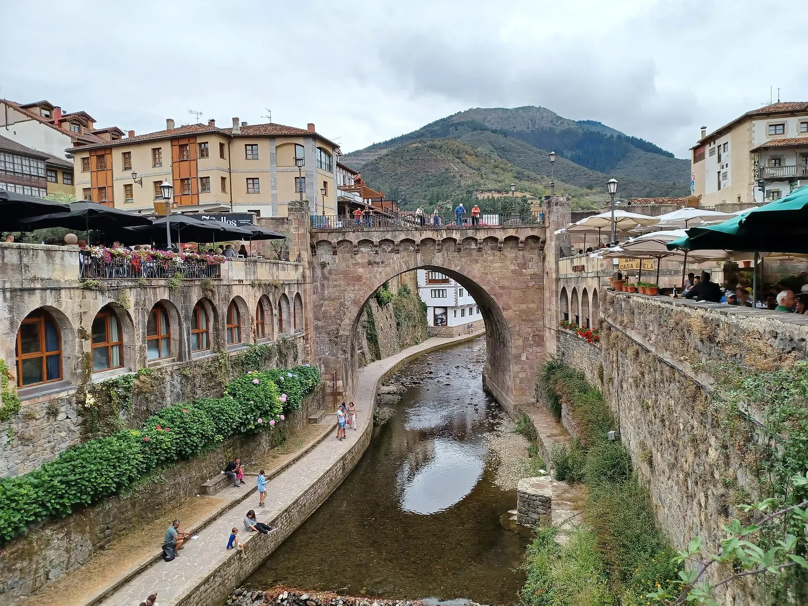
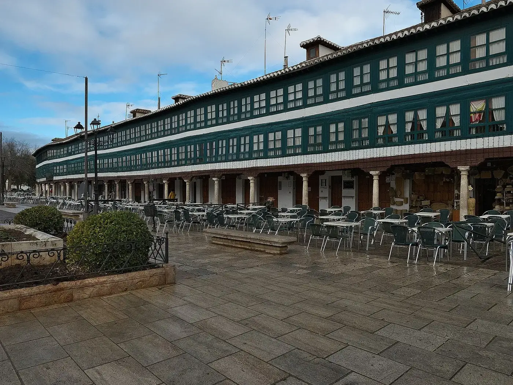
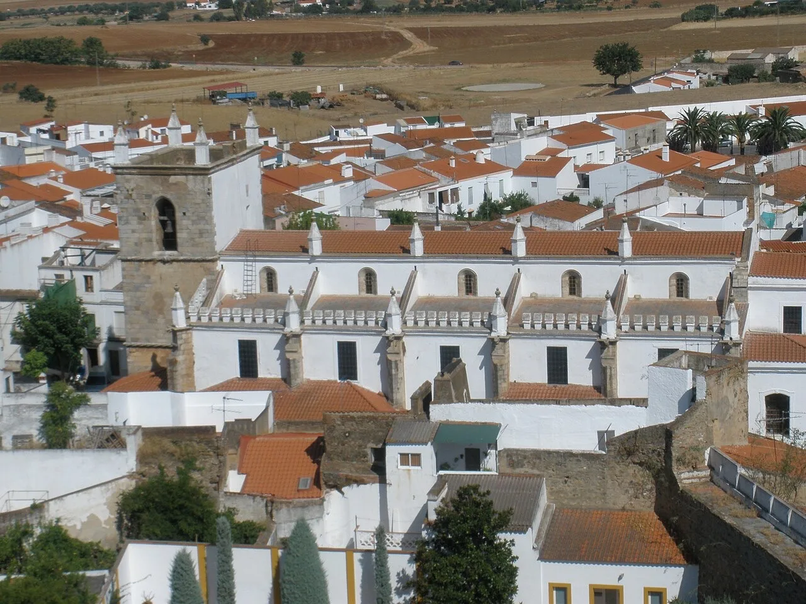
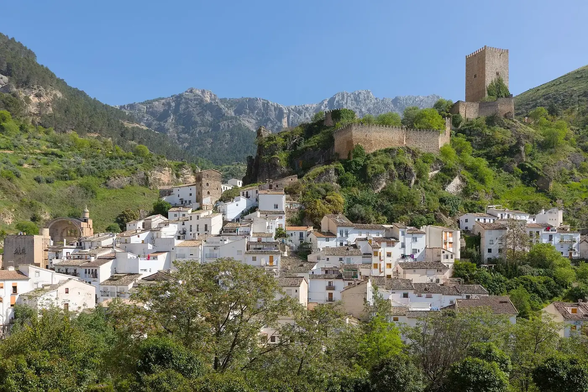

Cada Navidad, **Ferrero Rocher** elige un pueblo de España para llenarlo de luces con su campaña **«Juntos Brillamos Más»**. En 2026 empezaron **34 candidatos**, dos por comunidad autónoma, y tras la primera votación quedan **17**. El ganador se conoce el **14 de diciembre** y su iluminación se enciende el **16**.

🗳️ <strong>Cómo va el concurso (21 de noviembre):</strong> los <strong>17 pueblos siguen en votación</strong>. Todavía no hay semifinalistas ni finalistas: los 5 semifinalistas se anuncian el <strong>30 de noviembre</strong>. Actualizaré este post en cuanto salgan.

Muchos de los candidatos son pueblos de los que ya te he hablado en el blog. Te cuento el calendario, cómo votar y qué ver en cada uno, gane quien gane 👇

En un vistazo<h2>Lo que vas a encontrar</h2>

<b>🎄</b>17 pueblos

<b>🗳️</b>Votación abierta

<b>🏆</b>Ganador el 14 dic

<b>✨</b>Encendido el 16 dic

<b>🗺️</b>Qué ver en cada uno

Fechas<h2>Calendario del concurso 2026</h2>

<ol class="guide__timeline">
<li><b>8 nov</b>Primera votación: de 34 a 17 pueblos</li>
<li><b>9-30 nov</b>Segunda votación entre los 17 (fase actual)</li>
<li><b>30 nov</b>Se anuncian los 5 semifinalistas</li>
<li><b>7 dic</b>Se anuncian los 2 finalistas</li>
<li><b>14 dic</b>Ganador</li>
<li><b>16 dic</b>Encendido de las luces</li>
</ol>

Los candidatos<h2>Los pueblos candidatos que ya conoces</h2>
Estos son los candidatos de los que tengo guía en el blog. Pincha en cada uno para ver qué visitar.

<ol class="guide__grid guide__grid--cuenca">
<li class="gcard reveal">
01

<h3>Albarracín (Teruel)</h3>
Murallas sobre el pueblo, casas rojizas colgadas del río Guadalaviar y los Pinares de Rodeno. Representa a <strong>Aragón</strong>. <a href="/blog/albarracin-que-ver.html">Ver qué visitar →</a>

</li>
<li class="gcard reveal">
02

<h3>Llanes (Asturias)</h3>
Los Cubos de la Memoria, el paseo de San Pedro y un casco antiguo con muralla junto al mar. Representa a <strong>Asturias</strong>. <a href="/blog/llanes-que-ver.html">Ver qué visitar →</a>

</li>
<li class="gcard reveal">
03

<h3>Potes (Cantabria)</h3>
El pueblo de los puentes en el corazón de Liébana, a los pies de los Picos de Europa, con el monasterio de Santo Toribio al lado. Representa a <strong>Cantabria</strong>. <a href="/blog/potes-santo-toribio-de-liebana.html">Ver qué visitar →</a>

</li>
<li class="gcard reveal">
04

<h3>Almagro (Ciudad Real)</h3>
Su Plaza Mayor con galerías verdes y el único corral de comedias del Siglo de Oro que sigue en uso. Representa a <strong>Castilla-La Mancha</strong>. <a href="/blog/almagro-que-ver.html">Ver qué visitar →</a>

</li>
<li class="gcard reveal">
05

<h3>Ciudad Rodrigo (Salamanca)</h3>
Murallas que se pueden recorrer, una catedral con marcas de cañonazos y el famoso Carnaval del Toro. Representa a <strong>Castilla y León</strong>. <a href="/blog/ciudad-rodrigo-que-ver.html">Ver qué visitar →</a>

</li>
<li class="gcard reveal">
06

<h3>Montblanc (Tarragona)</h3>
La villa amurallada donde, según la leyenda, Sant Jordi mató al dragón. Representa a <strong>Cataluña</strong>. <a href="/blog/montblanc-que-ver.html">Ver qué visitar →</a>

</li>
<li class="gcard reveal">
07

<h3>Olivenza (Badajoz)</h3>
El pueblo español que fue portugués, con calles empedradas en blanco y negro y azulejos lusos. Representa a <strong>Extremadura</strong>. <a href="/blog/olivenza-que-ver.html">Ver qué visitar →</a>

</li>
<li class="gcard reveal">
08

<h3>Cazorla (Jaén)</h3>
La puerta de entrada a la Sierra de Cazorla, el mayor espacio protegido de España, con el castillo de la Yedra sobre el pueblo. Representa a <strong>Andalucía</strong>. <a href="/blog/sierra-de-cazorla.html">Ver qué visitar →</a>

</li>
</ol>

El resto<h2>Los otros nueve candidatos</h2>

<ul class="checklist" style="margin:0 0 1rem;"><li><strong>Los Molinos</strong> (Comunidad de Madrid), en la sierra de Guadarrama.</li><li><strong>Bocairent</strong> (Comunidad Valenciana), con su casco medieval y las Covetes dels Moros.</li><li><strong>Betanzos</strong> (Galicia), uno de los cascos históricos más bonitos de A Coruña.</li><li><strong>Muro</strong> (Islas Baleares), en el norte de Mallorca.</li><li><strong>Villa de Mazo</strong> (Canarias), en la isla de La Palma.</li><li><strong>Alfaro</strong> (La Rioja), famoso por su colonia de cigüeñas en la colegiata.</li><li><strong>Estella-Lizarra</strong> (Navarra), parada clásica del Camino de Santiago.</li><li><strong>Urduña/Orduña</strong> (País Vasco), el único municipio con título de ciudad de Bizkaia.</li><li><strong>Cehegín</strong> (Región de Murcia), con un casco antiguo declarado conjunto histórico.</li></ul>

Cómo funciona<h2>Cómo votar paso a paso</h2>

<ol class="checklist" style="margin:0 0 1rem;"><li><strong>Entra en la web oficial de Ferrero Rocher</strong> y busca el apartado del concurso «Juntos Brillamos Más».</li><li><strong>Elige el pueblo</strong> que quieres apoyar entre los candidatos de la fase.</li><li><strong>Confirma tu voto.</strong></li><li><strong>Vuelve en cada fase:</strong> los votos no pasan de una fase a otra.</li></ol>

En 2025 ganó <strong>Tejeda</strong>, en Gran Canaria, y en 2024, <a href="/blog/ribadavia-que-ver.html">Ribadavia</a>, en Ourense.

<h3>🎄 Aunque no gane tu favorito</h3>
Todos estos pueblos se visten de Navidad a su manera y son una escapada perfecta en diciembre. Además, en temporada baja hay menos gente y el alojamiento es más barato.

Si buscas más planes de estas fechas, mira mi guía de <a href="/blog/navidad-en-madrid.html">Navidad en Madrid</a>, las <a href="/blog/luces-navidad-vigo.html">luces de Navidad de Vigo</a> o las <a href="/blog/magicas-navidades-torrejon.html">Mágicas Navidades de Torrejón</a>.

<!--faq-->

<h2>¿Te gustan estos planes?</h2>
Sígueme en Instagram como <a href="https://www.instagram.com/chenoaventuras/" target="_blank" rel="noopener">@chenoaventuras</a>: subo escapadas como esta cada semana.
<a class="btn guide__btn" href="/blog.html">Ver más planes en el blog</a>

Lista de candidatos y calendario de la edición 2026 publicados por Ferrero Rocher y recogidos por Marketing Directo (10 de noviembre de 2026) y Retail Actual (6 de noviembre de 2026). Las fechas pueden cambiar: consúltalas en la web oficial de la campaña. Las fotos son las de la guía de cada pueblo en este blog (con sus créditos en cada post).

