Cada Navidad, **Ferrero Rocher** elige un pueblo de España para llenarlo de luces con su campaña **«Juntos Brillamos Más»**. En 2026 empezaron **34 candidatos**, dos por comunidad autónoma, y tras la primera votación quedan **17**. El ganador se conoce el **14 de diciembre** y su iluminación se enciende el **16**.

🗳️ <strong>Cómo va el concurso:</strong> la web oficial de Ferrero Rocher muestra ahora el aviso «<em>Estamos contando los votos de esta fase</em>»: ahora mismo no se puede votar. Los <strong>5 pueblos que pasan a la tercera fase</strong> se darán a conocer el <strong>miércoles 2 de diciembre, en directo</strong>, con <strong>Jesús Vázquez</strong> como presentador, según me han confirmado desde Ferrero Rocher (la web oficial marca el 30 de noviembre como inicio de esa fase). Ferrero no publica cómo va el recuento. <em>Actualizado el 25 de noviembre de 2026.</em>

Los 17 candidatos tienen su guía en el blog. Te cuento el calendario, cómo votar y qué ver en cada uno, gane quien gane 👇

En un vistazo<h2>Lo que vas a encontrar</h2>

<b>🎄</b>17 pueblos

<b>🗳️</b>Recuento de votos

<b>🏆</b>Ganador el 14 dic

<b>✨</b>Encendido el 16 dic

<b>🗺️</b>Qué ver en cada uno

Fechas<h2>Calendario del concurso 2026</h2>

<ol class="guide__timeline">
<li><b>8 nov</b>Primera votación: de 34 a 17 pueblos</li>
<li><b>9-30 nov</b>Segunda votación entre los 17 (ya cerrada, en recuento)</li>
<li><b>2 dic</b>Gala en directo con Jesús Vázquez: se dan a conocer los 5 pueblos de la tercera fase</li>
<li><b>7 dic</b>Se anuncian los 2 finalistas</li>
<li><b>14 dic</b>Ganador</li>
<li><b>16 dic</b>Encendido de las luces</li>
</ol>

Los candidatos<h2>Los 17 pueblos candidatos</h2>
Uno por comunidad autónoma, ordenados por comunidad. Pincha en cada uno para ver qué visitar.

<ol class="guide__grid guide__grid--cuenca">
<li class="gcard reveal">
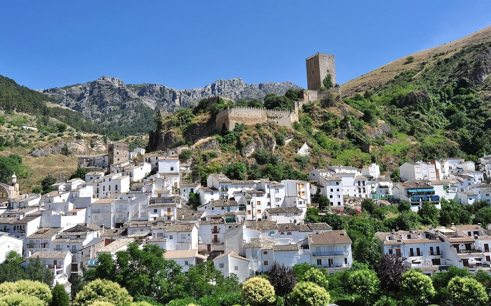01

<h3>Cazorla (Jaén)</h3>
La puerta de entrada a la Sierra de Cazorla, el mayor espacio protegido de España, con el castillo de la Yedra sobre el pueblo. Representa a <strong>Andalucía</strong>. <a href="/blog/cazorla-que-ver.html">Ver qué visitar →</a>

</li>
<li class="gcard reveal">
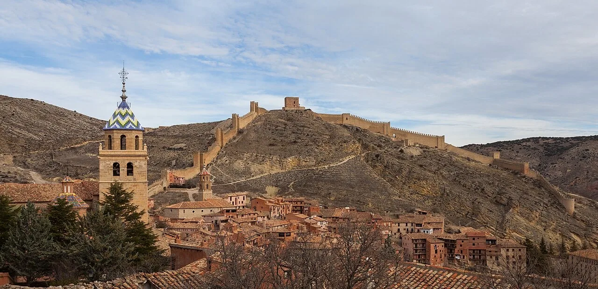02

<h3>Albarracín (Teruel)</h3>
Murallas sobre el pueblo, casas rojizas colgadas del río Guadalaviar y los Pinares de Rodeno. Representa a <strong>Aragón</strong>. <a href="/blog/albarracin-que-ver.html">Ver qué visitar →</a>

</li>
<li class="gcard reveal">
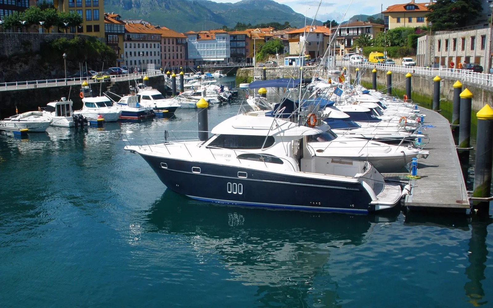03

<h3>Llanes (Asturias)</h3>
Los Cubos de la Memoria, el paseo de San Pedro y un casco antiguo con muralla junto al mar. Representa a <strong>Asturias</strong>. <a href="/blog/llanes-que-ver.html">Ver qué visitar →</a>

</li>
<li class="gcard reveal">
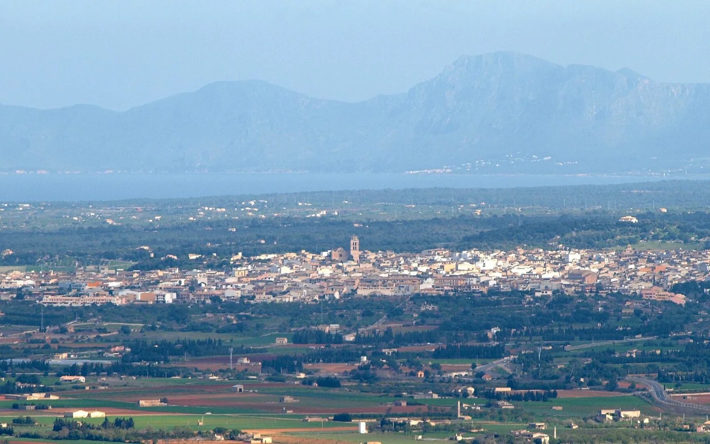04

<h3>Muro (Mallorca)</h3>
En el norte de Mallorca, junto al humedal de s'Albufera y la playa de Muro, con su fiesta de Sant Antoni. Representa a las <strong>Illes Balears</strong>. <a href="/blog/muro-mallorca-que-ver.html">Ver qué visitar →</a>

</li>
<li class="gcard reveal">
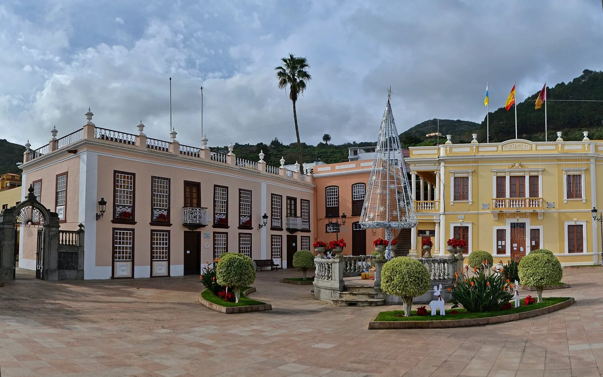05

<h3>Villa de Mazo (La Palma)</h3>
Los primeros petroglifos hallados en Canarias, un museo del Corpus y mercadillo cada fin de semana. Representa a <strong>Canarias</strong>. <a href="/blog/villa-de-mazo-que-ver.html">Ver qué visitar →</a>

</li>
<li class="gcard reveal">
06

<h3>Potes (Cantabria)</h3>
El pueblo de los puentes en el corazón de Liébana, a los pies de los Picos de Europa, con el monasterio de Santo Toribio al lado. Representa a <strong>Cantabria</strong>. <a href="/blog/potes-santo-toribio-de-liebana.html">Ver qué visitar →</a>

</li>
<li class="gcard reveal">
07

<h3>Almagro (Ciudad Real)</h3>
Su Plaza Mayor con galerías verdes y el único corral de comedias del Siglo de Oro que sigue en uso. Representa a <strong>Castilla-La Mancha</strong>. <a href="/blog/almagro-que-ver.html">Ver qué visitar →</a>

</li>
<li class="gcard reveal">
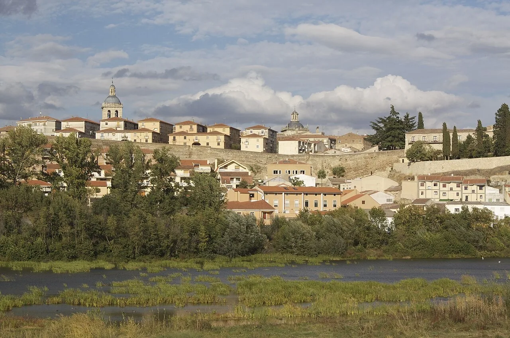08

<h3>Ciudad Rodrigo (Salamanca)</h3>
Murallas que se pueden recorrer, una catedral con marcas de cañonazos y el famoso Carnaval del Toro. Representa a <strong>Castilla y León</strong>. <a href="/blog/ciudad-rodrigo-que-ver.html">Ver qué visitar →</a>

</li>
<li class="gcard reveal">
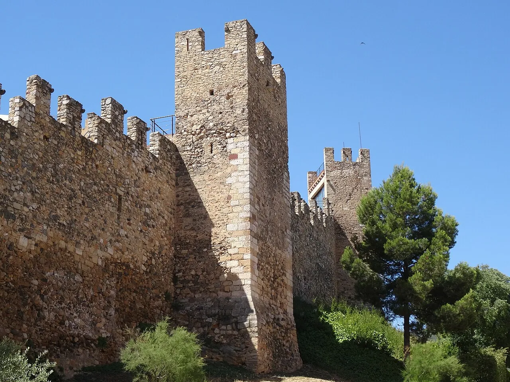09

<h3>Montblanc (Tarragona)</h3>
La villa amurallada donde, según la leyenda, Sant Jordi mató al dragón. Representa a <strong>Cataluña</strong>. <a href="/blog/montblanc-que-ver.html">Ver qué visitar →</a>

</li>
<li class="gcard reveal">
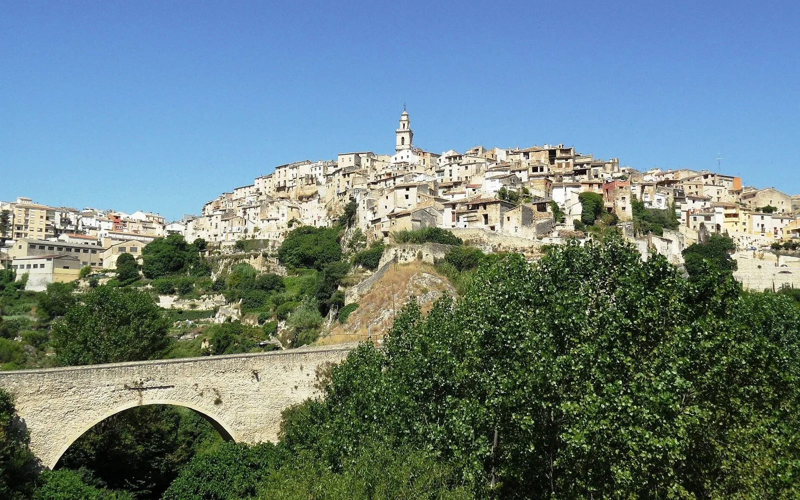10

<h3>Bocairent (Valencia)</h3>
Las misteriosas Covetes dels Moros y una plaza de toros excavada en la roca. Representa a la <strong>Comunitat Valenciana</strong>. <a href="/blog/bocairent-que-ver.html">Ver qué visitar →</a>

</li>
<li class="gcard reveal">
11

<h3>Olivenza (Badajoz)</h3>
El pueblo español que fue portugués, con calles empedradas en blanco y negro y azulejos lusos. Representa a <strong>Extremadura</strong>. <a href="/blog/olivenza-que-ver.html">Ver qué visitar →</a>

</li>
<li class="gcard reveal">
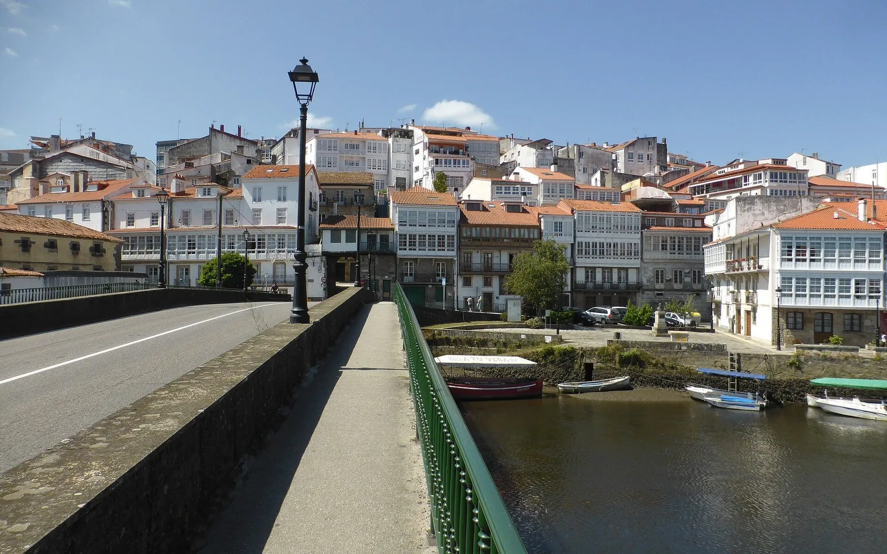12

<h3>Betanzos (A Coruña)</h3>
Iglesias góticas, casco medieval y el globo de papel de San Roque cada 16 de agosto. Representa a <strong>Galicia</strong>. <a href="/blog/betanzos-que-ver.html">Ver qué visitar →</a>

</li>
<li class="gcard reveal">
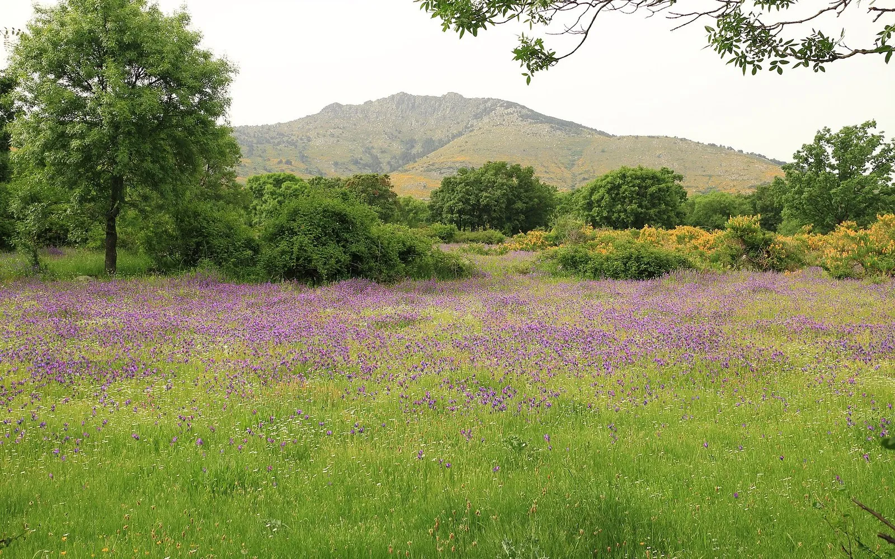13

<h3>Los Molinos (Madrid)</h3>
Pueblo serrano de la Sierra de Guadarrama con antiguos molinos y villas de veraneo. Representa a la <strong>Comunidad de Madrid</strong>. <a href="/blog/los-molinos-que-ver.html">Ver qué visitar →</a>

</li>
<li class="gcard reveal">
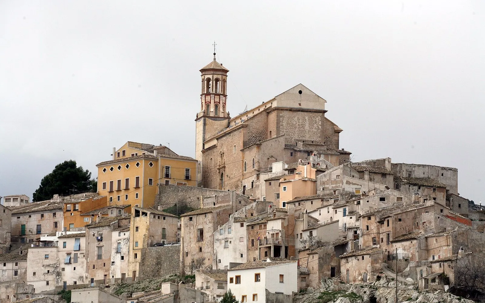14

<h3>Cehegín (Murcia)</h3>
Un casco antiguo con más de cien escudos y las ruinas romanas y visigodas de Begastri. Representa a la <strong>Región de Murcia</strong>. <a href="/blog/cehegin-que-ver.html">Ver qué visitar →</a>

</li>
<li class="gcard reveal">
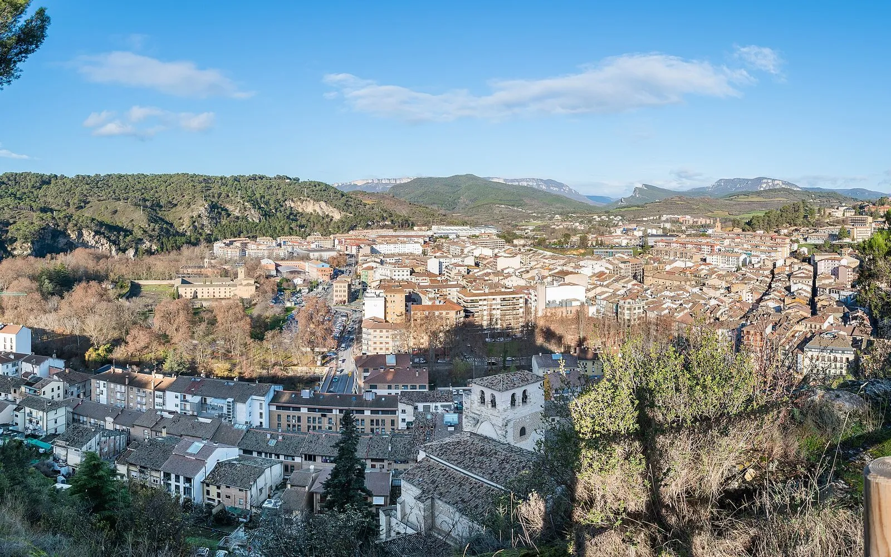15

<h3>Estella-Lizarra (Navarra)</h3>
El «Toledo del Norte»: palacio románico e iglesias medievales en pleno Camino de Santiago. Representa a <strong>Navarra</strong>. <a href="/blog/estella-lizarra-que-ver.html">Ver qué visitar →</a>

</li>
<li class="gcard reveal">
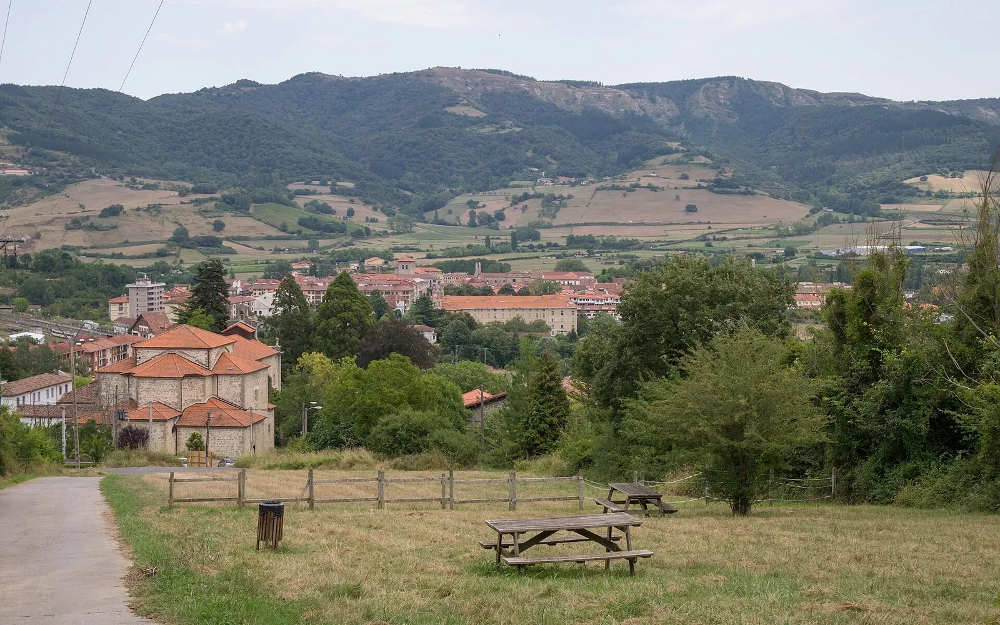16

<h3>Urduña/Orduña (Bizkaia)</h3>
La única ciudad de Bizkaia, con su Plaza de los Fueros y el salto del Nervión muy cerca. Representa al <strong>País Vasco</strong>. <a href="/blog/orduna-que-ver.html">Ver qué visitar →</a>

</li>
<li class="gcard reveal">
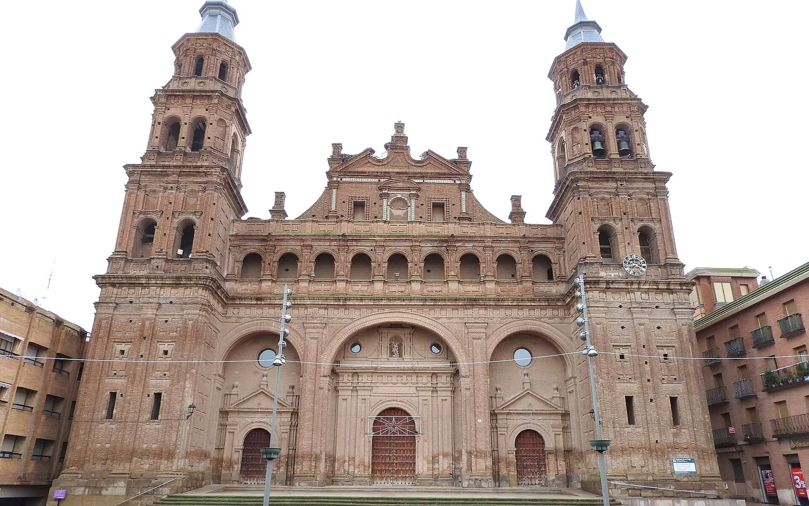17

<h3>Alfaro (La Rioja)</h3>
La ciudad de las cigüeñas: cientos de nidos sobre su Colegiata barroca. Representa a <strong>La Rioja</strong>. <a href="/blog/alfaro-que-ver.html">Ver qué visitar →</a>

</li>
</ol>

Cómo funciona<h2>Cómo votar paso a paso</h2>

<ol class="checklist" style="margin:0 0 1rem;"><li><strong>Entra en la <a href="https://www.ferrerorocher.com/es/es/xp/navidaddeoro/votar/" target="_blank" rel="noopener">página oficial para votar</a></strong> de la campaña «Juntos brillamos más» de Ferrero Rocher (ferrerorocher.com).</li><li><strong>Elige comunidad y pueblo</strong> en el desplegable.</li><li><strong>Marca las casillas</strong>: que eres mayor de 18 años y que aceptas las bases y la política de privacidad (la de recibir publicidad es opcional).</li><li><strong>Pulsa «Vota».</strong> Solo puedes votar <strong>un pueblo por fase</strong>, hasta 4 veces en total.</li><li><strong>Vuelve en cada fase:</strong> según Ferrero, los votos <strong>se acumulan</strong> entre fases, así que cada voto cuenta hasta el final.</li></ol>

<a class="btn" href="https://www.ferrerorocher.com/es/es/xp/navidaddeoro/votar/" target="_blank" rel="noopener">🗳️ Ir a la votación oficial de Ferrero Rocher</a>

En 2025 ganó <strong>Tejeda</strong>, en Gran Canaria, y en 2024, <a href="/blog/ribadavia-que-ver.html">Ribadavia</a>, en Ourense.

<h3>🎄 Aunque no gane tu favorito</h3>
Todos estos pueblos se visten de Navidad a su manera y son una escapada perfecta en diciembre. Además, en temporada baja hay menos gente y el alojamiento es más barato.

Si buscas más planes de estas fechas, mira mi guía de <a href="/blog/navidad-en-madrid.html">Navidad en Madrid</a>, las <a href="/blog/luces-navidad-vigo.html">luces de Navidad de Vigo</a> o las <a href="/blog/magicas-navidades-torrejon.html">Mágicas Navidades de Torrejón</a>.

🎄 <strong>Más Navidad en España:</strong> <a href="/blog/navidad-en-madrid.html">Madrid</a> · <a href="/blog/cortylandia-2026.html">Cortylandia</a> · <a href="/blog/magicas-navidades-torrejon.html">Mágicas Navidades de Torrejón</a> · <a href="/blog/navidad-en-barcelona.html">Barcelona</a> · <a href="/blog/navidad-en-sevilla.html">Sevilla</a> · <a href="/blog/navidad-en-valencia.html">Valencia</a> · <a href="/blog/navidad-en-palma.html">Palma</a> · <a href="/blog/navidad-en-zaragoza.html">Zaragoza</a> · <a href="/blog/navidad-en-malaga.html">Málaga</a> · <a href="/blog/luces-navidad-vigo.html">luces de Vigo</a> · <a href="/blog/belen-viviente-buitrago-del-lozoya.html">Belén viviente de Buitrago</a>.

<!--faq-->

<h2>¿Te gustan estos planes?</h2>
Sígueme en Instagram como <a href="https://www.instagram.com/chenoaventuras/" target="_blank" rel="noopener">@chenoaventuras</a>: subo escapadas como esta cada semana.
<a class="btn guide__btn" href="/blog.html">Ver más planes en el blog</a>

Lista de candidatos y calendario de la edición 2026 publicados por Ferrero Rocher y recogidos por Marketing Directo (10 de noviembre de 2026) y Retail Actual (6 de noviembre de 2026). Las fechas pueden cambiar: consúltalas en la web oficial de la campaña. Las fotos son las de la guía de cada pueblo en este blog (con sus créditos en cada post).

