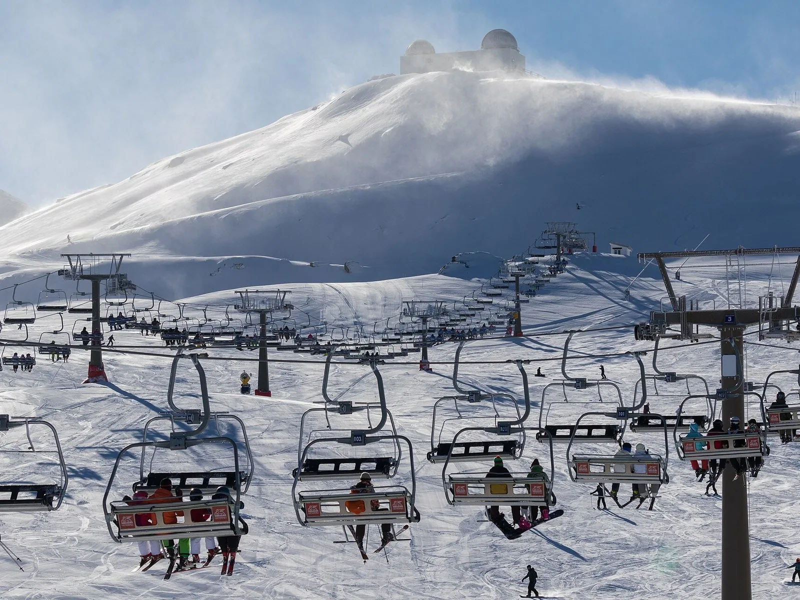
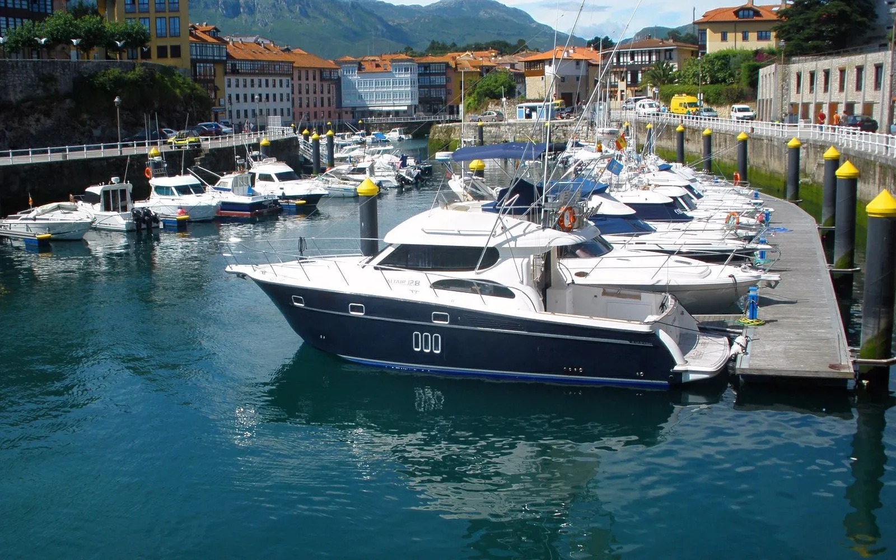
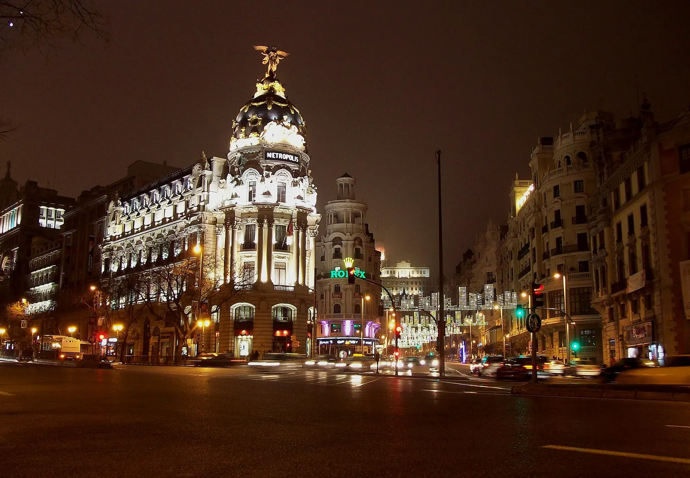
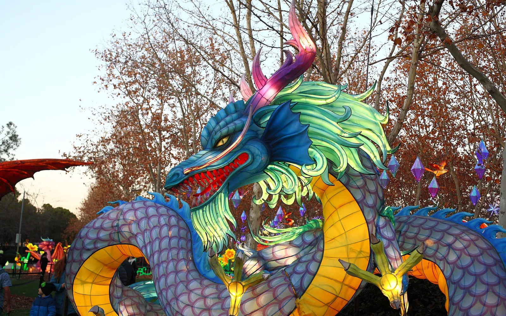
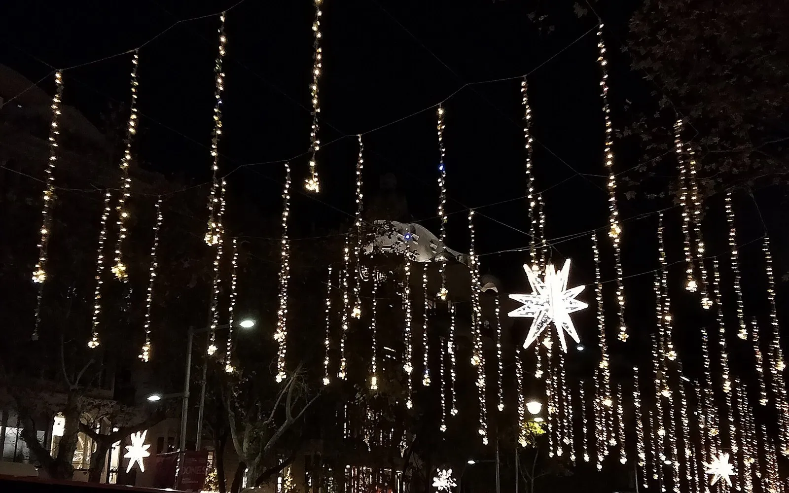
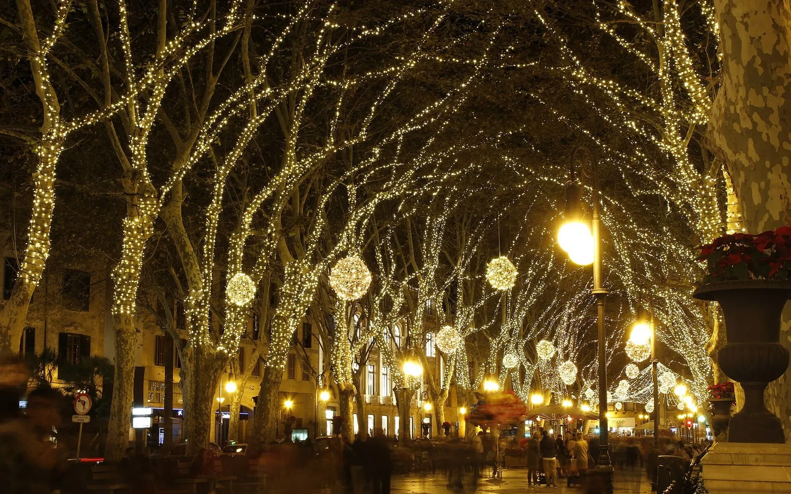

El **puente de diciembre de 2026** viene con regalo para media España: el **6 de diciembre cae en domingo** y varias comunidades pasan el festivo al **lunes 7**. Con la **Inmaculada el martes 8**, salen **cuatro días seguidos**, del sábado 5 al martes 8.

Te cuento dónde es festivo cada día según el BOE y seis escapadas para aprovecharlo 👇

En un vistazo<h2>Lo que vas a encontrar</h2>

<b>📅</b>Del 5 al 8 de diciembre

<b>🗓️</b>Festivos por comunidad

<b>🎿</b>Nieve

<b>🎄</b>Pueblos de Navidad

<b>✨</b>Luces y mercados

Festivos<h2>¿Es festivo el lunes 7 de diciembre de 2026?</h2>
Según el calendario de fiestas laborales de 2026 publicado en el BOE.

<h3>✅ Puente de 4 días (5-8 dic)</h3>
El lunes 7 es festivo en <strong>Andalucía, Aragón, Asturias, Cantabria, Castilla y León, Extremadura, Madrid, Murcia, La Rioja y Melilla</strong>.

<h3>➖ Solo el martes 8</h3>
En <strong>Baleares, Canarias, Castilla-La Mancha, Cataluña, Galicia, Navarra, País Vasco, Comunitat Valenciana y Ceuta</strong> el lunes 7 se trabaja (salvo fiesta local).

<ul class="guide__prices"><li>Domingo 6<b>Día de la Constitución (cae en domingo)</b></li><li>Lunes 7<b>Festivo en 9 comunidades y Melilla</b></li><li>Martes 8<b>Inmaculada: festivo en toda España</b></li></ul>
Si en tu comunidad el lunes es laborable, cogerte ese día libre también te da cuatro días seguidos.

Escapadas<h2>Seis escapadas para el puente de diciembre</h2>

<ol class="guide__grid guide__grid--cuenca">
<li class="gcard reveal">
01

<h3>Estrenar la temporada de esquí</h3>
Formigal-Panticosa y Cerler abren el 27 de noviembre, Baqueira y Sierra Nevada apuntan al 28, y Andorra y La Molina, al 4 de diciembre. Mira las <a href="/blog/apertura-estaciones-esqui-2026.html">fechas de apertura de cada estación</a>.

</li>
<li class="gcard reveal">
02

<h3>Un pueblo candidato de Ferrero Rocher</h3>
Llanes, Albarracín, Potes, Almagro, Cazorla… Los <a href="/blog/pueblo-navidad-ferrero-rocher-2026.html">17 pueblos de la Navidad de Ferrero Rocher</a> son escapadas perfectas, y el ganador se conoce el 14 de diciembre.

</li>
<li class="gcard reveal">
03

<h3>Las luces de Madrid y Cortylandia</h3>
Luces desde el 21 de noviembre, mercado de la Plaza Mayor y <a href="/blog/cortylandia-2026.html">Cortylandia</a> con pases todo el día. Todo en mi guía de <a href="/blog/navidad-en-madrid.html">Navidad en Madrid</a>.

</li>
<li class="gcard reveal">
04

<h3>Mágicas Navidades de Torrejón</h3>
El gran parque navideño junto a Madrid. En el puente la entrada general es de <strong>10 €</strong> y el lunes 7 cierra a medianoche. Horarios y precios en <a href="/blog/magicas-navidades-torrejon.html">Mágicas Navidades de Torrejón</a>.

</li>
<li class="gcard reveal">
05

<h3>Mercados de Navidad de Barcelona</h3>
La Fira de Santa Llúcia junto a la catedral, el mercado de la Sagrada Família y las luces del Passeig de Gràcia. Ojo: en Cataluña el lunes 7 no es festivo. Más en <a href="/blog/navidad-en-barcelona.html">Navidad en Barcelona</a>.

</li>
<li class="gcard reveal">
06

<h3>Una ciudad con luces y belenes</h3>
<a href="/blog/navidad-en-palma.html">Palma</a>, <a href="/blog/navidad-en-sevilla.html">Sevilla</a>, <a href="/blog/navidad-en-malaga.html">Málaga</a>, <a href="/blog/navidad-en-valencia.html">Valencia</a> o <a href="/blog/luces-navidad-vigo.html">Vigo</a>: todas tienen ya las luces encendidas o a punto, con mercados y belenes.

</li>
</ol>

<!--actividades-->

Consejos de Cheno<h2>Para aprovechar el puente</h2><ul><li><b>Reserva ya</b>: es uno de los fines de semana con más demanda del año.</li><li><b>Sal el viernes por la tarde</b> o el sábado temprano para evitar los atascos de salida.</li><li><b>Vuelve el lunes</b> si en tu comunidad solo es festivo el martes: el martes por la tarde hay mucho tráfico de vuelta.</li><li><b>Si vas a la nieve</b>, lleva cadenas y mira el parte de la estación antes de salir.</li></ul>

🎄 <strong>Más Navidad en España:</strong> <a href="/blog/navidad-en-madrid.html">Madrid</a> · <a href="/blog/cortylandia-2026.html">Cortylandia</a> · <a href="/blog/magicas-navidades-torrejon.html">Mágicas Navidades de Torrejón</a> · <a href="/blog/navidad-en-barcelona.html">Barcelona</a> · <a href="/blog/navidad-en-valencia.html">Valencia</a> · <a href="/blog/navidad-en-sevilla.html">Sevilla</a> · <a href="/blog/navidad-en-zaragoza.html">Zaragoza</a> · <a href="/blog/navidad-en-malaga.html">Málaga</a> · <a href="/blog/navidad-en-palma.html">Palma</a> · <a href="/blog/luces-navidad-vigo.html">luces de Vigo</a> · <a href="/blog/belen-viviente-buitrago-del-lozoya.html">Belén viviente de Buitrago</a> · <a href="/blog/pueblo-navidad-ferrero-rocher-2026.html">Pueblo Navidad Ferrero Rocher</a>.

<!--faq-->

<h2>¿Te gustan estos planes?</h2>
Sígueme en Instagram como <a href="https://www.instagram.com/chenoaventuras/" target="_blank" rel="noopener">@chenoaventuras</a>: subo escapadas como esta cada semana.
<a class="btn guide__btn" href="/blog.html">Ver más planes en el blog</a>

Festivos según la <a href="https://www.boe.es/diario_boe/txt.php?id=BOE-A-2025-21667" target="_blank" rel="noopener">Resolución de 17 de octubre de 2025 de la Dirección General de Trabajo (BOE)</a>, con la relación de fiestas laborales de 2026; no incluye fiestas locales. Fechas de esquí y eventos según cada post enlazado (consultadas en noviembre de 2026). Fotos de Wikimedia Commons: <a href="https://commons.wikimedia.org/wiki/File%3AAlbarrac%C3%ADn%2C_Teruel%2C_Espa%C3%B1a%2C_2014-01-10%2C_DD_051.JPG" target="_blank" rel="noopener">Diego Delso</a> (CC BY-SA 3.0) · <a href="https://commons.wikimedia.org/wiki/File:Sierra_Nevada_-_Telesilla,_Pradollano.jpg" target="_blank" rel="noopener">Werner Wilmes</a> (CC BY 2.0) · <a href="https://commons.wikimedia.org/wiki/File:Llanes_-_Puerto_7.jpg" target="_blank" rel="noopener">Zarateman</a> (CC0) · <a href="https://commons.wikimedia.org/wiki/File%3ACalle_de_Alcal%C3%A1_%28Madrid%29_34.jpg" target="_blank" rel="noopener">Luis García (Zaqarbal)</a> (CC BY-SA 3.0) · <a href="https://commons.wikimedia.org/wiki/File:Magicas_Navidades_2024_-_Torrejon_de_Ardoz_-_Madrid_05.jpg" target="_blank" rel="noopener">Javier Perez Montes</a> (CC BY-SA 4.0) · <a href="https://commons.wikimedia.org/wiki/File:058_Passeig_de_Gr%C3%A0cia_(Barcelona),_il%C2%B7luminaci%C3%B3_nadalenca.jpg" target="_blank" rel="noopener">Enric</a> (CC BY 4.0) · <a href="https://commons.wikimedia.org/wiki/File:Palma_de_Mallorca_in_Christmas.jpg" target="_blank" rel="noopener">Travelinho</a> (CC BY-SA 4.0).

