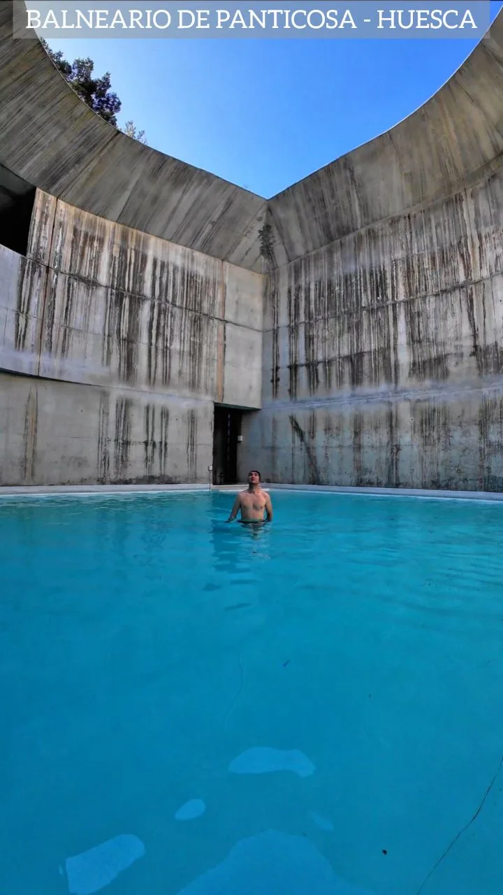
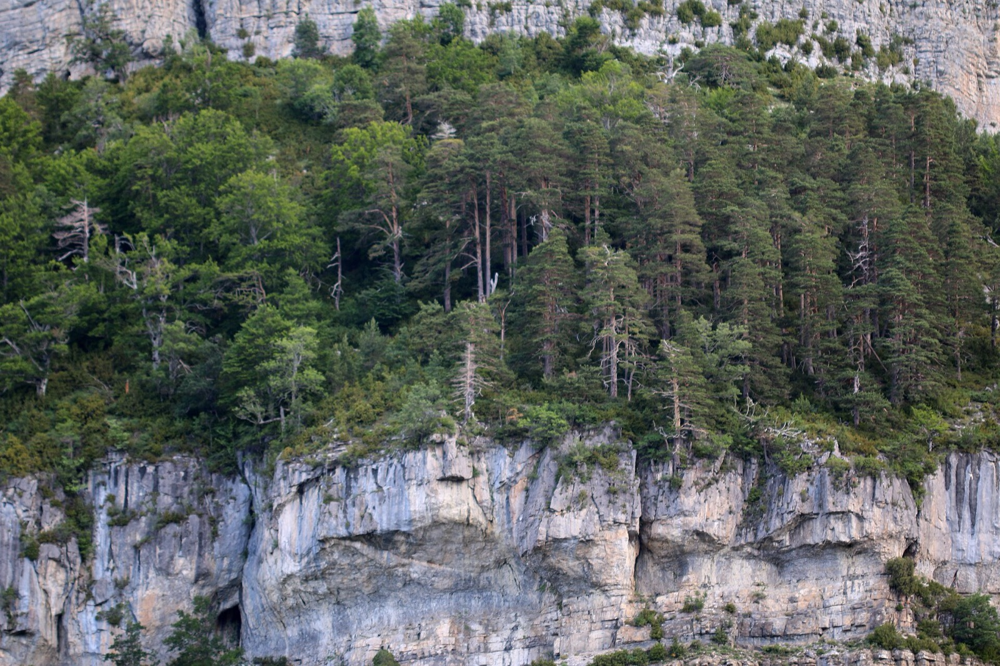
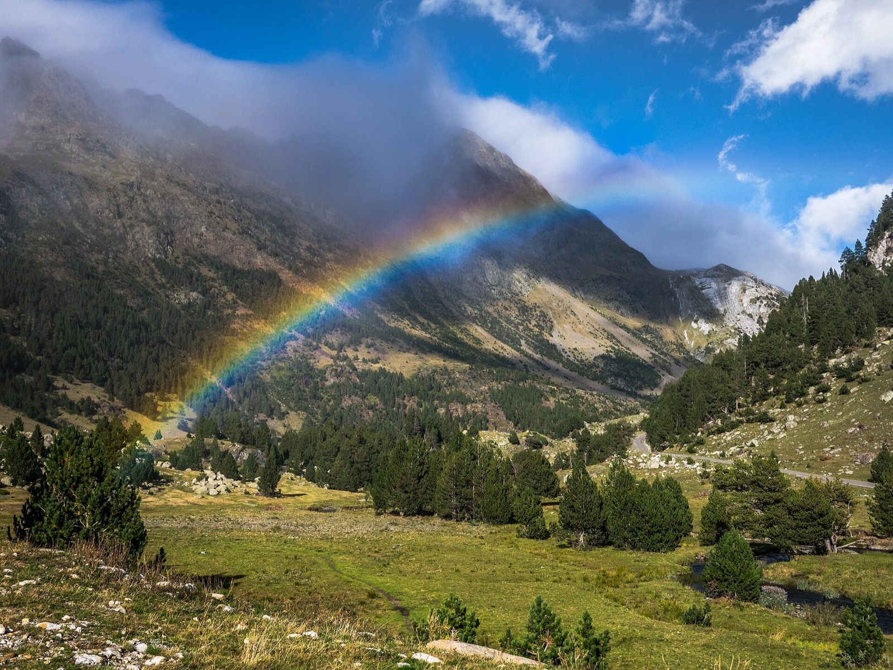
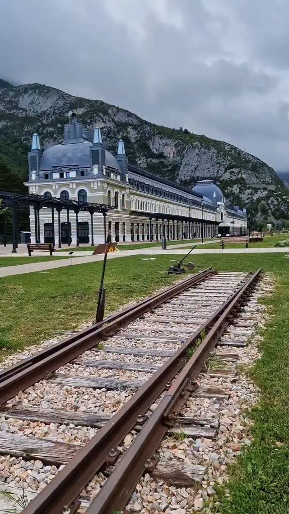
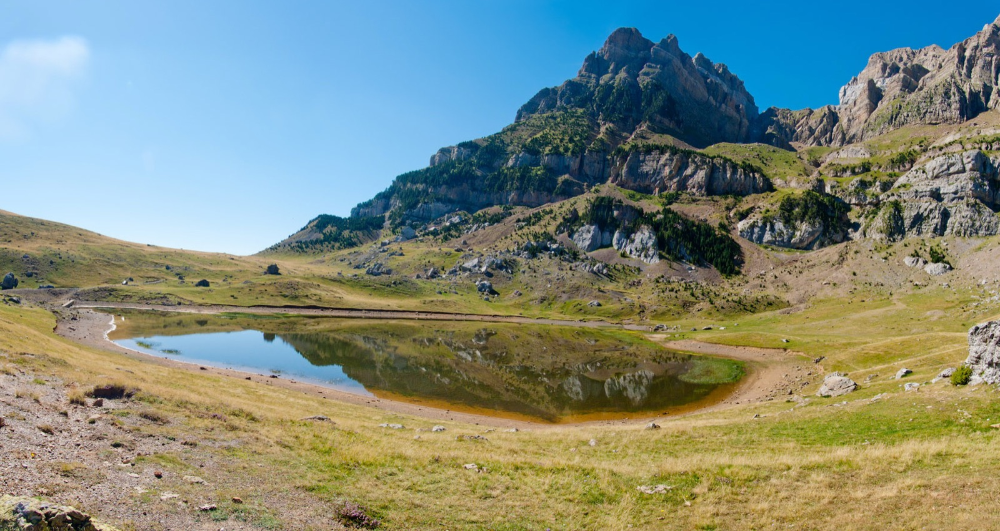
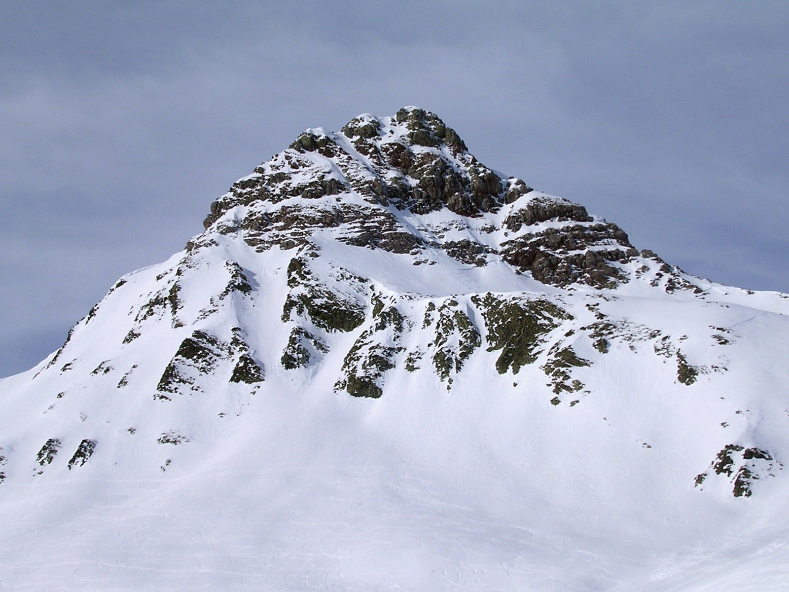
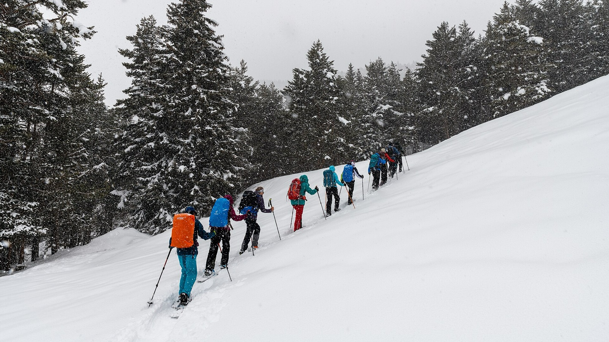

Andar sobre la nieve sin hundirte, en silencio, entre pinos y con los picos del Pirineo alrededor. Las **raquetas de nieve** son la forma más fácil de disfrutar de la montaña en invierno: no hace falta saber esquiar ni estar en gran forma.

Te dejo **siete rutas del Pirineo de Huesca**, de la más sencilla a las de nivel medio, y cómo hacerlas con guía 👇

En un vistazo<h2>Lo que vas a encontrar</h2>

<b>❄️</b>Dic – mar

<b>👨‍👩‍👧</b>Rutas para niños

<b>🥾</b>Sin experiencia

<b>🧭</b>Salidas con guía

Antes de ir<h2>Lo básico de las raquetas</h2>

<h3>📅 Cuándo</h3>
Normalmente de <strong>diciembre a marzo</strong>, según cómo venga la nieve. Mira el parte antes de salir.

<h3>🎒 Material</h3>
Raquetas y bastones se <strong>alquilan</strong> en Biescas, Panticosa, Formigal o Benasque. Botas impermeables y ropa por capas.

<h3>⚠️ Seguridad</h3>
Consulta el <strong>riesgo de aludes</strong> y el tiempo. Bajo la nieve las marcas desaparecen: lleva el track en el móvil.

<h3>💡 Mi consejo</h3>
La primera vez, ve <strong>con guía</strong>: te dejan el material y eligen la ruta según la nieve de ese día.

Rutas<h2>7 rutas con raquetas en el Pirineo aragonés</h2>

<ol class="guide__grid guide__grid--cuenca">
<li class="gcard reveal">
01

<h3>Balneario de Panticosa</h3>
Fácil1,5 km · casi llano

La más sencilla: un paseo de <strong>1,5 km</strong> con muy poco desnivel alrededor del <a href="/blog/balneario-de-panticosa.html">Balneario de Panticosa</a>, a más de 1.600 metros. Se tarda entre hora y media y dos horas con calma. Perfecta para ir con niños o para estrenarte.

</li>
<li class="gcard reveal">
02

<h3>Circuito de Gabardito</h3>
Fácil3 km · unas 2 h

En el <strong>Valle de Hecho</strong>, junto al refugio de Gabardito, que alquila el material. Un circuito de unos <strong>3 km</strong> recomendado para iniciarse, entre pinos y bajo grandes paredes de roca (en la foto, en verano).

</li>
<li class="gcard reveal">
03

<h3>Llanos del Hospital (Benasque)</h3>
Fácil6 km · unas 3 h

Una ruta circular de unos <strong>6 km</strong> desde el Hospital de Benasque por un valle ancho y llano, a los pies de los tresmiles. Sencilla y apta para niños a partir de unos 8 años. La foto es de otra época del año.

</li>
<li class="gcard reveal">
04

<h3>Canfranc: a los diques de Estiviellas</h3>
Fácil2,3 km · menos de 1 h

Desde la <a href="/blog/estacion-de-canfranc.html">estación de Canfranc</a> hasta el primer dique de Estiviellas: un circuito corto de <strong>2,3 km</strong> y unos 130 metros de desnivel. Ideal para combinarlo con la visita a la estación el mismo día.

</li>
<li class="gcard reveal">
05

<h3>Ibón de Piedrafita</h3>
Iniciación7 km · unos 250 m

En el <strong>Valle de Tena</strong>, saliendo del aparcamiento del parque Lacuniacha, en Piedrafita de Jaca. Hasta el ibón hay algo más de 3 km; el circular completo son unos 7 km. Si sigues hasta el <strong>arco geodésico</strong>, con vistas al embalse de Búbal, la ruta crece a unos 12 km y más de 500 metros de desnivel. En la foto, el ibón sin nieve.

</li>
<li class="gcard reveal">
06

<h3>Circular de O Forato (Formigal)</h3>
Media6 km · 480 m

Alrededor de la <strong>Peña Forata</strong>, encima de la estación de Formigal: unos <strong>6 km</strong> y 480 metros de desnivel, en unas 4 horas. Más exigente que las anteriores; en Formigal puedes alquilar el material.

</li>
<li class="gcard reveal">
07

<h3>Valle de Pineta</h3>
FácilVarias rutas

A los pies de la cara norte del <strong>Monte Perdido</strong>, cerca de Bielsa. Varias rutas por el fondo del valle, con poco desnivel y aptas para familias. En el refugio de Pineta alquilan raquetas y organizan salidas guiadas.

</li>
</ol>

<h3>🧭 Con guía</h3>
Si es tu primera vez, lo más cómodo es ir con guía. La <a href="https://www.getyourguide.es/senegue-espana-l290115/raquetas-de-nieve-en-el-valle-de-tena-t1148839/?partner_id=PEUGCO9&utm_medium=online_publisher" target="_blank" rel="noopener sponsored">salida con raquetas por el Valle de Tena de GetYourGuide</a> dura unas 3 horas, en grupos de máximo 8, con guía de media montaña y recogida incluida; eligen la ruta (Portalet, Sallent o Biescas) según la nieve. El <a href="https://www.civitatis.com/es/biescas/paseo-raquetas-nieve-valle-tena/?aid=110968" target="_blank" rel="noopener sponsored">paseo con raquetas desde Biescas de Civitatis</a> es más largo, unas 5 horas, desde unos 60 €, con raquetas, bastones y fotos (mayores de 12 años). Hoy todavía no tiene fechas: se abren cuando empieza la temporada. Para completar el día, la <a href="https://www.civitatis.com/es/canfranc-estacion/visita-guiada-estacion-canfranc/?aid=110968" target="_blank" rel="noopener sponsored">visita guiada por la estación de Canfranc</a>.

<!--actividades-->

Consejos de Cheno<h2>Un fin de semana de raquetas</h2><ul><li><b>Sábado por la mañana</b>: salida guiada con raquetas por el Valle de Tena.</li><li><b>Sábado por la tarde</b>: baño termal en el Balneario de Panticosa o paseo por el pueblo de Panticosa.</li><li><b>Domingo</b>: ruta corta por tu cuenta, al ibón de Piedrafita o en Canfranc.</li><li><b>Antes de volver</b>: la estación de Canfranc y Jaca. Más ideas en mi guía del <a href="/blog/pirineo-aragones-que-ver.html">Pirineo aragonés</a>.</li></ul>

<!--faq-->

<h2>¿Te gustan estos planes?</h2>
Sígueme en Instagram como <a href="https://www.instagram.com/chenoaventuras/" target="_blank" rel="noopener">@chenoaventuras</a>: subo escapadas como esta cada semana.
<a class="btn guide__btn" href="/blog.html">Ver más planes en el blog</a>

Información consultada el 9 de noviembre de 2026. Las distancias y desniveles son orientativos y cambian con la nieve; consulta el parte meteorológico y el boletín de aludes antes de salir. La foto de la portada es una imagen genérica de raquetas de nieve, no del Pirineo, y varias fotos de las rutas son de verano. Fotos de Wikimedia Commons: <a href="https://commons.wikimedia.org/wiki/File:Snowshoe-Hiking_in_Snowfall.jpg" target="_blank" rel="noopener">Christoph Strässler</a> (CC BY-SA 2.0) · <a href="https://commons.wikimedia.org/wiki/File:Pico_Royo_(Formigal).jpg" target="_blank" rel="noopener">Autor desconocido</a> (CC BY-SA 3.0) · <a href="https://commons.wikimedia.org/wiki/File:Ib%C3%B3n_de_piedrafita_1.jpg" target="_blank" rel="noopener">Kunzuilh</a> (CC BY 3.0) · <a href="https://commons.wikimedia.org/wiki/File:Benasque_-_Llanos_del_Hospital_01.jpg" target="_blank" rel="noopener">Basotxerri</a> (CC BY-SA 4.0) · <a href="https://commons.wikimedia.org/wiki/File:Gabardito_-_Flickr_-_S._Rae.jpg" target="_blank" rel="noopener">S. Rae from Scotland, UK</a> (CC BY 2.0)

