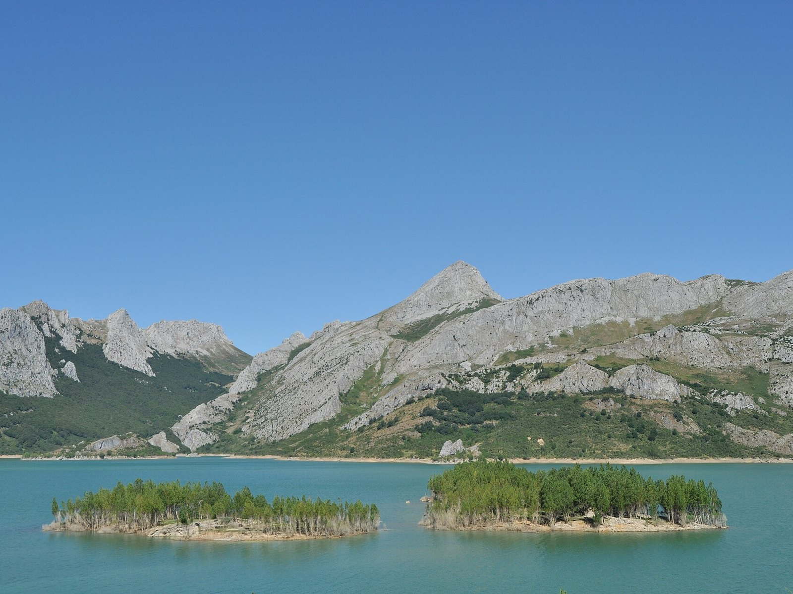
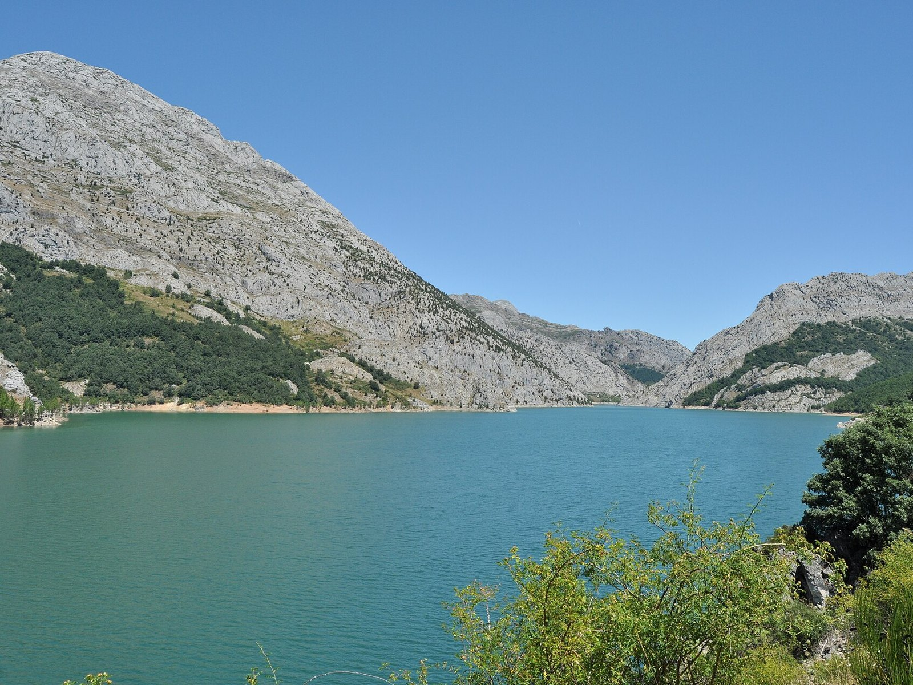
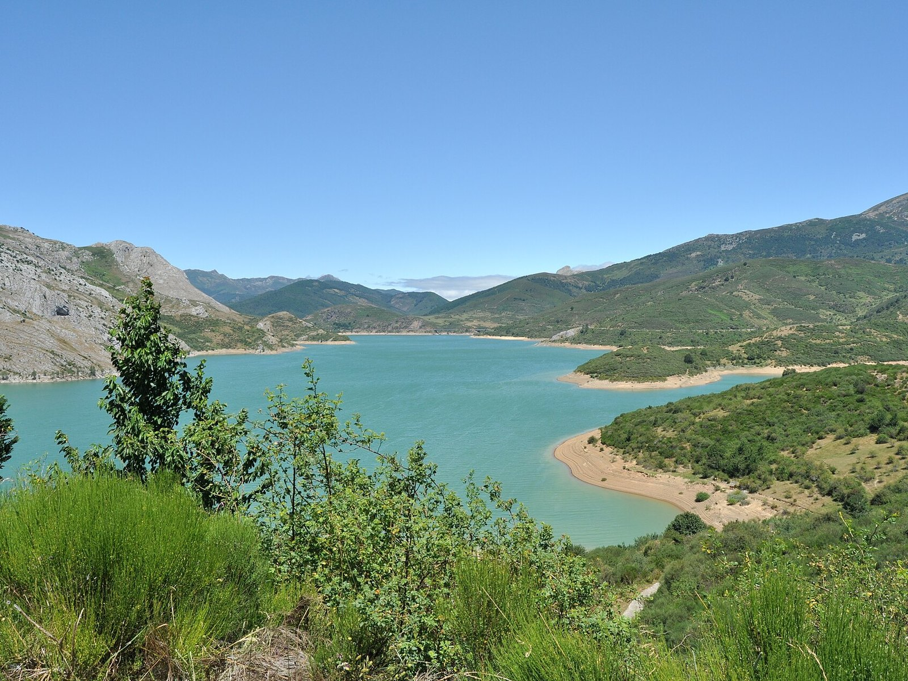
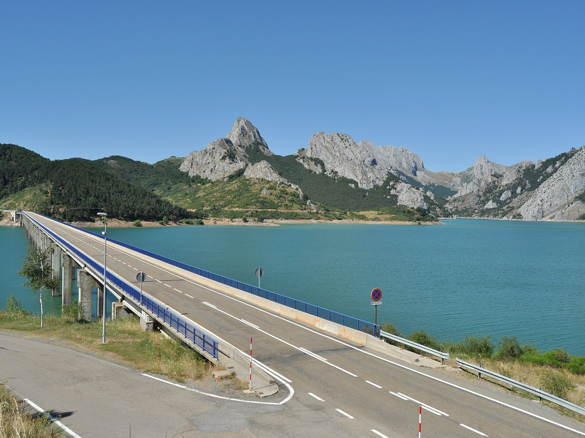
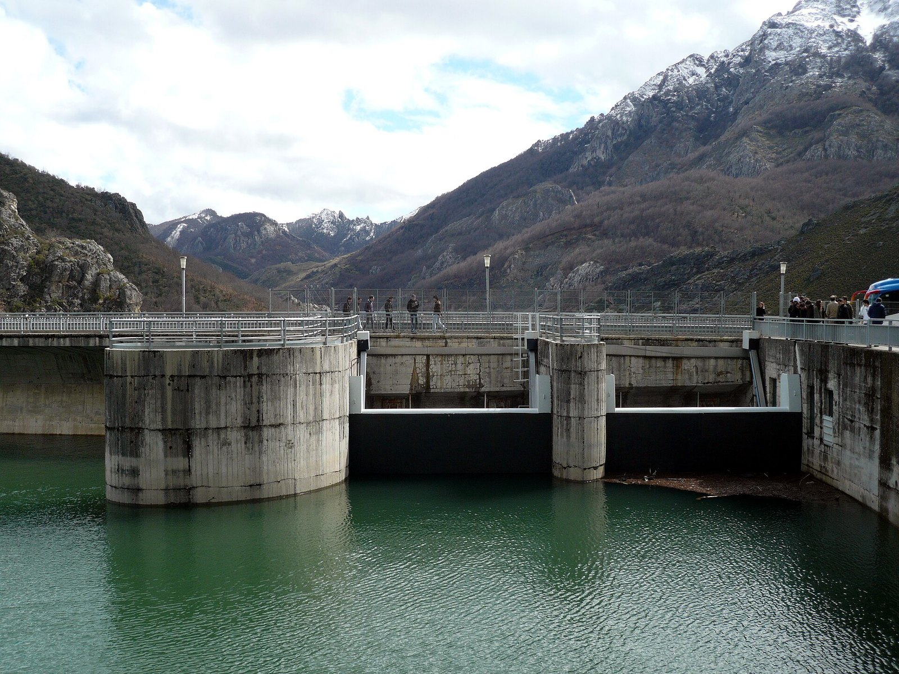
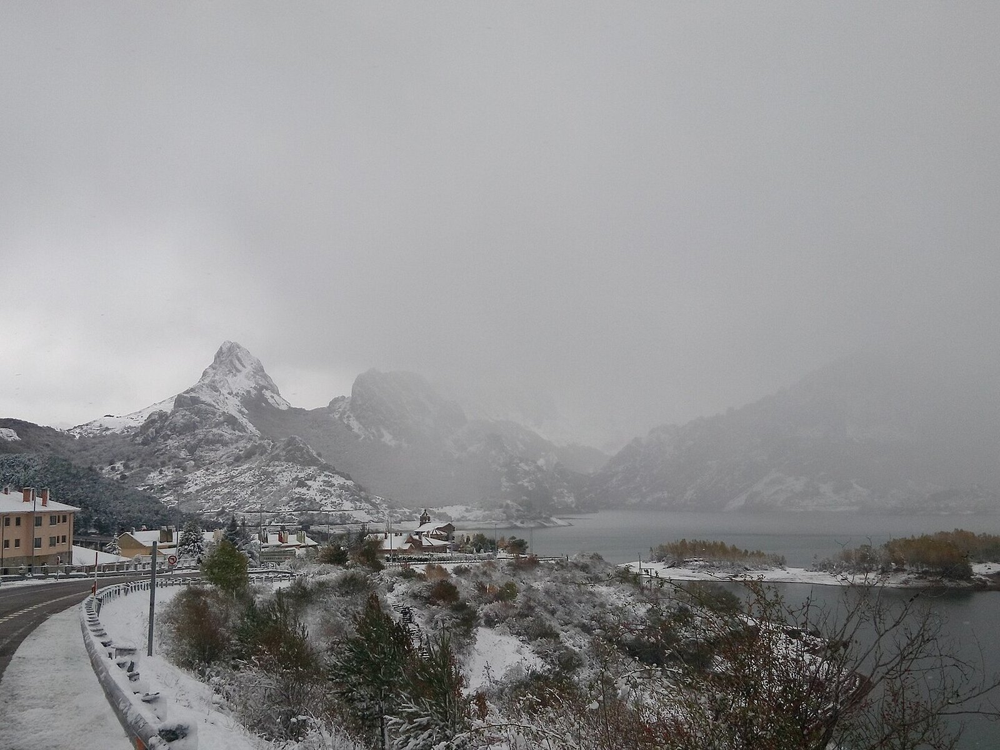

En el norte de León, entre picos calizos de más de 2.000 metros, un embalse de agua azul se mete por varios valles a la vez. Desde los miradores parece **Noruega**, y por eso lo llaman los **«fiordos leoneses»**. Pero bajo esa postal hay una historia dura: en **1987**, para llenar el pantano, se desalojaron e inundaron **nueve pueblos**, entre ellos el Riaño antiguo.

Te cuento qué ver, dónde están los mejores miradores y lo que pasó con los pueblos sumergidos 👇

En un vistazo<h2>Lo que vas a encontrar</h2>

<b>🏞️</b>Fiordos leoneses

<b>🏔️</b>Picos de 2.000 m

<b>👀</b>Miradores

<b>⛪</b>Iglesias trasladadas

<b>🚣</b>Barco y kayak

Antes de ir<h2>Lo básico de Riaño</h2>

<h3>📍 Dónde está</h3>
En el noreste de <strong>León</strong>, en el Parque Regional Montaña de Riaño y Mampodre, junto a los Picos de Europa.

<h3>💧 El nivel del agua</h3>
El embalse no siempre está lleno: tras veranos secos baja mucho. La mejor época para verlo lleno suele ser la <strong>primavera</strong>.

<h3>❄️ En invierno</h3>
Nieva a menudo y las montañas se cubren de blanco. Revisa el estado de las carreteras y lleva cadenas.

Qué ver<h2>Qué ver en Riaño</h2>

<ol class="guide__grid guide__grid--cuenca">
<li class="gcard reveal">
01

<h3>El embalse</h3>
Agua azul turquesa, pequeñas islas con árboles y montañas de roca que caen al agua. Cada curva de la carretera es una postal.

</li>
<li class="gcard reveal">
02

<h3>Las montañas</h3>
Paredes de caliza caen directas al agua. La más famosa es el <strong>pico Gilbo</strong>, de forma piramidal, al que llaman el «Cervino leonés» y que tiene una ruta de subida con vistas increíbles.

</li>
<li class="gcard reveal">
03

<h3>Los miradores</h3>
El de <strong>Las Hazas</strong>, junto al pueblo, es el más visitado y tiene un columpio con vistas. El del <strong>Alto de Valcayo</strong> da la panorámica más amplia.

</li>
<li class="gcard reveal">
04

<h3>Los puentes</h3>
Las carreteras cruzan el embalse por largos viaductos. Para un momento en los apartaderos: las vistas desde el agua son de las mejores.

</li>
<li class="gcard reveal">
05

<h3>La presa</h3>
Cerró el valle en <strong>1987</strong>. Asomarse a sus compuertas, con las montañas detrás, ayuda a entender el tamaño de la obra.

</li>
<li class="gcard reveal">
06

<h3>Riaño en invierno</h3>
Con nieve en las cumbres y niebla sobre el agua, el paisaje cambia por completo. Hay mucha menos gente.

</li>
</ol>

Historia<h2>Los nueve pueblos bajo el agua</h2>

El embalse se proyectó en los años sesenta para regar las tierras del sur, pero la presa no se cerró hasta <strong>1987</strong>, tras años de protestas. Los vecinos de <strong>nueve pueblos</strong> tuvieron que marcharse y sus casas fueron derribadas antes de llenar el pantano. El Riaño de hoy es un pueblo nuevo, construido en la ladera.

Algunas cosas se salvaron: la iglesia de <strong>Nuestra Señora del Rosario</strong>, del pueblo de La Puerta, y la de <strong>Santa Águeda</strong>, de Pedrosa del Rey, se trasladaron piedra a piedra al nuevo Riaño. En el pueblo hay también un <strong>hórreo</strong> traído de Salio y un museo en recuerdo de los pueblos anegados.

<h3>🚣 En el agua</h3>
En temporada (de primavera a otoño) hay <strong>paseos en barco</strong> y alquiler de <strong>kayaks y paddle surf</strong>. Ver los fiordos desde el agua es otra experiencia.

Cómo llegar<h2>Cómo llegar a Riaño</h2>

En coche: a algo más de <strong>hora y media de León</strong> por la N-621 y la N-625, y a unas dos horas de Santander, cruzando los Picos de Europa. No hay transporte público práctico: necesitas coche.

<a class="btn guide__mapbtn" href="https://www.google.com/maps/dir/?api=1&destination=42.9773,-5.0039" target="_blank" rel="noopener"><svg class="ico" viewBox="0 0 24 24" width="15" height="15" aria-hidden="true" fill="currentColor"><path d="M12 2a7 7 0 0 0-7 7c0 5.25 7 13 7 13s7-7.75 7-13a7 7 0 0 0-7-7zm0 9.5a2.5 2.5 0 1 1 0-5 2.5 2.5 0 0 1 0 5z"/></svg> Cómo llegar en Google Maps</a>

Combínalo con <a href="/blog/leon-que-ver.html">León</a> y la <a href="/blog/valporquero-que-ver.html">Cueva de Valporquero</a>, o cruza a Cantabria por los Picos de Europa hasta <a href="/blog/potes-santo-toribio-de-liebana.html">Potes</a>.

Consejos de Cheno<h2>Para disfrutarlo al máximo</h2><ul><li><b>Ve al amanecer o al atardecer</b>: la luz sobre el agua es lo mejor.</li><li><b>Mira el nivel del embalse</b> antes de ir: lleno es mucho más bonito.</li><li><b>Para en los apartaderos</b>, nunca en mitad de los puentes.</li><li><b>Lleva abrigo</b>: incluso en verano refresca al caer la tarde.</li></ul>

<!--faq-->

<h2>¿Te gustan estos planes?</h2>
Sígueme en Instagram como <a href="https://www.instagram.com/chenoaventuras/" target="_blank" rel="noopener">@chenoaventuras</a>: subo escapadas como esta cada semana.
<a class="btn guide__btn" href="/blog.html">Ver más planes en el blog</a>

Información consultada en noviembre de 2026 (eldiario.es, Guía Repsol y webs de turismo de Castilla y León). Fotos de Wikimedia Commons: <a href="https://commons.wikimedia.org/wiki/File:Ria%C3%B1o.Le%C3%B3n._(6305152783).jpg" target="_blank" rel="noopener">Miguel Ángel García</a> (CC BY 2.0) · <a href="https://commons.wikimedia.org/wiki/File:Embalse_de_Ria%C3%B1o_-_006.jpg" target="_blank" rel="noopener">Luis Rogelio HM</a> (CC BY-SA 2.0) · <a href="https://commons.wikimedia.org/wiki/File:Embalse_de_Ria%C3%B1o_-_003.jpg" target="_blank" rel="noopener">Luis Rogelio HM</a> (CC BY-SA 2.0) · <a href="https://commons.wikimedia.org/wiki/File:Embalse_de_Ria%C3%B1o_-_001.jpg" target="_blank" rel="noopener">Luis Rogelio HM</a> (CC BY-SA 2.0) · <a href="https://commons.wikimedia.org/wiki/File:Embalse_de_Ria%C3%B1o_-_008.jpg" target="_blank" rel="noopener">Luis Rogelio HM</a> (CC BY-SA 2.0) · <a href="https://commons.wikimedia.org/wiki/File:Presa_de_Ria%C3%B1o._Compuertas_del_aliviadero_lateral_(4481430989).jpg" target="_blank" rel="noopener">Felipe Gabaldón</a> (CC BY 2.0) · <a href="https://commons.wikimedia.org/wiki/File:Embalse_de_Ria%C3%B1o_desde_el_pueblo.jpg" target="_blank" rel="noopener">AdelfunsCastellae</a> (CC BY-SA 4.0).

