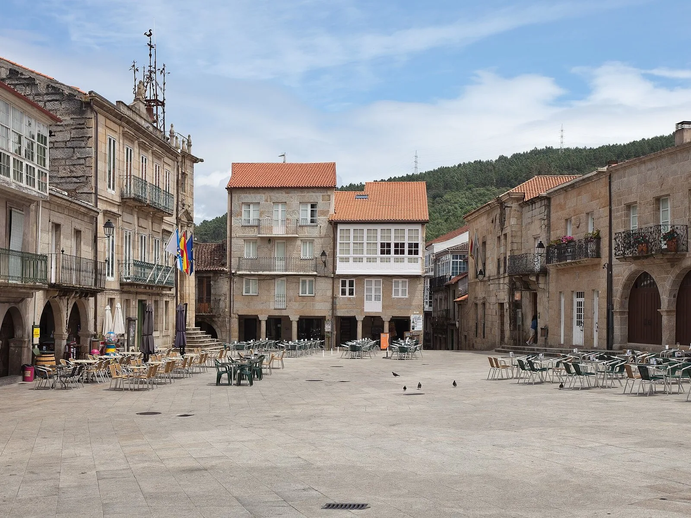
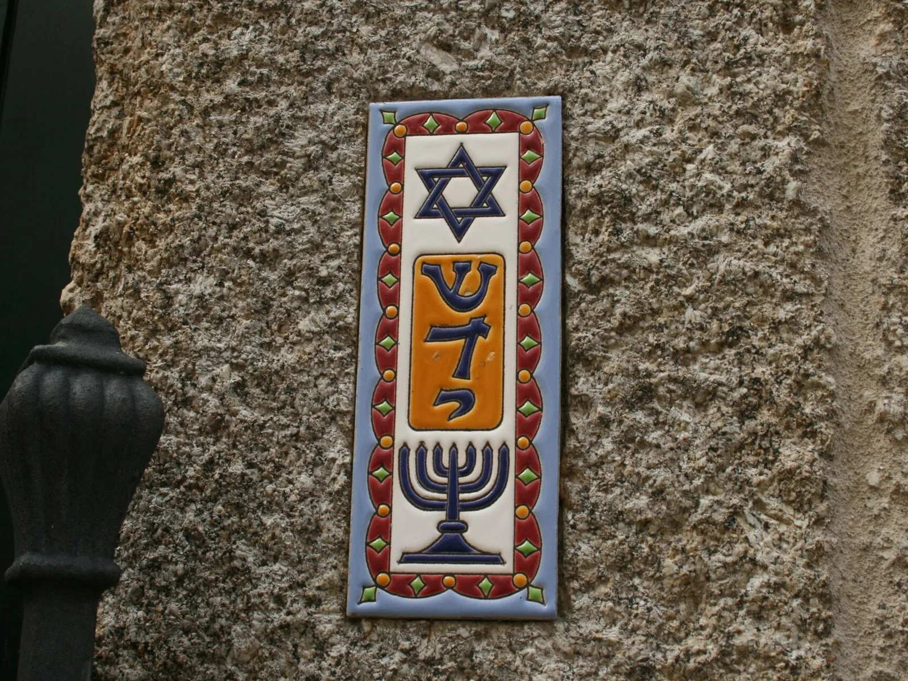
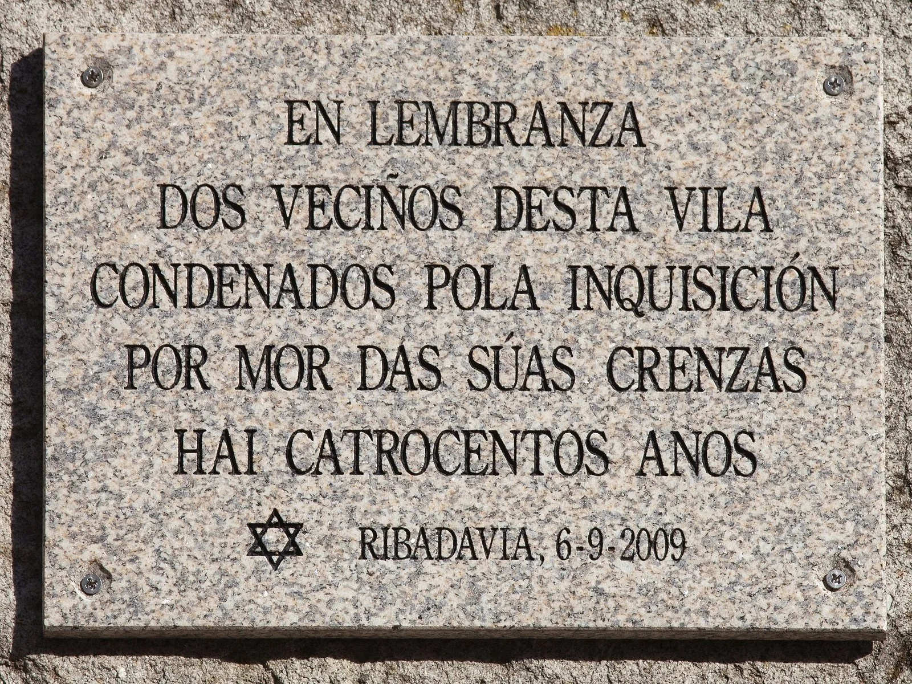
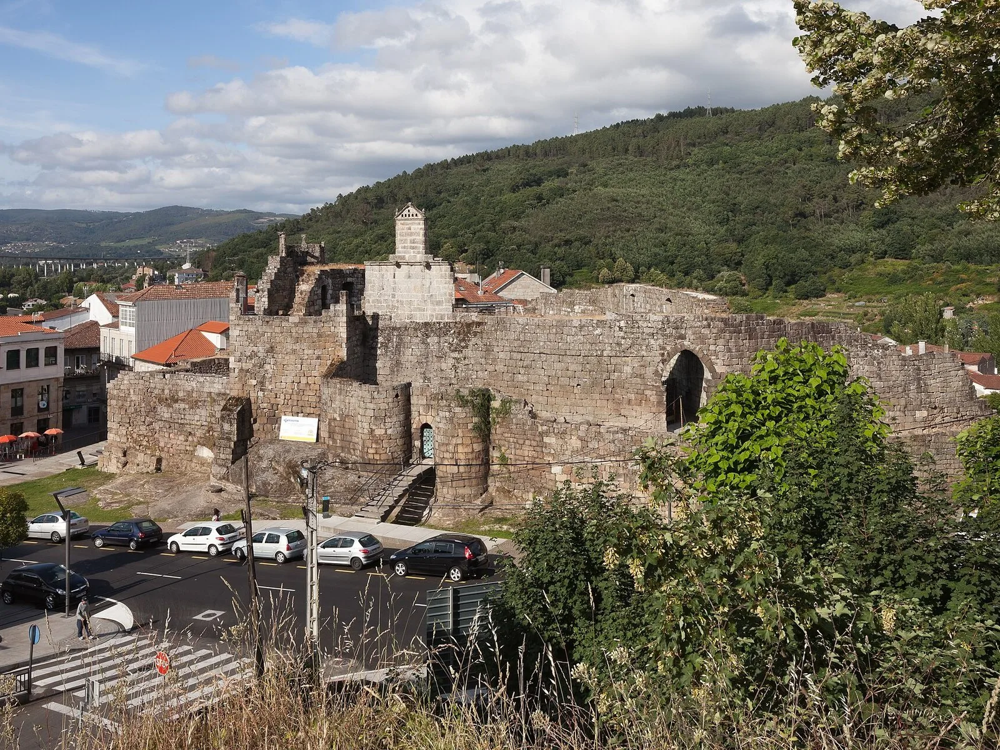
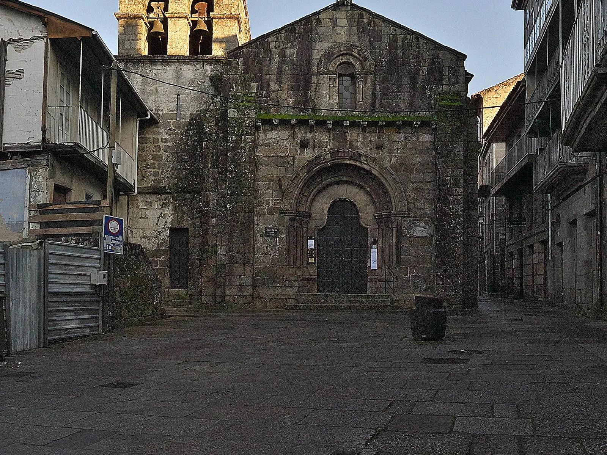
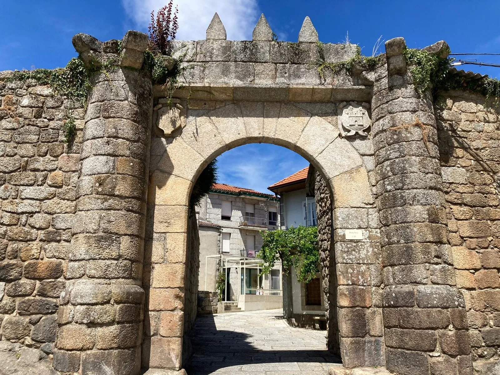
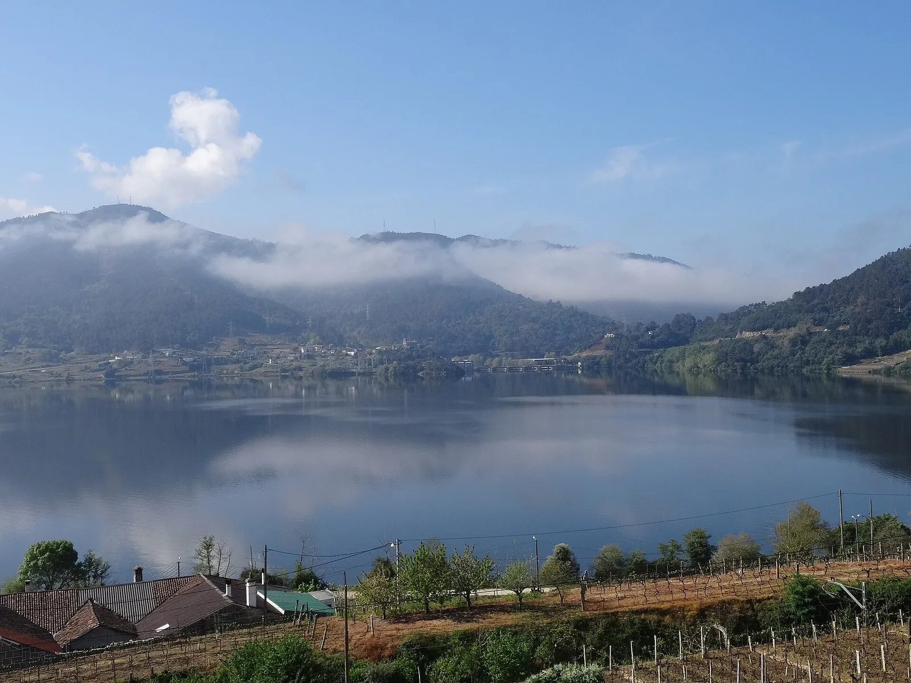

**Ribadavia** es pequeña, pero tiene historia para una ciudad entera. Fue corte de reyes gallegos en la Edad Media, tuvo una de las **comunidades judías** más importantes de Galicia y es la capital del **vino del Ribeiro**, uno de los más antiguos de España. Su casco histórico, entre el Miño y el Avia, está lleno de soportales, iglesias románicas y callejuelas con símbolos judíos en las puertas.

Además, en la Navidad de 2024 fue el **pueblo ganador de Ferrero Rocher**. Te cuento qué ver 👇

En un vistazo<h2>Lo que vas a encontrar</h2>

<b>✡️</b>Barrio judío

<b>🏰</b>Castillo

<b>🍷</b>Vino del Ribeiro

<b>⛪</b>Románico

<b>⚔️</b>Fiesta medieval

Antes de ir<h2>Lo básico de Ribadavia</h2>

<h3>📍 Dónde está</h3>
En el sur de <strong>Ourense</strong>, donde el río Avia se une al Miño, a medio camino entre Ourense y Vigo.

<h3>⏱️ Tiempo</h3>
Medio día para el casco histórico. Un día entero si visitas alguna bodega.

<h3>📅 Cuándo ir</h3>
En otoño, con la vendimia y las viñas rojas, o el último fin de semana de agosto para la <strong>Festa da Istoria</strong>.

Qué ver<h2>Qué ver en Ribadavia</h2>

<ol class="guide__grid guide__grid--cuenca">
<li class="gcard reveal">
01

<h3>La Praza Maior</h3>
El corazón de la villa, con <strong>soportales</strong> de piedra, galerías acristaladas y el Ayuntamiento. Es el sitio para tomar un vino del Ribeiro.

</li>
<li class="gcard reveal">
02

<h3>El barrio judío</h3>
Uno de los mejor conservados de Galicia. Busca las <strong>mezuzás</strong> y estrellas de David en las puertas, y la antigua <strong>Casa de la Inquisición</strong>.

</li>
<li class="gcard reveal">
03

<h3>La memoria judía</h3>
Una placa recuerda a los vecinos condenados por la Inquisición «por sus creencias» hace cuatrocientos años. En el Pazo de los Condes está el <strong>Centro de Información Judía de Galicia</strong>.

</li>
<li class="gcard reveal">
04

<h3>El castillo de los Sarmiento</h3>
La fortaleza de los <strong>condes de Ribadavia</strong>, del siglo XV. Dentro se conservan restos de la muralla y una necrópolis con <strong>tumbas excavadas en la roca</strong>.

</li>
<li class="gcard reveal">
05

<h3>Las iglesias románicas</h3>
<strong>San Juan</strong>, Santiago y Santo Domingo forman un conjunto románico y gótico muy bonito para una villa tan pequeña.

</li>
<li class="gcard reveal">
06

<h3>Las puertas de la muralla</h3>
De la muralla medieval quedan tramos y puertas como la <strong>Porta Nova</strong> y la Porta Falsa, por las que se entra al casco viejo.

</li>
<li class="gcard reveal">
07

<h3>El Miño y las viñas</h3>
Alrededor del pueblo, laderas de viñedo bajan hasta el <strong>embalse de Castrelo de Miño</strong>. En otoño, con las viñas rojas, es precioso.

</li>
</ol>

Fiestas<h2>La Festa da Istoria</h2>

El último fin de semana de agosto, Ribadavia vuelve a la Edad Media. En la <strong>Festa da Istoria</strong> los vecinos se visten de época, en las tiendas y bares se paga con <strong>maravedís</strong> y hay torneos, cetrería, mercado y la recreación de una <strong>boda judía</strong>. Es una de las fiestas medievales más conocidas de Galicia.

<h3>🎄 El pueblo de Ferrero Rocher</h3>
En 2024 Ribadavia ganó el concurso «Juntos Brillamos Más» y se llenó con la iluminación navideña de Ferrero Rocher. Este año compiten otros pueblos: <a href="/blog/pueblo-navidad-ferrero-rocher-2026.html">aquí tienes los candidatos de 2026</a>.

Cómo llegar<h2>Cómo llegar a Ribadavia</h2>

En coche, por la <strong>A-52</strong>: está a unos <strong>30 minutos de Ourense</strong> y a unos <strong>45 de Vigo</strong>. Aparca en la parte baja, junto al río, y sube andando al casco histórico.

En <strong>tren</strong>: Ribadavia tiene estación en la línea Ourense-Vigo.

<a class="btn guide__mapbtn" href="https://www.google.com/maps/dir/?api=1&destination=42.2883,-8.1432" target="_blank" rel="noopener"><svg class="ico" viewBox="0 0 24 24" width="15" height="15" aria-hidden="true" fill="currentColor"><path d="M12 2a7 7 0 0 0-7 7c0 5.25 7 13 7 13s7-7.75 7-13a7 7 0 0 0-7-7zm0 9.5a2.5 2.5 0 1 1 0-5 2.5 2.5 0 0 1 0 5z"/></svg> Cómo llegar en Google Maps</a>

Combínalo con <a href="/blog/ourense-que-ver.html">Ourense</a> y sus termas, el <a href="/blog/canon-del-sil.html">Cañón del Sil</a> o <a href="/blog/allariz-que-ver.html">Allariz</a>. Si vienes de la costa, tienes cerca <a href="/blog/vigo-que-ver.html">Vigo</a>.

Consejos de Cheno<h2>Para disfrutarlo al máximo</h2><ul><li><b>Prueba las tartas judías</b>: en las pastelerías del barrio judío hacen dulces de tradición sefardí.</li><li><b>Visita una bodega</b> del Ribeiro: muchas ofrecen catas con reserva.</li><li><b>Sube al castillo</b> por la tarde, con luz suave sobre la piedra.</li><li><b>Mira las puertas</b>: los símbolos judíos están en los detalles.</li></ul>

<!--faq-->

<h2>¿Te gustan estos planes?</h2>
Sígueme en Instagram como <a href="https://www.instagram.com/chenoaventuras/" target="_blank" rel="noopener">@chenoaventuras</a>: subo escapadas como esta cada semana.
<a class="btn guide__btn" href="/blog.html">Ver más planes en el blog</a>

Información consultada en noviembre de 2026 (Turismo de Galicia, Red de Juderías de España y prensa gallega). Fotos de Wikimedia Commons: <a href="https://commons.wikimedia.org/wiki/File:Ribadavia_-_Galiza-10.jpg" target="_blank" rel="noopener">Lmbuga</a> (CC BY-SA 3.0) · <a href="https://commons.wikimedia.org/wiki/File:Mezuz%C3%A1_jud%C3%ADo_en_Ribadavia_(4571953191).jpg" target="_blank" rel="noopener">Contando Estrelas</a> (CC BY-SA 2.0) · <a href="https://commons.wikimedia.org/wiki/File:En_lembranza_dos_condenados_pola_Inquisici%C3%B3n._Ribadavia._Galiza.jpg" target="_blank" rel="noopener">Lmbuga</a> (CC BY-SA 3.0) · <a href="https://commons.wikimedia.org/wiki/File:Ribadavia_-_Galiza-21.jpg" target="_blank" rel="noopener">Lmbuga</a> (CC BY-SA 3.0) · <a href="https://commons.wikimedia.org/wiki/File:Fachada_de_la_Iglesia_de_San_Juan,_Ribadavia.jpg" target="_blank" rel="noopener">Jl FilpoC</a> (CC BY-SA 4.0) · <a href="https://commons.wikimedia.org/wiki/File:Vista_de_la_porta_Nova_desde_los_extramuros,_Ribadavia,_Galicia.jpg" target="_blank" rel="noopener">Felicia, Yu-Jyun Fan</a> (CC BY-SA 4.0) · <a href="https://commons.wikimedia.org/wiki/File:Encoro_de_Castrelo_de_Mi%C3%B1o_dende_Ribadavia_2.JPG" target="_blank" rel="noopener">Elisardojm</a> (CC BY-SA 4.0).

