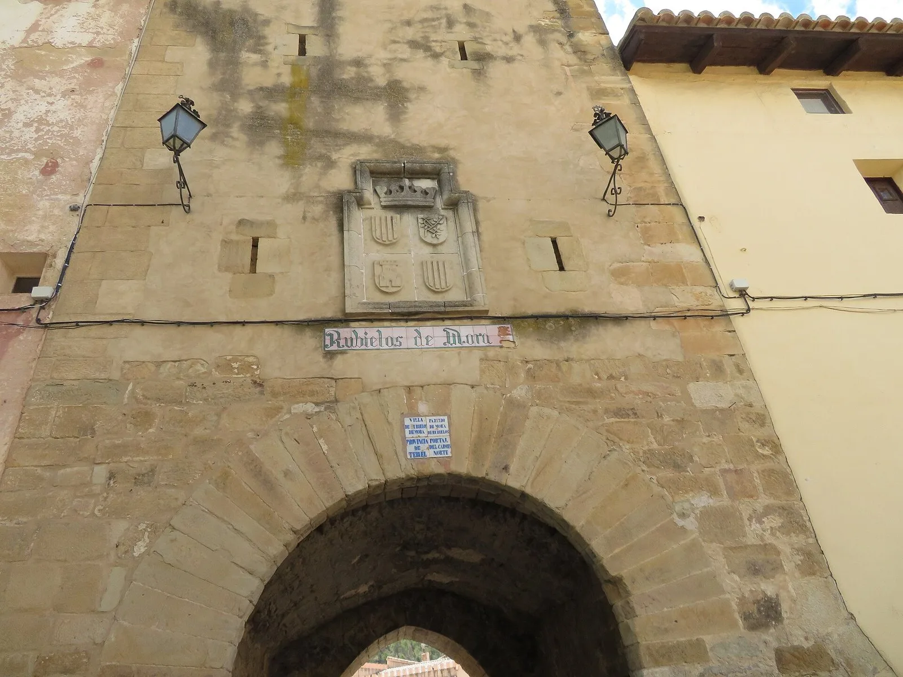
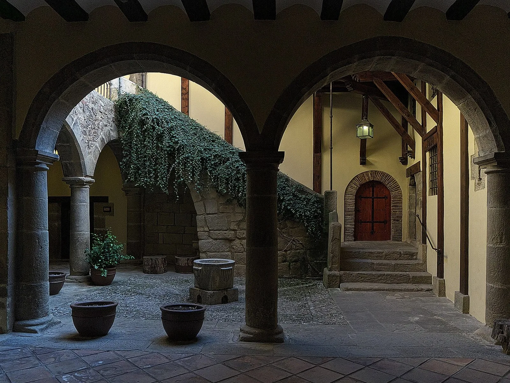
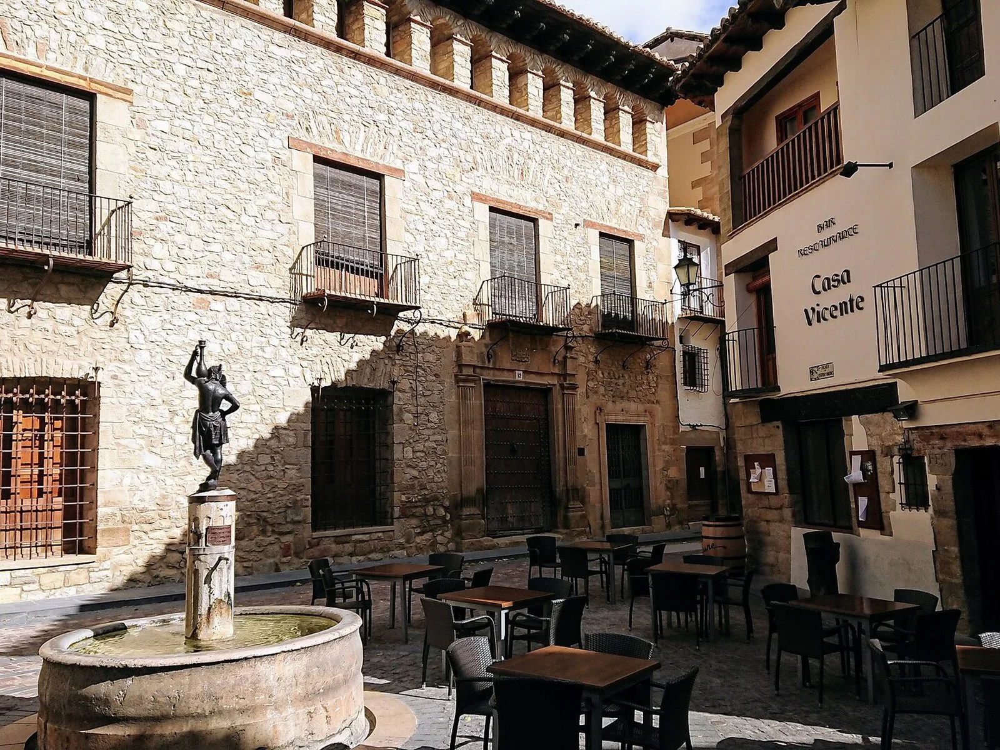
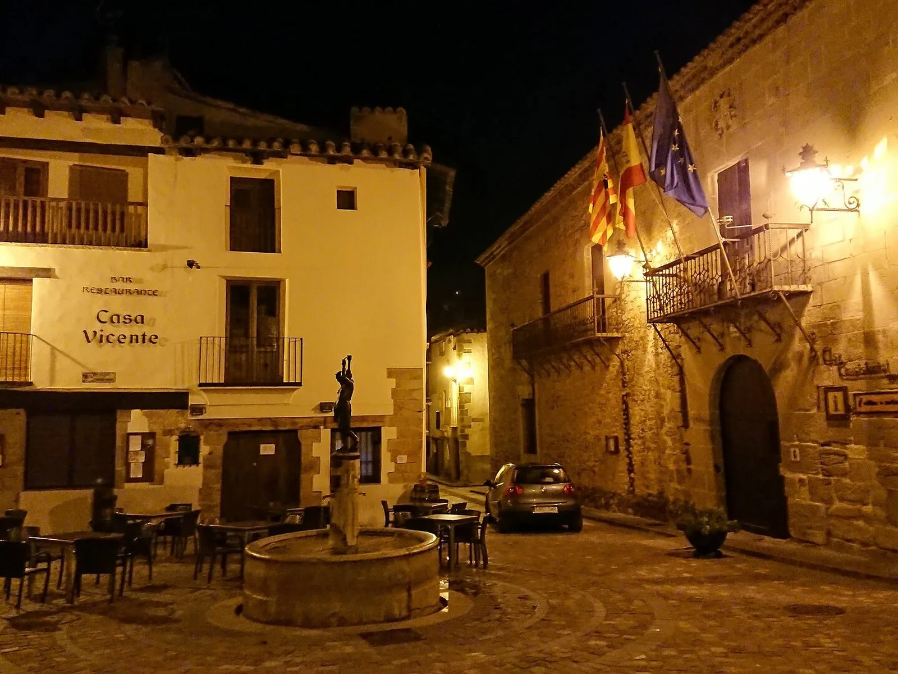
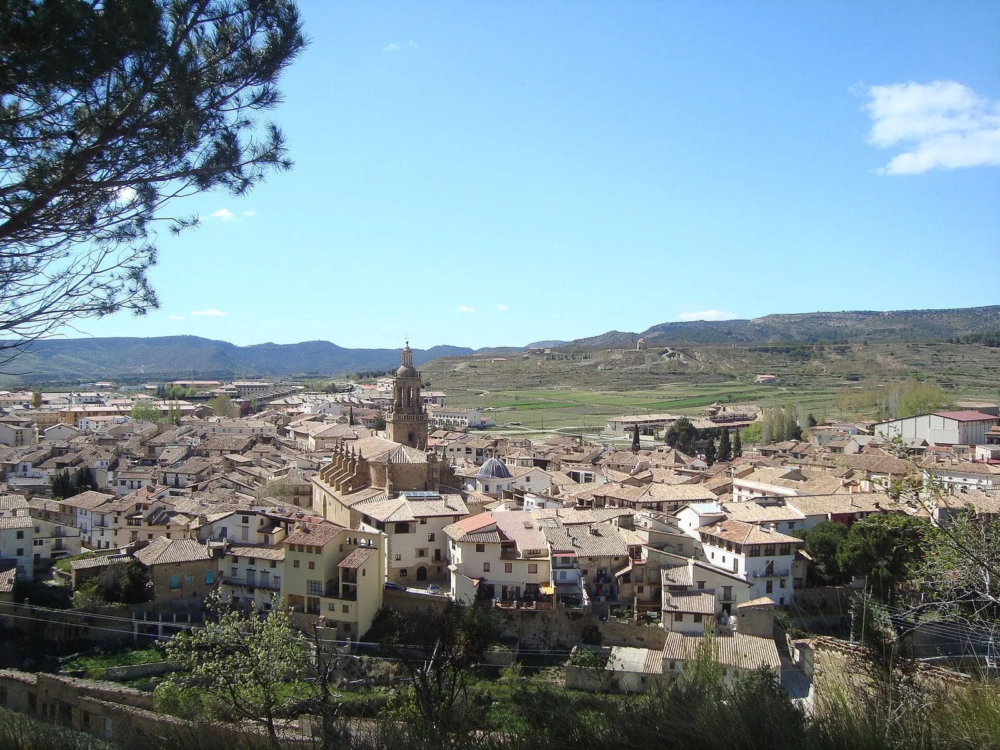
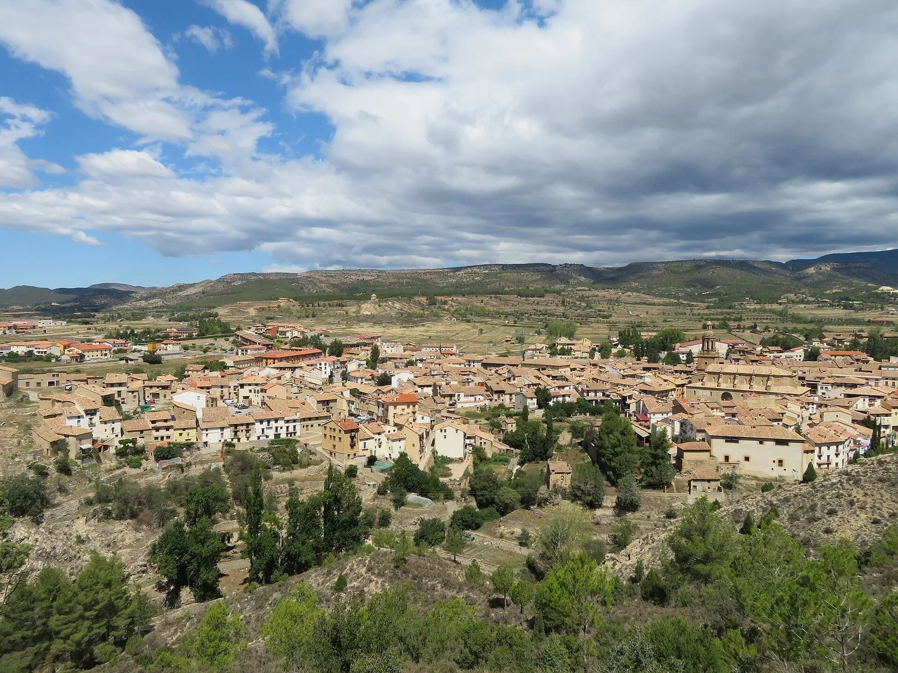

**Rubielos de Mora** parece hecho de una sola piedra dorada. Casonas con escudos, aleros de madera, portales medievales y calles empedradas: todo está tan bien conservado que el pueblo forma parte de **los pueblos más bonitos de España**. Está en la **sierra de Gúdar**, al sureste de Teruel, y en invierno tiene la nieve muy cerca.

Te cuento qué ver 👇

En un vistazo<h2>Lo que vas a encontrar</h2>

<b>🏰</b>Portales medievales

<b>🏛️</b>Ayuntamiento y lonja

<b>🖼️</b>Retablo gótico

<b>🎨</b>Arte contemporáneo

<b>⛷️</b>Nieve cerca

Antes de ir<h2>Lo básico de Rubielos</h2>

<h3>📍 Dónde está</h3>
En la comarca de <strong>Gúdar-Javalambre</strong>, a unos 50 minutos de Teruel.

<h3>⏱️ Tiempo</h3>
Medio día. Un fin de semana si lo combinas con la sierra y la nieve.

<h3>❄️ Invierno</h3>
Hace frío de verdad: a más de 900 metros, lleva abrigo y mira la carretera si ha nevado.

Qué ver<h2>Qué ver en Rubielos de Mora</h2>

<ol class="guide__grid guide__grid--cuenca">
<li class="gcard reveal">
01

<h3>Los portales</h3>
La muralla medieval tenía siete puertas. Quedan en pie dos: el <strong>Portal del Carmen</strong> y el <strong>Portal de San Antonio</strong>. Entrar al pueblo por ellos es la mejor bienvenida.

</li>
<li class="gcard reveal">
02

<h3>El ayuntamiento y la lonja</h3>
Un edificio <strong>renacentista del siglo XVI</strong> con una lonja de arcos en la planta baja, donde antes se comerciaba. Es de los más bonitos de la provincia.

</li>
<li class="gcard reveal">
03

<h3>Las casonas con escudo</h3>
Pasea sin rumbo: hay palacios y casas nobles con escudos en casi cada calle. Busca también los <strong>pequeños símbolos</strong> grabados en las puertas de algunas casas.

</li>
<li class="gcard reveal">
04

<h3>El pueblo de noche</h3>
Con las farolas encendidas, las plazas de piedra tienen un ambiente precioso. Si duermes aquí, sal a dar una vuelta después de cenar.

</li>
<li class="gcard reveal">
05

<h3>La excolegiata de Santa María</h3>
Su torre domina el pueblo. Dentro guarda un <strong>retablo gótico de unos 7 metros</strong> dedicado a la Virgen, una joya del gótico internacional.

</li>
<li class="gcard reveal">
06

<h3>El entorno</h3>
Campos, pinares y montañas de la sierra de Gúdar. Hay rutas cortas que salen del mismo pueblo.

</li>
</ol>

Museos<h2>Arte en un pueblo pequeño</h2>

<ul class="checklist" style="margin:0 0 1rem;"><li><strong>Museo Salvador Victoria</strong>: el pintor abstracto nació en Rubielos en 1928. Su museo, en el antiguo hospital, reúne su obra y la de otros artistas españoles.</li><li><strong>Museo Gonzalvo</strong>: en el antiguo convento del Carmen, con obras del escultor José Gonzalvo.</li></ul>

<h3>⛷️ La nieve, a un paso</h3>
En invierno, Rubielos es buena base para esquiar en <strong>Valdelinares</strong>, en la sierra de Gúdar, a menos de una hora. Y a 15 minutos tienes el gran castillo de <strong>Mora de Rubielos</strong>.

Cómo llegar<h2>Cómo llegar a Rubielos de Mora</h2>

En coche: a unos <strong>50 minutos de Teruel</strong> y a <strong>1 hora y 45 minutos de Valencia</strong>, por la A-23 y la carretera de la sierra. Aparca fuera del casco antiguo y entra a pie.

<a class="btn guide__mapbtn" href="https://www.google.com/maps/dir/?api=1&destination=40.1886,-0.6531" target="_blank" rel="noopener"><svg class="ico" viewBox="0 0 24 24" width="15" height="15" aria-hidden="true" fill="currentColor"><path d="M12 2a7 7 0 0 0-7 7c0 5.25 7 13 7 13s7-7.75 7-13a7 7 0 0 0-7-7zm0 9.5a2.5 2.5 0 1 1 0-5 2.5 2.5 0 0 1 0 5z"/></svg> Cómo llegar en Google Maps</a>

Si vas a la provincia, mira también <a href="/blog/teruel-que-ver.html">Teruel</a>, <a href="/blog/albarracin-que-ver.html">Albarracín</a> y <a href="/blog/que-ver-en-matarrana.html">el Matarraña</a>.

Consejos de Cheno<h2>Para disfrutarlo al máximo</h2><ul><li><b>Confirma horarios</b> de museos y excolegiata: en temporada baja abren menos.</li><li><b>Duerme en el pueblo</b> si vas a esquiar.</li><li><b>Prueba el jamón de Teruel</b> y la trufa negra de la zona en invierno.</li><li><b>Combínalo con Mora de Rubielos</b>.</li></ul>

<!--actividades-->

<!--faq-->

<h2>¿Te gustan estos planes?</h2>
Sígueme en Instagram como <a href="https://www.instagram.com/chenoaventuras/" target="_blank" rel="noopener">@chenoaventuras</a>: subo escapadas como esta cada semana.
<a class="btn guide__btn" href="/blog.html">Ver más planes en el blog</a>

Información consultada en noviembre de 2026 (Turismo de Aragón, Los Pueblos Más Bonitos de España y la comarca Gúdar-Javalambre). Fotos de Wikimedia Commons: <a href="https://commons.wikimedia.org/wiki/File:Rubielos_de_Mora_2024.jpg" target="_blank" rel="noopener">Juan Emilio Prades Bel</a> (CC BY 4.0) · <a href="https://commons.wikimedia.org/wiki/File:Municipio_de_Rubielos_de_Mora.jpg" target="_blank" rel="noopener">Juan Emilio Prades Bel</a> (CC BY 4.0) · <a href="https://commons.wikimedia.org/wiki/File:Planta_baja_de_la_antigua_lonja_de_Rubielos_de_Mora.jpg" target="_blank" rel="noopener">Jl FilpoC</a> (CC BY-SA 4.0) · <a href="https://commons.wikimedia.org/wiki/File:Rubielos_de_Mora_3,_Teruel_(Espa%C3%B1a).jpg" target="_blank" rel="noopener">Heparina1985</a> (CC BY-SA 4.0) · <a href="https://commons.wikimedia.org/wiki/File:Rubielos_de_Mora,_Teruel_(Spain).jpg" target="_blank" rel="noopener">Heparina1985</a> (CC BY-SA 4.0) · <a href="https://commons.wikimedia.org/wiki/File:Panor%C3%A1mica_de_Rubielos_de_Mora_(Teruel,_Arag%C3%B3n).JPG" target="_blank" rel="noopener">Juan Emilio Prades Bel</a> (CC BY-SA 4.0) · <a href="https://commons.wikimedia.org/wiki/File:Rubielos_de_Mora,_Teruel.jpg" target="_blank" rel="noopener">Juan Emilio Prades Bel</a> (CC BY 4.0).

