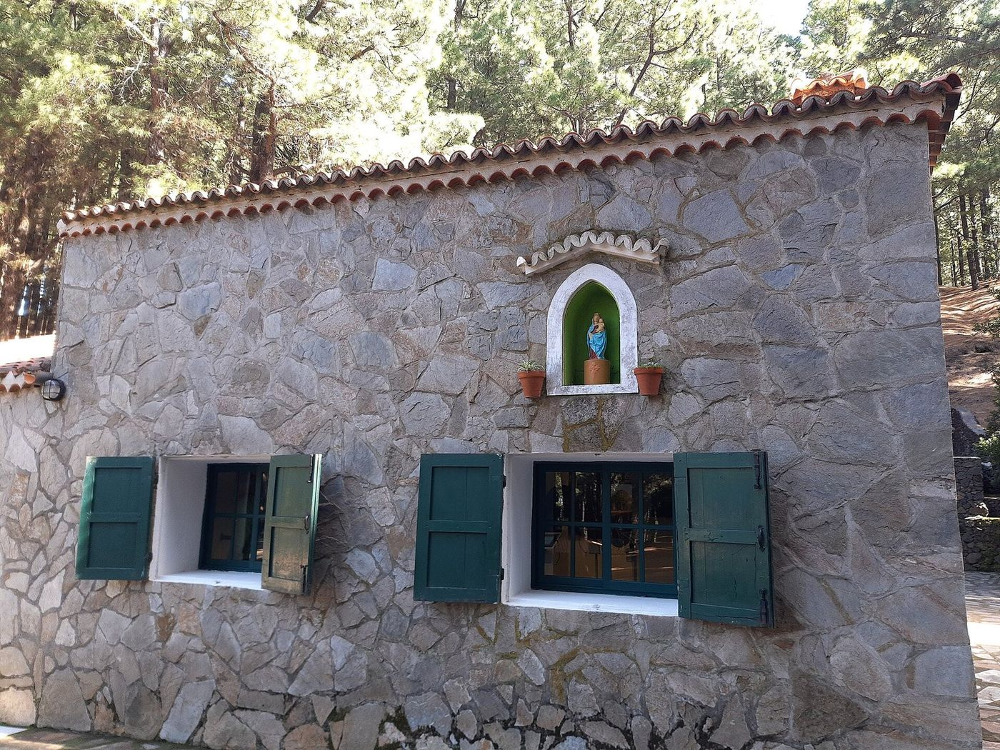
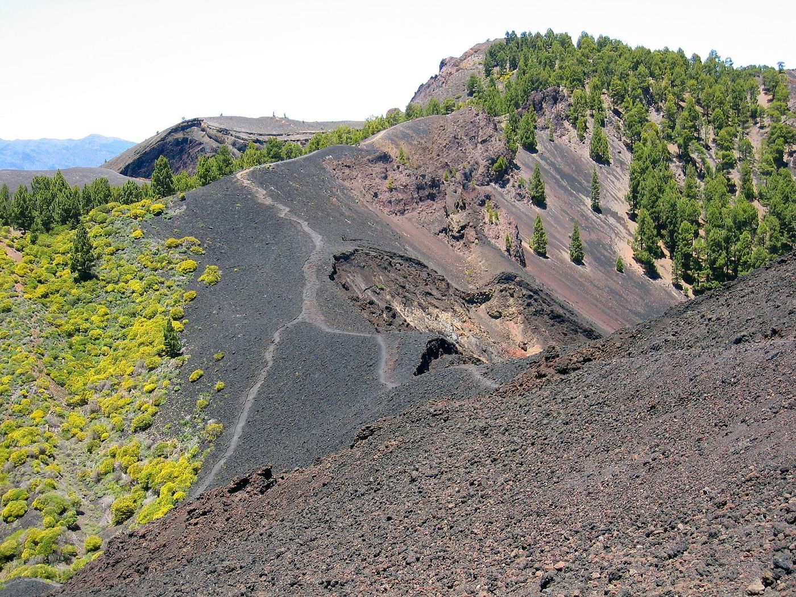
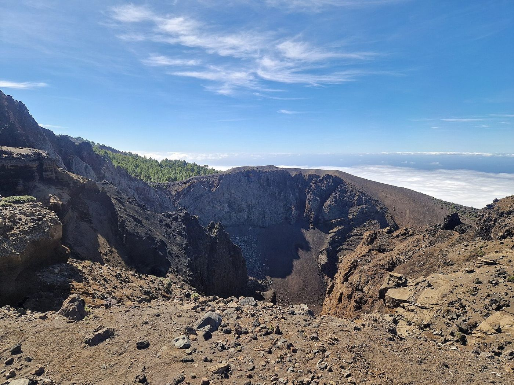
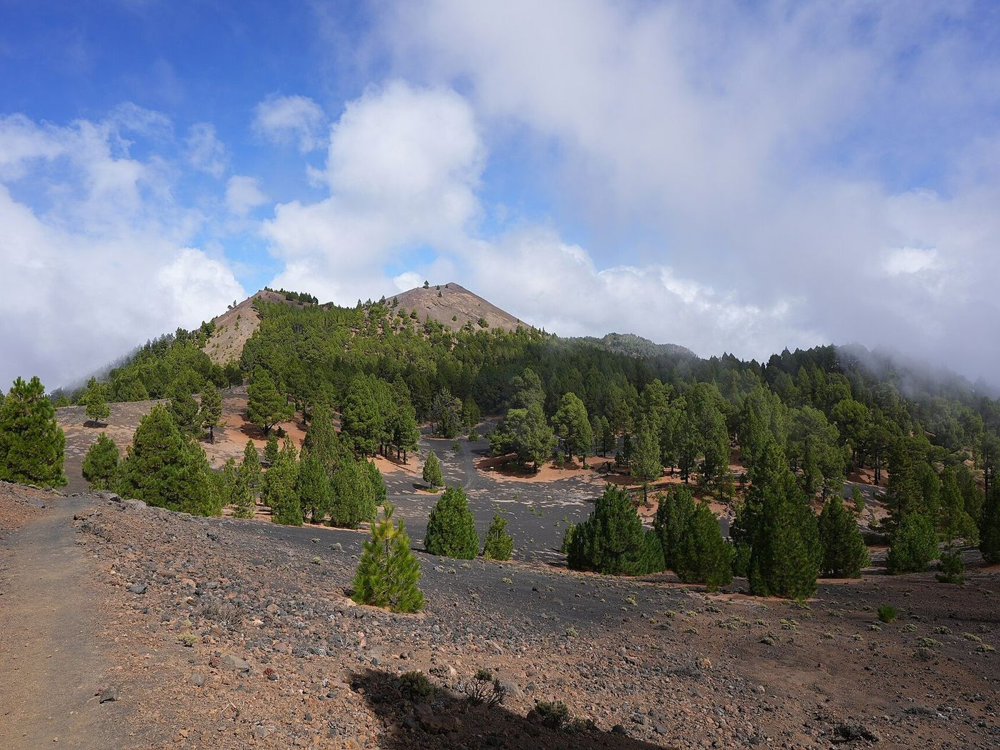
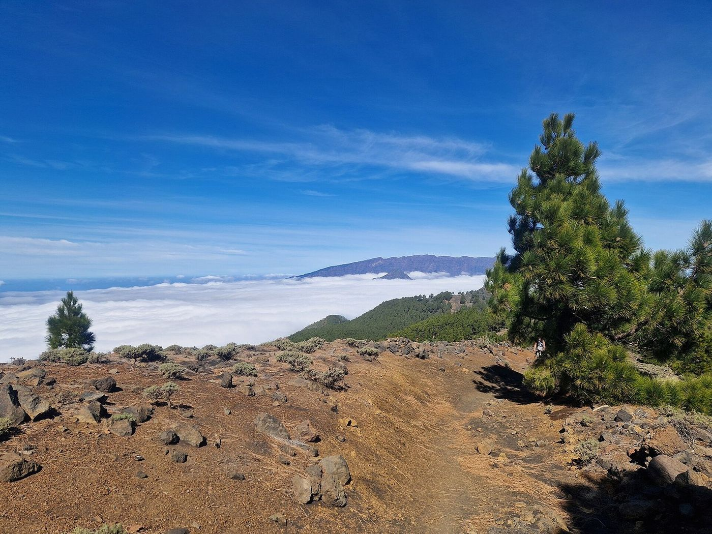

Un camino de ceniza por la cumbre de la isla, con conos volcánicos a los lados, pinares al fondo y un mar de nubes a tus pies. La **Ruta de los Volcanes** es la gran travesía de **La Palma**, y está dentro del **GR 131**.

Te cuento cómo es, cuánto se tarda, qué llevar y cómo organizar la vuelta 👇

En un vistazo<h2>Lo que vas a encontrar</h2>

<b>🌋</b>Conos y cráteres

<b>🌲</b>Pinar canario

<b>☁️</b>Mar de nubes

<b>🥾</b>17 km

<b>🔭</b>Vistas al Teide

Antes de ir<h2>Lo básico de la ruta</h2>

<h3>📏 Distancia</h3>
Unos <strong>17,5 km</strong> de El Pilar a Los Canarios (Fuencaliente).

<h3>⏱️ Tiempo</h3>
Entre <strong>6 y 7 horas</strong>. Sal pronto.

<h3>🚗 Logística</h3>
Es <strong>lineal</strong>: organiza taxi, dos coches o excursión.

La historia<h2>Un paisaje hecho por las erupciones</h2>

La cumbre de <strong>Cumbre Vieja</strong> es la espina dorsal volcánica del sur de La Palma, y su paisaje se explica por erupciones muy recientes: en <strong>1949</strong>, por ejemplo, se abrieron cráteres como el Duraznero y el Hoyo Negro, y en <strong>1971</strong> el <a href="/blog/volcan-san-antonio-teneguia.html">Teneguía</a>, ya en el extremo sur. La ruta sigue esa línea de cráteres, y por eso ves ceniza negra, escorias rojas y pinos que crecen donde hace décadas solo había lava.

La ruta<h2>Qué ver en el camino</h2>

<ol class="guide__grid guide__grid--cuenca">
<li class="gcard reveal">
01

<h3>El Refugio de El Pilar</h3>
El punto de salida, en un pinar a unos 1.400 metros de altura. Aquí hay un área recreativa y se ve el cartel de la ruta.

</li>
<li class="gcard reveal">
02

<h3>Conos y retamas</h3>
El camino de ceniza sube y baja entre conos. En primavera, las retamas llenan de amarillo las laderas.

</li>
<li class="gcard reveal">
03

<h3>El Hoyo Negro</h3>
Uno de los cráteres de la erupción de 1949, de paredes casi verticales. Se contempla desde el borde, sin entrar.

</li>
<li class="gcard reveal">
04

<h3>La Deseada</h3>
Otro de los conos de la cumbre, con el pinar al fondo, antes de iniciar la larga bajada hacia Fuencaliente.

</li>
<li class="gcard reveal">
05

<h3>El mar de nubes</h3>
Muchos días, las nubes se quedan abajo y el camino queda por encima. Con suerte asoma el Teide en el horizonte.

</li>
</ol>

Prepárala<h2>Cómo organizarla</h2>

La logística es lo más importante: la ruta empieza en El Pilar y termina en <strong>Los Canarios</strong>, así que hay que resolver cómo volver. Lo más cómodo es contratar una <a href="https://www.civitatis.com/es/fuencaliente-de-la-palma/ruta-volcanes-la-palma/?aid=110968" target="_blank" rel="noopener sponsored">excursión guiada por la Ruta de los Volcanes</a>, que se ocupa del transporte. Si vas por tu cuenta, deja un coche al final, usa taxi o combina horarios de guagua. Lleva dos litros de agua como mínimo, comida, gorra, crema y una capa de abrigo, porque en la cumbre hace viento.

Cómo llegar<h2>Cómo llegar a la Ruta de los Volcanes</h2>

<strong>Inicio:</strong> en el <strong>Refugio de El Pilar</strong>, en el municipio de El Paso, al que se llega por la carretera que sube desde El Paso.

<strong>Final:</strong> en <strong>Los Canarios</strong> (Fuencaliente), donde puedes tomar un taxi de vuelta a El Pilar. Si sigues hasta el faro, es el resto del GR 131.

<strong>Antes de ir:</strong> mira la previsión (viento y niebla) y consulta si hay avisos o cierres en el Cabildo de La Palma.

<a class="btn guide__mapbtn" href="https://www.google.com/maps/search/?api=1&query=Refugio%20El%20Pilar%2C%20El%20Paso%2C%20La%20Palma" target="_blank" rel="noopener"><svg class="ico" viewBox="0 0 24 24" width="15" height="15" aria-hidden="true" fill="currentColor"><path d="M12 2a7 7 0 0 0-7 7c0 5.25 7 13 7 13s7-7.75 7-13a7 7 0 0 0-7-7zm0 9.5a2.5 2.5 0 1 1 0-5 2.5 2.5 0 0 1 0 5z"/></svg> Cómo llegar en Google Maps</a>

Termina la travesía en el sur con los <a href="/blog/volcan-san-antonio-teneguia.html">volcanes San Antonio y Teneguía</a> y las <a href="/blog/salinas-y-faros-de-fuencaliente.html">salinas y faros de Fuencaliente</a>. Más ideas en <a href="/blog/que-hacer-en-la-palma.html">qué hacer en La Palma</a>.

Consejos de Cheno<h2>Para disfrutarlo al máximo</h2><ul><li><b>Sal con la primera luz:</b> evitas la niebla de la tarde.</li><li><b>Dos litros de agua</b> como mínimo: no hay fuentes.</li><li><b>Capa de abrigo:</b> en la cumbre sopla el viento.</li><li><b>Planifica la vuelta</b> antes de empezar.</li><li><b>Si dudas, haz solo un tramo:</b> la parte inicial es la más espectacular.</li></ul>

<h2>¿Te gustan estos planes?</h2>
Sígueme en Instagram como <a href="https://www.instagram.com/chenoaventuras/" target="_blank" rel="noopener">@chenoaventuras</a>: subo escapadas como esta cada semana.
<a class="btn guide__btn" href="/blog.html">Ver más planes en el blog</a>

Información consultada en noviembre de 2026. Los accesos, cierres y permisos cambian a menudo: consúltalos en las webs oficiales del Cabildo de La Palma y del Parque Nacional antes de ir. Fotos de Wikimedia Commons: <a href="https://commons.wikimedia.org/wiki/File:GR-131_Ruta_de_los_Volcanes_La_Palma_20080606b.jpg" target="_blank" rel="noopener">Tigerente</a> (CC BY-SA 4.0) · <a href="https://commons.wikimedia.org/wiki/File:GR-131_Ruta_de_los_Volcanes_La_Palma_20080606d.jpg" target="_blank" rel="noopener">Tigerente</a> (CC BY-SA 4.0) · <a href="https://commons.wikimedia.org/wiki/File:Ruta_de_los_Volcanes,_Volc%C3%A1n_Hoyo_Negro.jpg" target="_blank" rel="noopener">Gerda Arendt</a> (CC0) · <a href="https://commons.wikimedia.org/wiki/File:La_Palma_-_Deseada.jpg" target="_blank" rel="noopener">Ingo Mehling</a> (CC BY-SA 4.0) · <a href="https://commons.wikimedia.org/wiki/File:Ruta_de_los_volcanes,_Refugio_El_Pilar,_La_Palma.jpg" target="_blank" rel="noopener">Gerda Arendt</a> (CC0) · <a href="https://commons.wikimedia.org/wiki/File:Ruta_de_los_Volcanes,_view_north_to_more_clouds.jpg" target="_blank" rel="noopener">Gerda Arendt</a> (CC0).

