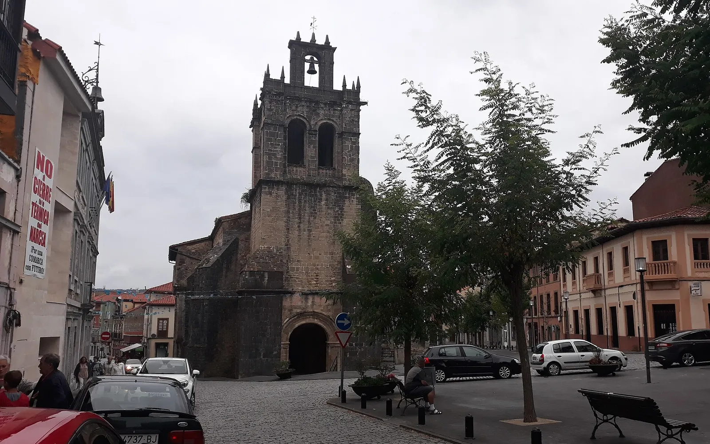
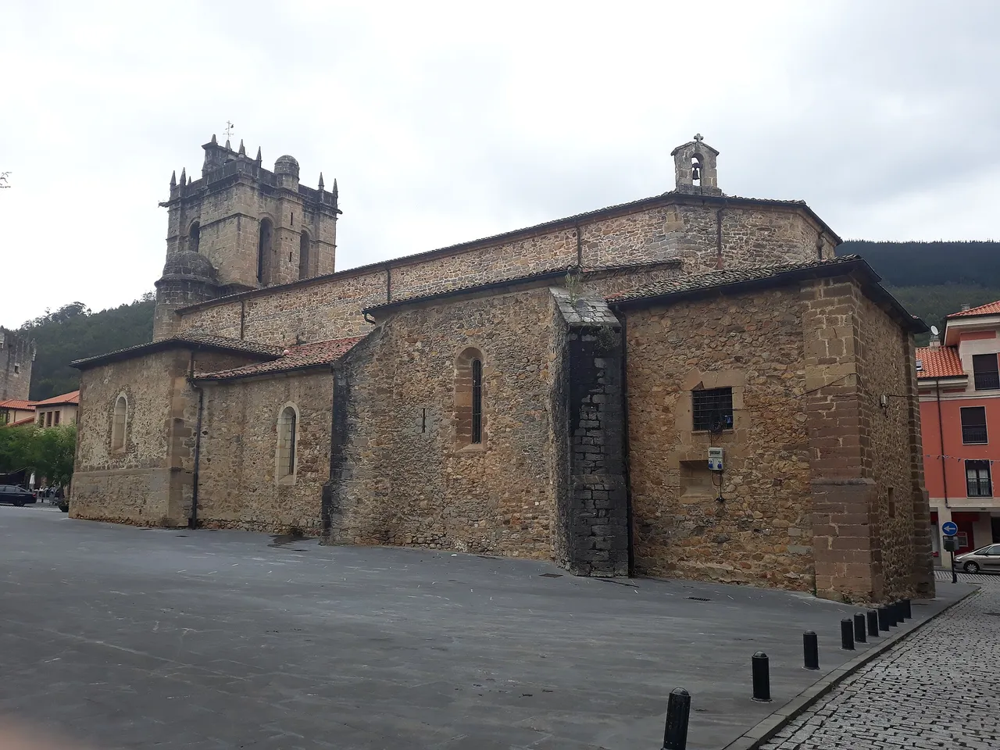
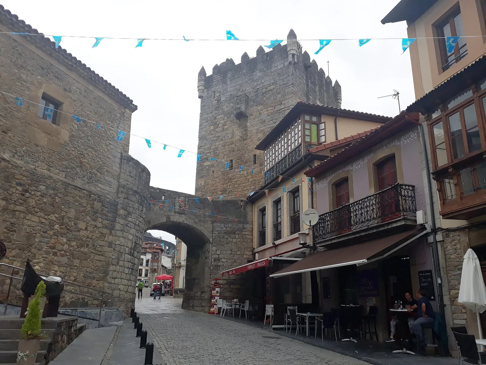
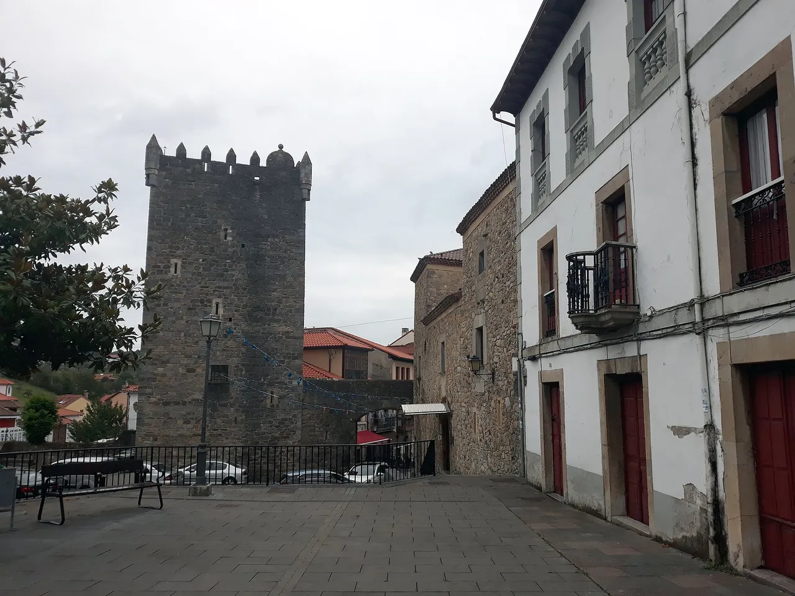
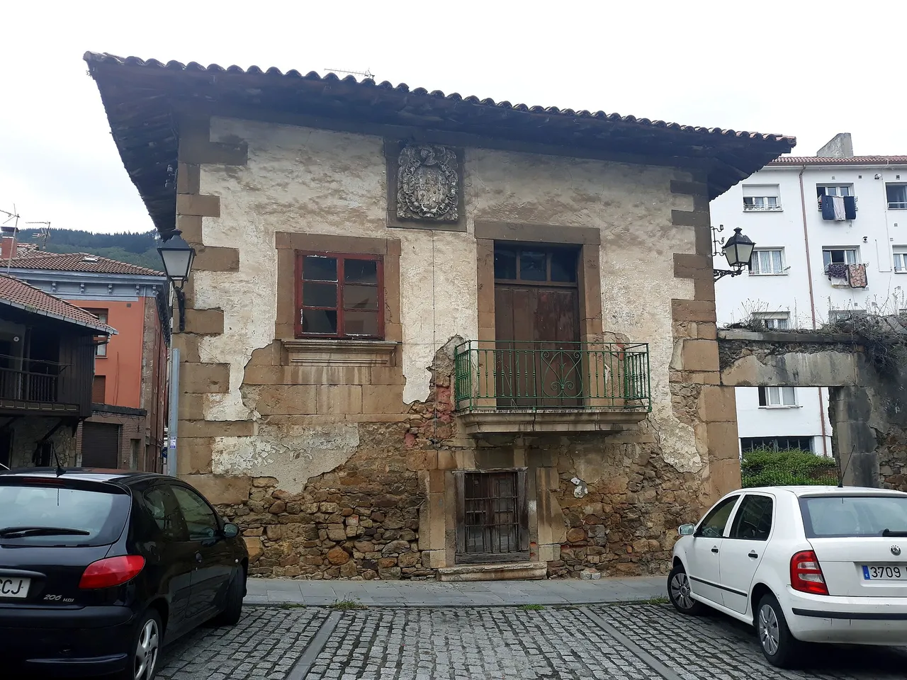

Una villa con **conjunto histórico declarado bien de interés cultural**, una **colegiata** con el mausoleo del fundador de la Universidad de Oviedo y una **torre** medieval en pleno casco. **Salas**, conocida como la **Puerta del Occidente** de Asturias, está a unos 45 km de Oviedo.

Te cuento qué ver, su historia y cómo llegar 👇

En un vistazo<h2>Lo que vas a encontrar</h2>

<b>⛪</b>Colegiata de Santa María

<b>🗼</b>Torre y palacio

<b>🏘️</b>Conjunto histórico

<b>🏛️</b>Museo prerrománico

<b>🍪</b>Carajitos del Profesor

<b>🐟</b>Río Narcea y salmón

Antes de ir<h2>Salas: lo básico</h2>

<h3>🏛️ Conjunto histórico</h3>
Es bien de interés cultural desde 1994.

<h3>⛪ Colegiata</h3>
Santa María la Mayor, con el mausoleo de Fernando Valdés Salas, inquisidor general y fundador de la Universidad de Oviedo.

<h3>🏯 Torre y palacio</h3>
El conjunto de la torre y el palacio Valdés Salas es el otro gran atractivo.

<h3>🚗 Dónde está</h3>
En el centro-occidente de Asturias, a unos 45 km de Oviedo, junto al río Narcea.

Curiosidades<h2>Datos y curiosidades</h2>

La primera referencia escrita de Salas es una <strong>donación del año 896</strong>, y Alfonso X le dio la <strong>carta puebla</strong> en 1277. El concejo tiene 227 km² y unos 4.750 habitantes, con La Espina y Cornellana como núcleos principales. Las fiestas incluyen la Romería del Viso (15 de agosto) y las fiestas del Bollo; <strong>confirma fechas</strong>.

<!--enr-->

Arte e historia<h2>El sepulcro del inquisidor y el Camino Primitivo</h2>

La gran joya de Salas está dentro de la <strong>Colegiata de Santa María la Mayor</strong>: el <strong>sepulcro de alabastro</strong> de <strong>Fernando de Valdés y Salas</strong>, el hijo más ilustre de la villa. Fue obispo de varias diócesis, arzobispo de Sevilla, inquisidor general y presidente del Consejo de Castilla, y dejó en su testamento el dinero que dio origen a la Universidad de Oviedo. La colegiata la levantó como panteón de su familia, y su tumba la talló el escultor italiano <strong>Pompeo Leoni</strong> entre <strong>1576 y 1582</strong>. Sufrió daños en 1936 y la restauró después el escultor asturiano <strong>Víctor Hevia</strong>.

Junto a ella están el <strong>palacio de Valdés Salas</strong>, del siglo XVI (hoy hotel, casa de cultura y oficina de turismo), y la <strong>torre medieval</strong>, que forman con la colegiata el conjunto histórico de la villa.

Salas es además una de las paradas clásicas del <strong>Camino Primitivo</strong>, el Camino de Santiago que sale de Oviedo: verás peregrinos con mochila cruzando el casco antiguo camino de Tineo.

Imprescindible<h2>La torre medieval y el Museo Prerrománico</h2>

La <strong>torre medieval</strong> es del <strong>siglo XIV</strong> y está pegada al palacio de Valdés Salas. Dentro está el <strong>Museo Prerrománico de San Martín</strong>: <strong>21 piezas originales</strong> y lápidas con inscripciones del <strong>siglo X</strong> que salieron de la iglesia prerrománica de San Martín de Salas (la iglesia se rehízo en el siglo XV y hoy tiene reproducciones). Hay también un aula con paneles sobre el arte prerrománico asturiano y, para terminar, puedes subir a la <strong>azotea de la torre</strong>, con las mejores vistas de Salas.

Se entra por la <strong>oficina de turismo</strong>, en la plaza del Ayuntamiento. Los horarios cambian según la temporada: llama antes al <strong>985 830 988</strong>.

Para llevar<h2>Los carajitos del Profesor</h2>

Salas es la cuna de los <strong>carajitos del Profesor</strong>, unas galletas crujientes de <strong>avellana, azúcar y clara de huevo</strong>. Nacieron en la <strong>Casa del Profesor</strong>, un café que abrió en la villa en <strong>1918</strong> el director de la banda de música, y se siguen haciendo en Salas. Llévate una caja: es el recuerdo típico. En la zona también es muy típico el queso <strong>afuega'l pitu</strong>, y los <strong>martes</strong> hay mercado semanal.

Qué ver<h2>Qué ver en Salas</h2>
Colegiata, torre y callejuelas.

<ol class="guide__grid guide__grid--cuenca">
<li class="gcard reveal">
01

<h3>El centro</h3>
Una plaza con la torre de la colegiata y calles tranquilas.

</li>
<li class="gcard reveal">
02

<h3>La colegiata</h3>
Una iglesia de piedra en el centro de la villa.

</li>
<li class="gcard reveal">
03

<h3>La torre y el arco</h3>
Un rincón con la torre medieval al fondo.

</li>
<li class="gcard reveal">
04

<h3>La torre</h3>
La torre del conjunto Valdés Salas.

</li>
<li class="gcard reveal">
05

<h3>Una casa tradicional</h3>
Casas de piedra y balcón de madera.

</li>
</ol>

Más paradas<h2>Otros lugares con encanto</h2>

<ul class="checklist" style="margin:0 0 1rem;"><li><strong>Cornellana:</strong> el monasterio de San Salvador (siglo XI), que fue de la orden de Cluny y es monumento nacional. El pueblo es la capital salmonera de Asturias, con la Senda del Salmón junto al Narcea.</li><li><strong>Malleza y Mallecina:</strong> pueblos de casas de indianos, dentro de la Ruta de los Indianos.</li><li><strong>Las Dorigas:</strong> la iglesia de San Esteban, con pinturas románicas.</li><li><strong>Láneo:</strong> aldea a orillas del Narcea con hórreos, paneras y casas palaciegas.</li><li><strong>Oviedo:</strong> <a href='/blog/oviedo-que-ver.html'>a unos 45 km</a>.</li><li><strong>Cudillero:</strong> <a href='/blog/cudillero-que-ver.html'>pueblo marinero</a> a media hora.</li><li><strong>Cangas del Narcea:</strong> <a href='/blog/cangas-del-narcea-que-ver.html'>concejo vecino</a>.</li></ul>

Cómo llegar<h2>Cómo llegar</h2>

<strong>En coche:</strong> unos 45 km desde Oviedo. Coge la autovía <strong>A-63</strong> (hacia Grado y La Espina) hasta Cornellana y sigue por la <strong>N-634</strong> hasta Salas. Hay aparcamiento en la entrada de la villa: el casco se recorre a pie.

<strong>Sin coche:</strong> hay autobuses desde Oviedo; <strong>confirma horarios</strong>.

<a class="btn guide__mapbtn" href="https://www.google.com/maps/dir/?api=1&destination=Salas" target="_blank" rel="noopener"><svg class="ico" viewBox="0 0 24 24" width="15" height="15" aria-hidden="true" fill="currentColor"><path d="M12 2a7 7 0 0 0-7 7c0 5.25 7 13 7 13s7-7.75 7-13a7 7 0 0 0-7-7zm0 9.5a2.5 2.5 0 1 1 0-5 2.5 2.5 0 0 1 0 5z"/></svg> Cómo llegar en Google Maps</a>

Consejos de Cheno<h2>Salas en medio día</h2><ul><li><b>Mañana</b>: la colegiata, la torre con su museo y la azotea.</li><li><b>Mediodía</b>: comida en la villa y carajitos de postre.</li><li><b>Tarde</b>: el monasterio de Cornellana y la Senda del Salmón, o la costa de Cudillero.</li></ul>

<!--faq-->

<h2>¿Te gustan estos planes?</h2>
Sígueme en Instagram como <a href="https://www.instagram.com/chenoaventuras/" target="_blank" rel="noopener">@chenoaventuras</a>: subo escapadas como esta cada semana.
<a class="btn guide__btn" href="/blog.html">Ver más planes en el blog</a>

Información consultada en octubre de 2026. Los precios, horarios y accesos cambian: consúltalos en las webs oficiales. Fotos de Wikimedia Commons: <a href="https://commons.wikimedia.org/wiki/File:Colegiata_de_Santa_Mar%C3%ADa_la_Mayor,_Salas_03.jpg" target="_blank" rel="noopener">Simon Burchell</a> (CC BY-SA 4.0) · <a href="https://commons.wikimedia.org/wiki/File:Salas,_Asturias_03.jpg" target="_blank" rel="noopener">Simon Burchell</a> (CC BY-SA 4.0) · <a href="https://commons.wikimedia.org/wiki/File:Salas,_Asturias_05.jpg" target="_blank" rel="noopener">Simon Burchell</a> (CC BY-SA 4.0) · <a href="https://commons.wikimedia.org/wiki/File:Salas,_Asturias_01.jpg" target="_blank" rel="noopener">Simon Burchell</a> (CC BY-SA 4.0) · <a href="https://commons.wikimedia.org/wiki/File:Colegiata_de_Santa_Mar%C3%ADa_la_Mayor,_Salas_01.jpg" target="_blank" rel="noopener">Simon Burchell</a> (CC BY-SA 4.0).

