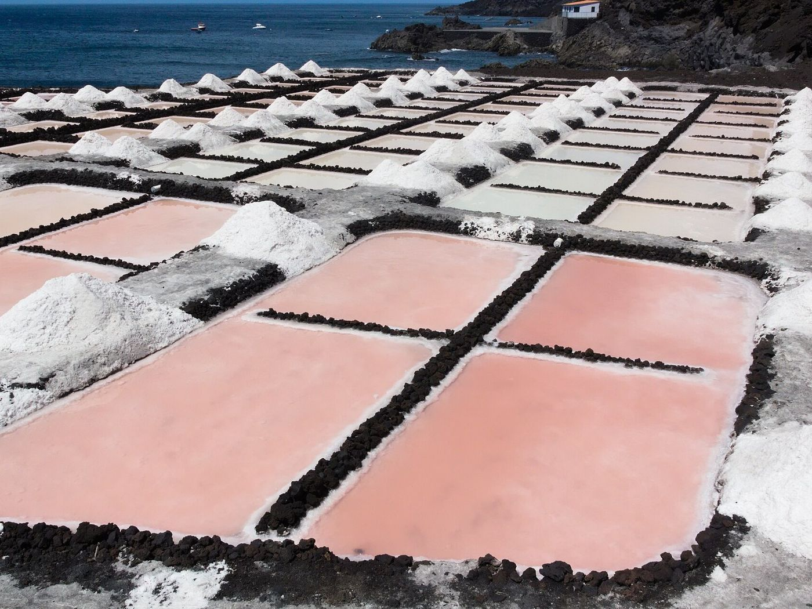
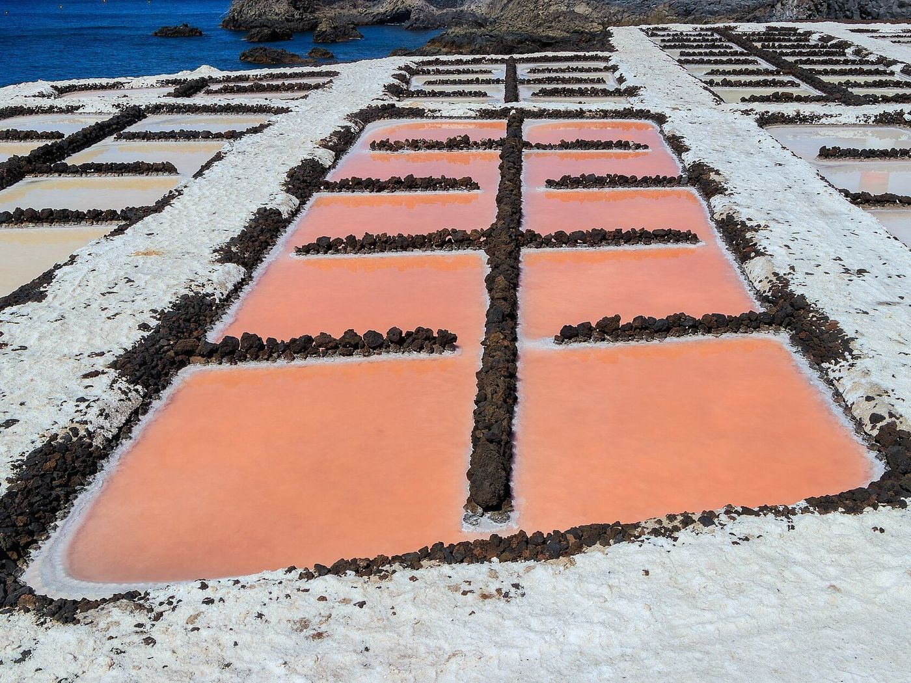
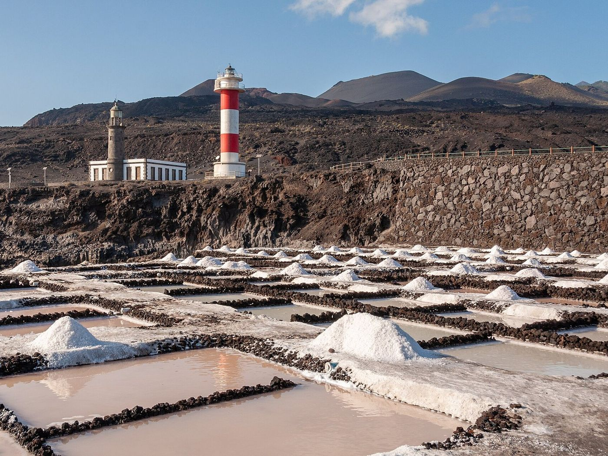
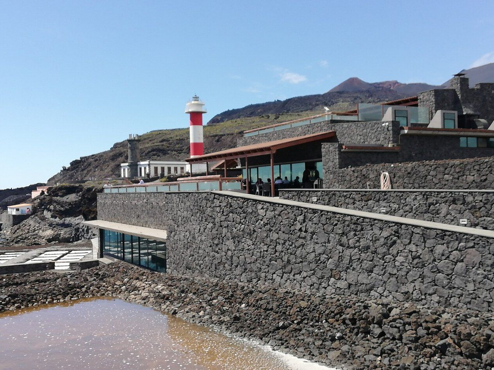

Estanques rosados y blancos sobre un suelo de lava negra, con dos faros al fondo y el Atlántico detrás. Las **Salinas de Fuencaliente**, en la punta sur de **La Palma**, son uno de los paisajes más fotogénicos de la isla, y casi nadie se cansa de mirarlas.

Te cuento su historia, qué ver, cómo llegar y qué más hacer en la zona 👇

En un vistazo<h2>Lo que vas a encontrar</h2>

<b>🧂</b>Salinas artesanales

<b>🗼</b>Dos faros

<b>🌋</b>Lava negra

<b>🌅</b>Atardecer

<b>🐟</b>Reserva marina

Antes de ir<h2>Lo básico de las salinas y los faros</h2>

<h3>📍 Dónde está</h3>
En la <strong>punta sur de La Palma</strong>, al final de la carretera de Fuencaliente al faro.

<h3>⏱️ Tiempo</h3>
<strong>1-2 horas</strong>; media tarde si comes y esperas al atardecer.

<h3>📸 Mejor luz</h3>
<strong>Mañana o atardecer</strong>: el rosa de los estanques y los faros destacan más.

La historia<h2>De Lanzarote al sur de La Palma</h2>

Las salinas se pusieron en marcha en <strong>1967</strong>: se trasladó a La Palma el modelo de las salinas de Lanzarote, con estanques poco profundos donde el sol evapora el agua del mar. Hoy ocupan alrededor de <strong>35.000 m²</strong> junto a la costa y están protegidas como espacio natural. Sobre ellas se levantan dos faros: el <strong>faro viejo</strong>, de <strong>1903</strong>, hoy convertido en el Centro de Interpretación de la Reserva Marina, y el <strong>faro nuevo</strong>, de bandas rojas y blancas, encendido en <strong>1985</strong>.

Qué ver<h2>Qué ver en las salinas y los faros</h2>

<ol class="guide__grid guide__grid--cuenca">
<li class="gcard reveal">
01

<h3>Los estanques</h3>
Cuadrículas de piedra negra rellenas de agua que va del verde al rosa y al blanco, según la cantidad de sal. Se pasea por los caminos que las rodean.

</li>
<li class="gcard reveal">
02

<h3>El color de la sal</h3>
Al evaporarse, el agua cambia de color por la concentración de sal y de algas diminutas, hasta dejar montones de sal blanca.

</li>
<li class="gcard reveal">
03

<h3>Los dos faros</h3>
El nuevo, rojiblanco, y el viejo, restaurado, comparten la punta. Desde ahí se ve la costa de lava hasta el Teneguía.

</li>
<li class="gcard reveal">
04

<h3>El mirador y el restaurante</h3>
Junto a las salinas hay terraza y restaurante para comer con vistas, y una pequeña tienda donde comprar sal artesanal.

</li>
</ol>

Más cerca<h2>Qué hacer por la zona</h2>

Cerca del faro hay una pequeña <strong>playa de arena negra</strong>, para un chapuzón si el mar lo permite. Si te gusta el mar, hay <a href="https://www.civitatis.com/es/fuencaliente-de-la-palma/snorkel-fuencaliente/?aid=110968" target="_blank" rel="noopener sponsored">snorkel en Fuencaliente</a> y, tierra adentro, los <a href="/blog/volcan-san-antonio-teneguia.html">volcanes San Antonio y Teneguía</a>. Y para ver todo el sur con calma, puedes hacer una <a href="https://www.civitatis.com/es/santa-cruz-de-la-palma/excursion-sur-la-palma/?aid=110968" target="_blank" rel="noopener sponsored">excursión por el sur de La Palma</a>.

Cómo llegar<h2>Cómo llegar a las salinas</h2>

<strong>En coche:</strong> desde Santa Cruz de La Palma, por la <strong>LP-2</strong> hasta Fuencaliente y luego por la carretera que baja al faro. Calcula en torno a una hora desde la capital.

<strong>Aparcamiento:</strong> hay uno junto a las salinas, con un paseo corto y cómodo hasta los estanques.

<strong>Plan redondo:</strong> visita primero el <a href="/blog/volcan-san-antonio-teneguia.html">volcán San Antonio</a> y baja después a las salinas para el atardecer.

<a class="btn guide__mapbtn" href="https://www.google.com/maps/search/?api=1&query=Salinas%20de%20Fuencaliente%2C%20La%20Palma" target="_blank" rel="noopener"><svg class="ico" viewBox="0 0 24 24" width="15" height="15" aria-hidden="true" fill="currentColor"><path d="M12 2a7 7 0 0 0-7 7c0 5.25 7 13 7 13s7-7.75 7-13a7 7 0 0 0-7-7zm0 9.5a2.5 2.5 0 1 1 0-5 2.5 2.5 0 0 1 0 5z"/></svg> Cómo llegar en Google Maps</a>

Sigue con los <a href="/blog/volcan-san-antonio-teneguia.html">volcanes de Fuencaliente</a> y la <a href="/blog/ruta-de-los-volcanes-la-palma.html">Ruta de los Volcanes</a>. Más ideas en <a href="/blog/que-hacer-en-la-palma.html">qué hacer en La Palma</a>.

Consejos de Cheno<h2>Para disfrutarlo al máximo</h2><ul><li><b>Ve al atardecer:</b> la luz sobre los faros es lo mejor del día.</li><li><b>Gafas de sol:</b> el blanco de la sal deslumbra.</li><li><b>No pises los estanques:</b> quédate en los caminos.</li><li><b>Compra sal</b> artesanal: es un buen recuerdo de la isla.</li><li><b>Combínalo</b> con los volcanes San Antonio y Teneguía.</li></ul>

<h2>¿Te gustan estos planes?</h2>
Sígueme en Instagram como <a href="https://www.instagram.com/chenoaventuras/" target="_blank" rel="noopener">@chenoaventuras</a>: subo escapadas como esta cada semana.
<a class="btn guide__btn" href="/blog.html">Ver más planes en el blog</a>

Información consultada en noviembre de 2026. Los accesos, horarios y precios cambian: consúltalos en las webs oficiales del Cabildo de La Palma antes de ir. Fotos de Wikimedia Commons: <a href="https://commons.wikimedia.org/wiki/File:At_La_Palma_2023_079.jpg" target="_blank" rel="noopener">Photograph by Mike Peel</a> (CC BY-SA 4.0) · <a href="https://commons.wikimedia.org/wiki/File:La_Palma_-_Salinas_de_Fuencaliente_-_03.jpg" target="_blank" rel="noopener">Xosema</a> (CC BY-SA 4.0) · <a href="https://commons.wikimedia.org/wiki/File:Salinas_de_Fuencaliente_-_50752665987.jpg" target="_blank" rel="noopener">Fraganda</a> (CC BY-SA 4.0) · <a href="https://commons.wikimedia.org/wiki/File:Salinas_de_Fuencaliente_-_La_Palma_03.jpg" target="_blank" rel="noopener">H. Zell</a> (CC BY-SA 3.0) · <a href="https://commons.wikimedia.org/wiki/File:Salinas,_restaurante_y_faro_de_Punta_de_Fuencaliente.jpg" target="_blank" rel="noopener">Josi</a> (CC BY 4.0).

